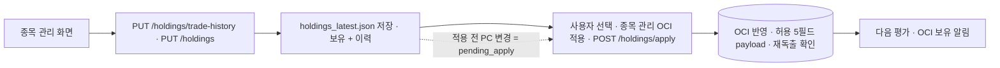
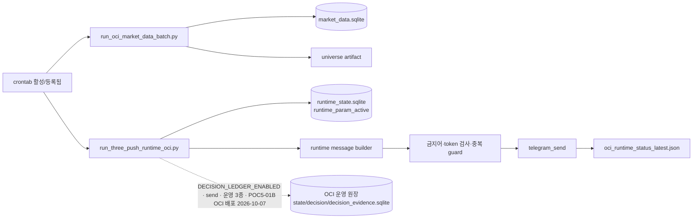

# PROGRAM_TRUTH.md

현행 프로그램 통합 설계서 (PROGRAM_TRUTH_RECONSTRUCTION_V1)

- **`POC7-02` 맥북 구현 · 모의 시험 2026-11-23 · Windows 실측 2026-11-24(AC4 품질 미달 · 설계자 결과 판정 대기)**: **로컬 AI 주간 ETF 검토 한 장 요약**(설계 `docs/ai_design/POC7/POC7_02_WEEKLY_REVIEW_LOCAL_AI_SUMMARY_DESIGN_V1_2026-11-22.md` · PLAN V1 `docs/ai_plan/POC7/POC7_02_WEEKLY_REVIEW_LOCAL_AI_SUMMARY_PLAN_V1.md` · 설계자 PLAN PASS `docs/ai_design/POC7/POC7_02_WEEKLY_REVIEW_LOCAL_AI_SUMMARY_PLAN_DECISION_2026-11-23.md` · 실행 전 판정 `docs/ai_design/POC7/POC7_02_WEEKLY_REVIEW_LOCAL_AI_SUMMARY_PRE_RUN_DECISION_2026-11-23.md` · 결과서 `docs/ai_result/POC7/POC7_02_WEEKLY_REVIEW_LOCAL_AI_SUMMARY_RESULT.md`): 맥북 CLI `scripts/run_review_summary.py`(`archive` · `lock-key` · `pack` · `merge` · `report`) → `app/review_summary/*`(새 연구 패키지 · 운영 경로 변경 0). 맥북 서버 「주간 ETF 점검」 읽기 조회(`GET /weekly/etf-check?selected=…`) 응답 한 건을 사례로 보관하고, 채점용 메모를 잠근 뒤, Windows PC 용 실행 묶음(zip · 표준 라이브러리 실행기 `run_summary.py` · `run_summary.bat` · 합성 점검 입력)을 만든다. 형수님이 USB 로 옮겨 실행하면 Windows PC 안 Ollama(`qwen3.5:9b-q4_K_M`)가 합성 점검 → 토큰 세기 → 실제 요약을 하고 `result_<n>/`(한 장 HTML · 결과 기록)를 남긴다. 맥북 `merge` 가 묶음 코드로 다시 구분 · 다시 만들어 대조한 뒤 보관한다. 한 사례에 본 요약 시도는 한 번이다(본 호출 전 시작 표지 · 응답 직후 받은 원문 기록 · 시도가 하나라도 회수되면 새 묶음 없음 · 같은 묶음을 두 번 돌리면 둘 다 보관하고 `report` 가 회수 순서와 상관없이 판정을 막음 · 실행 id 가 같을 때만 같은 실행으로 이음). Ollama 판 · 모델 digest 를 못 읽거나 같은 폴더 앞 실행(합성 점검까지 간 것)과 digest 가 다르면 모델을 부르지 않는다. 같은 폴더 다시 실행은 앞 결과를 회수와 같게 읽는다(다 쓴 임시 결과 포함 · 폴더 번호 순 · 못 읽으면 막음). 새 묶음은 앞 묶음의 마지막 기록(앞 결과 사슬로 정함 · 벽시계 안 씀)이 설정 · 모델 멈춤일 때만 만든다(환경 · 설치 멈춤은 같은 폴더 다시 실행). 응답을 받은 뒤 중단 · 실행기 오류는 기술 실패이고 `report` 는 실행 상태와 응답 구분이 둘 다 완료일 때만 판정한다. 토큰 세기 뒤 본 호출 직전 관문(판 · digest 다시 읽기 · 세기 · 잘림 · 출력 여유 · 모델 내림)을 못 넘으면 본 요약을 부르지 않는다(`PRE_MAIN_STOPPED`). 묶음의 실행 코드는 5개(`run_summary.py` · `review_render.py` · `review_judge.py` · `review_ollama.py` · `review_files.py`)다. 운영 화면 · API · 기록 DB · OCI · PUSH 변경 없음.
- **`POC7-01` PC 회고 연구 공식 실행 2026-11-22**: **주간 ETF 신규 후보의 즉시 참여와 한 주 보류 비교**(총괄 설계 `docs/ai_design/POC7/POC7_MASTER_DESIGN_V1_2026-11-20.md` · PLAN V1 `docs/ai_plan/POC7/POC7_01_WEEKLY_ENTRY_TIMING_BREADTH_PLAN_V1.md` · 설계자 PLAN PASS `docs/ai_design/POC7/POC7_01_WEEKLY_ENTRY_TIMING_BREADTH_PLAN_DECISION_2026-11-22.md` · 형수님 착수 지시 2026-11-22 · 결과서 `docs/ai_result/POC7/POC7_01_WEEKLY_ENTRY_TIMING_BREADTH_RESULT.md`): PC CLI `scripts/run_entry_timing.py`(`prepare` · `run` · `verify`) → `app/entry_timing/*`(새 연구 패키지 · 운영 경로 변경 0 · 공용 reader 읽기만). 봉인 KRX 판으로 운영 「주간 ETF 점검」 1개월 상위 30 을 그날 이름 · 그날 지수명으로 복원하고, 국내 주식형(공식 기본정보 일치 · 명칭으로 추정 · 미확인) 후보를 신호 다음 거래일 시가에 바로 사는 경로와 다음 신호의 다음 거래일 시가에 사는 경로를 같은 시각 · 같은 가격으로 비교한다. 상승 확산 규칙 = 국내 주식형 공식 기초지수(한 지수 한 표) 중 지난 1개월에 오른 비율 < 0.5 이면 보류. 결과 = 판정 C(이 규칙 연구 종료 · Δ = 주당 −0.0037%p · 95% 구간 0 포함) · 검증자 r1 ~ r6 REJECTED(기록 · 검산 보호 F1 ~ F13) → 정정 잠금 · 정정 실행 6회(결과 같음) · 검산 VERIFIED_OK(22개 대조 · 완료 기록 · 실제 경로 · 쓰기 위치 · 확인 뒤에만 읽기) · 검증자 r7 VERIFIED · 설계자 RESULT PASS(판정 C · 운영 미채택 · `docs/ai_design/POC7/POC7_01_WEEKLY_ENTRY_TIMING_BREADTH_RESULT_DECISION_2026-11-22.md`) · 최종 전체 회귀 통과(6635 passed · 2026-11-22) · 커밋 c32f13a5 · push(2026-11-22) · CLOSED · 운영 미채택. 산출물 `state/ml/research/poc7_01/`(git 제외). 운영 DB · OCI · 화면 · API · PUSH 변경 0 · 새 의존성 0.
- **`POC6-35` main 반영 2026-11-20 · OCI 반영 · AC3 PASS · CLOSED 2026-11-23**: 2026-11-20 — **장중 재진입 알림 누락(K2) 정정**(설계 `docs/ai_design/POC6/POC6_35_INTRADAY_REENTRY_ALERT_DELIVERY_DESIGN_V1_2026-11-19.md` · 설계자 PLAN 판정 2026-11-19 보완 후 구현 승인 · A1 채택 `docs/ai_design/POC6/POC6_35_INTRADAY_REENTRY_ALERT_DELIVERY_PLAN_DECISION_2026-11-19.md` · PLAN V1 확정 `docs/ai_plan/POC6/POC6_35_INTRADAY_REENTRY_ALERT_DELIVERY_PLAN_V1.md` · 격리 브랜치 `poc6-35-reentry` · 결과서 `docs/ai_result/POC6/POC6_35_INTRADAY_REENTRY_ALERT_DELIVERY_RESULT.md` · 독립 검토 1회 반영 · 검증자 r1 REJECTED(F1) 정정 · 검증자 r2 VERIFIED · 설계자 RESULT PASS 2026-11-20 `docs/ai_design/POC6/POC6_35_INTRADAY_REENTRY_ALERT_DELIVERY_RESULT_DECISION_2026-11-20.md` · 커밋 전 전체 백엔드 회귀 6532 passed · 구현 커밋 `f0e0c945` main 반영). 회복 뒤 마지막 전달 상태와 같은 상태로 다시 잡혀 그 회차 발송 후보였는데 전달되지 못한 재진입(구역 상한 · 전송 실패 · 부분 전송 · 발송 전 차단 · 일일 상한)이 다음 회차에 그 회차 정책으로 다시 판정되고, 전체 전송 성공인데 러너 첫 상태 저장이 실패한 회차는 관측 저장이 성공 사실을 대신 남기며, 세 상태 쓰기가 쓰기 직전 다시 읽기에 실패하면 이번 회차가 이미 아는 상태 위에 쓴다 · 「OCI 운영·적용」 ② '구역별 최대' 문장 · 상태 파일 형식 · `schema_version` · 임계값 · 재발송 대기 · 상한 · cron · 원장 계약 버전 무변경 · 자세한 내용 = §9 '장중 급등락' 의 '사업군 · 급등 전달 상태' 아래 세 항목. 아래 칸의 '`POC6-35`(main 반영 2026-11-20 · OCI 반영 · AC3 PASS · CLOSED 2026-11-23)' 표시는 main 의 동작이고, OCI 는 OCI pull 전까지 그 앞 동작이다.
- **최종 반영**: 2026-11-19 — **좌측 메뉴 순서 · 단계 정리(형수님 직접 지시 · 설계자 `POC6-34` 종료 인계 '메뉴 위치 조정은 형수님이 개발자와 직접 진행' · `docs/ai_design/POC6/POC6_34_CLOSEOUT_HANDOFF_2026-11-19.md`)**: 그룹 5 → 7 · 순서 = 오늘 확인 → ETF보유 및 후보 선정 → 보유·자료 관리 → 진단·상태 → 승인·운영(「받은 알림 기록」을 이리로) → ML 연구(폴더 → 그룹) → 미사용 기능(폴더 → 그룹 · 「개발·실험용」을 이리로). MenuKey · 이름 · 힌트 · 화면 연결 변경 없음 · 화면 글 2곳(「개발·실험용」 안내 줄 · 옛 대시보드 버튼 '개발·실험용 확인') · 자세한 내용 = §5.1 아래 '2026-11-19 메뉴 순서 · 단계' 메모.
- (그 전) 2026-11-19 — **`POC6-34` 「OCI 운영·적용」 상태 문구 · 「ETF NAV·괴리율 조회」 이름 정리 · main 반영**(설계자 화면 판정 2026-11-19 `docs/ai_design/POC6/POC6_34_OCI_AND_ETF_NAV_SCREEN_REVIEW_DECISION_2026-11-19.md` · 설계자 PLAN 판정 2026-11-19 조건부 PASS `docs/ai_design/POC6/POC6_34_OCI_AND_ETF_NAV_SCREEN_REVIEW_PLAN_DECISION_2026-11-19.md` · PLAN V1 확정 `docs/ai_plan/POC6/POC6_34_OCI_AND_ETF_NAV_SCREEN_REVIEW_PLAN_V1.md` · 격리 브랜치 `poc6-34-oci-nav` · 검증자 r1 REJECTED(R1-F1 ~ F3) → 개발자 r1 정정 → 검증자 r2 REJECTED(R2-F4 · KS-10) → 개발자 r2 정정 → 검증자 r3 VERIFIED_WITH_NOTES → 설계자 RESULT 판정 2026-11-19 조건부 PASS `docs/ai_design/POC6/POC6_34_OCI_AND_ETF_NAV_SCREEN_REVIEW_RESULT_DECISION_2026-11-19.md` → 표시 보완(C3 · C5 · C7 · C8 · C9 · 조회 성공률 문구) · 전체 백엔드 회귀 6,462 passed · 설계자 RESULT PASS → 구현 커밋 `5dbddaaf` · main 빨리 감기 2026-11-19 · 결과서 `docs/ai_result/POC6/POC6_34_OCI_AND_ETF_NAV_SCREEN_REVIEW_RESULT.md`). 화면 이름 · 문구 · 기존 영역 배치 · 조회 동선과 `GET /oci/startup-status` 응답 칸 2개(`param_read_at` · `param_source` — 이미 메모리에 있는 값을 싣기만 함 · 새 OCI 읽기 · 새 쓰기 없음)가 바뀐다. r1 정정(R1-F3)으로 `GET /intraday-config/state` 의 후보 출력도 바뀐다 — 후보가 있으면 `policy_values` 는 후보 정책에서만 읽고(후보 정책 블록이 없거나 비면 12개 값 모두 null · 활성 값으로 메우지 않음), `candidate_policy_enabled` 는 값이 없거나 bool 이 아니면 null(전에는 '꺼짐' false). 정책 블록이 객체가 아니면(목록 · 문자열 · 숫자) 500 대신 기존 손상 응답(`payload_error`)이다. r2 정정(R2-F4)으로 활성 출력도 같은 규칙이 된다 — `policy_enabled` 는 활성 정책의 `enabled` 가 없거나 bool 이 아니면(문자열 "false" 등) null(전에는 `bool(...)` 이라 "false" = true · 없음 = false) · 활성 버전이 아예 없으면 false 그대로 · 손상 응답(`payload_error`)에서는 null(전에는 false) · `policy_status` · `candidate_policy_status` 는 문자열이 아니면 null(전에는 응답 모델 오류 500). 판정값 · 발송 정책 · 적용 계약 · OCI 판정(`overall`) · DB · 저장 형식 · 메뉴 key(`data_status`) 무변경. 아래 칸의 '`POC6-34`(main 반영 2026-11-19)' 표시 = 이번 반영으로 바뀐 main 동작이다.
- (그 전) 2026-11-19 — **`POC6-33` 「보유 현황」 · 「종목 관리」 · 「확인 근거」 · 「데이터 상태」 화면 정리 · main 반영**(설계 2026-11-18 · 설계자 PLAN 판정 2026-11-18 조건부 PASS · PLAN V1 확정 `docs/ai_plan/POC6/POC6_33_HOLDINGS_UI_REVIEW_PLAN_V1.md` · 격리 브랜치 `poc6-33-holdings-ui` · 검증자 r2 VERIFIED · 설계자 RESULT 판정 2026-11-19 조건부 PASS `docs/ai_design/POC6/POC6_33_HOLDINGS_UI_REVIEW_RESULT_DECISION_2026-11-19.md` → 판정 §2 · §3 표시 보완 · 확인 · 전체 백엔드 회귀 6,401 passed → 설계자 RESULT PASS 확정 2026-11-19 · 구현 커밋 7eb7cd0c · main 빨리 감기 2026-11-19 · 결과서 `docs/ai_result/POC6/POC6_33_HOLDINGS_UI_REVIEW_RESULT.md` · push · 격리 정리는 형수님 승인 뒤). 화면 글자 · 배치만 바뀐다 — API · 계산 · DB · 저장 형식 · 공유 builder · PUSH · AI 원문 무변경 · 백엔드는 `app/holdings_reference_date.py` 머리 주석만 · KS-2 판정 기록 = `docs/KILL_SWITCHES.md` 'KS-2 판정 기록 (2026-11-18, POC6-33 일괄 기준일 화면 경로)'. 아래 칸의 '`POC6-33`(main 반영 2026-11-19)' 표시가 지금 main 동작이고, 합치기 전 동작은 '(그 앞 동작)'으로 남겼다.
- (그 전) 2026-11-18 — **`POC6-32` V2 「오늘 확인 › 주간 ETF 점검」 · main 반영 · IMPLEMENTED_VERIFIED_CLOSED**(설계 2026-11-17 · PLAN 판정 V1 PASS_WITH_REQUIRED_CORRECTIONS → V1 격리 구현(「오늘의 투자 점검」 안 주간 카드) → 형수님 격리 화면 확인 2026-11-17 = 화면 분리 · 메뉴 정리 요청 → 재설계 판정 V2 · PLAN 판정 V2 2026-11-17 CONDITIONAL_PASS · PLAN V2 확정 · 격리 구현 · 독립 검토 지적 정정 · 형수님 격리 화면 확인(AC4 · 2026-11-18) → 검증자 r1 REJECTED(F1 ~ F3) → 정정 → 검증자 r2 VERIFIED → 설계자 RESULT 판정 V2 조건부 PASS → 조건 2건 확인 = 설계자 RESULT PASS(2026-11-18) · 구현 커밋 bf5aada1 · main 빨리 감기 · 문서 커밋 0b4e16ac · `origin/main` push · 격리 작업 사본 · 전용 브랜치 `poc6-32-weekly-review` 삭제(형수님 승인 · 종료 정리 커밋 e1ffa546) · 결과서 `docs/ai_result/POC6/POC6_32_ETF_WEEKLY_REVIEW_ONE_PAGE_RESULT.md`). 아래 칸의 `POC6-32`(main 반영 2026-11-18) 표시 = 운영 동작. (기록) 합치기 전 main 은 「오늘의 투자 점검」 「잘 오르는 ETF」 카드 · 메뉴 「보유와 후보 비교」 · 「ETF 구성종목」 · 화면 값으로 만든 일일 [AI용 시장 정보 복사] 글 · VIX 근거 없는 해석 줄 · 판단 값 '미기록' 없음이었다. V1 의 「오늘의 투자 점검」 안 주간 카드는 V2 에서 메뉴 「주간 ETF 점검」으로 옮겼고 주간 경로는 `GET /weekly/etf-check` 하나다(옛 경로 없음 · 저장 기록 해석은 그 아래 `GET /weekly/etf-check/records/{id}/review`).
- (그 전) 2026-11-16 — **`POC6-31` ETF 구성종목을 보유 · 후보 판단에 연결 STEP 1 ~ 5 · main 반영**(구현 커밋 4bee2b1c · 검증자 STEP 1 ~ 3 r5 · STEP 4 ~ 5 r3 VERIFIED · STEP 6 첫 운영 확인 · 설계자 RESULT PARTIAL(AC1 ~ AC3 PASS · AC4 다음 실제 후보 검토에서 재확인) · 문서 커밋 2a3ea05f · 결과서 `docs/ai_result/POC6/POC6_31_ETF_CONSTITUENTS_DECISION_WORKFLOW_RESULT.md`). 아래 칸의 `POC6-31`(main 반영 2026-11-16) 표시 = 운영 동작.
- (그 전) 2026-11-14 — **`POC6-29` CLOSED · `POC6-29-1` 운영 기록 종료 · 운영 기준 `main`**(구현 커밋 d2e995ae · 운영 정리 커밋 6122d714 · `origin/main` push · 격리 작업 사본 · 전용 브랜치 삭제 · 운영 기록 `docs/ai_result/POC6/POC6_29_1_ETF_MARKET_DISCOVERY_REFOCUS_OPERATION_RESULT.md` · 후속 표시 개선 후보 = 그 결과서 §6-1 · 다음 = `POC6-30` 범위 결정 대기) · **`POC6-29` A·B·C 화면 통합(「요즘 잘 오르는 ETF」 정리 · 설계 V1 네 번째 개정본 · PLAN 판정 2026-11-12 PASS_WITH_REQUIRED_CORRECTIONS(Q1 ~ Q17) · 격리 작업 사본 구현 · 결과서 `docs/ai_result/POC6/POC6_29_ETF_MARKET_DISCOVERY_REFOCUS_RESULT.md` · 사용자 격리 화면 확인 · 검증자 r1 REJECTED(F1 · F2) → 정정 → r2 REJECTED(F3) → 정정 → r3 VERIFIED · 설계자 RESULT PARTIAL(보완 4건) → 보완 PLAN 승인(`docs/ai_design/POC6/POC6_29_ETF_MARKET_DISCOVERY_REFOCUS_SUPPLEMENT_PLAN_DECISION_2026-11-12.md`) → 보완 구현 → 설계자 RESULT 재판정 PARTIAL 유지(`…RESULT_DECISION_V2_2026-11-12.md` · 실사용 기준) → 실제 PC 자료일 대조 · 보완 PLAN §10 승인(`docs/ai_design/POC6/POC6_29_ETF_MARKET_DISCOVERY_REFOCUS_S_PLAN_DECISION_2026-11-12.md`) → 보완 2차 구현(격리 작업본) → 형수님 화면 의견 반영(2026-11-13) → 검증자 정정 F4 ~ F10 · VERIFIED(결과서 §26) → 설계자 RESULT 재판정 V3 PASS_WITH_CLOSING_CORRECTIONS(2026-11-13) → 마감 보완 D1 ~ D4 · 복사(결과서 §27) → 검증자 V3 마감 F11 정정 VERIFIED(결과서 §30) → 마감 뒤 화면 조절(결과서 §31 · 아침 요약 정리) → 설계자 RESULT 마감 판정 PASS(2026-11-13 · `docs/ai_design/POC6/POC6_29_ETF_MARKET_DISCOVERY_REFOCUS_RESULT_CLOSEOUT_DECISION_2026-11-13.md` · 결과서 §32) = CLOSED 2026-11-14 · main 운영 반영(구현 d2e995ae · 운영 정리 6122d714))** · **보완 2차**: 「오늘의 투자 점검」 시장 흐름 = 아침 요약(직전 국내 거래일 마감 기준 · 필수 3 준비 상태 한 줄 · 아침 판정 = 기준일까지의 저장 이력으로 기존 산식 · 새 `GET /market/morning-basis`) → 오늘 시장 변화(네이버 3칸 · 공통 시점 한 번 · 당일 판정(강조) → 시장 판정 근거 표 → 코스피 공식 종가 + 바로 아래 차트 · 코스피 지표 — 형수님 결정 2026-11-13) · 근거 접기 하나(근거 표 단기 흐름 5거래일 · 5회 · 새 `GET /market/short-flows` · 시장 위험 참고 20거래일 차트(공용 차트) · 사건 · 출처 · 받은 시각은 상태 옆 [?]) · [최신 자료 갱신] ② 가 6시간 대기면 같은 작업에서 ③ 전일 자료 보충(코스피 공식 종가 · 수급(PC 보관본 먼저) · VIX · 원/달러 · WTI 중 모자란 것만 · 기존 경로) · 「보유와 후보 비교」 기본 비교(1 · 3개월 · 최근 5 · 20구간 · 고점 대비) + 종목별 근거 · **보완**: 「오늘의 투자 점검」 시장 흐름 맨 위 '지금 시장'(네이버 빠른 시세 코스피 · 코스닥 · KODEX 200 3칸 + 국면 · 판정 근거 · VIX · 수급 · 환율 · 유가 흐름 문장) · [최신 자료 갱신] ⓪ 빠른 시세 단계(6시간 대기와 무관 · 새 `GET /market/quick-quotes` = 저장값만) · 갱신 전후 대조 = 날짜 + 저장 시각 + 값(같은 거래일 다시 받음) · 「보유와 후보 비교」 좌우 카드 · 차이 줄(같은 기간 · 같은 가격 상태일 때만) · 「진단·상태 › 미사용 기능 › 신규 ETF 관찰 점검」(MenuKey 17): 「요즘 잘 오르는 ETF」(`market_discovery`) 메뉴 없앰 · 전용 파일 30개 `archive/poc6_29_market_discovery/` 보관. 왼쪽 메뉴 그룹 「비교·판단」의 이름을 「ETF보유 및 후보 선정」으로 바꾸고 「ETF 비교하기」 폴더는 없앰 — 그룹 바로 아래 보유(`workbench_holdings`) · 섹터요약(`etf_sector`) · 후보리스트(`workbench`) · 보유와 후보 비교(`holding_candidate_compare`) · ETF 구성종목 · AI 투자 세션(MenuKey 16). 다섯 화면(오늘 점검 카드 · 보유 · 섹터요약 · 후보리스트 · 보유와 후보 비교)이 조회 조건과 기본 기간을 따로 저장(`krx.screenBasis.<화면>.v1` · 옛 C 기본 기간은 오늘 점검만 한 번 이어받음 · 저장값 상태 = 저장됨 · 없음 · 쓸 수 없는 값 · 읽기 실패 — 뒤 둘은 안내(처음 열 때 그 이유로 1개월로 시작했고 지금도 1개월이면 '…해 1개월로 시작했습니다' · 그 밖은 '— 지금 조회(기간)는 그대로입니다') · 저장은 다시 읽어 확인 · 저장 실패 안내 = 실패한 기간을 적고 그 기간이 저장된 것으로 다시 읽히면 내림 · 다른 탭 저장은 표시만 다시 읽음). 새 `GET /market/etf-detail`(종목 상세 수치 · 최대 30) · 새 `POST /refresh/all` · `GET /refresh/all/status`([최신 자료 갱신] = 보유 현재가 → 기존 시장 갱신 시작 · 보유 현재가 조회 single-flight) · 판단 근거 미리보기에 화면의 공통 기간 목록 대조(`list_source=common_period` · 후보 = 쪽 · 순위 · 날짜 · 가격 시점 · 화면이 본 수익률 · 보유 = 그 화면 조건 목록으로 확인한 후보 관계만). 「오늘의 투자 점검」 = 보유 점검 · 잘 오르는 ETF 두 카드 + [시장 근거와 다른 변화 보기] 접기. `market_topn.py` · `pc_etf_compare_summary.py` · DB 표 · OCI · PUSH 변경 0.
- (그 전) 2026-11-11 — **`POC6-28` 「ETF 비교하기」 섹터 요약 · 보유 연결(설계 V1 수정본 · PLAN 판정 2026-11-11 PASS_WITH_REQUIRED_CORRECTIONS(Q0 ~ Q10) · 격리 구현 · 검증자 r4 VERIFIED · 설계자 RESULT PASS_WITH_CLOSING_CORRECTIONS · 마감 정정 VERIFIED · **PC 반영 2026-11-11 16:04(8000 `--reload` · 3000 `next dev` 가 스스로 다시 읽음 · 재시작 없음) · 구현 커밋 49326b5b · push 완료 · IMPLEMENTED_VERIFIED_CLOSED** · 결과서 `docs/ai_result/POC6/POC6_28_ETF_COMPARISON_SECTOR_AND_HOLDINGS_RESULT.md`)**: 「비교·판단 › ETF 비교하기」는 폴더다(「후보」 = `workbench` · 「보유」 = 새 `workbench_holdings`). 「후보」 = 새 `GET /market/etf-compare/summary` 한 응답으로 [섹터 요약](공식 기초시장 · 자산 구성 · '사업군 분류 n/30' · 반복된 업종 · 공통 구성종목과 범위 · 목록 전체 AI 복사) · [ETF 순위]([선정 순서] + 네 기준 · 기간 다름 · 값 없음은 양방향 뒤 · 0.00% 유효) · 「보유」 = 비중 · 매입 대비 손익 + 기존 하락 판정 · 점검 사유(직접 하위권 + 그 기간 수익률 음수) · 노출 확인 · 비교 자료 부족 · 행 상세. 가격 시점 = 끝일 행 저장 시각으로 장중 저장값 · 잠정 / 마감 뒤 저장 / 마감값 확인 필요(종가 단정 안 함). 「확인 필요」 탭 없앰. 조회 기준 = 이 화면 안 공유 · 새로 고침 기본값. 기존 `market_topn.py` · 응답 · 사업군 사전 · 공식 CSV · OCI · PUSH · DB 변경 0. PC 화면 확인(16:05 · 11/10 장중 저장값 기준): 「후보」 비교한 ETF 961개 · 「보유」 전체 29 · 최근 하락 25 · 약세 묶음 접점 7 · 비교 자료 부족 20.
- (그 전) 2026-11-09 — **`POC6-27` 「오늘의 투자 점검」 개편(설계 기준서 V2 · PLAN 판정 2026-11-09 PASS_WITH_REQUIRED_CORRECTIONS(Q1 ~ Q11 · 필수 보완) · 구현 · 시험 · 검증자 r2 VERIFIED · 설계자 RESULT PASS_WITH_CLOSING_CORRECTIONS 2026-11-09 · 마감 보완 · **운영 PC 반영 2026-11-09 23:53 · 구현 커밋 589f3773 · push · IMPLEMENTED_VERIFIED_CLOSED 2026-11-10** · 형수님 격리 화면 확인 완료 · 결과서 `docs/ai_result/POC6/POC6_27_TODAY_CHECK_REVISION_RESULT.md`)**: 화면 순서 = 머리(버튼 넷 · 읽은 시각) → 「자료 최신화 필요」 · 「OCI 운영 스케줄 확인」(기본 접힘 · 함께 펼치고 접음) → 시장 흐름(코스피 수치 → KOSPI 차트 → 외국인 수급 → 최근 큰 변화) · 보유 점검 | 잘 오르는 ETF → 자세히 좌우 → 자료 · 연구(§5.2) · [요약 다시 읽기] = 받아 둔 뒤 대조 · 확인 창 · [AI용 시장 정보 복사] · 목록 조건 탭 공유 · 시장 갱신 공용 hook(두 화면 · 진행 이어받기) · 응답 추가만 = `/market/flow-context` 구조 칸 · `freshness` · `/oci/startup-status` `schedule` · 새 `GET /decision-ledger/latest-by-kind`(PC 사본 읽기) · 기존 칸 · 문장 · OCI · PUSH · DB 변경 0.
- (그 전) 2026-11-08 — **구간 1(운영 흐름 완결) 마감 판정 반영(`docs/ai_design/POC6/POC6_MILESTONE_1_CLOSEOUT_DECISION_2026-11-08.md` · PASS · 종료)**: 프로세스 A 등급 = 2026-10-09 실제 적용 확인 · 2026-11-08 적용 대기(pending_apply) 사실 · 흐름도를 현재 적용 경로로 정정. 코드 · 운영 변경 0.
- (그 전) 2026-11-08 — **`POC6-26` KODEX200 분배금 포함 보유 기준선 검산(설계 V1 · PLAN 판정 V1.1 HOLD → 사용자 Q1 (a) → 재개 판정 V1.2 PASS_WITH_REQUIRED_CORRECTIONS · 사용자 한 묶음 승인 · 본계산 1회 2026-11-08 SAMPLE_RECONCILED · 검증자 r1 VERIFIED · 설계자 최종 RESULT PASS · IMPLEMENTED_VERIFIED_CLOSED(2026-11-08 · 종료 커밋 2dcba050) · 결과서 `docs/ai_result/POC6/POC6_26_KODEX200_DISTRIBUTION_BENCHMARK_RECONCILIATION_RESULT.md`)**: PC 연구 1회성 검산 도구 `scripts/run_kodex200_distribution_check.py`(봉인 판 reader 읽기 전용 · 외부 호출 0) · 069500 · 2025 · 1주 · A 무조정 +89.98% · B 분배금 현금 보유 +92.64% · C 기존 연결(KRX_BASEPRICE_CHAIN) +94.24% · 공식 분배 자료 = 삼성자산운용 [분배금현황 다운로드](사용자 결정 · 비공개 로컬 최소 기록) · 기존 연구 결론 · 비교 기준 · 운영 · 화면 · API 변경 0.
- (그 전) 2026-11-07 — **`POC6-25` 보유 시세 · 평가금액의 미확인 표시 정정(설계 V1 · PLAN 판정 2026-11-07 PASS(통합설계 V1.1 · Q1 (a)) · 사용자 한 묶음 승인 · 구현 · 시험 · 격리 사본 build 2026-11-07 · 사용자 실화면 확인 완료 · 검증자 r1 VERIFIED · 설계자 최종 RESULT PASS(2026-11-07 · `docs/ai_design/POC6/POC6_25_HOLDINGS_MISSING_VALUE_DISPLAY_FIX_RESULT_DECISION_2026-11-07.md`) · IMPLEMENTED_VERIFIED_CLOSED(2026-11-07 · 종료 커밋 e8760d90) · 결과서 `docs/ai_result/POC6/POC6_25_HOLDINGS_MISSING_VALUE_DISPLAY_FIX_RESULT.md`)**: 「보유 현황」 `EnrichedHoldingsSection.tsx` 에서 `current_price` · `eval_amount` 가 값 없음(null · 칸 없음)이면 행 '현재 미확인' · 상세 '현재가 미확인' · '평가금액 평가 불가'(예전 '0원' · 줄 숨김) · 숫자(0 포함) 표시 · API · 계산 · 매입비중 · 다른 화면 무변경.
- (그 전) 2026-11-07 — **`POC6-24` 보유 판단의 현금 · 추가 투입 한도와 AI 근거 연결(설계 V1 · PLAN 판정 2026-11-06 PASS(통합설계 V1.1 · Q1 ~ Q3 (a)) · 사용자 목업 배치 확인 · 사용자 한 묶음 승인 · 구현 · 가상 자료 시험 2026-11-06 · 사용자 실화면 확인 완료 · 검증자 r1 REJECTED(F1) → 정정 → 검증자 r2 VERIFIED(프런트 build 통과) · 설계자 최종 RESULT PASS(2026-11-07 · `docs/ai_design/POC6/POC6_24_HOLDINGS_CAPITAL_CONTEXT_AND_AI_EVIDENCE_RESULT_DECISION_2026-11-07.md`) · IMPLEMENTED_VERIFIED_CLOSED(2026-11-07 · 종료 커밋 f2782680) · 결과서 `docs/ai_result/POC6/POC6_24_HOLDINGS_CAPITAL_CONTEXT_AND_AI_EVIDENCE_RESULT.md`)**: 「보유 현황」 보유 배너 아래 「자금 기준」 카드(검토에 포함할 현금 C · 이번 검토의 추가 투입 한도 A · 확인일 · 보유 + 입력 현금 합계 T · 보유/현금 구성 · 입력 · 수정 · 비우기) · 종목 행 비중 = 첫 줄 '보유 내 비중'(기존 값 그대로) + 계산될 때만 둘째 줄 '입력 현금 포함' · 자금 값은 `state/holdings/capital_context.json`(holdings_latest.json · 「보유 OCI 반영」 밖 · git 제외) · `PUT /holdings/capital-context` · `/holdings/enriched` 응답 `capital` · 행 `cash_inclusive_weight_pct` · 판단 근거 미리보기에 [보유 · 자금 기준] 묶음(V · C · A · T 원 단위 금액만 · 종목 합산 두 비중 · 묶음 11개) · [대상]의 평가비중은 그 묶음으로 이동 · [AI에게 요청] 한 줄 · [복사] 옆 금액 포함 기본 안내. 기존 시장 비중 분모 · 손익 · OCI · PUSH · PARAM 변경 0.
- (그 전) 2026-11-06 — **`POC6-23` 비용을 반영한 주간 의사결정 학습(설계 V1 · PLAN 판정 2026-11-05 PASS(통합 설계 V1 개정 2) · 사용자 한 묶음 승인 · 구현 · 시험 103 · 변이 47/47 · 실행 전 독립 검토 1회 · 공식 실행 1회 2026-11-06 09:37 KST · OK · verify OK · 검증자 r1 VERIFIED · 설계자 최종 RESULT PASS · IMPLEMENTED_VERIFIED_CLOSED(2026-11-06 · 종료 커밋 2d22d8f5 · push 완료) · 결과서 `docs/ai_result/POC6/POC6_23_COST_AWARE_WEEKLY_DECISION_LEARNING_RESULT.md`)**: 새 PC 연구 CLI `scripts/run_decision_learning.py` · 패키지 `app/decision_learning/`(H1 · POC6-20 · 21 코드 재사용 · 수정 0) · 화면 · API · OCI · PUSH 변경 0. 결론 = 같은 입력 · 70계수 선형 · 같은 허용 행동에서 SPO+(S)가 MAE(P)보다 비용 후 성과가 좋다는 근거 없음(20bp CAGR S − P = −5.23%p · NOT_SHOWN · NOT_CANDIDATE · UNCERTAIN) · 운영 미채택 · 총수익 검증 아님. 산출물 `state/ml/research/poc6_23/`(git 제외).
- (그 전) 2026-11-05 — **`POC6-22` 저장 예측 · 장부로 추세 판단의 실패 지점 확인(설계 V1 · PLAN 판정 2026-11-05 PASS · 사용자 한 묶음 승인 · 일회성 분석 1회 2026-11-05 10:09 KST · OK · 검증자 r1 VERIFIED · 설계자 최종 RESULT PASS · IMPLEMENTED_VERIFIED_CLOSED(2026-11-05 · 일회성 진단 완료) · 결과서 `docs/ai_result/POC6/POC6-22_SAVED_PREDICTION_AND_POLICY_DIAGNOSTIC_RESULT.md`)**: 코드 · CLI · 화면 · API 변경 0. POC6-21 저장 산출물만 읽은 PC 사후 기술 분석(분석 파일 원문은 PC 산출물 · Git 미추적). 결론 = 이번 고정 구간 · 날짜 균형 집계에서 M 의 높은 점수 구간이 이후 평균 변화가 더 크게 관측되는 관계를 확인하지 못함(원인 미분리) · 다음 모델 연구의 구체적 새 근거 미확보 → 추가 모델 연구 보류(설계자 최종 판정). 산출물 `state/ml/research/poc6_22/`(git 제외).
- (그 전) 2026-11-04 — **`POC6-21` 추세 참여와 단기 재진입 · 재이탈의 ML 효용 검증(설계 V1 · 설계 검토 판정 2026-11-04(통합 설계 V1 개정 2 · Q1 ~ Q10 확정) · PLAN 판정 2026-11-04 PASS(분모 집계 설명 보완 1건 반영) · 사용자 한 묶음 승인 · 구현 · 시험 70 · 변이 27 · 실행 전 독립 검토 1회 · 공식 실행 2026-11-04 20:29 ~ 20:31 KST · verify OK · 검증자 r1 VERIFIED · 설계자 최종 RESULT PASS · IMPLEMENTED_VERIFIED_CLOSED(2026-11-04 · 고정 가설 종료) · 결과서 `docs/ai_result/POC6/POC6-21_TREND_PARTICIPATION_AND_RECENT_SWITCH_ML_RESULT.md`)**: PC CLI `scripts/run_trend_switch.py`(`prepare` · `run` · `verify`) → `app/trend_switch/*` — H1 체결 · 이연 · 보호(`_State` · `_open` · `_close`)와 POC6-20 34열 · ML_B 학습 · 시장 4열을 고치지 않고 재사용하고, ETF 자체 60거래일 절대 로그 가격변화 정답으로 분기마다 M 1개를 학습해 주간 보유/현금 전환(후보 = RET_120 상위 5 · 문턱 h · 최근 10거래일 재진입 · 재이탈 2h)의 R0 · R1(단순 추세 log(1+RET_60)) · M0 · M1 과 K(069500)를 20bp · 40bp 로 비교한다. 결과 = ML_GAIN_NOT_SHOWN · STRENGTHEN_GAIN_NOT_SHOWN · NOT_CANDIDATE · UNCERTAIN(운영 채택 아님). 산출물 `state/ml/research/poc6_21/`(git 제외). 운영 DB · OCI · 화면 · API 변경 0 · 새 의존성 0.
- (그 전) 2026-11-04 — **`POC6-20` 시장 정보 추가 효용 비교(설계 V1 · PLAN 판정 2026-11-04 PASS_WITH_REQUIRED_CORRECTIONS · 사용자 한 묶음 승인 · 구현 · 시험 · 공식 실행 2026-11-04 13:17 ~ 13:19 KST · verify OK · 검증자 r1 REJECTED(F1 마지막 예산 판정) → 정정 · 정정 실행(14:08 ~ 14:11 KST) → 검증자 r2 REJECTED(F2 보고 글 생성 경계) → 정정 · 두 번째 정정 실행(15:17 ~ 15:20 KST · 결과 같음) · verify OK · 검증자 r3 VERIFIED · 설계자 최종 RESULT PASS · IMPLEMENTED_VERIFIED_CLOSED(2026-11-04) · MARKET_GAIN_OBSERVED · NOT_CANDIDATE · UNCERTAIN · 운영 미채택 · 결과서 `docs/ai_result/POC6/POC6-20_MARKET_CONTEXT_INCREMENTAL_VALUE_RESULT.md`)**: PC CLI `scripts/run_market_context_value.py`(`prepare` · `run` · `verify`) → `app/market_context_value/*` — H1 봉인 판 · 자격 · 30열 · 정답 · ML_B 설정 · 운용 정책을 고치지 않고 재사용하고, POC6-19 사본으로 시장 4열(외국인 · 기관계 수급 방향 · 원/달러 변화 · WTI 차이 · 이용 시각 고정 가정)을 붙인 M 과 30열 P 를 같은 행에서 비교한다(B = MOM120 · K = 069500). 결과 = MARKET_GAIN_OBSERVED · NOT_CANDIDATE · UNCERTAIN(운영 채택 아님). 산출물 `state/ml/research/poc6_20/`(git 제외). 운영 DB · OCI · 화면 · API 변경 0 · 새 의존성 0.
- (그 전) 2026-11-04 — **`POC6-19` 과거 시장 자료(코스피 수급 · 원/달러 · WTI) 연구 사본 확보(설계 V1 · PLAN 판정 2026-11-03 PASS_WITH_REQUIRED_CORRECTIONS · 사용자 승인(외부 조회 · 연구 폴더 · 커밋 · push) · 구현 · 시험 2026-11-03 · Yahoo 선행 실측 1회(13:43 KST · 키움 = 토큰 거절 코드 3 · 사유 8050) · 검증자 r1 · r2 REJECTED → 정정 → r3 VERIFIED(코드 · 시험 · Yahoo 선행 범위) · 설계자 RESULT PARTIAL(2026-11-03 · A 연속 실패 = 공급자 중단으로 정정) → 정정 변경분 VERIFIED → 설계자 RESULT 범위 확정 · 선반영(2026-11-03 · 구현 · 원/달러 · WTI 선행 사본 수용 확정 · 전체 PARTIAL) · 키움 보충 실행 1회(22:53 KST · 사용자 와이파이) = 토큰 거절(코드 3 · 사유 8050 · 자료 요청 0) · 검증자 보충 실행 결과 VERIFIED · 설계자 보충 판정(2026-11-03) = 전체 PARTIAL 유지 · 사용자 등록 IP 일치 확인 · 승인 뒤 키움 추가 실행 1회(2026-11-04 02:19 ~ 03:11 KST · 인증 통과) = 코스피 수급 PARTIAL(3,050일 확보 · 4일 응답 코드 7) · 세 자료 공통 650주 · 검증자 추가 실행 결과 VERIFIED · 설계자 최종 RESULT 판정(2026-11-04) = 단계 PASS · CLOSED / 수급 사본 PARTIAL(4일 미확보) · 결과서 `docs/ai_result/POC6/POC6-19_HISTORICAL_MARKET_CONTEXT_RESEARCH_INPUT_RESULT.md`)**: PC CLI `scripts/run_market_history.py`(`fetch` · `verify [--run-id]`) → `app/market_history/*`(inputs · transport · fetch · normalize · report · verify) — 기존 어댑터(`KiwoomClient` · `fetch_completed_daily`)에 원시 보관 전송을 주입해 A 표본(수급 8일 · 원/달러 · WTI 창 3개씩) → 조건부 B 장기(수급 = 성공한 가장 이른 표본일 ~ 2026-09-21 · Yahoo = 2014-01-02 ~ 2026-09-21)를 받아 원시 · 정규화 · report.json/md 로 `state/ml/research/poc6_19/<run_id>/` 에만 쓴다. 공유 코드 · 운영 DB · OCI · 화면 · 스케줄러 변경 0 · 새 의존성 0. Yahoo 선행 사본 = 원/달러 3,310일 · WTI 3,175일(각 665주 · 기존 저장본과 겹치는 날 값 같음 · WTI 자정 아닌 봉 23일은 원시에 있으나 현행 어댑터 규칙으로 정규화 제외). ARCHIVE_READY = 수집 사본 상태(ML 효용 · 새 미사용 시험 · 운영 채택 아님).
- (그 전) 2026-11-02 — **`POC6-17` OCI 수급 보관본의 PC 반영과 비교 기준일 설명(조사 요청 · 회신 2026-11-02 · 설계 V1 · PLAN 판정 2026-11-02 PASS_WITH_REQUIRED_CORRECTIONS(Q1 (a) pull 비대기 잠금 · Q2 (a) 가져오기 실패 때 검증된 PC 사본 반영) · 구현 · 시험 2026-11-02 · 검증자 r2 VERIFIED(격리 구현 범위) · 설계자 RESULT PASS 2026-11-02 · 실제 PC 반영 2026-11-02 21:48(단독 실행 · 수급 · D 10-30) · 구현 커밋 d2da9490 · IMPLEMENTED_VERIFIED_CLOSED 2026-11-02 · 결과서 `docs/ai_result/POC6/POC6-17_OCI_INVESTOR_FLOW_PC_IMPORT_AND_DATE_EXPLANATION_RESULT.md`)**: PC 「최신 시장 데이터 갱신」의 투자자 수급 단계 = 키움 직접 조회 대신 05 `pull`(자식 프로세스 · 150초 · 넘으면 프로세스 그룹 정리) + `app/oci_flow_import.py`(공개 완료 일일 수집 묶음을 run_id 순 · 묶음마다 한 트랜잭션 · 행 우선순위 = OCI `observed_at` · 같은 값도 더 늦은 관측이면 출처 · 시각 갱신 · 이른 관측은 덮지 않음 · 같은 시각 다른 값 = 충돌 · 수급 FAILED 묶음은 제외 기록 · 반영 기록 표 `market_investor_flow_import`). 원/달러 · WTI 단계 · OCI 09:40 수집 · 키움 공통 함수 그대로. 가져오기 실패(망 · SSH · 시간 초과 · 경합 · 전송 확인 필요)면 검증된 PC 사본은 반영하고 '가져오기 실패 · … 새 OCI 자료는 확인하지 못했습니다' 로 구분 · 가져오기 실행 자체의 알 수 없는 실패면 반영하지 않음 · 확인된 OCI 최근 수집 실패는 반영 실패 · 가져오기 실패 · 옛 직접 조회 실패와 겹쳐도 가장 먼저 판단(두 사실을 함께 쓰고 '다시 누르기' 안내 없음 · 화면도 `flowRetryHelps` 로 같은 규칙 · 검증자 r1 F1 정정). 05 `transfer.pull` 에 보관소 기준 비대기 잠금(`.pull.lock` · 겹치면 `BUSY`). `GET /market/flow-context` 응답에 `end_basis`(기간 비교 기준일을 막은 자료 · 문장) · `flow_link`(수급 연결 상태 · `retry_helps`) — 「시장 흐름 자세히」 · 대시보드 시장 흐름 줄 · KOSPI 카드 · AI 복사문 · 판단 근거 미리보기가 같은 서버 문장. 「지금 할 일」 = 수급이 기간을 막고 다시 눌러 나아질 때만 기존 시장 갱신 할 일에 이유 한 줄(OCI 수집 실패 확인 · 정상 가져오기 뒤 새 자료 없음이면 없음). 단독 확인 `python -m app.oci_flow_import`.
- (그 전) 2026-11-02 — **`POC6-16` 기존 대시보드(「오늘의 투자 점검」)의 요약 구조와 이동 동선(설계 V1 · PLAN 판정 2026-11-02 V1.1 PASS_WITH_REQUIRED_CORRECTIONS · 사용자 목업 확인 2026-11-02 · 구현 · 시험 2026-11-02 · 사용자 실화면 확인 2026-11-02 · 검증자 r1 · r2 REJECTED → 정정 → r3 VERIFIED · 설계자 RESULT PASS 2026-11-02 · 구현 커밋 826d8833 · IMPLEMENTED_VERIFIED_CLOSED 2026-11-02 · 결과서 `docs/ai_result/POC6/POC6-16_PC_DASHBOARD_SUMMARY_AND_NAVIGATION_RESULT.md`)**: 맨 위 「지금 확인할 내용」(`today/SummarySection.tsx` · 줄 문장 = `today/summaryLines.ts` — 기존 응답 · 함수만 · 새 점수 · 등급 없음) = 「지금 할 일」(기존 정비 점검이 알린 시장 자료 갱신 · 보유 현재가 [업데이트] · 상태 모름 → 다시 읽기 · 갱신 자동 실행 없음) + 투자 판단에 볼 것(시장 흐름 · 보유 점검 · 잘 오르는 ETF) + 자료 · 연구 상태(자료 확인 · 연구 = `forwardConclusion`) · 줄마다 결론 · 기준일 · 주요 이동 하나. KOSPI 카드는 그 아래 전체 폭 그대로. 아래 왼쪽 카드 제목 「보유 · 잘 오르는 ETF 자세히」(잘 오르는 ETF = 실제 목록 길이 N · 기간 · 제외 조건 · 상위 3개). 머리말 = 이 화면이 값을 읽은 시각(범위) · [요약 다시 읽기](저장 자료 6개 강제 다시 읽기 — KOSPI 시계열 · 시장 흐름 · 보유 · 보유 근거 · NAV · 연구 · 후보 목록(`/market/topn/latest`) · OCI 기동 상태 제외). 첫 진입 GET 8(기존 7 + `/ml/forward-comparison`). 공유 캐시 `queryCache` 가 성공 시각(`successAt`)을 같이 둔다(실패 · 재사용 때 그대로). 정비 항목에 할 일 분류(`MaintenanceItem.task`). 백엔드 · API 무변경.
- (그 전) 2026-11-01 — **`POC6-15` PC 메뉴 구분과 ML 연구 화면 정리(설계 V1 · PLAN 판정 2026-11-01 PASS_WITH_REQUIRED_CORRECTIONS(Q1 (a) 결론 · 버튼 먼저 · Q2 (a) 두 화면 · Q3 (b) 여섯 카드 쉬운 한국어) · 사용자 목업 3 확인 2026-11-01 · 구현 · 시험 2026-11-01 · 검증자 r1 REJECTED(F1) → 정정 → r2 VERIFIED(2026-11-02) · 사용자 실화면 확인(2026-11-02) · 설계자 RESULT PASS_WITH_CLOSING_CORRECTIONS(2026-11-02 · 표시 문구 2곳 보완 반영) · 구현 커밋 228d2239 push → IMPLEMENTED_VERIFIED_CLOSED(2026-11-02) · 결과서 `docs/ai_result/POC6/POC6-15_PC_RESEARCH_MENU_ORGANIZATION_RESULT.md`)**: 「진단·상태 › ML 실험」(`ml` · 카드 6개) → 「진단·상태 › ML 연구」 폴더(한 단계 · key 없음 · 펼침 · 접힘만 · `useState` · 저장 없음) 아래 「예측과 결과 비교」(`ml` 그대로 · `MLView page="forward"` · POC6-14 카드 1개) · 「이전 자료·실험」(새 `ml_legacy` · `MLView page="legacy"` · 옛 POC2 줄기 카드 5개 · 맨 위 '이 자료를 다시 만들어도 현재 예측 비교의 입력이나 모델이 갱신되는 것은 아닙니다'). MenuKey 13→14. 고른 화면의 카드만 그리고 조회한다(예측과 결과 비교 GET 1 · 이전 자료·실험 GET 4). 여섯 카드 순서 = 제목 → 현재 결론 한 줄(`MLCardParts.CardConclusion`) → 주요 버튼 · 선택 → 설명 → 근거 표 → 접힌 '자세한 정보(개발 정보)'(`DevDetails` · 표 이름 · 파일 경로 · 작업 번호 · 실행 · 보고 · 모델 버전 id · 원문). 화면 글자 = 쉬운 한국어(D20 → '20거래일 내 종가 하락폭(%)' · 날짜 균형 MAE → '평균 오차(%p) · 날짜마다 같은 비중' 등). 백엔드 · API · 명령 핸들러 · 막힘 조건 · 숫자 · 단위 무변경. 자료 → 학습 → 예측 → 결과 전체 현황 화면은 후속 설계 요구(STATE).
- (그 전) 2026-11-01 — **`POC6-14` 전향 ML 비교 결과의 PC 조회(설계 V1 · PLAN 판정 2026-10-30 PASS_WITH_REQUIRED_CORRECTIONS(Q1 · Q2 · Q3 수용) · 사용자 목업 확인 2026-10-30 · 구현 · 시험 2026-10-30 · 사용자 실화면 확인(2026-10-30) · 검증자 r1 REJECTED(F1 · F2) → 정정 → r2 REJECTED(F3) → 정정(2026-10-31) · 검증자 r3 VERIFIED(2026-10-31) · 설계자 RESULT PASS(2026-10-31) · 구현 커밋 89afeba6 push → IMPLEMENTED_VERIFIED_CLOSED(2026-11-01) · 결과서 `docs/ai_result/POC6/POC6-14_FORWARD_MODEL_COMPARISON_PC_VIEW_RESULT.md`)**: 「진단·상태 › ML 실험」 맨 위 카드 `ForwardComparisonCard` → GET `/ml/forward-comparison`(`app/api_ml_forward_comparison.py` → `app/forward_compare_view.py :: build`) — 06 연구 폴더를 읽기만 한다(06 `records.prediction_docs` · `primaries` · `targets` · `cohort.load` 재사용 · 회차 기록 · 보고 JSON 읽기 · 읽는 구조 전부를 06 이 쓰는 모양으로 검사 — 손상은 정상 미평가 · 빈 비교가 아니라 확인 필요). 쓰기 · 잠금 · 실행 · 학습 · 모델 열기 · 보고 생성 · SSH · 외부 조회 0. 화면 = 기준일(유효 주 기록 D 만 · 기본 최신) · 근거 한 줄(공개 확인 · 입력 확정 · 기록 회차 · 모델 판 · 결과 상태 출처 — 여럿이면 범위) · 고정 연구 표본 24종 표(네 방법 범위 제한 예측 % · 실제 D20 또는 성숙 상태 · 티커 순) · 행 바로 아래 상세 · [복사](화면 응답에서만) · 누적 비교(저장된 보고 · 회차 보고 있음/대기/손상 · 같은 행 MAE %p 부호 없음). 연구용 · 운영 미채택(추천 · 매매 아님).
- (그 전) 2026-10-30 — **`POC6-13` 전향 비교 정기 실행 · 연구 증거 별도 보관(설계 V1 · PLAN 판정 2026-10-28 PASS_WITH_REQUIRED_CORRECTIONS(Q1 = C 전체를 사용자 소유 다른 물리 저장소 · Q2 = (b) 업로드 작업당 OCI 목록 1회 · Q3 = 활성화 전 가동 여건 확인) · 격리 구현 · 시험 · 독립 검토 1회 반영 · 검증자 r1 · r2 REJECTED → 정정 → r3 VERIFIED(2026-10-29 · 격리 구현 범위) · 설계자 RESULT PASS(V1.1 · 2026-10-29) · **맥북 LaunchAgent 설치(2026-10-29 20:54 · 사용자 승인) · 첫 정기 실행 OK(2026-10-30 10:05 · D = 10-29 · 결과서 §14-4) · C 별도 PC 사본 · 복원 확인 완료(2026-10-30 · 결과서 §15-7) → IMPLEMENTED_VERIFIED_CLOSED(2026-10-30)** · 결과서 `docs/ai_result/POC6/POC6-13_FORWARD_COMPARISON_DAILY_AUTOMATION_AND_RECOVERY_RESULT.md`)**: PC CLI `scripts/run_forward_auto.py`(`tick` · `status` · `install/uninstall [--apply]` · `backup plan/run/verify`) → `app/forward_auto/*`(schedule · view · status · runner · launchd · backup_source · backup) — A: 맥북 LaunchAgent 1개(10:05 · 12:05 · 14:35 · 15:25 + 로그인)가 10:00 ~ 15:20 KST 에만 기존 06 `run --pull` 을 자식으로 부름(오늘 미완료 · 자동 4회 · 15분 간격 · 20분 상한 · 완료 = 06 `records.primaries` 의 마감 전 영수증 주 기록 · 실제 분모 · 방법 실패 0) · B: 예측과 따로 `archive --upload`(보관 대기 · 4회 · 10분) · C: 08 ~ 11 · 봉인 DB · 코드 bundle 을 외장 장치 또는 별도 PC 윈도우 공유 폴더(`--pc-share` · SMB · 2026-10-29 보완)에 `.partial` → 해시 대조 → 이름 바꾸기 · 빈 칸 복원 확인(외장 장치 없음 → WAITING_TARGET · OCI 전송 없음 = 봉인 DB OCI 미전송 계약 유지). 공유 코드 = `transfer.upload_research_many`(업로드 작업당 OCI 목록 1회 · 묶음별 기존 판정 그대로 · 실패 묶음은 끝에서 예외). 06 기록 · 운영 모델 · 화면 · OCI 코드 변경 0.
- (그 전) 2026-10-27 — **`POC6-11` H1 주간 ETF 상대성과 선별 검증(설계 V1 · PLAN 판정 2026-10-26 PASS_WITH_MANDATORY_AMENDMENTS · 설치 사용자 승인(Homebrew · libomp · lightgbm 4.7.0) · 구현 · 독립 검토 반영 · 공식 실행 · verify OK · 검증자 r1 ~ r5 REJECTED → 검증 · 실패 기록 코드 결함 정정 · 정정 잠금 · 정정 실행 4회(결과 같음) → 설계자 검증 범위 · 실행 보완 판정(2026-10-27 · F5 = 비차단 공개 한계) → 검증자 r5 보충 VERIFIED → 설계자 RESULT PASS(2026-10-27 · H1 묶음 종료) → IMPLEMENTED_VERIFIED_CLOSED(2026-10-27 · 구현 커밋 549af63c · push · PC 전용) · 결과서 `docs/ai_result/POC6/POC6-11_WEEKLY_ETF_RELATIVE_RETURN_SELECTION_RESULT.md`)**: PC CLI `scripts/run_weekly_selection.py`(`prepare [--correction-reason]` · `run` · `verify [--run-id]`) → `app/weekly_selection/*`(data · features · model · policy · report · protocol · evidence · flow · audit · verify) — 봉인 KRX `krx_etf_universe_v1` 한 판의 합성 가격지수(봉 검사는 원시 OHLC)로 시점별 자격 · 가격 · 거래량 30열 · 60거래일 상대성과 순위 정답을 만들고, 분기 LightGBM(CPU · 47회 · 300회 반복 · 고정 매개변수) 순위 L 과 단순 모멘텀 순위 B(MOM20 · MOM120)를 같은 주간 운용(최대 5종목 · 상위 10위 유지 · 주 1개 편입 · 보호 이탈 −15% · 재진입 대기 검토 4회)과 K(069500 보유)로 비교 · 검증 2018 ~ 2020 에서 설정 선택 → 시험 2021-01-04 ~ 2026-09-21 · 20 · 40bp · 사전 잠금 · 잠금당 공식 실행 1회 · 정정 잠금(코드 결함 한정) · verify = 정책 재적용 + 독립 손검산 + 필수 근거 완결성. 공식 결과: `PRICE_GAIN_NOT_SHOWN` · `NOT_CANDIDATE` · `UNCERTAIN`(20bp · L(ML_B) CAGR 5.15% · MDD −21.39% · 회전율 8.73 / B(MOM120) 5.82% · −55.78% · 6.43 / K 21.92% · −40.81% · L−B −0.67%p/년 · 보조 우위 1/3 · 목적 · 회전 · 40bp 비용 미충족) · 합성 가격지수 모의 성과(계좌 · 총수익 아님) · 운영 채택 NO · 자동 후속 없음. 06 기록 · 운영 모델 · 화면 · OCI 변경 0 · 산출물 PC 연구 폴더만.
- (그 전) 2026-10-26 — **`POC6-10` 외부 참고 주간 추세 기준선 검증(설계 V1 · PLAN 판정 2026-10-26 PASS(보완 반영 · 질문 7 판정) · 설치 사용자 승인 2026-10-26 · 엔진 격리 실증 · 구현 · 독립 검토 1회(확인 14 · 모두 반영) · 변이 64종 전부 잡힘 · 공식 6조합 1회 · verify OK(2026-10-26) · 검증자 r1 VERIFIED(2026-10-26) → 설계자 RESULT PASS(2026-10-26 · NO_REFERENCE_CASE 수용) → IMPLEMENTED_VERIFIED_CLOSED(2026-10-26 · CODE_DISTRIBUTION LOCAL_ONLY = 로컬 연구 브랜치 `research/poc6-10-local` 구현 커밋 6779a31c(원격 없음) · PUBLICATION DOCS_ONLY = 공개 문서 커밋 9a0859d3 push · PC 전용) · 공개 = (나) 연구 코드 로컬 전용 · 문서만 공개(사용자 선택 2026-10-26 · RESULT 판정 §4) · 결과서 `docs/ai_result/POC6/POC6-10_REFERENCE_WEEKLY_TREND_BASELINE_RESULT.md`)**: PC CLI(코드 = 로컬 전용 연구 브랜치 `research/poc6-10-local` · 공개 main 에 없음 · 판정 §4-2) `scripts/run_reference_trend.py`(`run [--correction-reason]` · `verify [--run-id]`) → `app/reference_trend/*`(prices · rules · engine · report · flow · verify) — 봉인 KRX `krx_etf_universe_v1` 한 판의 기준가 중립 합성 가격지수(Î = 연결 종가 × 상수 · O* = Î × O/C · 체결 = 원시 거래량 > 0 · 시가 양수 · 관계 성립)로 06 고정 24종 중 이름 필터 뒤 20종에서 A(REF_EMA20_60 · 주간 상위 5 · 주중 이탈 · 빈 슬롯 현금) · B(MOM20_WEEKLY) · M(KODEX200_HOLD) × 편도 11.5 · 25bp 를 Backtrader 1.9.78.123(GPL-3.0-or-later · 수정 없이 import · PC 연구 의존성 `requirements-research.txt`)로 한 번 회고 계산. 공식 결과: `NO_REFERENCE_CASE`(편도 11.5bp · A CAGR 5.93% · MDD −22.36% / B 8.23% · −28.17% / M 15.70% · −40.81% · PRICE_DRAWDOWN_CASE 는 MDD 개선(+5.81 · +18.45%p) · 구간 MDD 2/3 는 충족했지만 B 대비 CAGR 열위 −2.29%p 로 미충족 · 25bp 공개도 미충족 · 비용 민감 사례 없음 = 사전 정의 상태값(비용 영향이 작다는 뜻 아님 · 25bp 에서 A CAGR 5.93 → 2.07%)) · 실제 계좌 수익 · 총수익 · 친구 모의투자 재현 · 운영 채택 아님. 06 기록 · 운영 모델 · 화면 · OCI 변경 0 · 산출물 PC 연구 폴더만.
- (그 전) 2026-10-25 — **`POC6-09` 기존 모델의 검토 우선순위 효용 검증(설계 V1 · PLAN 판정 2026-10-25 PASS · 구현 · 독립 검토 1회 반영 · 변이 47종 · 공식 계산 1회 · verify OK(2026-10-25) · 검증자 r1 VERIFIED · 설계자 RESULT PASS(2026-10-25 · 고정 가설 마무리) → IMPLEMENTED_VERIFIED_CLOSED(2026-10-25 · 구현 커밋 49f5ab88 · push · PC 전용) · 결과서 `docs/ai_result/POC6/POC6-09_EXISTING_MODEL_REVIEW_PRIORITY_VALIDATION_RESULT.md`)**: PC CLI `scripts/run_review_priority.py`(`run [--correction-reason]` · `verify [--run-id]`) → `app/review_priority/*`(core · flow · report) — 08 정정 실행의 저장 시험 예측 · 정답 · P 입력만 읽어(6파일 전체 해시 · 같은 바이트 · 재학습 · 모델 복원 없음) 매일 3종목(k = 3 · 경계 동점 부분 비중 · 두 범위 독립 순위)을 낮은 예측 순서로 고를 때 큰 하락(실제 D20 ≤ -0.08) 종목을 단순 기준(PRICE20_RULE · MEDIAN_P · UNIFORM_EXPECTATION)보다 잘 모으는지 회고 비교 · 판정은 정확한 분수. 공식 결과: RIDGE_P · HGB_P × G_ALL · G_REVIEW 모두 `PRIORITY_GAIN_NOT_SHOWN`(표본 충족 · RIDGE_P 는 가격 규칙 · 균등 대비 조건은 충족했지만 MEDIAN_P 대비 사전 추가 효용 조건 미충족 · HGB_P 는 가격 규칙 · MEDIAN_P 대비 조건 미충족 · P 는 비중 소수 · 차이 0.05 = 5%p · 고정 가설 마무리 · 검토 순서 운영 · 전향 연결 없음). 06 기록 · 운영 모델 · 화면 · OCI 변경 0 · 산출물 PC 연구 폴더만.
- (그 전) 2026-10-25 — **`POC6-08` 거래량 · 동일 기간 상대강도의 ML 추가 효용 검증(설계 V1 · PLAN 판정 2026-10-24 PASS · 구현 · 독립 검토 1회 반영 · 변이 95종 · 첫 공식 lock · run(2026-10-24) · 검증자 r1 REJECTED(F1 · F2 P2) → 정정(변이 30종) · 정정 잠금 · 같은 고정 실험 재실행(2026-10-25 · 결과 같음) · verify OK · 검증자 r2 VERIFIED · 설계자 RESULT PASS(2026-10-25 · NOT_JUDGED · 정정 재실행 1회 수용) → IMPLEMENTED_VERIFIED_CLOSED(2026-10-25 · 구현 커밋 3df43539 · push · PC 전용) · 결과서 `docs/ai_result/POC6/POC6-08_VOLUME_AND_RELATIVE_STRENGTH_FEATURE_VALUE_RESULT.md`)**: PC CLI `scripts/run_feature_gain.py`(`lock` · `run` · `verify [--run-id]` · 정정 = `lock --correction-reason`) → `app/feature_gain/*` — 06 고정 24종(적격 21 · G_REVIEW 15) · 06 초기 가격 사본 · 03 사본의 069500 · 06 초기 학습의 05 연구 축(완전한 sha256 고정 · 다르거나 못 읽으면 CHECK_REQUIRED) · T 2026-10-19 · 세 시험 구간 63일 · 여섯 구성(MEDIAN_P · RIDGE_P · HGB_P · HGB_PV · HGB_PR · HGB_PVR · V = POC5-09 거래량 배수 반올림 전 · R = 같은 축 날짜 069500 대비 20거래일 변화 차) 회고 D20 비교 · 성과 열람 전 lock(PLAN 표 대조) · 공식 1회(코드 결함 정정은 정정 잠금 → 같은 고정 실험 · 이전 실행 보존) · verify = 새 fit 없이 잠긴 입력 · 저장 모델 · 저장 예측에서 다시 계산. 공식 결과: A(HGB_P 대비 추가 정보 효과) 세 후보 · 두 범위 모두 `FEATURE_GAIN_NOT_SHOWN`(개선 0.04% ~ 0.54% < 5%) · B = NOT_JUDGED = A 를 충족하지 않아 다음 사용 검증 후보 지위를 판단하지 않음(설계자 RESULT 판정 §3 정식 이름 · B 수치는 계산 · 보존 · 자료 부족 · 실행 실패 · U=0 · 정보 효과 확인 아님) · 사용 검증 후보 0(개선율은 소수 · 0.004552 = 약 0.455% · 기준 0.05 · D20 = 기준일 종가 대비 다음 20거래일 최저 종가 변화). 운영 경보 · 추천 · 매매 · PUSH · 화면 · API · OCI · 06 입력 · 운영 모델 변경 0 · 08 산출물은 PC 연구 폴더만(OCI 보관 아님).
- (그 전) 2026-10-23 — **`POC6-07` 선택 ETF의 진입 · 보유 검토 근거 연결(설계 V1 · 사용자 목업 확인 2026-10-23 · 설계자 PLAN PASS 2026-10-23(Q1 · Q2 · Q3 (a) · 판정 §3 = 같은 기준일 가격 근거 대조 · 날짜 검사 · ETF 구분 확인 불가) · 구현 2026-10-23 · 사용자 실화면 확인 2026-10-23 · 검증자 r1 REJECTED → 정정 → r2 VERIFIED · 설계자 RESULT CONDITIONAL_PASS(F3 표시 · 대조 설명 정정) → 정정 · 검증자 변경분 VERIFIED · 사용자 승인 커밋 · push · `IMPLEMENTED_VERIFIED_CLOSED`(2026-10-23 · 구현 커밋 a87fcfa2 · PC 전용) · 결과서 `docs/ai_result/POC6/POC6-07_SELECTED_ETF_ENTRY_AND_HOLDING_EVIDENCE_RESULT.md`)**: 「요즘 잘 오르는 ETF」 › '보유와 비교' 판단 근거 미리보기의 [가격 흐름 · PC 저장 종가] 묶음 '변화율 …' 줄 다음(흐름 값이 없으면 묶음 끝)에 세 줄 — `종목 이동평균: MA20 …원 · MA60 …원` · `표시값 기준 위치: MA20 > MA60 > 종가 (종가 …원)`(세 값을 화면 표시 소수 둘째 자리 값으로 큰 순 · 같으면 '=' · 같은 값 안 이름 순서 종가 · MA20 · MA60 · 세 값이 모두 있을 때만 · 아니면 '확인 불가(없는 평균 없음) · 종가 …원') · `이동평균 계산 구간: MA20 = 저장 종가 20개(시작 → D) · MA60 = …`(계산 못 한 평균은 '계산 안 함'). MA20 · MA60 = 가격 기준일 D(보유 = PC 비교 기준일과 같은 종목 끝 날짜 · 다르면 계산하지 않음 / 후보 = 미리보기 읽기 끝 날짜 · 목록 응답 날짜와 다르면 확인 불가)를 끝으로 한 원본 저장 종가 20 · 60행의 단순평균(D 종가 포함 · 선택 종목만 `mode=ro` 로 `date <= D` 최근 60행 1회 · 거른 행을 오래된 행으로 채우지 않음). 창마다 행 부족(k/n개) → 날짜 형식(실제 파싱) → 날짜 중복 → 종가 · 출처 → 창 안 연결(POC5-06 `link_break` · 창 첫 행으로 들어오는 연결은 보지 않음) 순서로 보고, MA60 창 문제는 MA20 에 번지지 않음. 같은 기준일 가격 근거 대조(판정 §3-1 · 새 조회 없음): 보유 = 보유 근거 응답의 5 · 20저장일 시작일 · 5 · 10 · 20저장일 변화율을 새 읽기에서 같은 규칙으로 다시 구해 대조(원시 종가 직접 비교 아님 · 검사 사이 행 · 같은 배율 변경은 못 잡을 수 있음) · 후보 = 미리보기 읽기 최근 21행(날짜 · 종가 · 출처)과 목록 응답 시작일 · 변화율 대조(수신 시각 · NAV 시장가 · 평단은 보지 않음) · 다르면 '확인 불가 — 같은 기준일(D)의 가격 근거가 앞서 읽은 값과 다릅니다'. 개별 종목 = '대상 아님(개별 종목 · 이 관측은 ETF만)' · `etf_master` 목록이 비었으면 '확인 불가 — ETF 구분 자료를 확인하지 못했습니다(개별 종목으로 보지 않음)'이고 [대상]도 '보유 종목(구분 확인 불가)' · 상태 줄도 '구성종목 겹침 · NAV 괴리율: 확인 불가(ETF 구분 자료를 확인하지 못했습니다)'(같은 분류 · RESULT 판정 §2 F3 · 확인된 ETF · 개별주 · 후보 글 불변) · DB 읽기 오류는 미리보기 전체 짧은 실패(기존 계약). 원문 끝에 [검토 질문] 묶음(진입 검토 · 보유 점검 · 판단 한계 3줄 · 기존 9개 + 1 = 10개). 응답 선택 필드 `moving_average`(원문 줄을 만든 같은 객체 · 화면은 원문 상자만 그림 · 세션 저장 구조 무변경). 도움말 ?에 '종목 이동평균' · '검토 질문' 문단. 화면 · [복사] · [AI 세션에서 검토] 초안 = 같은 원문 · 예전 세션은 당시 원문 그대로. 새 모듈 `app/pc_selected_moving_average.py` · 공유 builder · 흐름 · 흔들림 읽기 · PUSH · OCI · cron 무변경. 지시문 외(사용자 승인 · 실화면 중 발견): 「시장 흐름」 차트 '최근 큰 변화' 점은 같은 자료 · 같은 날 사건이 여러 개여도 점 하나(React key 중복 정정 · `marketflow/MarketFlowCard.tsx` · 사건 줄 · 문장은 그대로).
- (그 전) 2026-10-23 — **`POC6-06` 보유 독립 ETF 대상의 전향 ML 비교 · 기록(설계 V1 · PLAN 판정 2026-10-22 PASS(Q1 = 판정 §1 문장 기반 문서 3곳 · Q2 = (a) 종목별 가장 이른 유효 입력 판) · 격리 구현 · 시험 · 독립 검토 1회 반영 · 변이 63종 · 사용자 승인 묶음(2026-10-23) · 실제 연결 1회(2026-10-23 · 초기 조회 24/24 · 초기 학습 · 첫 전향 기록 D = 2026-10-22 24종 · 공개 확인 영수증 11:26 KST) · 검증자 r1 REJECTED(P2 2 · P3 1) · r2 REJECTED(F3 잔여 P3 1) → 정정 → r3 VERIFIED · 설계자 RESULT PASS_TO_DEPLOY → IMPLEMENTED_VERIFIED_DEPLOYED_CLOSED(2026-10-23 · 배포 666fc5c0 · 산출물 16파일 OCI 보관 · 양쪽 복원 · 첫 성숙 · 월별 학습 = 운영 확인 대기) · 결과서 `docs/ai_result/POC6/POC6-06_HOLDINGS_INDEPENDENT_FORWARD_MODEL_COMPARISON_RESULT.md`)**: PC CLI `scripts/run_forward_compare.py`(`select-cohort` · `bootstrap-fetch` · `run [--pull] [--archive]` · `report` · `archive [--upload]`) → `app/forward_compare/*` — 보유 · seed 와 무관한 고정 24종(cohort_v1 · 05 목록 판 + PC 저장일 365 이상 · SHA-256 순) · 05 PC 보관본 입력(종목별 가장 이른 유효 원래 공개 판 · 공개 · PC 수신 ≤ 입력 기준 시각) · 네 방법(MEDIAN · RIDGE · HGB · MLP_CPU = 02 recipe · PC CPU) 학습 · 저장 · 복원 대조 · 전향 D20 예측(놓기 직전 시각 < D 다음 거래일 15:30 KST = 전향 후보 · 놓은 뒤 공개 확인 영수증 `.receipt.json` 시각 < 마감 일 때만 주 기록 · 아니면 진단 · 연구 폴더 단일 실행 잠금 `.run.lock` · 시계 역행 = 쓰기 0) · 성숙 목표(한 수신 창 · D ~ D+20 21종가 · 첫 평가 고정) · KST 월 최대 1회 조건부 재학습(새 LOGGED_FORWARD 예제) · 같은 행 날짜 균형 MAE 보고 · 05 보관 허용 형식 `FORWARD_RESEARCH_ARTIFACTS`(`app/ml_evidence/forward_artifacts.py` · 영수증 형식 `prediction_receipt` 포함 · OCI bytes 보관만). 운영 경보 · 추천 · 매매 · PUSH · PARAM · 화면 · API · OCI 학습 · 예측 · cron 변경 0 · ML_OPERATION_PROMOTION=NOT_APPROVED · CURRENT_DEPLOYABLE_ML_MODEL=none.
- (그 전) 2026-10-22 — **`POC6-05` 지속 시장 자료 수집 · ML 연구 증거 보관 연결(설계 V1 · PLAN 판정 2026-10-22 PASS_WITH_REQUIRED_CORRECTIONS(Q1 ~ Q4 (a)) · 구현 · 격리 시험 · 독립 검토 반영 · 검증자 r1 REJECTED(P2 3건) → 정정(변이 56종 · 전체 회귀 4309 passed) · 검증자 r2 VERIFIED(격리 구현 범위) · 설계자 RESULT PASS_TO_DEPLOY(2026-10-22) · 실제 연결 확인 · IMPLEMENTED_VERIFIED_DEPLOYED_CLOSED(2026-10-22 · 배포 8bda752f · 첫 09:40 정기 실행(2026-10-23) = 정기 운영 확인 OK)(OCI 증거 폴더 · cron · 두 표 반영 확인) · 결과서 `docs/ai_result/POC6/POC6-05_CONTINUOUS_MARKET_DATA_AND_ML_EVIDENCE_RETENTION_RESULT.md`)**: CLI `scripts/run_ml_evidence.py` — OCI `collect-daily`(cron 09:40 매일 예정 · 독립 프로세스 · `.collect.lock`): ETF 목록 · 네이버/FDR 120일 수신 창(보유 · seed 와 무관한 ETF 전체 · 새 완료 거래일 · 같은 기준일 미확보분만 · 간격 0.25초 · 시간 초과 5회 · 실패 20회 · HTTP 403/429 즉시 멈춤 · 30분 새 요청 예산 · 진행 중 봉 뺌 · DB 쓰기 0) · 기존 OCI 표(KRX ETF · 보유 개별주 · 지수) 최근 21거래일 delta(재조회 0) · 08:10 · 09:20 상태 파일 · KOSPI 정정 증거 · 달력 · KOSPI 저장일 · 원/달러 · WTI · 코스피 수급(POC6-01 함수 + capture = 표 반영 전에 보관 · OCI DB 새 쓰기 = 두 시장 흐름 표만)을 `state/ml/evidence/`(내용 해시 object · 완료 manifest · 재생 가능 색인 · 덮어쓰기 없음)에 보관. PC `pull`(완료 manifest 전체 대조 · 없는 object 만 · 이미 받은 묶음도 매번 검사해 없는 · 손상 사본은 되살림 = REPAIRED) · `register-research`(POC6-02 · 03 · 04 공식 22파일 · 바이트 그대로 · RETROSPECTIVE_TEST · 가중치 not_saved) · `upload-research` → OCI `accept-upload` · `export --as-of`(실제 해석한 UTC published_at ≤ as-of · 판 이어 붙이기 없음) · `restore-check`. 학습 · 추론 · 성과 계산 · PUSH · PARAM · 화면 · API 변경 0.
- (그 전) 2026-10-21 — **`POC6-04` D20 확장 표본 재현 검증(탐색적 · CPU · 설계자 진행 판정 §6 · PLAN 판정 2026-10-21 PASS_TO_IMPLEMENT_WITH_CORRECTIONS · 구현 · 독립 검토 반영 · 공식 CPU 실행 1회(2026-10-21 · C 12종 탐색적 기준 미충족) · 결과서 `docs/ai_result/POC6/POC6-04_D20_EXPANDED_SAMPLE_REPRODUCTION_RESULT.md` · 검증자 r1 VERIFIED(2026-10-21 · 결과서 §11) · 설계자 RESULT PASS · IMPLEMENTED_VERIFIED_CLOSED(2026-10-21 · 결과서 §12 · 연구 주 판정 탐색적 기준 미충족 · 운영 채택 없음))**: PC 수동 연구 CLI `scripts/run_d20_expanded_check.py run` — 고정 manifest(입력 6파일 전체 sha256 · 학습 전 확인 · A 실행 환경과 같아야 함)로 A(POC6-02 공식 4종 CPU 결과 · 고정 사본) · B(POC6-03 사본의 같은 4종) · C(사본의 POC6-02 규칙 적격 12종)를 POC6-02 `study` 그대로 비교 (행 구조 · 목표 창 · feature 값 · 정답 일치 확인 · 대조군 MEDIAN · RIDGE ≤ 1e-12 · 공통 4종 평가 · 보조 (a)(b) 평가만 필터 · 판정 이름 '탐색적 기준 충족 / 미충족'). 결과 = `state/ml/research/poc6_04/<시각>_<id>/` 새 폴더. 외부 조회 · 라이브 DB · GPU 묶음 · POC6-02 결과 쓰기 0.
- (그 전) 2026-10-21 — **`POC6-03` 가격 이력 기준 일관성 검증(연구 사본 · 설계자 진행 판정 2026-10-21 §3 · PLAN 판정 2026-10-21 PASS_TO_IMPLEMENT_WITH_CORRECTIONS(26종 · 구현 · stub 시험 먼저 · 자료 검증 보고까지) · 구현 · 격리 시험 · 독립 검토 1회 반영 2026-10-21 · 사용자 조회 승인 2026-10-21 · 한 묶음 실제 조회 1회(26/26 OK) · 대조 보고 · 결과서 `docs/ai_result/POC6/POC6-03_PRICE_HISTORY_BASIS_CONSISTENCY_RESULT.md` · 검증자 r1 VERIFIED(2026-10-21 · 결과서 §11) · 설계자 RESULT PASS(2026-10-21 · 결과서 §12) · 종료 `IMPLEMENTED_VERIFIED_CLOSED`(연구 사본 생성 · 대조 보고 완료 · 라이브 가격 이력 문제 해소 아님 · 12종 = 연구 입력 후보))**: PC 수동 연구 CLI `scripts/run_price_basis_check.py`(`fetch --snapshot --expect-digest` · `compare --copy-dir` · `run`) — POC6-02 공식 snapshot 의 보유 ETF 26종을 기존 `market_data_fdr` 읽기 함수(숫자 종목코드 → FinanceDataReader 네이버 차트)로 종목마다 1회 한 묶음 조회해 새 연구 폴더 사본(`state/ml/research/poc6_03/<시각>_<id>/copy.sqlite`)에 저장하고(승인 범위 확인 = 공식 snapshot digest · ≤ 26종 · 같은 snapshot 사본 있으면 거절 · 재시도 0 · 저장부 호출 0), 기존 이력(snapshot 행) · KRX 봉인 판(`krx_sealed_reader` · 2014-01-02 ~ 2026-09-21)과 대조한다(06 경계 · 연구 축 연속 + KRX 연속 거래일 짝의 일간 배율 ±1원 · 기준가 조정 후보 · 불일치 나눔 · 수집 묶음 차이 · POC6-02 규칙 적격 다시 세기 · 성과 계산 0). 사본 change 는 원천이 같은 응답 종가로 계산하므로 사본 06 경계 0 은 근거가 아니다(KRX 대조가 주 근거). 라이브 시세 DB · 보유 · 원장 · OCI 쓰기 0 · 화면 · API 없음.
- (그 전) 2026-10-21 — **`POC6-02` ML 고도화: ETF D20 공동 학습 비교 연구(설계 V1 개정 2 · 설계자 PLAN 판정 2026-10-21 PASS_TO_IMPLEMENT_WITH_CORRECTIONS(최소 ETF 4종 · 맥북 개발 · CPU 실행 + RTX PC 는 작은 GPU 실행 묶음만) · 구현 2026-10-21 · 독립 검토 1회 반영 · 맥북 공식 CPU 실행 1회(2026-10-21 · 완료 범위 CPU_PARTIAL_GPU_PENDING) · 검증자 r1 REJECTED(2026-10-21 · CPU 선행 검증 · snapshot 날짜를 해석하지 않은 P2 · 결과서 §11) → 개발자 정정(결과서 §4-5 · 공식 결과 불변 확인) · 검증자 r2 REJECTED(2026-10-21 · 취합이 행 종목코드 손상을 놓친 P2 · 결과서 §12) → 개발자 정정(결과서 §4-6 · 취합 = 잠긴 입력에서 CPU 보고서 전체 재계산 비교) · 검증자 r3 VERIFIED(2026-10-21 · CPU 범위 한정 · 결과서 §13) · RTX PC GPU 실행 · 맥북 취합 완료(2026-10-21 · 완료 범위 FULL · POOLED_GPU_MLP REJECT · POOLED_HGB RESEARCH_PROMISING · 4종 한정) · GPU 부분 검증자 r1 VERIFIED(2026-10-21 · 결과서 §14) · 설계자 RESULT PASS · IMPLEMENTED_VERIFIED_CLOSED(2026-10-21 · 결과서 §15 · completion FULL · 운영 채택 없음) · 결과서 `docs/ai_result/POC6/POC6-02_ETF_D20_ML_IMPROVEMENT_RESULT.md`)**: PC 수동 연구 CLI `scripts/run_d20_pooled_research.py`(`run` · `run --smoke` · `run --snapshot` · `merge`) — 현재 보유 ETF(ticker 만 · 화면과 같은 `holdings_edit.current_holdings` · 보유 파일 없음 = 확인 필요)의 PC 저장 종가를 한 번 읽어(`mode=ro` · 공통 기준일 T = KOSPI 저장 최신일 · snapshot 계약 검사 = 날짜 해석 · 엄격한 오름차순 · 수 · 글자 칸 · 보유 건수 · 축 내부 일치 — 만들 때 · 파일 읽을 때 · 계산 시작 세 곳 · 어긋나면 CHECK_REQUIRED) 06 연구 축 · 가격 경계 · D20 목표 · feature 5개 그대로 MEDIAN · RIDGE_EXISTING(ETF 별 06) · POOLED_HGB(맥북 CPU) · POOLED_GPU_MLP(RTX PC CUDA) 를 같은 ETF × 시험 날짜 · 날짜 균형 MAE 로 비교한다(3구간 × 63일 · 학습 정답 끝 < 구간 시작 · 적격 = 구간별 학습 ≥ 252 · 시험 날짜 ≥ 42 · 최소 4종(최초 5종) · 두 기준 각각 세 조건). 결과 = `state/ml/research/poc6_02/<시각>_<id>/`(report.md · report.json · input_snapshot.json · gpu_bundle/ + gpu_bundle.zip) · RTX PC 묶음 = Python + CUDA PyTorch 만(저장소 · DB · 키 · 인터넷 불필요 · CUDA 없으면 GPU_NOT_RUN) · `merge` 는 study ID · 입력/recipe/묶음 digest · 실행 코드 해시 · 행 ID 를 대조하고, 잠긴 input_snapshot 으로 CPU 단계를 다시 계산해 report.json 전체(구간별 시간만 제외)와 묶음 표본이 완전히 같은지 확인한 뒤 GPU OK = `gpu_merged/` · 아니면 `gpu_attempts/<시각>_<상태>_<id>/`(부분 완료 기록). 화면 · API · OCI · PUSH · PARAM · 보유 · 원장 · 시장 DB 쓰기 0 · 외부 호출 0 · 운영 ML 아님(ML_OPERATION_PROMOTION=NOT_APPROVED · CURRENT_DEPLOYABLE_ML_MODEL=none). 06 `app/reentry_review/model.py` 에 공개 이름 `median`(= `_median` · 동작 같음)만 더함. 백로그 조건부 3건(#63 업종 Treemap · #64 후보 초과수익 순위 보조 차트 · #65 Holdings 마지막 슬롯 시각 재검토 조건) 등재(설계 §12).
- (그 전) 2026-10-21 — **`POC6-01` 시장 흐름 통합 — 수급 · 환율 · 유가(POC5-28 설계 개정 3 이관 · 설계자 PLAN 판정 2026-10-20 · POC6-01 범위 · 자료원 판정 2026-10-20(투자자 수급 = 키움 REST `ka10051` 한 경로 · KRX 회원 웹 자동 수집 중단 — KRX 이용약관 제10조 · 제12조) · 사용자 승인 2026-10-20(Yahoo 호출 · 새 테이블 2개 · `GET /market/flow-context` · 키움 사용) · 사용자 목업 확인 2026-10-20 · 구현 2026-10-20 · 사용자 실화면 확인 2026-10-20 · 'VIX 다시 받기' 조건 = 시장 흐름 실패도 다른 단계 실패로 셈(사용자 결정 (a)) · 검증자 r1 REJECTED(2026-10-20 · 결과서 §10 · 표시/사건 누락 3건) → 개발자 정정(2026-10-20 · 결과서 §4) · 검증자 r2 VERIFIED(2026-10-20 · 결과서 §11) · 설계자 RESULT PASS(2026-10-21 · 결과서 §12 · 추가 구현 없음) · `IMPLEMENTED_VERIFIED_CLOSED`(종료 2026-10-21))**: 「최신 시장 데이터 갱신」 마지막 단계(NAV 다음)가 원/달러(Yahoo `KRW=X` · 런던 날짜) · WTI(Yahoo `CL=F` 근월물 선물 · 뉴욕 날짜) 완료 일봉과 코스피 투자자별 순매수(키움 REST `ka10051` · KRX 코스피 종합 · 억원 → 원)를 받아 `market_macro_daily` · `market_investor_flow_daily` 에 넣는다(첫 수집 = 1월 1일 앞 코스피 60거래일부터 · 이후 환율 · WTI 최근 90일(마지막 저장일이 더 오래면 그 다음 날부터) · 수급 빠진 날 + 최근 20 코스피 거래일 겹쳐 받기(최신 날짜부터 · 연속 3일 실패 · 전체 180초 상한) · 오늘 KST 날짜 · 주말 날짜 봉 저장 안 함 · 원천 정정 반영 · 실패는 이 단계만 '시장 흐름 자료 일부를 갱신하지 못했습니다(…)'). 새 읽기 API `GET /market/flow-context` 가 기간 4종(1개월 · 3개월 · 6개월 · 연초 이후 · 누적 기준 = 기간 시작 직전 0 · 빠진 날은 부분 집계) · 최근 20 · 60거래일 · 자료마다 최신일의 최근 큰 변화(이전 20회 평균 변화의 3배 · 직전 20개 범위 · 관측 표시 기준) · 설계 §4 표 해석(기간마다 · 입력이 없거나 부분이면 '확인 못 한 조합') · 자료 기준일 · 수집 시각 · 문장(화면 · 오늘 두 줄 · AI 글)을 한 번에 준다(DB 쓰기 0 · 확인할 수 없는 것을 '없음 · 해당 없음'으로 쓰지 않음 — 부분 집계 · 부분 기간 · 20일 비교 불가 · 비교 못 한 자료를 그대로 적음). 「요즘 잘 오르는 ETF」 시장 정보 영역 시장 흐름 카드(기간 버튼 = 다시 조회 없음 · 날짜 가로축 차트 4개) · 「오늘의 투자 점검」 코스피 카드 안 두 줄 · AI 복사문(AI 세션 · ETF 구성종목 넘김) · 판단 근거 미리보기(`flow_period`) · AI 세션 넘김에 같은 서버 글 · 같은 기간.
- (그 전) 2026-10-20 — **`POC5-27` PC 에서 OCI 운영 기준(PARAM) 실제 활성화(백로그 #50 · 설계 V1 · 사용자 목업 확인 2026-10-20 · 사용자 원격 쓰기 구현 승인 2026-10-20 · 설계자 PLAN PASS 2026-10-20(Q1 ~ Q4 (a) + 보완) · 구현 2026-10-20 · 사용자 실화면 확인 완료 2026-10-20 · 검증자 r1 REJECTED(결과서 §10 · 응답 단절 뒤 오류 표시 소실 · 손상 결과 값의 500) → 정정 → 검증자 r2 REJECTED(결과서 §11 · 첫 상태 조회 실패 뒤 응답 단절 시 확인 불가 누락/P2 · 기존 r1 재현은 통과) → 정정 → 검증자 r3 VERIFIED(2026-10-20 · 결과서 §12) → 설계자 RESULT PASS(2026-10-20 · 결과서 §13) · 종료 `IMPLEMENTED_VERIFIED_CLOSED` · 실제 OCI 확인 = 같은 값 경로(OCI 쓰기 0) · 다른 값 전환 · 복구는 격리 시험)**: 「OCI 운영·적용」 ② 버튼 **[현재 기준 OCI 적용]** = PC 운영 기준(코드 기본 14값 · 값 고르는 화면 없음)을 OCI DB 활성 PARAM 으로 **실제 적용**한다(`app/three_push_param_activation.py`). ① OCI 활성값을 `mode=ro` 로 먼저 읽고(못 읽으면 OCI 에 쓰지 않고 실패) ② 유효값이 같으면 OCI 쓰기 0 · 새 버전 0 · `일치 · 변경 없음` ③ 다르면 JSON 전달(sync · **확인한 뒤에만 교체**) → OCI 로컬 도구 `scripts/apply_three_push_param_oci.py` 를 임시 업로드해 OCI venv 로 실행(PC 가 보낸 JSON 바이트의 SHA-256 대조 · 다르면 쓰기 전 실패 → 검증 → 버전 기록 → DB 에서 다시 만든 후보가 러너 읽기 함수 통과 · 유효값 = 요청 → 활성 전환 → 다시 읽기 · 요청과 다르면 직전 활성으로 되돌리고 이전 값까지 확인될 때만 실패) → 임시 도구 정리 · 발행 · 복구는 OCI 잠금 파일(`state/three_push/params/.param_apply.lock` · git 무시 폴더)로 한 번에 하나(앞 실행이 돌고 있으면 손대지 않고 busy → PC 는 읽기로 판정) ④ 결과를 모르면 읽기만 0 · 2 · 5초(요청값이 읽힐 때만 적용 완료 · 아니면 확인 불가 · 자동 재적용 · 역전환 없음). 결과 4종 `active_same` · `activated` · `failed`(기존 OCI 활성값 그대로) · `unconfirmed`(단정하지 않음) + `busy`(서버 잠금 하나 · 진행 중 GET 도 busy) · 화면이 적용 응답을 받지 못하면 이전 상태 유무와 무관하게 '확인 불가'(지난 성공 기록으로 덮지 않음 · 첫 상태 조회부터 실패했다면 모르는 적용 기준·시각은 '—' · 구성 오류는 상태 유지 · 검증자 r3 통과/결과서 §12) · 전체 예산 105초(화면 120초 안) · 마지막 결과 = PC `state/three_push/params/param_activation_status_latest.json`(결과 · 단계 · 비교 수 · 시각 · ID · 경로 없음) · 예전 '전달' 기록만 있으면 `이전 전달 기록 · 활성화 확인 없음`. ① `운영 기준 활성` 행은 적용 요청 안에서 실제로 읽은 값 · 시각으로만 바뀐다(`기동 때 확인` / `적용 때 확인` · 묶음별 다른 수 · 확인 불가면 그 상태 · 예전 '— 전달만 되고 활성화되지 않음' 꼬리 폐기). 기반 문서 경계 = PC 승인값의 DB 발행으로 한정(PROJECT_ORIGIN_INTENT · ASSUMPTIONS · KILL_SWITCHES 2026-10-20 주석 · PC 의 OCI DB 직접 접속 · OCI 자율 PARAM 생성/승격 금지 유지). 러너 · 중복 발송 키(`param_id` 포함) · 원장 · 발송 변경 0 · 복구 = 같은 도구를 임시 업로드해 `--list` → `--activate-version <id>` → 다시 읽기 확인 → 정리(OCI pull 없이도 · 결과서 복구 절차). sync 기존 결함 정정(확인 전 교체 · 확인 누락 성공 · 시간 제한 합 · BatchMode).
- (그 전) 2026-10-19 — **`POC5-26` 「요즘 잘 오르는 ETF」 기본 조회 기준 설정(백로그 #19 · 설계 V1 · 사용자 목업 확인 2026-10-19 · 설계자 PLAN PASS 2026-10-19(Q1 (a) · 저장 실패 문구 정정) · 구현 2026-10-19 · 사용자 실화면 확인 2026-10-19 · 검증자 r1 VERIFIED(2026-10-19 · 결과서 §10) · 설계자 RESULT PASS(2026-10-19 · 결과서 §11) · IMPLEMENTED_VERIFIED_CLOSED(종료 2026-10-20))**: 목록 카드 맨 위(카드 · 표 보기 공통)에 '기본 조회 기준 {일간 · 1개월 · 3개월}' 한 줄 + [이 기준을 기본으로](중간 40px · 지금 보는 기준이 기본이면 회색 '이미 기본'(누를 수 없음) · 다르면 '· 지금 보는 기준 {기준}' · 저장값이 허용 밖이면 1개월(대신 쓴 값)이어도 버튼이 살아 있어 명시 저장으로 바로잡음). 저장 = 이 브라우저 localStorage 키 하나 `krx.marketDiscovery.defaultBasis.v1`(값 = API `basis` 그대로 · 정렬 방향 · 필터 · 보기 방식은 저장 안 함 · `frontend/lib/marketBasisPreference.ts`) · 버튼을 눌렀을 때만 쓰고 시장 GET 없음 · setItem 뒤 다시 읽어 같을 때만 성공 · 실패 = '기본값 저장을 확인하지 못했습니다. 현재 조회는 유지됩니다.'(기본 표시 · 지금 조회 그대로). 화면 상태 초기값에서 한 번 읽어 첫 시장 조회부터 그 기준(1개월을 먼저 부르지 않음 · 메뉴 재진입 = 화면이 새로 올라와 저장 기본으로 시작) · 없음 · 허용 밖 값 · 읽기 실패 = 1개월(허용 밖 · 읽기 실패는 같은 줄 주황 짧은 안내 · 저장값 자동 수정 없음). 기준 바꾸기는 지금처럼 표 머리만(임시 변경 · 방향 전환은 기본 저장 아님) · 표시 · 「보유와 비교」 조건 · 복사 · 전달 = 지금 조회 응답 그대로(새 필드 0) · 다시 읽기 · 필터 변경은 지금 기준 유지 · 같은 브라우저 다른 탭의 저장 · 삭제는 storage 이벤트로 '기본' 표시만 다시 읽음(지금 조회 · 시장 GET 그대로) · 기간 상자 첫 줄 ? 끝에 저장 범위 한 문장. 다른 화면(「오늘의 투자 점검」 · 대시보드 · 「ETF 비교하기」)은 기본 1개월 그대로 · 백엔드 · API · DB 변경 0.
- (그 전) 2026-10-19 — **`POC5-25` 현재 저장 종가의 고점 대비 근거 정정(설계 V1 · 사용자 목업 확인 2026-10-19 · 설계자 PLAN PASS 2026-10-19(Q1 (a) · Q2 (a)) · 구현 2026-10-19 · 사용자 실화면 확인 2026-10-19 · 검증자 r1 VERIFIED(2026-10-19 · 결과서 §12) · 설계자 RESULT PASS(2026-10-19 · 결과서 §13) · IMPLEMENTED_VERIFIED_CLOSED(종료 2026-10-19))**: 「요즘 잘 오르는 ETF」 카드 펼침 · 표 · 「ETF 비교하기」 정렬 · 카드 줄 · 상세의 '고점 대비'가 폐기된 참고점수 스냅샷(`state/ml/relative_upside_score_latest.json` · 2026-08-27 · 날짜 없음 · 비율)의 `drawdown_20d` 대신 **'20저장일 종가 고점 대비'**(현재 PC 저장 종가)를 쓴다. PC 시장 목록 API(`GET /market/topn/latest`)만 후보 선택 객체 `stored_drawdown_20 {status, reason, value_pct, end_date, start_date, close, peak_close, peak_date, rows}` — D = 후보 실제 끝 행(POC5-21 `price_end_date` · 마지막 유효 종가 · 시장 최신일 아님) · D 포함 D 이하 원본 저장 행 20개(종목별 LIMIT 20 · `mode=ro` 연결 하나 · 거르지 않음) · 비정상 종가 · 허용 밖 출처 → `invalid_price` · POC5-06 연결 판정 확인 불가 → `basis_unconfirmed` · 20행 미만 → `insufficient_history` · D 없음 · 창 끝 ≠ D → `end_date_unknown` · 값 = (D 종가 ÷ 20개 최고 종가 − 1) × 100 · % · 소수 4자리 · 고점일 = 최고 종가의 가장 늦은 날짜 · 오래된 행으로 채우지 않음. 옛 `drawdown_20d` 필드 · 머지 · 연구 정의는 그대로(화면 · 정렬은 쓰지 않음 · 대체 없음). 화면: 목록 위 기간 상자 셋째 줄 '20저장일 종가 고점 대비'(공통 기간 '… 저장 종가 20개 · 표시 후보 n개 모두 같음' · 다르면 '종목별 기간 다름 · 끝일 …' · 값 없음 수 · ?) · 칸 이름 '20저장일 종가 고점 대비' · 값 아래 고점 날짜(공통과 다른 기간이면 그 기간) · 값 없으면 사유 · 0%(고점과 같음)는 '+' 없이 중립 색 · 「ETF 비교하기」 정렬 = 같은 버튼 · 첫 클릭 오름(값 작은 순) · **값 없음은 방향과 무관하게 맨 뒤**(전에는 오름에서 맨 앞) · 동률 기존 순서 · 상세 '값 (기간 · 고점 날짜 종가)'. 복사문 · AI 전달은 고점 대비를 싣지 않아 변경 0.
- (그 전) 2026-10-19 — **`POC5-24` 선택 근거의 AI 투자세션 연결(설계 V1 · 설계자 PLAN PASS 2026-10-18(Q1 · Q2 · Q3 모두 (a) · 보충 = 당시 화면의 후보 목록 필터 표기 · 가격 기준일 없으면 기록 기준일 = 생성 시각 KST 날짜 · 초안 시각 KST) · 사용자 수정 목업 확인 2026-10-18 · 구현 2026-10-18 · 사용자 실화면 확인 2026-10-19 · 검증자 r1 VERIFIED(2026-10-19 · 결과서 §10) · 설계자 RESULT PASS(2026-10-19 · 결과서 §11) · IMPLEMENTED_VERIFIED_CLOSED(종료 2026-10-19))**: 「보유와 비교」 판단 근거 미리보기 버튼 줄 [AI 세션에서 검토](중간 버튼 · 미리보기가 정상 생성되고 그 대상의 결과일 때만) → 지금 보이는 응답 그대로 AI 세션 초안(브라우저 sessionStorage 기존 한 칸 · 재생성 · 재계산 0) → 「AI 투자 세션」 새 기록 저장 탭. 초안 = `source_screen` `holdings_compare_preview` · 질문 = 미리보기 원문 · `candidate_snapshot` 1건(보유 순위 null · 후보 = 전달 당시 화면 목록 순위) + 선택 필드 `selected_preview`(대상 종류 · `generated_at` · 근거 날짜 3 · 원문) · `asof` = 가격 기준일(없으면 생성 시각의 KST 날짜 · 가격 기준일 칸은 비운 그대로) · 필터 = 「보유와 비교」 화면 목록 필터 · 다른 스냅샷 null · 최신 ML 근거 자동 보충 안 함. 저장하지 않은 기존 초안이 있으면 확인 줄(출처 · KST 시각 · [바꾸고 이동] · [취소]) · 대상 · 목록 조건 변경 · [다시 생성] 때 닫힘. 작성 화면은 선택 종목 묶음(대상 · 생성 · 근거 날짜 · 기록 기준일 안내 · 당시 화면의 후보 목록 필터) · 질문 칸 원문(편집 가능). 저장 = 기존 `POST /decision/sessions`(새 표 · 열 0 · 쓰기 검사 `app/decision_selected_preview.py` · 위반 422). 기록 조회 목록 요약 앞 `[이름(티커)]`(선택 근거 기록만 · `target_label`) · 상세 '기록 기준일' · '당시 화면의 후보 목록 필터' · '선택 종목 (저장 시점)' · '넘겨받은 판단 근거 (원문)'(질문을 고쳤으면 원문 따로). 기존 「요즘 잘 오르는 ETF」 · 「ETF 구성종목」 전달 · 저장 · 옛 기록 표시는 그대로.
- (그 전) 2026-10-18 — **`POC5-23` 선택 ETF 판단 근거 미리보기 통합(설계 V1 · 설계자 PLAN PASS 2026-10-18(Q1 (a) · Q2 (a) · Q3 (b) · Q4 (a) · Q5 (a)) · 사용자 수정 목업 확인 2026-10-18 · 구현 2026-10-18 · 독립 검토 1회 반영 · 사용자 실화면 확인 2026-10-18 · 검증자 r1 REJECTED(2026-10-18 · 작은 양수 거래량이 0주로 표시됨 · 결과서 §10) → 개발자 정정(2026-10-18 · 숫자 글 = 화면 JS 규칙 · 결과서 §11) · 검증자 r2 REJECTED(2026-10-18 · 큰 유한 거래량 HTTP 500/P2 · 음수 0 표시/P3 · 결과서 §12) → 개발자 정정(2026-10-18 · 숫자 극단값 = 화면 JS 규칙 · 글 조립 예외도 짧은 실패 · 결과서 §13) · 검증자 r3 REJECTED(2026-10-18 · 큰 NAV·시장가 JS 표시 차이/P3 · 결과서 §14 · r1/r2 지적 해소) → 개발자 정정(2026-10-18 · Math.round 결과를 Intl 짧은 표현으로 · 무작위 double 대조 불일치 0 · 결과서 §15) · 검증자 r4 VERIFIED(2026-10-18 · 결과서 §16) · 설계자 RESULT PASS(2026-10-18 · 결과서 §17) · IMPLEMENTED_VERIFIED_CLOSED(종료 2026-10-18))**: 「요즘 잘 오르는 ETF」 › '보유와 비교' 선택 상세의 [판단 근거 미리보기 생성](`POST /decision-draft/preview`)이 화면이 이미 쓰는 두 응답(보유 = `get_holdings_market_evidence_latest()` PC 근거 사본 · 후보 = `get_market_topn_latest(화면 목록 조건)`)에서 선택 종목 값을 그대로 꺼내 묶음 8개 글로 조립한다([대상] [시장] [가격 흐름 · PC 저장 종가] [KODEX200 동일 기간 비교] [거래량] [가격 흔들림] [중복 · 자료 상태] [AI에게 요청] · 값이 없으면 그 묶음 안 사유 · 0 · 다른 값으로 채우지 않음 · 생성 시각 선택 필드 `generated_at`). 이전 조립의 연결 누락(보유 `data_quality` · `overlap` 키 없음 → 늘 '확인되지 않음' · 후보는 `compute_topn()` 원본이라 근거 0줄 · 화면 기준과 다른 1개월 기본 목록에서 찾아 3개월 기준이면 10개 중 8개 실패)을 해소. 후보 요청은 화면 목록 조건(개수 · 기준 · 정렬 · 네 필터)을 선택 필드로 보낸다(없으면 기존 기본 조건 · 그 조건 목록에 없으면 '현재 목록 조건에서 이 후보를 찾지 못했습니다' 사유). 후보 거래량 · 가격 흔들림은 선택 1종목의 저장 창만 읽어 POC5-09 · 16 함수 그대로. 후보 ↔ 보유 ETF 구성종목 중복 = 「ETF 구성종목」 `compute_pair_overlap`(Top 10 기준 · 종목마다 마지막 저장 구성종목 · 비교 가능 a/b · 자료 없는 쌍 계산 안 함). 단기 차이 이름 '단기 KODEX200 차이(저장일 수 기준)'(보유는 날짜 다르면 비움 · 후보는 날짜 일치 검사 없음 — 글 · 도움말에 한 번). REJECT 참고점수 · 폐기 스냅샷 고점 대비는 글에 넣지 않음. 개별 종목 보유 = '보유 종목(개별 종목)' · 구성종목 · NAV '대상 아님'. 화면: 미리보기 카드 = 묶음 상자(1440 두 줄 · 좁으면 한 줄) + [복사](응답 글 그대로 · 실패 시 직접 선택 안내) + ? · 종목 · 종류 · 후보 목록 조건이 바뀌면 비우고 늦은 응답 버림. 「보유와 비교」 최소 정정(판정 §3): 후보 칸 · 정렬 '보유 노출' = 직접 보유만 확정 · 나머지 '구성종목 중복 미확인'(후보 ETF 티커 ↔ 주식 티커 비교 판정 폐기) · 선택 후보 상세와 정렬의 '고점 대비' 제거(종목별 스냅샷 날짜를 화면이 받지 못함) · [세부 근거 펼치기] 글자색 · 선택 후보 · 보유 상세 KODEX 대비 5 · 10 · 20일 단위 %p. 글 규칙(독립 검토 반영): 보유 겹침 일치 0건 = '비교 범위 한정'(없음 아님) · NAV `partial` 도 값 + '부분 자료' · NAV · 일간 경고는 한국어 문구 · 보유 국면 날짜 = KODEX200 최신 저장일(PC 비교 기준일) · 시장 목록 계산 실패는 일반 실패 · 낮은 순 목록 순위에 '낮은 순'. 외부 조회 · 저장 · LLM · OCI · PUSH 변경 0. 결과서 `docs/ai_result/POC5/POC5-23_SELECTED_ETF_DECISION_EVIDENCE_PREVIEW_RESULT.md`.
- (그 전) 2026-10-18 — **`POC5-22` PC 후보와 KODEX200 의 동일 기간 수익률 비교(설계 V1 · 사용자 목업 확인 2026-10-17 · 설계자 PLAN PASS 2026-10-17(Q1 · Q2 · Q3 모두 (a)) · 구현 2026-10-18 · 검증자 r1 VERIFIED(2026-10-18 · 결과서 §10) · 설계자 RESULT PASS(2026-10-18 · 결과서 §11) · IMPLEMENTED_VERIFIED_CLOSED(종료 2026-10-18))**: 후보 1개월 · 3개월 KODEX200 대비를 **동일 기간** 값으로 교체 — 후보 수익률이 실제로 쓴 시작 · 끝 저장 행(A · B)의 같은 날짜 KODEX200 저장 종가로 KODEX200 수익률을 다시 계산해 반올림 전 값으로 뺀 차이(%p · 소수 4자리 · 전후 날짜 · 보간 없음 · 양수 · 유한 종가만 · 계산 불가 사유 `candidate_period_unknown` / `kodex200_start_price_missing` / `kodex200_end_price_missing`). PC 시장 API · 보유 근거 API 만 `compute_topn(same_period_kodex200=True)`(이미 읽은 069500 이력 한 번 정리 · 추가 조회 0 · 다른 호출 · 공유 builder · `excess_return.*` · `basis_*` 그대로). 「요즘 잘 오르는 ETF」 카드 · 표 · 위 둘째 줄과 ? · 「ETF 비교하기」 후보 · 보유 탭 · 상세 · 사용자 선택 정렬 · 공통 AI 복사문 [동일 기간 KODEX200 대비] · 새 AI 전달 `candidate_snapshot.same_period_kodex200` 가 같은 객체 · 같은 helper(`lib/samePeriodKodex.ts`). 가격 조정 기준(자료원 · change) 연속성은 검사하지 않음(판정 Q1 (a) · ? · 복사문에 한 번). 보유 탭 값은 보유 근거 API 의 후보 계산 상위 10 과 연결된 보유 종목만(없으면 '동일 기간 값 없음'). 「보유와 비교」 후보 카드 칸이 1개월 값을 '20일' 이름으로 보이던 연결을 기존 단기 20구간 값으로 정정 · 두 카드 칸 이름 '20구간 KODEX200 차이' · %p(판정 Q3 (a)). 사용자 요청(2026-10-18): 「ETF 비교하기」 빠른 선택 버튼 4개(`.wb-filter`)를 POC5-UI-01 중간 버튼 규격(40px · 14px)으로 — 예전 '선택 묶음' 제외 목록에서 옮김(크기만).
- (그 전) 2026-10-17 — **`POC5-21` PC 후보 수익률의 실제 계산 기간 표시(설계 V1 · 설계자 PLAN PASS 2026-10-17(Q1 (b) · Q2 (a) · Q3 (b)) · 사용자 수정 목업 확인 2026-10-17 · 구현 2026-10-17 · 사용자 실화면 확인 2026-10-17 · 검증자 r1 VERIFIED(2026-10-17 · 결과서 §10) · 설계자 RESULT PASS(2026-10-17 · 결과서 §11) · IMPLEMENTED_VERIFIED_CLOSED(종료 2026-10-17))**: 「요즘 잘 오르는 ETF」 후보 카드 · 표 위에 두 줄 — 「{선택 기간} 수익률 계산 기간」(값이 있는 표시 후보의 날짜가 전부 확인되고 전부 같을 때만 '시작 → 끝 종가 · 표시 후보 N개 모두 같음' · 일부 미확인 '날짜 확인된 n개 같음 · m개 계산 기간 확인 불가' · 여러 종류 '종목별 계산 기간 다름' + 같은 시작 / 끝만 '공통') · 「KODEX200 대비 1M · 3M」('기간 다른 수익률 차이' / '같은 기간 수익률 차이' / '후보별로 다름' · 단위 %p) + 각 줄 클릭형 ?(계산 정의 · 6개 기간 날짜 · 양쪽 실제 기간). 후보 끝일 ≠ 시장 저장 최신일이면 이름 옆 '수익률 끝일 YYYY-MM-DD' · 시작일이 여러 종류인 기간은 모든 값 아래 '시작 YYYY-MM-DD' · 날짜 없는 값 '계산 기간 확인 불가'(시장 저장 최신일로 채우지 않음) · KODEX200 대비 값 단위 % → %p(숫자 그대로) · 요약 '시장 저장 최신일 (저장된 전체 종목 가격 중 가장 늦은 저장일)' · 표 아래 '1년' 문구 정정. AI 해석용 복사문(수동 · AI 세션 · ETF 구성종목 전달 공통 생성기): 수익률 줄마다 '(사용 종가 시작 → 끝)' · 단기 5 / 10 / 20거래일 · 데이터 품질 일간 포함 · KODEX200 대비 줄 '수익률 차이 …%p (기간 다름 — 후보 … · KODEX200 …)' · 섹션 [KODEX200 대비 수익률 차이] · 머리말 '○○ 기준 결과' 대신 시장 저장 최신일. 백엔드: PC 화면 API 만 `compute_topn(actual_price_dates=True)`(이미 읽은 행 · 추가 조회 0 · 다른 호출 7곳 출력 불변 · `basis_end_date` 는 그대로 시장 저장 최신일). 「보유와 비교」 탭 · 「ETF 비교하기」 표시는 그대로.
- (그 전) 2026-10-17 — **`POC5-20` 가격 · 거래량 · 변동성 근거 조합의 과거 사례 대조(설계 V1 · 설계자 PLAN PASS 2026-10-17(Q1 (b) · 종료일 고정) · 구현 2026-10-17 · 공식 대조 1회 · 검증자 r1 REJECTED(2026-10-17 · 종료일 검사 P2 1건 · 결과서 §10) → 개발자 정정(결과서 §11 · DB 최신 저장일 = 종료일로 자르지 않은 실제 값) · 검증자 r2 VERIFIED(2026-10-17 · 결과서 §12) · 설계자 RESULT PASS · IMPLEMENTED_VERIFIED_CLOSED(종료 2026-10-17 · 결과서 §13 · 연구 결론: 일부 가격 구간에서 흔들림 비교와 이후 경로 차이가 함께 관측됐으나 거래량 · 흔들림 조합의 보편적 위험 순서는 확인되지 않음 · 새 점수 · 등급 · 경보 없음))**: PC 수동 CLI `scripts/run_evidence_combination_review.py --end YYYY-MM-DD`(계산 `app/evidence_combo/*`) — 현재 보유 ETF(`etf_master` 에 있는 보유 종목 · 개별주는 대상 밖 건수) × 2026 캘린더 기준일(2026-02-19 ~ `--end`)마다 t 이하 자료로 세 관측(PC 20저장일 하락 구간 · POC5-09 거래량 배수(반올림 전 > 1 = 평균 초과) · POC5-16 흔들림 비교(소수 둘째 자리 higher = 커짐)) · t 다음 2026 캘린더 20거래일의 끝점 · 최저 종가 변화(결측은 채우지 않음 · POC5-16 연결 확인) · 정해진 순서의 첫 사유 하나로 센 제외표 · 같은 공통 표본의 가격 구간 표 · 네 조합 표(건수 · 종목 · 기준일 · 중앙값 · 25 / 75 분위 · 날짜별 중앙값의 중앙값 · 빈 칸 '표본 없음') · 앞 / 뒤 기간 부록. 시장 DB `mode=ro` 한 번의 읽기 트랜잭션 · 입력 사본 해시 · 본문 해시(생성 시각 제외) · 산출 `state/ml/research/poc5_20/<종료일>_<생성시각>/` report.md · report.json · input_snapshot.json. 공식 대조 `--end 2026-10-14`: 4,134 → 공통 표본 1,633(`state/ml/research/poc5_20/2026-10-14_20261017T164233155811/`). 학습 · 예측 · 기준 탐색 · 위험 등급 · 운영 채택 아님(Q6 운영 계약 OPEN). DB · 보유 · 원장 쓰기 · API · 화면 · OCI · PUSH 변경 0.
- (그 전) 2026-10-17 — **`POC5-UI-04` 종목 가격 차트 기간 선택(설계 `docs/ai_design/POC5/POC5-19_RESULT_DECISION_AND_PRICE_CHART_PERIOD_DESIGN_2026-10-17.md` §3 · §4 · POC5-19 RESULT 판정 §2 의견 1 채택 · PLAN 왕복 없음 · 사용자 목업 확인 2026-10-17 · 구현 2026-10-17 · 사용자 실화면 확인 2026-10-17 · 검증자 r1 VERIFIED(2026-10-17 · 결과서 §10) · 설계자 RESULT PASS · IMPLEMENTED_VERIFIED_CLOSED(종료 2026-10-17 · 결과서 §11))**: 「확인 근거」 · 「ETF 비교하기」가 같이 쓰는 `workbench/PriceChart.tsx` 위에 '기간: 3개월 · 6개월 · 1년 · 전체'(기존 정렬 선택 묶음 모양 · 처음 3개월 · 종목을 바꾸면 3개월). 기준 D = 받은 종목 가격 시계열의 마지막 저장일 · 3 · 6개월 · 1년 = D 에서 달력 개월을 뺀 날 ~ D(월말은 그 달 말일 · 경계 포함 · 문자열 날짜 계산 `lib/pricePeriod.ts`). 기간을 바꾸면 고른 날 = 그 창의 최근 저장일 · 아래 줄 '표시 기간 시작 ~ 끝 · N개 저장일'(+ 전체 저장 기간 / '저장된 자료 전체(선택한 기간보다 짧음)'). 받은 전체 시계열(공유 조회 결과)은 그대로 두고 그릴 배열만 자름 — 세부 흐름 창 날짜 대응 그대로 · 기간 버튼 조회 0. 코스피(최근 120개) · 세부 흐름 창(최근 최대 20개) · 계산 · API · 백엔드 변경 없음.
- (그 전) 2026-10-17 — **`POC5-19` 저장 거래량 흐름 보기 · 종목 상세 근거 함께 보기 · 차트 읽기(설계 V1 · 사용자 첫 목업 의견 → 설계자 근거 배치 개정 판정 2026-10-16 · 사용자 수정 목업 확인 2026-10-17 · 구현 2026-10-17 · 사용자 실화면 의견 → 설계자 차트 읽기 · 세부 접근 개정 2026-10-17 · 수정 목업 확인 2026-10-17 · 개정 구현 2026-10-17 · 사용자 실화면 확인 2026-10-17(의견 2건 · 결과서 §7) · 검증자 r1 REJECTED(2026-10-17 · P2 1건 · 결과서 §10) → 개발자 정정(2026-10-17 · 결과서 §11) · 검증자 r2 VERIFIED(2026-10-17 · 결과서 §12) · 설계자 RESULT PASS · 종료 2026-10-17)**: ① PC 근거 응답 사본 종목 항목 선택 필드 `volume_trend {asof_date, points: [{date, volume | null}], missing_count}`(`app/stored_volume_evidence.py :: compute_volume_trend, VolumeTrendEvidence` · 거래량 칸 · 가격 흐름과 같은 읽기 행(종가가 유효한 저장 행)의 기준일 포함 최근 최대 20개 · 오래된 순 · 유효하지 않은 거래량은 null(0 으로 채우지 않음 · 저장된 0 은 0 · 행 건너뛰지 않음) · 추가 DB 읽기 0 · 같은 종목 여러 계좌 같은 값). ② 「확인 근거」 종목 상세: 제목 줄 오른쪽 **[세부 흐름 보기] 하나** → 자료 확인 안내 → **가격 흐름 · 거래량 · 가격 흔들림 세 묶음**(`holdings_risk_evidence/EvidenceGroups.tsx` · 5일 · 20일 · KODEX200 대비 20일 · 하락 구간 / 거래량 · 평균 대비 · 직전 20개 저장일 평균 · 기존 '과거 저장 자료' 안내 / 최근 · 직전 20구간 · 비교 또는 사유 · 묶음마다 실제 기준일 · ? 하나(가격 흔들림 필드가 없으면 '확인 불가'만 · ? 없음) · 계산 불가 · 기준일 다름은 기존 사유를 묶음에) → 가격 차트(기존 자리 · 받은 전체 저장 기간) → NAV · 구성종목. 아래쪽 펼침 영역은 없음. ③ **세부 흐름 창**(`DetailFlows.tsx` · `DetailFlowsBody.tsx` · 기존 「종목 관리」 창 틀 `holdings_manage/Dialog.tsx` 재사용(처음 초점 선택 prop `focusSelector` 하나 추가 · 맞는 요소가 없으면 기존 첫 입력 칸 · 버튼 → 닫기(×) 순 · 창 안 ? 도움말이 열려 있으면 Esc 는 도움말만 닫음 · 넘기지 않는 기존 다섯 창은 동작 그대로) · Esc · × · 바깥 누르기로 닫힘 · 닫으면 버튼으로 초점 · 열면 차트에 초점 · 종목을 바꾸면 이어받지 않음(key)): 제목 = 종목명 · 첫 부분 = 세 근거의 실제 기준일 + 핵심 값 한 줄씩(`evidenceStrip.ts` · 기준일이 다르면 기존 '과거 저장 자료' 안내) · '같은 날짜로 맞춘 최근 N개 저장일 · 시작 ~ 끝' + ? · 차트 위 고른 날 '날짜 · 종가 · 거래량' · 종가 선(이미 받은 가격 시계열을 **날짜로** 찾음 · 배열 위치로 짝짓지 않음 · 그날 종가가 없으면 '종가 자료 없음' · 선을 끊음 · 기본 화면 가격 차트와 같은 공유 조회 키를 구독만(lazy) 해 창을 열고 닫아도 · 앞 조회가 실패했어도 새 GET 0 · 요청 중이면 '불러오는 중' 뒤 같은 결과) · 거래량 막대(`VolumeBars.tsx` · 값 없는 날 점선 빈칸 · 0 은 바닥선 · 자료 0개는 기존 '거래량 자료 없음') · 두 차트가 같은 날을 함께 가리킴 · 아래에 가격 흐름 기간 · 하락 구간 세부 · 거래량 출처와 비교 구간 · 가격 흔들림 기간. 평균 · 배수는 기준일 하나의 값(과거 날짜의 평균으로 붙이지 않음). ④ **차트 세 곳 공통 읽기**(`components/charts/SeriesChart.tsx` · `ReadableLineChart.tsx` · `lib/chartScale.ts` — 코스피(「오늘의 투자 점검」 · 최근 120개 · pt) · 종목 가격(「확인 근거」 · 「ETF 비교하기」 같은 `workbench/PriceChart.tsx` · 원) · 세부 거래량(주)): 날짜 눈금 4~5개(첫 눈금 · 해 바뀜은 연도까지 · 저장일 순서이며 달력 연속 관측 아님) · 값 눈금 4~5개와 단위 · 같은 높이 옅은 가로선 · 거래량 0 시작 · 차트 위 고정 줄에 고른 날짜와 정확한 값(처음 = 가장 최근 저장일 · 툴팁에 기대지 않음 · 표시 정밀도 `fmtExact` — 정수 그대로 · 일반 값 최대 소수 6자리 · 1 미만 0 아닌 값은 유효 숫자 6개(모든 소수의 무손실 표시는 아님) · 0 이 아닌 값이 0 으로 보이지 않음 · 검증자 r1 정정) · 마우스 올리기 / 누르기 / 터치 끌기 / 좌우 · Home · End · 고른 날 = 점선 세로줄 + 점 / 진한 막대 · 결측은 선 끊기 / 점선 빈칸 · 일정한 값 · 전부 0 에서도 좌표 정상 · 선 색 기존 계약 그대로(정상 accent · 지연 warn). 가격 차트 아래 'N일' → 'N개 저장일' · 코스피 차트 아래 '최근 120거래일 · 최종 X' → '최근 120개 저장일 · 최종 Xpt'. 예전 상세의 하락 구간 줄 · 가격 흐름 기준 줄 · 거래량 네 칸 · POC5-16 가격 흔들림 접힘 구역은 묶음 · 창으로 옮김(예전 자리에 남기지 않음 · 창에서는 기준일 · 판정하지 않는 사유가 맥락으로 다시 보임). 계산 · API · 수집 변경은 ①뿐. 「오늘의 투자 점검」은 코스피 차트 읽기만 바뀜(KODEX200 거래량 칸 · 목록 카드 그대로). 검증된 종합 위험 등급 · 매매 의견 아님.
- (그 전) 2026-10-16 — **`POC5-18` PC 시장 갱신의 예상 밖 오류 상태 정정(`DEF-PC-REFRESH-UNEXPECTED-COMPLETED` · 설계 V1 · PLAN PASS 2026-10-16 · 구현 2026-10-16 · 검증자 r1 VERIFIED(2026-10-16) · 설계자 RESULT PASS · 종료 2026-10-16)**: PC `POST /market/refresh` 작업(`app/market_refresh_service.py :: _execute_refresh_job`)의 ETF 목록 · 가격 블록에서 예상 밖 예외(`refresh_unexpected: …` · 예: 종목 목록 읽기 실패 · 가격 함수 반환 전 가격 기록 쓰기 실패)가 나면 실행별 지역 표식 `stage_unexpected` 를 세우고, 최종 판정 `success_overall = … and not (price_stopped or stage_unexpected)` 로 뒤 단계가 성공해도 `failed`(성공 시각 · 6시간 대기 없음 · 이전 성공 기록 그대로 · 바로 다시 실행 · 받은 가격 보존 · 건수 추정 없음 · VIX 단독 실패 표식 안 생김). 예전에는 가격 건수를 못 받아(0) `completed` + 6시간 대기였다. POC5-17 중단 · 오류 사유 결합도 문자열 접두어 대신 이 표식으로 판단(문구 같음). 정상 · 일부 실패 · 마지막 5종목 · 다른 단계 정책 · 화면 · API 그대로.
- (그 전) 2026-10-16 — **`POC5-17` PC 수동 갱신의 멈춤 보호(`DEF-FDR-TIMEOUT` 잔여 · 설계자 지시 · PLAN PASS 2026-10-16 · 구현 2026-10-16 · 검증자 r2 VERIFIED(2026-10-16) · 설계자 RESULT PASS · 종료 2026-10-16)**: ① PC `POST /market/refresh` 작업의 FinanceDataReader 조회 세 단계(ETF 목록 · ETF 가격 · 보유 개별주)를 기존 `app/three_push_runtime/market_data_batch.py :: fdr_request_timeout()`(요청 20초 · OCI · VIX 와 같은 함수)으로 감쌈 — 연결 · 읽기마다의 대기 설정이며 종목 하나 · 작업 전체가 20초 안에 끝난다는 보장이 아님(DNS 대기 · 조금씩 오는 응답은 남는 한계). ② ETF 가격 단계만 `market_data_fdr.refresh_price_history(stop_after_consecutive_timeouts=5)`(`market_refresh_service.PRICE_TIMEOUT_STOP_STREAK`) — 조회한 종목 결과가 연속 5번 실제 시간 초과(`requests` Timeout 계열 · 내장 `TimeoutError` · 본문 읽기 중 시간 초과 `ConnectionError(urllib3 ReadTimeoutError)` · 예외 종류로만 판단)면 남은 종목은 조회하지 않음 · 시간 초과 아닌 결과(성공 · 빈 자료 · 다른 예외 · 저장 실패)는 연속 수를 0으로 · 인자 없는 호출(OCI 배치)은 그대로. ③ 멈춘 회차는 뒤 단계가 성공해도 `failed`(성공 시각 · 6시간 대기 시작 안 함 · 작업이 실제로 끝난 뒤 마지막 기록에서 `running` 해제 · 바로 다시 누를 수 있음 · 중단 사실은 가격 기록 쓰기 전에 `on_stop` 으로 받아 그 기록이 실패해도 `failed` · 검증자 r1 정정) · 사유 '가격 조회가 연속으로 시간 초과되어 남은 N종목은 받지 않았습니다. 앞서 받은 자료는 보존했습니다. 갱신 작업 종료 후 다시 실행할 수 있습니다.' · 가격 기록 행은 기존 뜻(시도 = 대상 · 실패 = 대상 − 성공) 그대로 · 사유 앞 `stopped_after_consecutive_timeouts=5 queried=Q not_started=N`. ④ 일부 종목만 실패한 완료 · ETF 목록 실패 · 보유 개별주 실패 · NAV(8초) · KOSPI(40초) · VIX(20초) · 서버 재시작 정리 · 화면 · API 응답 필드 · 터미널 수동 스크립트는 그대로.
- (그 전) 2026-10-16 — **`POC5-16` 저장 종가의 가격 흔들림(변동성) 근거(설계 V1 · 사용자 목업 확인 2026-10-15 · 설계자 PLAN PASS 2026-10-16 · 구현 2026-10-16 · 사용자 실화면 확인 완료(2026-10-16) · 검증자 r1 VERIFIED(2026-10-16) · 설계자 RESULT PASS · 종료 2026-10-16)**: ① PC 근거 응답 사본(`GET /holdings/market-evidence/latest`)이 종목 항목마다 선택 필드 `price_volatility {status, recent, previous, comparison, recent_reason, previous_reason, end_date}` 를 붙인다 — `app/pc_price_volatility.py :: build_price_volatility, compute_price_volatility, PriceVolatilityEvidence`. 날짜: D = PC 가격 흐름 기준일(`price_basis.reference_date`) · E = 마지막 유효 가격일(`price_dates.end_date` · 기존 거른 읽기). 판정 순서 E 없음 → `unavailable`(두 기간 자료 부족) · D 없음 → `reference_unavailable` · E ≠ D → `date_mismatch`(값 숨김) · 통과하면 D 이하 원본 최근 41행(null · 0 이하 종가를 거르지 않음 · `mode=ro` · 종목별 SELECT 한 번 · 같은 종목 여러 계좌 공유). 기간: 오래된 순 P0…P40 · 직전 = P0…P20 · 최근 = P20…P40(경계 종가 공유 · 수익률 구간 안 겹침) · 단순 수익률 20개의 모집단 표준편차(분모 20) × 100 · 소수 둘째 자리 · 연율화 · 로그 수익률 없음 · 비교 `higher` · `lower` · `same` 는 반올림한 두 값으로(둘 다 있을 때만). 기간별 사유 순서: `insufficient_history`(행 부족) → `invalid_price`(비정상 종가 · 허용 밖 출처) → `basis_unconfirmed`(POC5-06 연결 판정 `app/reentry_review/prices.py :: link_break` — FinanceDataReader change 불일치 · 누락 · FinanceDataReader → NAVER_FDR 재전환 · 숫자로 읽을 수 없는 저장 change(PC 쪽 `_link_unconfirmed` 만 · 응답 실패 대신) · 라벨 변경 NAVER_FDR → FinanceDataReader 만으로는 경계 아님 · NAVER_FDR 구간은 change 가 없어 부분 검사). 상태 `ok` · `recent_only` · `previous_only` · `unavailable` · `date_mismatch` · `reference_unavailable`. KODEX200 이력 길이 · 20일 시작일은 조건이 아니다. 공유 builder · PUSH · 초안 결과에는 없음 · 기존 읽기 · 5일 · 20일 · 구간 값 · 날짜 그대로. ② `app/reentry_review/prices.py` 에 공개 이름 `valid_close` · `link_break` 만 붙임(기존 함수 그대로 · 06 동작 무변경). ③ 「확인 근거」 종목 상세 거래량 칸 바로 아래 접힌 구역 '가격 흔들림(변동성) 보기'(`frontend/app/components/holdings_risk_evidence/PriceVolatilityBlock.tsx`(POC5-19 에서 상세 묶음으로 옮겨 미사용 → 2026-10-19 사용자 승인으로 삭제) · 문구 `priceVolatility.ts`) — 기본 접힘(버튼 + ?) · 지금 해당하는 짧은 사유는 접혀 있어도 보임 · 종목을 바꾸면 다시 접힘 · 펼치면 '최근 20구간 · 직전 20구간' 두 칸(값 % 또는 '자료 부족' · '가격 확인 필요' · '가격 기준 확인 필요') · 비교 문구 '직전보다 커짐 / 작아짐 / 직전과 같음' · 작은 기간 줄(둘 다 없으면 '마지막 유효 가격일 …') · 'PC 저장 종가' · 기준일 다름 · 기준일 없음은 칸 · 비교 · 기간 줄 없음 · 색 중립 · ? 문장 = 뜻(하락 폭 아님) → 계산 기준 → 지금 해당하는 제한만 · 새 조회 0. ④ ASSUMPTIONS Q6 에 'PC 가격 흔들림 관측 후보'(계산 범위만 · 운영 계약 OPEN)를 기록.
- (그 전) 2026-10-15 — **`POC5-15` 현재 시장 · 보유 상태 조합(설계 V1 · 설계자 PLAN CONDITIONAL_PASS 2026-10-15 · 사용자 수정 목업 확인 2026-10-15 · 구현 · 사용자 실화면 확인 완료(2026-10-15) · 검증자 r1 VERIFIED(2026-10-15) · 설계자 RESULT PASS · 종료 2026-10-15)**: ① 공통 판정 함수 `frontend/app/components/holdings_risk_evidence/riskCombination.ts :: riskStateFromQueries`(이미 받은 보유 · 근거 두 조회와 성공 여부만 · 새 조회 0) — 시장 M = 근거 응답 `judgment_summary.market_position`(`available` 이고 `bear` = 하락 · `bull` · `neutral` = 하락 아님 · 그 밖 = 미확인 · 화면 문구를 거꾸로 읽지 않음) · 보유 H = 정상 응답의 빈 보유 → 대상 없음(실패보다 먼저) · 쓸 자료 없음 → 미확인 · 13 요약 N > 0 → 하락 있음(일부 판정 불가여도) · N = 0 이고 A = B → 하락 없음 · 그 밖 미확인 · 다시 읽기 실패(stale)는 받은 자료로 판정 · 받는 중이면 판정 안 함. ② 문구(설계 §4 · 판정 Q4): 시장·보유 동반 약세 / 보유 하락 구간 확인 / 시장 하락 · 보유 하락 구간 미해당 / 시장·보유 하락 구간 미해당 / 보유 하락 구간 확인 · 시장 판정 불가 / 시장 하락 · 보유 판정 불완전 / 자료 확인 필요 / 보유 하락 구간 미해당 · 시장 판정 불가 / 보유 판정 대상 없음 — 같은 입력이면 두 화면 같은 문구. 실패 사유는 실제 실패한 조회만 한 문장('보유 자료를 불러오지 못했습니다.' · '확인 근거를 불러오지 못했습니다.' · 둘 다). ③ 「오늘의 투자 점검」 보유 띠 세 묶음(상태 문구 + ? / 하락 구간 종목 수 · 보유 평가 비중 / 작은 보조 묶음 '시장 하락장 · 4거래일째' · '구간 판정 가능 a/b종목(· 일부 종목 판정 불가)') · 실패면 상태와 사유만 · 빈 보유면 상태만 · 지금까지 실패면 띠가 사라지던 것을 바꿈. 「확인 근거」 요약 = 현재 상태 + ? / 종목 수 · 비중 / 구간별 / 작은 보조 묶음(시장 국면 · 판정 가능 · PC 가격 흐름 기준일 · PC 저장 종가 기준) · 13 긴 안내 문단 삭제 · 실패 · 빈 보유 안내 앞에 같은 상태 문구. ④ '?' 도움말 `holdings_risk_evidence/HelpPopover.tsx`(요약마다 하나 · 클릭 · Escape · 바깥 클릭 · Tab 으로 초점이 창 밖으로 나가면 닫힘 · 마우스 올림만으로는 안 열림 · 보이는 폭(스크롤바 제외) 안으로 옮김 · 창 크기 바뀌면 다시 잼 · 버튼 40 × 40) — 문장 `riskHelpParagraphs`(지금 조합의 뜻 → 구간 경계 · 반올림 · PC 저장 종가라 OCI 알림과 다를 수 있음 · 비중 평가금액 합산 · 시장 국면 기준 → 지금 해당하는 제한만 · 비중 확인 불가 / 일부 평가 미확인은 기본 화면과 같은 조건). ASSUMPTIONS Q6 에 '운영 표시 후보' 문장(운영 계약 OPEN 그대로). backend · API · DB · OCI · PUSH 변경 0.
- (같은 날) 2026-10-15 — **`POC5-13` 보유 · 시장 위험 근거 통합 1차(설계 V1 · 설계자 PLAN CONDITIONAL_PASS 2026-10-14 · 사용자 목업 결정 B안 · 배지 파란 계열 2026-10-15 · 구현 · 사용자 실화면 확인 2026-10-15 · 검증자 r1 VERIFIED 2026-10-15 · 커밋 · push 2026-10-15 · 설계자 RESULT PASS · 종료 2026-10-15)**: ① PC 근거 응답 사본(`app/pc_price_basis.py :: apply_pc_price_basis`)이 종목 항목마다 선택 필드 `decline_band {judgeable, state, label, return_20d_pct_1dp, unjudged_reason}` 를 붙인다 — 구간 = OCI 보유 알림과 같은 `classify_decline(normalize_pct(20저장일 변화))`(소수 첫째 자리 반올림 뒤 −5 · −8 · −10 경계 · `D10_PLUS` · `D8_10` · `D5_8`) · 이름은 PC 전용 'PC 20저장일 하락 10% 이상 / 8~10% / 5~8%'(`PC_DECLINE_LABEL` · 공유 `DECLINE_STATE_LABEL` · OCI 알림 이름 그대로) · 판정 = 기준일 검사 통과(`comparison != date_mismatch`) · 단기 흐름 `ok` · 20저장일 값 유한(20일 시작일만 다른 `window_mismatch` 도 자기 값으로 판정) · 판정 안 함 이유 `date_mismatch` · `insufficient_history` · `invalid_value`(판정 순서 기준일 → 이력 → 값 · 판정 안 함 ≠ 구간 밖). 공유 builder · PUSH · 초안 결과에는 없음. ② 요약 조립 함수 하나(`frontend/app/components/holdings_risk_evidence/declineSummary.ts :: buildDeclineSummary`)를 두 화면이 같이 쓴다 — 종목 수 = ticker · 비중 = 정상 `GET /holdings/enriched` 의 `aggregateHoldingsByTicker` 평가 비중 원값 합(근거 응답 평가금액 미사용) · 평가 일부 미확인이면 '(확인된 평가금액 기준 · 일부 평가 자료 미확인)' · 평가금액이 하나도 없거나 그 묶음 종목이 모두 미평가면 '확인 불가' · 시장 국면 = `judgment_summary.market_position`(날짜 없음) · 'PC 가격 흐름 기준일' = `price_basis.reference_date`. ③ 「확인 근거」 목록 위 요약 블록(시장 국면 · PC 최근 20저장일 하락 구간 N종목 · 보유 평가 비중 · 구간별 · 구간 판정 가능 a/b종목 · 안내) · 보기 '전체 / 하락 구간 (N) / 자료 확인 필요 (k)' · 이름 아래 파란 구간 배지 · 상세 'PC 20저장일 하락 구간' 줄(판정 값 · 실제 기간 · 20일 시작일이 KODEX200 과 다르면 비교 기간 사유 · 판정하지 않은 이유). ④ 「오늘의 투자 점검」 '내가 가진 ETF' 제목 바로 아래 파란 띠 세 줄(시장 국면 / 하락 구간 종목 수 · 보유 평가 비중 / 구간 판정 가능 a/b종목 · 사용자 목업 결정 B안) · 같은 칸 안내 문장 작게. 최대 3개 선정 · 5일 정렬 · 표시값 그대로 · 추가 조회 0(이미 받은 보유 · 근거 응답만). 새 API 경로 · DB · 외부 수집 · OCI · PUSH 변경 0. ⑤ RESULT 판정 §4: 「현재 제공 범위와 남은 기능」 '내가 가진 ETF의 위험 신호' 배지 '개발 중' → '부분 제공' · 설명 '시장 국면과 PC 하락 구간·평가 비중을 제공합니다. 종합 위험 구간 분류는 아직 제공하지 않습니다.'(제목 · 자리 그대로 · 종합 위험 구간 분류 = ASSUMPTIONS Q6 남은 요구).
- (같은 날) 2026-10-15 — **`POC5-14` 같은 종목 · 여러 계좌 평가값 정정(`DEF-HOLDINGS-EVIDENCE-MULTIROW-VALUATION` · 설계자 PLAN PASS 2026-10-15 · 검증자 r1 VERIFIED 2026-10-15 · 커밋 · push 2026-10-15 · 설계자 RESULT PASS · 종료 2026-10-15)**: ① 공유 보유 근거 builder(`app/holdings_market_evidence.py :: build_holdings_market_evidence`)가 보유 줄과 평가 줄을 **같은 위치끼리** 짝짓는다(`zip(holdings, enrich_holdings(...))` · 길이 · `source_index` 가 어긋나면 `ValueError` — 예전에는 종목 키 사전이라 같은 종목 여러 줄에 마지막 줄 평가금액 · 손익률이 복사됨). ② 요약(`app/market_summary_composer.py :: select_top_holdings` · `summarize_holdings`)이 같은 종목 여러 줄을 **종목 합산**으로 쓴다(평가 = 줄 평가 합 · 한 줄이라도 없으면 없음 · 손익률 = (평가 합 − Σ 수량 × 평단) ÷ 매입 합 · 매입 계산 불가 · 0 이면 없음 · 비중 = 평가 합 ÷ 기존 전체 합 · 한 줄 종목은 그 줄 값 그대로 · 선정 · 5일 정렬 · 최대 3개 · 자료 확인 규칙 · 자릿수 그대로 · 예전에는 첫 줄 값). 영향 = PC 근거 응답 `judgment_summary`(PC 사본 요약 포함) · 「개발·실험용」 수동 PC 보유 초안 메시지 '[오늘 먼저 볼 보유 ETF]' 비중 · 손익 · 예전 런타임 근거 줄. OCI 정기 보유 브리핑 · 보유 위험 · 시장 브리핑은 이 함수들을 쓰지 않아 출력 불변(`runner_evidence.SKIP_EVIDENCE_KINDS` · `select_holdings` 자체 종목 합산). 화면은 원래 정상 보유 평가 응답의 종목 합산을 써서 표시 변화 없음. OCI 과거 발송 여부는 확인하지 않음(판정 Q2 — 수정 조건에서 제외).
- (그 전) 2026-10-14 — **`POC5-12` PC 시장 화면 응답 · VIX 경고 · 실패 재시도 보완(설계 V1 · 설계자 PLAN PASS 2026-10-14 · 검증자 r1 REJECTED → r2 VERIFIED · 사용자 화면 확인 · 종료 2026-10-14 · 실행 스크립트 · README 수동 실행 명령 감시 범위 · PC 서버 18:00 다시 켜 적용)**: ① VIX 최신성 = 미국 장 마감 기준(`app/pc_vix_refresh.py :: vix_freshness` · E = `last_settled_us_date(조회 시각)` · 토 · 일은 직전 금요일 · L = 저장 기준일 D 다음 날부터 E 까지 평일 수 · `fresh` D = E · `one_weekday_behind` L = 1 · `update_check` L ≥ 2 · `date_check` 날짜 없음 · 해석 불가 · D > E · 달력 없음 · KODEX200 날짜 미사용) → PC `GET /market/topn/latest` 응답 조립만 `market_risk_reference.vix.freshness = {state, compare_date, weekdays_behind}`(공유 builder · 초안 미리보기 무변경) → 「오늘의 투자 점검」 정비 큐 · 「ETF 비교하기」 「확인 필요」 · 「개발·실험용」 예외 목록 · 시장 카드 VIX 줄이 같은 문구(`frontend/lib/vixFreshness.ts`): `VIX 자료 업데이트 확인 필요(기준일 D)` · `VIX 기준일 확인 필요(기준일 D)`(판정 필드 없음 포함 · 옛 `vix < kodex` 추측 안 함) · 옛 '시장 불안 지표가 오래되었습니다' · 'VIX stale — … (시장 …보다 이전)' · '⚠ stale — 현재 시장값 아님' 삭제. ② 전체 갱신에서 VIX 만 실패(ETF 목록 · 가격 · KOSPI `ok`(예외 포함) · 보유 개별주 · NAV 반환 `status == "ok"` 모두 성공)하면 `market_refresh_state` 의 `refresh_scope = 'vix_retry'` 행 = needed(스키마 변경 0 · 그 밖이면 예전 표식을 cleared) → 「요즘 잘 오르는 ETF」 6시간 대기 중이면 같은 버튼이 'VIX 다시 받기' → `POST /market/refresh?scope=vix`(같은 잠금 · VIX 단계만 · 대상 없음 `not_needed` · 알 수 없는 scope 422 · 서로 실행 중이면 거절 = 전체 갱신 중 `running` · 다시 받기 중 `vix_retry_running`(재시도 id) · 대기 · 횟수 제한 없음 · 결과 completed / failed 는 그 행에만 · 전체 갱신 상태 · 시각 · 건수 · 기록 행 무변경 · 다시 켜면 running → failed) · `GET /market/refresh/status` 선택 필드 `vix_retry`(`app/market_refresh_vix_retry.py`). ③ 시장 TOP N GET 같은 주소 진행 중 공유(`lib/api/market.ts` · 끝나면 지움) · `loadTopn` 순번(늦은 응답 무시) · 같은 입력 재조회 실패 = 받은 자료 + 오류 한 줄 · 입력 바꾼 뒤 실패 = 오류 카드 · `start.sh` · `start.bat` uvicorn `--reload-dir app --reload-dir scripts`. 개발자 측정: 화면 한 번 열 때 시장 TOP N GET 2 → 1 · 파일 감시 CPU 약 79% → 5%(빈 앱 · 같은 조건).
- (그 전) 2026-10-14 — **`POC5-11` PC 시장 자료 갱신 연결 · 기준일 정정(설계자 PLAN PASS 2026-10-14 · 검증자 VERIFIED · 종료 2026-10-14 · 실제 수집 확인 2026-10-14: VIX 09-11 → 10-13 · 판정 날짜 = KODEX200 유효 최신 10-14 · 정비 큐 VIX 지연 경고는 기존 판정 한계로 남음 → `POC5-12` 에서 미국 장 마감 기준으로 정정)**: ① PC `POST /market/refresh` 작업이 KOSPI 단계 뒤 · NAV 앞에서 VIX 를 받는다(`app/pc_vix_refresh.py :: refresh_pc_vix` → OCI 와 같은 `market_benchmark_batch.refresh_vix` · 기존 `fdr_request_timeout()` 으로 그 블록 안 `requests` 호출(FDR Yahoo `^VIX` 조회 1회)에 timeout 20초 — 연결 대기 · 응답 바이트 사이 무응답을 각각 20초로 끊음(조회 1회 전체 시간 · DNS · 전체 갱신 시간 상한 아님) · 미국 동부 16:30 이전이면 그날 행은 저장 안 함(`max_date` · 진행 중 세션 값이 확정 종가처럼 저장돼 다음 증분에서 고쳐지지 않던 것 방지 · 갱신 시간대 제한 없음 · 남은 범위가 주말뿐이면 조회 안 함 · 요일만 · 미국 평일 휴장은 실패 문구가 날 수 있음) · 실패 = 완료 사유 끝 `시장 불안 지표(VIX)를 갱신하지 못했습니다` + 서버 로그(status · exit_code · error · as_of_date) · 새 기록 행 없음 · 다른 단계 결과 · 최종 판정 그대로). ② PC 화면 API(`GET /market/topn/latest`)만 `compute_topn(market_asof_from_kodex200=True)` — `market_context.asof` = 판정 · 지속일 · 기준선과 같은 읽기의 069500 유효 이력 마지막 날짜(없으면 None) · 최상위 `asof` · 후보 기간 · 다른 호출자(OCI 근거 · 초안 · 「확인 근거」 · ML)는 그대로 전체 최신일. ③ 「오늘의 투자 점검」 펼친 판정 줄 이름 = `KODEX200 기준일 D`(UI-03 의 '저장 가격 최신일 …'을 대신함). 공유 함수 기본 동작 · OCI · PUSH 변경 0(`run_vix_ingest` · `refresh_vix` 에 선택 인자 `max_date` 만 · 없으면 예전 호출 그대로).
- (그 전) 2026-10-14 — **`POC5-UI-03` 「오늘의 투자 점검」 정보 배치(설계 V1 · 설계자 PLAN PASS 2026-10-14 · 검증자 VERIFIED · 종료 2026-10-14)**: KOSPI 카드 오른쪽 = 코스피 일간 변화(화면 판정 `kospiValuesUsable` 정상 · 휴장만 값 · 아니면 사유 문장) · KODEX200 기준선 MA20 · MA60 + `기준일 D`(`market_risk_reference.kodex200.as_of_date` · 기준선 값(0 포함)이 있을 때만 날짜 칸을 붙임 · 그때 날짜가 없거나 `available` 이 아니면 `기준일 확인 불가` · 다른 날짜로 대신하지 않음) · 마지막 자료 기준일(KOSPI) · 출처 / 카드 아래 [시장 수치와 거래량 펼치기](기본 접힘 · 코스피 1개월 · 3개월 · 1년 · 최근 1년 고점 대비 + 상태 배지 · 기준 줄 · 기존 시장 판정(날짜 이름 = `저장 가격 최신일 D (저장된 전체 종목 기준)` — `market_context.asof` = 저장 가격 표 전체 최신일 · 예전 이름 '기준일') · KODEX200 거래량) · 접힌 칸의 자료 없음 · 부족 · 계산 불가 · 시장 판정 확인 불가는 펼치기 전후 버튼 옆 `확인 필요: …` / 최대 3개 = 이름 · 5일 · 비중 + 종목별 [수치 더보기](20일 · KODEX200 대비 · 손익 · 빈 값은 `확인 필요: …` · 비교 기간 불일치는 `windowMismatchText`) / 가격 기준일이 달라 뺀 보유 4종목 이상 = 종목 수 · 기준일별 종목 수 요약 + [모두 보기] / 「코스피 상세 지표」 · 「개발 중인 판단 기능」 → 화면 아래 「현재 제공 범위와 남은 기능」 한 묶음(기본 접힘 · 항목 · 배지 · 설명 그대로) / 「자료 최신화 필요」 카드 그대로(0건이어도 '최신' 한 줄 · 업데이트). 펼침 상태는 화면 안 상태만 · 응답 · 계산 · API · backend 변경 0.
- (그 전) 2026-10-13 — **`POC5-10` PC 보유 개별주 가격 수집 대상 보완(PLAN PASS · 검증자 r2 VERIFIED · 실제 수집 · 화면 확인 2026-10-13 · 종료)**: PC `POST /market/refresh` 작업이 ETF 가격 단계 뒤 · KOSPI 단계 앞에서 '현재 보유 − `etf_master`' 종목(지금 개별주 3)을 OCI 와 같은 `refresh_approved_prices`(마지막 저장일부터 증분)로 받는다(`app/holdings_equity_refresh.py`) · 결과 = `market_refresh_log` 별도 행 `holdings-equity-prices-<refresh_id>` 하나(종목별 수집 기록 행 없음 · ETF 건수와 합치지 않음 · '마지막 refresh'(`_latest_refresh_payload`)는 그 출처를 빼고 고른다 — 검증자 r1 정정) · 성공 · 실패는 종목마다 직접 셈(공유 함수의 이중 집계 수 미사용) · 보유 파일 없음 · 손상 = 읽기 실패(빈 보유로 바꾸지 않음) · 실패는 갱신 상태 `error_summary` 끝에 한국어 문구(전체 완료 · 실패 판정은 ETF 결과 그대로) · 「요즘 잘 오르는 ETF」 갱신 완료 줄에 사유가 있으면 '확인 필요: …'(사용자 결정). 개별주를 `etf_master` 에 넣지 않음 · 공유 수집 함수 · OCI 변경 0.
- (그 전) 2026-10-13 — **`POC5-09` 저장 거래량 확인 근거 + PC 가격 흐름 기준일 정정(설계자 PLAN `CONDITIONAL_PASS` 2026-10-13 · 검증자 r2 VERIFIED · 실화면 확인 · 종료 2026-10-13)**: ① PC 화면 API 응답 사본만 정정(`app/pc_price_basis.py :: apply_pc_price_basis` · 공유 builder · PUSH · 원장 · DB 불변 · 날짜와 5 · 10 · 20일 값 · KODEX200 대비는 같은 최근 21행 읽기에서 builder 와 같은 산식으로 함께 만든다 — 설계 §10-2-1) — 종목 가격 흐름 기준일 ≠ PC 비교 기준일(KODEX200 최신 저장 가격 날짜)이면(이력이 21행보다 짧아도 · 판정 순서 = 기준일 → 이력 길이 → 비교 기간) 5 · 10 · 20일 변화 · KODEX200 대비 null · status `unavailable` · 그 값으로 만든 메모 제거, 기준일은 같고 비교 기간 시작이 다르면 그 KODEX200 대비만 null(status `ok` 유지 · 최대 3개 후보 유지) · 최대 3개 · 자료 확인 필요 건수는 정정된 사본으로 기존 `summarize_holdings` 재계산(PC 보유 개별주 3종목 가격이 2026-08-12 에서 멈춰 있던 것이 「오늘의 투자 점검」 최대 3개에 들어가던 결함 · `DEF-PRICE-EQUITY-REFRESH` 재개 · 수집 원인 보완은 다음 작업). ② 「확인 근거」 목록 위 가격 흐름 기준 줄 · 기준일이 다른 행 5일 · 20일 · KODEX200 대비 '—' · 상세 '자료 확인 안내' 맨 위 실제 날짜 사유 · '가격 흐름 기준' 줄 · 종목 저장 거래량 4칸(기준일 · 거래량(주) · 직전 20개 저장일 평균 · 평균 대비 배 · 기준일이 PC 비교 기준일과 다르면 '과거 저장 자료'). ③ 「오늘의 투자 점검」 최대 3개 설명에 PC 저장 가격 기준일 · '가격 기준일이 달라 이 비교에서 뺀 보유' 줄 · 최대 3개 비중 · 손익 = 「확인 근거」와 같은 종목 합산(`aggregateHoldingsByTicker` · 설계 §10-2-2 · 예전 첫 계좌 값 — 실제로는 같은 종목 여러 줄에 마지막 줄 값이 복사된 첫 줄 값이었음 · `POC5-14` 정정) · KOSPI 카드 'KODEX200 거래량' 2 × 2(ETF 한 종목 · KOSPI 지수 거래량 아님) · 두 안내 카드 문구(판정 §9-3: '저장 거래량 확인 근거 · 일부 제공' · 'KOSPI 지수 거래량 · 미제공'). 새 수집 · API 경로 · DB · 의존성 · OCI 변경 0. 같은 응답을 쓰는 「요즘 잘 오르는 ETF」 보유 비교(`HoldingsCompareView`)도 기준일이 다른 종목의 단기 흐름 · KODEX200 대비를 '자료 확인 필요'로 보인다(날짜 사유 표시는 「확인 근거」에만).
- (그 전) 2026-10-12 — **`POC5-UI-02` 기존 보유 점검 화면 정정(POC5-UI-02 · 검증자 VERIFIED · 설계자 RESULT PASS 2026-10-12 · 커밋 `9cfb535f` · 실화면 의견 2건 → 설계자 보완 판정(설계서 §11 · 2026-10-12) · 보완 = 검증자 VERIFIED · 실화면 확인 · 종료 2026-10-12 · 설계 V1 개정 1 · PLAN 부분 판정 PARTIAL_PASS)**: 「확인 근거」 사용자 선택 정렬 **네 가지**(평가 비중 큰 값부터 · 손익률 · 5일 변화(기본) · 20일 변화 작은 값부터 · 화면 숫자 그대로 · 값 없는 종목 맨 뒤 · 같은 값 · 값 없는 행끼리 원래 순서 · 재조회 0 · `holdings_risk_evidence/helpers.ts :: sortEvidenceRows` · 'KODEX200 대비' 정렬은 20일 변화와 순서가 같아 보완 판정으로 뺐고 'KODEX200 대비 20일' 값 표시는 그대로 — 커밋 `9cfb535f` 시점은 다섯) · 선택 종목 상세 맨 위 **'자료 확인 안내'**(그 종목의 보유 시세 미확인 · 평가 계산값 미확인 · 계좌 간 단기 흐름 값 불일치 · `evidence_notes`(같은 문구 한 번 · Market Discovery 후보 여부 · 20거래일 KODEX200 대비 · 구성종목 같은 일반 문구도 그대로) · 자료 확인 필요인데 사유(시세 · 계산 미확인 · 계좌 불일치 · 단기 흐름 확인 불가)가 없으면 '자료 확인이 필요하지만 상세 사유 정보가 제공되지 않습니다.'를 먼저 · 안내가 없으면 영역 없음 · 이미 받은 두 응답만 · 재조회 0 · `helpers.ts :: evidenceGuidance`) · 부제 '보유 ETF의 수치와 확인 근거입니다.' · 상세 아래 버튼 **'전체 ETF NAV·괴리율 보기 →'** → 「데이터 상태」(`data_status` · 전체 ETF 표를 여는 보조 이동 · 종목 전달 · 검색 자동 입력 없음 · 커밋 `9cfb535f` 시점 문구 '데이터 상태에서 원인 확인 →' · 그 전에는 「개발·실험용」으로 잘못 이동) · 「오늘의 투자 점검」 '내가 가진 ETF' 목록 위 '최근 5거래일 변화가 낮은 보유 ETF부터 최대 3개'(선정 함수 · 숫자 변경 0 · OCI 보유 브리핑은 20거래일 하락 구간이라 기준이 다름). '개발 중인 판단 기능' · '코스피 상세 지표' 두 안내 카드는 **그대로**(설계자 판정 — 제거 · 기능 요구 폐기 보류). API · 데이터 · OCI 변경 0.
- (그 전) 2026-10-12 — **`POC5-02` · `POC5-03` 운영 확인 종료**: 원장 `price_outcome` 첫 결과 = 2026-10-09 08:10 배치 INSERT 458(10-08 사건 +1 MATURED · 보유 58 · 장중 392 · 시장 8) · 사용자 `원장 새로고침`(10-12 13:09) 뒤 PC 사본 = OCI(실행 29 · 항목 767 · 결과 458) · 「신호 결과 원장」 +1 = 수익률 % · +5 / +20 = 집계 중(평가 없는 알림도 같음). 코드 변경 0.
- (그 전) 2026-10-11 ~ 12 — **`POC5-08` 알림의 ML 사후평가(설계 V1 · 설계자 PLAN `PASS` 2026-10-11 · 보충 A ~ C · 결과 영역 목업 사용자 확인 2026-10-11 · 검증자 r2 VERIFIED · 설계자 RESULT PASS_TO_DEPLOY · 커밋 `f1951812` · PC 재기동 · 실화면 확인 · 종료 2026-10-12)**: 「받은 알림 기록」 머리 [원장 새로고침] 옆 큰 버튼 **[사후평가 실행]**(누를 때만 `POST /decision-ledger/retrospective-evaluation` · PC 원장 사본 `mode=ro` 1회 → `state/ml/research/poc5_08/<생성시각>_<id>/report.json · input_snapshot.json`) · 새 카드 「사후평가 결과」(신호 기간 끝 · 가격 관측 기준일 · 사본 읽은 시각 · 생성 시각 · 사본 동기화 · 건수 · 대상에서 뺀 항목 · +1/+5/+20 가격 결과 · ML 과거 검증(+5) · 세 구간 표 · 입력 변경 안내) · 알림 [자세히 보기] 안 「사후평가 — 가격 결과 · 과거 검증(+5)」 표(항목 · 계열마다 한 줄 · 내 평가와 따로) + 접기 `가격 결과 세부`. 진입 · 상세 열기는 `GET …/latest` 만(학습 · SSH · 쓰기 0). 2026-10-11 POC5-08 연구 예외 — 운영 · 추천 모델 아님(`CURRENT_DEPLOYABLE_ML_MODEL=none` · `ML_OPERATION_PROMOTION=NOT_APPROVED`). OCI 변경 0.
- (그 전) 2026-10-11 — **`POC5-UI-01` 버튼 크기 통일(설계 POC5-07 §10-3 · 사용자 실화면 확인)**: 기본 `button` = 큰 버튼(높이 48px · 글자 16px · 좌우 16px · 실행 · 저장 · 적용 · 새로고침 · 추가 · 분석 · 대화창 아래) · 중간 버튼 공통 규칙 1개(40px · 14px · 좌우 12px · `btn-md` · `hmx-btn-sm` · `ar-btn-sm` · `link-button` · `dashboard-exception-btn` · `wb-attn-btn` — 줄 안 보조 동작) · 아이콘 버튼 40 × 40(`hmx-x` · `hm-del` · `toggle-btn`) · 메뉴 · 탭 · 선택 묶음(정렬 · 보기 · 종류 · 평가 선택) · 링크형은 기존 크기 유지 · 720px 이하 `.hmx-row-actions` 줄바꿈(`frontend/app/globals.css` 끝 POC5-UI-01 블록 · 기록 `docs/ai_result/POC5/POC5-UI-01_BUTTON_SIZE_RESULT.md`). API · 데이터 변경 0.
- (그 전) 2026-10-11 — **`POC5-07` 기존 보유의 가격 비교 기준일(설계 V1 · 설계자 PLAN 판정 `PASS_TO_IMPLEMENT` · 검증자 r1 VERIFIED · 설계자 RESULT `PASS_TO_DEPLOY` · 실제 일괄 설정(2026-01-02 · 32기간) · 커밋 `89f90f0f` · PC 재기동 · 최종 화면 확인 · 종료 2026-10-11 · `IMPLEMENTED_VERIFIED_DEPLOYED_CLOSED`)**: PC 보유 문서 `personal_trade_history.records` 에 새 기록 종류 **REFERENCE_DATE**(payload = `{reference_date: 날짜 | null}` 한 칸 · 기준잔고 · 잔고 등록으로 시작한 기간만 · 날짜 ≤ 저장 시각의 KST 날짜 · 정정 · 취소 대상 아님 · 기간의 유효 값 = 저장 순서 마지막 기록 · null = 해제). 무결성 검사는 거치되 **기간 계산(replay)에서 제외** — 수량 · 평단 · 원가 · 손익 · 순서 · 기간 시작/종료 · `holdings` · OCI 적용 payload 불변(`app/holdings_book.py`). 저장 = 기존 `PUT /holdings/trade-history` 의 `action: "reference_date"`(`app/holdings_reference_date.py` · 대상 1 ~ 200 · request_id 재시도 → revision → 전부 판정 뒤 한 번 교체 · 같은 값 / 미설정 해제 = 쓰기 0 · V1 첫 저장 = 기존 ID 그대로 V2). 「종목 관리」 [가격 비교 기준일 설정](기준일 없는 현재 기준잔고 · 잔고 등록 보유 일괄 · 초기값 2026-01-02) · History 기간 머리 '실제 매수일: 미상' · '가격 비교 기준일: 날짜/없음' · [수정/해제](같은 줄 안). 시장 흐름 = '가격 비교 기준일 이후 종가 변화'(기준일 → 마지막 저장일) + 실제 매도로 끝난 기간은 기준일 → 마지막 매도 기준일(05 규칙 그대로) · 기준일이 있으면 매매가 없어도 [시장 흐름 보기]. OCI 실행 파일 변경 0(OCI pull 불필요) · 원장 · 06 ML 불변. 상세 §5.1 · §5.2 · §6.1 · §7.2 · 부록 A.
- (그 전) 2026-10-10 — **`POC5-06` 수동 재진입 검토 · ML 근거(설계 개정 2 · 설계자 PLAN 판정 `PLAN_PASS_TO_IMPLEMENT_WITH_CORRECTIONS` 2026-10-09 · 검증자 r2 VERIFIED · 설계자 RESULT PASS_TO_DEPLOY · 커밋 `21706285` · PC 재기동 · 최종 실화면 확인 · 종료 2026-10-10 · `IMPLEMENTED_VERIFIED_DEPLOYED_CLOSED`)**: 「종목 관리」 [History] 의 보유 기간마다 [재진입 검토](매매 유무와 무관) → 재진입 검토 창이 History 창 자리를 대신 연다(창 겹침 없음 · '← History' 로 복귀). 열 때 `GET /holdings/trade-history/reentry-review` 1회(학습 · 외부 조회 · 쓰기 0 · scikit-learn import 0): 1 내 거래(선택 · 이전 기간 · 마지막 실제 매도일 — 입력 정정 종료일은 매도일이 아님) · 2 저장된 근거(기준일 저장 종가의 5 · 20 · 60거래일 종가 변화 · 20일 변동성 · 60일 최고 종가 대비 · 05 시장 흐름 · PC 원장 사본의 같은 종목 알림(관측만 된 알림은 건수 + 펼치기) + '연관 근거'(사업군 신호 대표 ETF · 기초지수 묶음 구성 ETF · 알림 수 = event 수) · 가격 결과는 그 종목 series 만 · 평가 = 알림 전체 평가(최신 1건 · 메모 · 건수) · 원장 `values_json` 미반환 · 사본 손상은 '원장 사본 손상 — …'(빈 평가 · 집계 중으로 바꾸지 않음)) · 이동 링크(「요즘 잘 오르는 ETF」 · 「받은 알림 기록」 · 자동 실행 없음). 3 ML 검토 = [ML 검토 실행]을 누를 때만 `POST /holdings/trade-history/reentry-review/ml` — ETF 하나 · 이후 20거래일 최저 종가 변화(연구 추정 · D20) · feature 5개 · StandardScaler + Ridge(alpha 1 · svd) · 연구 축 마지막 189일 = 63일 × 3구간 검증(학습 표본 = 평가 끝이 구간 시작 전 · 구간당 252 미만 = 자료 부족 · 표준화는 학습만) · 단순 기준 = 학습 D20 중앙값 · MAE %p 소수 2자리 비교 · 자료 부족 · 가격 기준 불명(기준일 feature 창의 축 공백 · 경계 · 무효 종가) · 축 불확실 · ETF 아님 · 시세 없음이면 추정값 미표시 · 산출물 `state/ml/research/poc5_06/<YYYYmmddTHHMMSS>_<8hex>/review.json · input_snapshot.json`(실행마다 새 폴더 · 임시 폴더에 다 쓴 뒤 이름 바꿈 · gitignore · 메모 · 손익률 · `values_json` 미포함 · 저장 실패 = 500 · 결과 미표시). 연구 축 = 연도 파일 있는 해는 파일 · 없는 해는 평일 ∩ KOSPI 저장일('공식 휴장 목록이 아닌 KOSPI 저장일 보정 연구 축'). 가격 = 저장 종가(네이버 계열 · 분배락 조정 흔적 · 총수익 여부 미확정) · FinanceDataReader `change` 불일치(절대 1e-6 초과) · `change` 누락 · FinanceDataReader → NAVER_FDR 재전환은 경계. 이 값은 매수/매도 지시가 아니다. 신규 의존성 0 · OCI · cron · 발송 변경 0(OCI pull 불필요). 기반 문서 예외 = 설계자 §10-1 확정문(PROJECT_ORIGIN_INTENT · ASSUMPTIONS Q6 · POC5-00 설계 · PLAN · STATE). 상세 §5.1 · §5.2 · §6.1 · §7.2 · §11 · 부록 A.
- (그 전) 2026-10-09 — **`POC5-05` 보유 · 매매 이력 통합(설계 개정 2 · 검증자 VERIFIED · 설계자 RESULT PASS_TO_DEPLOY · 커밋 `33b002e4` · OCI pull · 첫 정상 적용 확인 2026-10-09 · 종료)**: 「종목 관리」 보유 줄에서 매매(추가매수 · 분할매도 · 전량매도)를 한 번 입력하면 `state/holdings/holdings_latest.json` 한 문서(schema 2 · revision · `holdings` = 계산 결과 · `personal_trade_history` = positions · records 정본)가 한 번 교체되며 수량 · 이동평균 평단 · 이력이 같이 바뀐다(`app/holdings_store.py` 저장 경계 · `app/holdings_book.py` 계산 · `app/holdings_history.py` 명령 · `app/holdings_edit.py` 입력 정정 · `app/holdings_history_view.py` 조회). 전량매도 = 과거 보유 · 재매수 = 같은 줄 새 보유 기간. 신규 로컬 API: `GET/PUT /holdings/trade-history` · `GET /holdings/trade-history/market-flow`(누를 때만 · PC 시세 DB 읽기 전용). 기존 API 변경: `GET/PUT /holdings` 를 `app/api_holdings.py` 로 이전(응답 + revision · status · 줄 ID · PUT = 입력 정정 모드 · 이력 문서에 revision 없는 PUT 409) · `GET /holdings/apply/status` + `pending_apply`. OCI 적용 = 허용 5필드 payload 전송 · payload hash. 정상 빈 보유 허용(PC · OCI `load()` · OCI 보유 브리핑 `skipped/no_holdings` · 위험 알림 = 사업군 대표만). 기존 형식 = 최상위 `holdings` 하나 · 행 허용 5필드 이하일 때만 — 나머지는 이력 문서로 보고 전체 판정. 이력 문서 무결성(`app/holdings_book.py :: check_document` · 허용 키 · ID 유일 · 모든 기록이 있는 줄을 가리킴 · 기간 한 줄 · 기록 없는 줄 없음 · 날짜 · 십진 형식 · 저장된 매수 수량 · 매매 단가의 입력 한도 · 매매대금 = 정확한 곱 · 같은 날 순번 유일 · 정정 · 취소 연결 규칙)과 `holdings` = 이력으로 다시 계산한 결과가 아니면 손상(빈 보유로 처리하지 않음 · 조회 · 쓰기(쓰기 직전 새 문서 포함) · `load()` · OCI 적용 모두 거절 — `app/holdings.py :: holdings_from_document`). 입력 한도(수량 소수 6 · 단가 소수 2 · 정수부 15자리 미만)는 **새로 입력한 매매 값에만** — 매수 수량 · 매매 단가 · 잔량이 남는 매도 수량 · 정정에서 바꾼 수량(`app/holdings_history.py :: _check_new_quantity`). 잔량을 0 으로 만드는 매도 · 정정에서 원래와 같은 수량 · 기준잔고 · 잔고 등록(새 보유 창 · 입력 정정 모드 새 줄 모두) · 입력 정정은 기존 보유 입력 규칙(형식 · 유한 · 양수 · float 범위). 재매수(줄 지정)는 그 줄의 종목 · 계좌를 쓴다(보낸 종목코드 재검사 없음). 입력 정정 모드는 바꾸지 않은 칸에 이력의 정확한 값을 유지하고, 종목코드는 공백 · 대소문자를 무시해 비교한다(줄의 종목코드는 기존 값). NaN · Infinity 수량 · 평단 거절(공용 `_coerce_holding` · PC · OCI). 매매대금 = 단가 × 수량 정확값(`holdings_book.exact_product`). 수동 publication CLI 는 이력 · 행 추가 필드 문서 거절. 상세 §5.1 · §6.1 · 프로세스 A · §13.
- (그 전) 2026-10-08 — **`POC5-04` R0 수집 점검 · R1 원시 가격 결과 리포트(`POC5-04` · 검증자 r2 VERIFIED · 설계자 RESULT PASS 2026-10-08 · 개발 종료 · 설계 개정 1)**: PC 수동 CLI `scripts/run_ledger_report.py r0|r1` 가 PC 원장 사본(03)을 `mode=ro` · 읽기 트랜잭션 1개로 읽어 `state/ml/research/poc5_04/<r0|r1>_<종료일>_<생성시각>/report.md · report.json`(새 폴더 · gitignore)을 쓴다. 화면 · API · DB · cron · SSH · 외부 조회 · 의존성 0 · 01B · 02 · 03 코드 변경 0. R0 판정 `COLLECTION_OK / CHECK_REQUIRED / NOT_READY`(수집 계약 점검 · 투자 효과 아님) · 공식 R0 = D10 2026-10-22 뒤 2026-10-23 배치 완료 근거 + 그 뒤 동기화한 사본으로 개발자 1회. R1 = 02 결과 대상 · 노출 세 구분(PRIMARY · SECONDARY · '노출 분류 없음') × 관측/전달 · MATURED 원시 통계 · 날짜 묶음 비원형 block bootstrap · 평가는 부가 표만(표본 무관).
- (그 전) 2026-10-08 — **`POC5-01B` 첫 거래일 운영 확인 통과(`OPERATION_CONFIRMED`)**: OCI 읽기 전용 10:13 — 원장 실행 3(08:30 시장 · 09:15 보유 · 09:30 장중 · 모두 FINALIZED · PRIMARY_LIVE · off_schedule 0 · run_id 연결) · 전달 3 sent · item 3 · 29 · 56(모두 evaluable) · STARTED 잔류 0 · 대조 CLI `status=OK` ok 3 · 누락 0 · 미종료 0 · 원장에만 0 · 폴더 700 · 파일 600 · 로그 원장 오류 0. `POC5-02` 첫 실행(08:10 `no_ledger` · 09:20 대상 32 · 대기 111) · `POC5-03` 실데이터 동기화(PC 사본 = OCI 행 수 같음 · 10:15).
- (그 전) 2026-10-07 — **`POC5-03` 받은 알림 기록(PC 원장 사본 · 선택 평가 · 검증자 r2 VERIFIED · 설계자 RESULT PASS_TO_USER_CHECK · 커밋 `4e92d0c5` · 사용자 실화면 2026-10-07 · 실데이터 동기화 2026-10-08 · 설계 개정 2)**: 「진단·상태」 `ML 실험` 아래 새 메뉴 `받은 알림 기록`(`alert_records` · MenuKey 12 → 13 · 「오늘의 투자 점검」 변경 0). `원장 새로고침` 버튼을 눌렀을 때만 PC 가 OCI 원장을 읽기 전용으로 export(SSH 1회 · `python3 -` 표준입력 = 저장소 `app/ledger_copy/remote_export.py` · OCI 파일 · cron · pull 0)해 검증한 뒤 PC `state/decision/decision_evidence.sqlite` 의 사본 5표에 한 트랜잭션으로 반영한다(성공 기록 `ledger_sync_attempt` 포함 · 실패면 기존 사본 그대로). 평가(`user_feedback` · append-only · sent · partial 만)는 선택이고 가격 결과는 평가 여부와 무관하게 보인다. 기동 · 화면 진입의 원장 SSH 0(POC3-07 기동 상태 SSH 1회는 그대로).
- (그 전) 2026-10-07 — **`POC5-02` 가격 결과 성숙(검증자 r1 VERIFIED · 설계자 RESULT PASS_TO_DEPLOY_AFTER_GATE · 커밋 `f0711340` · push 2026-10-07 · OCI pull 2026-10-07 22:19(배포 게이트 = 01B 첫 거래일 확인 전 · 사용자 pull) · 첫 실행 2026-10-08 08:10 `no_ledger`(원장 생성 전) · 09:20 ok(대상 32 · INSERT 0 · 대기 111 · price_outcome 표 생성) · 첫 결과 행 = 2026-10-09 08:10 배치 +1 MATURED 458(확인 2026-10-12 · 종료))**: 08:10 · 09:20 배치 `main()` 이 기존 기록 · 출력을 끝낸 뒤 원장의 `PRIMARY_LIVE` · 예정 회차 · 평가 가능 item 에 +1/+5/+20 거래일 원시 가격 결과를 새 표 `price_outcome` 에 한 번씩 INSERT 한다(격리 · 배치 status · 상태 JSON · stdout · exit code 불변 · 외부 조회 · cron · FDR 0). 계열 = KRX 무조정 ETF 표 · KRX 코스피 개별주 표 · KOSPI 공식 종가. 날짜 = 운영 거래일 캘린더만. `MATURED` = +1 ~ horizon 종가 전부 저장 · 빠진 날은 채우기 창(ETF 21 · 개별주 31 거래일) 안이면 대기 · 지나면 `PRICE_MISSING`(§7.1 · C-4 · §12 · 부록 A). 대조 CLI `--legacy`(§4). 설계 `docs/ai_design/POC5/POC5-02_PRICE_OUTCOME_MATURITY_DESIGN_V1.md` · PLAN 같은 이름 `ai_plan`.
- (그 전) 2026-10-07 — **`POC5-01B` 운영 의사결정 이벤트 원장(검증자 r3 VERIFIED · 커밋 · push 2026-10-07 · 설계자 RESULT PASS_TO_DEPLOY · OCI pull 2026-10-07 15:56 · 플래그 켬 · 첫 거래일 2026-10-08 운영 확인 통과 · `IMPLEMENTED_VERIFIED_DEPLOYED_OPERATION_CONFIRMED`)**: 활성 = 플래그 ∧ `mode=send` ∧ 운영 3종일 때만 OCI `state/decision/decision_evidence.sqlite`(폴더 0700 · 파일 0600 · WAL)에 `evaluation_run` · `signal_item` · `delivery` · `ledger_meta` 4테이블(§7.1). 러너 `@_ledger.boundary` · `begin` · `_finish` 안 `finalize` · `attach_assembly` · `attach_send` · `wrap_insert_status`(§4 · §9 C · 부록 A). record · JSONL · runtime DB · 본문 · 판정 · 상태 파일 · 시세 조회 수 불변 — 단 run() 밖으로 나가는 예외의 traceback 에 원장 모듈 frame 이 더해진다(원장 비활성이면 경계 frame 1개 · 원장이 켜진 실행의 insert_status 예외만 2개(경계 + wrap_insert_status)). flow 수집 자리(C-1 · C-4 · 장중 급등락 · 부록 A) · 읽기 전용 대조 CLI `scripts/run_decision_ledger_reconcile.py`(§4 · §12). PC 는 같은 경로의 기존 AI 세션 DB 를 쓰고 원장은 비활성이다 — PC `.env` 에 플래그가 없어서이고, 코드에 PC · OCI 판별은 없다(§7.1). 같은 반영에서 `POC5-01A` 배포 전 표현 3곳(§4 runner 행 · C-1 근거 · 부록 A `_finish`)을 배포 완료로 고쳤다. 설계 `docs/ai_design/POC5/POC5-01B_OPERATIONAL_DECISION_EVENT_LEDGER_DESIGN_V1.md` · PLAN · 결과서 같은 이름 `ai_plan` · `ai_result`.
- (그 전) 2026-10-07 — **`POC3-02D-OPS-04` 남은 운영 정정 6건(검증자 r2 VERIFIED · 커밋 · push 2026-10-06 · 설계자 PASS_TO_DEPLOY · OCI pull 2026-10-06 21:40 · 첫 거래일 2026-10-07 확인 통과 · `IMPLEMENTED_VERIFIED_DEPLOYED_OPERATION_CONFIRMED`)**: ① 보유 코스피 개별주 파생값 = KRX 공식 종가(새 표 `krx_stock_daily_price_unadjusted` · `sto/stk_bydd_trd` · C-1 · C-4) ② 08:30 배치 실패 고지에서 FDR 단계 실패 제외(C-4) ③ 「OCI 운영·적용」 ① `장중 대표 ETF` 행 ④ 누락 거래일 가드 — 운영 코드 변경 없음(기존 가드 확인 · 개별주 경로 테스트) ⑤ 창 빈 날 09:20 일시 오류 보강 1회(C-4 · §7.2) ⑥ PARAM '전달' 과 '활성' 구분(① `운영 기준 활성` 행 · ② 카드 문구 · §9 프로세스 B). 설계 `docs/ai_design/POC3/POC3-02D-OPS-04_REMAINING_OPERATIONAL_CORRECTIONS_DESIGN_V1.md` · PLAN 같은 이름 `ai_plan`.
- (그 전) 2026-10-03 — **`POC5-01A` 세 PUSH 러너 기계 분리(검증자 `VERIFIED` 2026-10-04 · OCI pull 2026-10-04 · 10-06 첫 거래일 확인 통과 · `IMPLEMENTED_VERIFIED_DEPLOYED_OPERATION_CONFIRMED`)**: `scripts/run_three_push_runtime_oci.py` 646 → 517줄 — 실행 기록 시작 · 종료(`_finish` 본문) `app/three_push_runtime/runner_record.py` · PARAM · 비밀값 · slot · kind 활성 사전 검사 `runner_preflight.py` · kind 조립(§3-c · §3-d · §3-e) · flag 뒤 판정(§6-c) `runner_dispatch.py`. 동작 · 본문 · 판정 · 상태 저장 순서 · 예외 종류와 전파 여부 · CLI · cron · DB 변경 0(PARAM 실패 경로의 예외 문맥 연결 1건만 다름 — 결과서 §6-1 · 동등성 검증 `scripts/poc5_01a/runner_split_equivalence.py` · 검증 전용). 같은 날 **후속 배포 확인**: 한국 거래일 계약 정정 커밋 7d507951은 2026-10-02 17:56 KST OCI pull로 반영됐다. OCI HEAD는 7d507951이며 OCI runner blob은 저장소 기준 blob f256677020232600627d207c54baf5081c70c6e2와 일치한다. OPS-03은 재개방하지 않는다. (개발자 OCI 읽기 전용 확인 · 아래 '다음 pull' 표기 3곳을 반영 완료로 정정). (그 전) 2026-10-02 — **`POC3-02D-OPS-03` 운영 데이터 최신성 · 자료원 복구 `IMPLEMENTED_VERIFIED_DEPLOYED_OPERATION_CONFIRMED`**(검증자 `VERIFIED` r3 2026-10-01 · 커밋 `7feddf2c` · OCI pull + cron 3줄 2026-10-01 · 첫 거래일 2026-10-02 실측 통과 · 사용자 결정으로 10-06 재실측 생략) · 운영 상태 `OPERATING`(`OPERATING_DEGRADED` 해제 — 국내 T-2 · KOSPI 정지 해소). 종료 커밋: 한국 거래일 계약 정정(설계자 2026-10-02 · 「OCI 운영·적용」 `거래일 기준` · `미국 휴장일 달력` 행 · 연도 파일 없는 해 5월 1일 · 12월 31일 휴장 · 저장 자료 없는 평일 건너뛰기 · 달력 준비 경고는 미국만 — PC 화면 행은 바로 · OCI 는 2026-10-02 17:56 KST pull 로 반영 · C-4). 운영에서 바뀐 것: 시간 계약 명시 개정(설계자 2026-09-29 · 사용자 결정) — 배치 07:20 → **08:10** · KRX 목표일(T-1) 시도 08:10 · 08:15 · 08:20 · 08:24 · 마감 08:27 · 시장 브리핑 08:00 → **08:30** · 09:20 KRX 전용 보강 1회(프로세스 C-4). 국내 최신성 = 기준일 == 기대 직전 거래일(T-1) · 5일 · 20일 = 거래일 날짜(시장 브리핑 · 장중 「신규 진입 검토」 · C-4 · 장중 급등락 절). 배치 단계별 실패 격리 · FDR timeout · 배치 실패 고지 하루 1회(C-4). KOSPI 자료원 KRX `idx/kospi_dd_trd` 공식 종가 · 최신 = 기대 T-1 정확 일치(C7 `lag ≤ 1` 폐기) · 09-17 정정 증거 · 차트 · AI 복사 텍스트 · 스냅샷도 같은 판정(§8 · §13-4). S&P500 = 가장 최근 완료 NYSE 세션(C-4). 보유 브리핑 20거래일 기준일 = 거래일 캘린더(C-1). 「OCI 운영·적용」 ① `거래일 달력` 행(§5.2). 설계자 RESULT 필수 보완(2026-09-30 · 저장소 코드 기준): 보유 PUSH 가격 기준 `ETF_KRX_UNADJUSTED__STOCK_FDR` — ETF 20거래일 전 · 구간 종가 = KRX 무조정 표 · 개별주 20거래일 수익률 · 고점 대비는 혼합 확정으로 늘 닫음(확정 계약 10 `DONE` · C-1) · KRX 적재 성공 조건에서 대표 ETF 커버리지 제외 · 장중 「신규 진입 검토」만 대표 27종 T-1 100% 관문(C-4 · 장중 급등락 절) · 창 빈 날 채우기 같은 날짜 하루 1회 호출 기록(C-4) · KOSPI 08:15 · 08:20 · 08:24 재시도(§8) · KOSPI 화면 제목 `KOSPI (보조)` · 출처 `출처: 한국거래소(KRX)` · KOSPI 카드 기준일 = KOSPI 기준일 · 정비 큐 KOSPI 항목 · 판정 · 문구 생성기 `frontend/lib/kospiStatus.ts`(§5.2 · §13-4). (그 전) 2026-09-29 — **`POC3-02D-OPS-02` 장중 전달 상태 · KOSPI 화면 상태 (검증자 VERIFIED 2026-09-29 · OCI 반영 2026-09-29 밤 · 새 코드 첫 장중 실행 2026-09-30)** · **운영 상태 `OPERATING_DEGRADED`(설계자 2026-09-29)** — 08:00 「오늘 볼 기초지수」 · 장중 「신규 진입 검토」 5일 · 20일이 매 거래일 T-2(07:20 에 KRX 가 T-1 을 아직 주지 않음 · OCI 실측) · KOSPI 원자료 09-17 정지 → `POC3-02D-OPS-03` 에서 복구(`POC5-01A` 는 그 뒤): 장중 급등락 억제 비교를 관측 `state` 가 아니라 마지막 성공 전달 상태(`last_delivered_state`)와 한다 — 잘림 · 전송 실패 · 부분 전송 · 조립 뒤 예외로 전달되지 못한 상태 변화가 다음 틱에 다시 후보가 된다(장중 급등락 절). 「오늘의 투자 점검」 · 「요즘 잘 오르는 ETF」 KOSPI 표시가 상태별 배지 · 기준 줄 · 사유 줄로 바뀐다(`GET /market/topn/latest` 선택 필드 3개 · §13-4). 낡은 fingerprint 역검증 ⑦ 정리(3-3). (그 전) 2026-09-27 — **메뉴 합침(사용자 직접 지시 · UI 전용)**: 「승인·적용」과 「OCI 운영 상태」를 한 화면 **「OCI 운영·적용」**(`approval`)으로 합쳤다 — ① 지금 OCI 상태(읽기만) · ② OCI 에 적용(현재 운영 기준 · 장중 급등락 설정). MenuKey 13→12(`oci_status` 없음). 두 적용 카드는 배치만 정리(문구 · 상태 구분 · 버튼 동작 불변 · §5.2). (같은 날) **`POC3-02D-OPS-01` 운영 정정 C1~C7 (검증자 VERIFIED 2026-09-27 · OCI 반영 2026-09-27 · 첫 거래일 2026-09-28 운영 확인)**. 08:00 기초지수 구역의 공식 CSV 를 파일명 상수 대신 공용 resolver 가 고르고(최신 유효 `krx_etf_basic_YYYYMMDD.csv`), 적재가 짧은 신규 ETF 는 차단하지 않고 pending 으로 기록하며, 갱신이 필요하면 08:00 본문 끝에 안내 1줄을 붙인다(C-3) · 「OCI 운영 상태」 필수 판정 = 운영 3종(§9-D) · 「장중 급등락」 '기준' 줄 실행 시각 · 잘린 보유 급락 재판정 · 15:40 '발송 실패 N회'(장중 급등락 절) · KOSPI 적재 stale 을 `failed` 로 기록(§8). OCI 쪽 정정(07:20 · 08:00 · 장중 · 15:40 · OCI 배치 KOSPI)은 2026-09-27 OCI `git pull` 로 반영됐고 2026-09-28 첫 거래일에 07:20 · 08:00 정상 동작을 확인했다(08:00 기초지수 구역 복귀 · STATE_LATEST). PC 쪽(OCI 상태 판정 · PC 수동 갱신 KOSPI)은 PC 백엔드 재기동(2026-09-27)으로 반영됐다. (그 전) 2026-09-26 — KRX 연구 DB consumer 에 POC4-03 러너 추가(§7.1). 2026-09-25 — **POC3 운영 상태 정정**. 장중 급등락 정책 `enabled=true`(2026-09-21 23:48 사용자 승인) · 정기 PUSH(시장 브리핑 08:00 · 보유 브리핑 3슬롯)는 2026-09-18 `02C-OPS-01` 배포부터 **내용이 같아도 발송**(C-1·C-2) · 보유 브리핑 상태 저장 3경우(C-1 `상태 확정`) · 현재 cron 7틱은 `holdings_risk_alert`, 폐지된 `spike_or_falling_alert` 는 cron 0건(§3·§10·§12) · KRX 연구 DB 는 공용 reader 와 POC4-02·03 러너만 읽는다(§7.1). 2026-08-29 이후의 본문 갱신(OPS-01A · OPS-02A · OPS-02B-2 · 02C · POC4-01·02)은 이 머리글에 따로 적지 않았다 — 각 절 참조.
- (그 전) 2026-08-29 — **REJECT 참고점수 판단 화면 비활성 (POC3-ML-02 REJECT Closeout)**. `relative_upside_v0` 이 유효성 검증에서 **`REJECT` 확정**(상위 10% net 25bp `−1.214 %/월` · CI `[−2.495%, −0.213%]`)돼 **판단 화면에서 소비하지 않는다**. 표시·정렬을 5곳에서 제거했다 — `요즘 잘 오르는 ETF` 후보 **표**(점수 열·점수 근거 열·점수 정렬 토글·사용자 고지 배너) · 후보 **카드**(점수 배지·점수 근거) · `ETF 비교하기`(정렬 키 `score`·정렬 버튼 `참고점수`·행 표시·선택 상세) · `보유와 비교`(타입에서 `"score"` 리터럴 삭제·정렬 키·정렬 버튼) · `보유와 비교` **선택 상세**(점수·사유). **대체 표시를 두지 않는다** — 비활성 선택지·`0`·`사용 불가`·경고 배지 전부 없음. 후보 카드의 빈 큰 숫자 자리만 **1개월 수익률**로 채웠고(결측은 `0` 아닌 `—`), `ETF 비교하기` 행은 자리 자체를 없앴다(아래 facts 줄에 이미 1M 이 있어 중복을 만들지 않는다). **후보 순서는 API 응답 순서 그대로** — 점수의 존재·부재·크기가 순서에 개입하지 않는다(세 화면 모두 기본 정렬이 이미 API 순서였다: 표 `scoreSort="off"` · 워크벤치 `useSort("rank")` · 보유와비교 `"default"`). **정상 정렬은 보존** — 워크벤치 `순위·1M·3M·KODEX초과·고점대비` 5개, 보유와비교 `20일 초과·고점 대비·보유 노출` 3개. **API 응답 필드는 유지**(`relative_upside_score`·`relative_upside_reasons` 등) — 계약 보존·연구 재현용이며 화면이 소비하지 않을 뿐이다. **백엔드·DB·artifact·OCI·PUSH·cron 변경 0건.** `ML 실험` 화면의 수동 실행은 **연구용 baseline 으로 유지**하고 그 카드 안에 `relative_upside_v0` · `REJECT` · `연구용 baseline이며 투자 판단에 사용하지 않음` 을 명시한다(이 문구와 점수는 ML 화면 밖에 노출하지 않는다). 실행 성공 후 후보 화면으로 넘어가던 링크는 제거했다. 결과서 `docs/ai_result/POC3/POC3-ML-02-CLOSEOUT_REJECTED_SCORE_DEACTIVATION_RESULT.md`.
- (그 전) 2026-08-25 — **ML feature·evidence 체인 복구 (POC3-ML-01 · 검증자 `VERIFIED`)**. `요즘 잘 오르는 ETF`·`ETF 비교하기`·`보유와 비교` 의 **참고점수·판단 사유·고점 대비가 실제 값으로 표시**되고 **`고점대비` 정렬이 실동작**한다(이전에는 전 종목 `null` 이라 정렬이 무의미했다). `etf_ml_feature_daily` **1,376,524행**(`2014-05-12`~`2026-08-20` · ETF **1,171**) · `market_risk_feature_daily` **3,013행** · 점수 snapshot **1,157종목** 적재. **두 체인은 독립이다** — 참고점수·사유·`drawdown_20d` 는 feature 테이블을 거치지 않고 `etf_daily_price` 를 직접 읽는다(`ml_relative_upside_features.py`). **증분 갱신은 수동** — `ML 실험` → `ML 근거 갱신`(`POST /ml/jobs/evidence-refresh`). 자동 스케줄러·OCI 역할 변경 0건. 코드 변경은 `ml_job_runner._run_feature` 의 0건 가드 1건뿐이며 (가드를 snapshot 기록 앞으로 + `and`→`or`), **계산 불가 종목은 `0` 으로 위장하지 않고 `—`** 로 둔다. 결과서 `docs/ai_result/POC3/POC3-ML-01_ML_FEATURE_AND_EVIDENCE_CHAIN_RESTORATION_RESULT.md`. **⚠ 2026-08-29 정정**: 이 항목의 *"참고점수·판단 사유가 실제 값으로 표시된다"* 는 **더 이상 사실이 아니다** — `relative_upside_v0` REJECT 확정으로 판단 화면에서 제거했다(맨 위 항목). `고점 대비` 표시와 `고점대비` 정렬은 그대로 살아 있다.
- (그 전) 2026-08-19 — **구성종목 수집 깊이 30 + 등락률 열 제거 (설계 확정 구현)**. 외부 호출을 가두는 상한(**ETF 1회 10개 · delay 0.5s · 예산 30s · 캐시 우선**)은 그대로 두고, **ETF 안에서 담는 깊이만 10 → 30**. 같은 source·endpoint 를 **1회** 부르되 `pageSize` 를 요청 깊이에 맞춘다(실측: `pageSize=30` → 30건, `componentCount=200` · 069500 · 2026-08-19). **표시 깊이와 중복률 깊이를 분리** — `top_holdings` 는 30, **중복률·반복 등장 집계는 항상 상위 10 고정**이라 `Top 10 기준` 문구와 `common_count_top10` 필드명이 계속 사실이다. 응답에 `overlap_top_k` 추가. **구 정책으로 정확히 10건 저장된 캐시는 완료로 보지 않고 재수집**하되, 그 외 건수(= source 고갈)는 캐시를 그대로 쓴다. `upsert` 가 rank 단위 `ON CONFLICT` 라 **30건 스냅샷이 이후 10건 수집으로 축소되지 않는다**(회귀 테스트로 고정). 구성종목 탭 제목 `상위 구성종목` · 요약 `상위 N개 표시 · 표시 비중 합계 XX.XX%`(`전체 구성종목` 표현 금지). **등락률 열·`unavailable` 안내문 제거** — 대체값 없음, API·DB 에 빈 필드 추가 없음. 개별주 등락률 수집은 **BACKLOG**(§2 기존 항목 갱신). **DB 스키마·신규 endpoint·신규 의존성 0건.** 결과서 `docs/ai_result/POC3/POC3-CONSTITUENTS_DEPTH30_AND_CHANGE_RATE_REMOVAL_RESULT.md`.
- (그 전) 2026-08-19 — **중복률 탭 카드 전환 + 구성종목 탭 식별 줄 정리**. `etf_exposure` 의 `중복률` 탭이 표 2개(쌍 5열 + 반복 종목 4열) → **카드 2벌**(`.wb-hrow.compact` 재사용). 쌍 정렬 세그먼트 3종 신설(기본 **중복률 높은순** — 이전엔 정렬이 없어 93% 쌍이 목록에 묻혔다), **겹침 없는 쌍은 0% 로 쓰지 않고**(`겹치는 종목 없음` 배지) 정렬에서 항상 뒤로 보낸다. 반복 종목 카드에 **최고 비중** + 해당 ETF 이름. **ETF 이름은 응답이 아니라 draft 후보 스냅샷에서 온다** — 네이버 구성종목 API 가 ETF 자기 이름을 주지 않아 `etf_constituents.etf_name` 이 저장 시점부터 전부 `NULL`(DB 실측). `ETFExposureView` 가 맵을 만들어 `OverlapTab`·`ConstituentsTab` 에 넘긴다(백엔드·수집 경로 변경 0건 · draft 에 없으면 티커 그대로). 구성종목 탭 summary 줄은 **이름 먼저 · 티커 뒤 · source 는 상세 안쪽(+`asof`)** 으로 바꾸고 배지를 공용 `.wb-hb` 로 통일했다(이 화면만 테두리 알약이었음 · 정상 배지는 사용자 판단으로 유지). 결과서 `docs/ai_result/POC3/POC3-OVERLAP_TAB_CARD_CONVERSION_RESULT.md`. **설계 판단 요청 2건**(구성종목 상위 10건 제한 · 등락률 미연결) → `docs/handoff/POC3/POC3_CONSTITUENTS_TOPK_AND_CHANGE_RATE_QUESTION.md`.
- (그 전) 2026-08-19 — **보유와 비교 카드 전환 + 보유 기간 수익률 확장(백엔드) + 좌우 2열 배치 정정 + 선택 보유 상세 채움**. 이 탭의 목적은 *보유↔추천 비교* 인데, **보유 evidence 에 1개월·3개월밖에 없어 같은 기간 비교가 불가능**했다. `holdings_market_evidence` 가 후보 `returns` 의 `six_month`·`twelve_month` 를 옮기지 않고 버리던 것을 연결해 **양쪽 모두 1/3/6/12개월**을 같은 자리에 놓는다(신규 계산·외부 조회 0건). `ReturnsPayload` 에 optional 필드 2개 추가 — **`status` 판정은 기존대로 1M/3M 기준 유지**(따라서 `ok` 여도 6·12개월이 `null` 일 수 있음). 화면은 표 2개 → 카드(상호 배타 선택·판단 초안 미리보기 무변경). **⚠ 2026-08-19 정정**: 최초 기록의 *"2열 배치 무변경"* 은 사실이 아니었다 — 전환 이전은 `1fr 360px` 에 보유/후보가 **세로로 쌓인** 형태였고 목업만 좌우 2열이었다. 사용자 지시로 `.cmp-twocol`(`auto-fit, minmax(430px,1fr)`) **좌우 2열**로 맞추고 선택 상세를 2열 아래 전체 폭으로 내렸다. 같은 날 `선택 보유 상세` 에 **보유 내역·후보 관계·단기 흐름·KODEX 대비·NAV 괴리·구성종목 겹침·확인 근거** 7줄을 채웠다(`SelectedHoldingDetail.tsx` 신규 · 응답에 이미 있는 값만 · 신규 계산 0건). 후보 카드의 **참고점수 제거** — 이 환경에서 항상 `null`(ML 미실행)이라 응답의 `basis`+`rank` 로 `1개월 1위` 표기 대체. `선택 보유 상세` 의 중복 3줄 제거(→ 2026-08-19 에 카드에 없는 값 7줄로 채움). 결과서 `docs/ai_result/POC3/POC3-HOLDINGS_COMPARE_CARD_CONVERSION_RESULT.md`.
- (그 전) 2026-08-16 — **요즘 잘 오르는 ETF 후보 카드 전환**. `market_discovery` 의 후보 보기가 `카드`(기본) / `표` / `보유와 비교` 3탭이 됐다(기존 `기본` 탭 → `카드`). 카드는 다른 화면과 같은 규칙(좌 2단 + 우 지표 + 정상이면 배지 숨김)이고, 카드에 없는 항목(6개월·12개월·3년·KODEX200 대비 3M·고점 대비·점수 근거)은 **행을 펼치면** 나온다 — 열을 버리지 않는다. **`1년` 열 제거**(backend `twelve_month` 를 두 번 표시하던 중복 · 17열→16열). 표는 `width:100%` 에 16열이 눌려 답답하던 것을 **가로 스크롤 + `min-width:1500px`** 로 풀었다(글자 크기는 원래 14px, 변경 없음). 보유 여부 배지를 위해 이 화면이 `DASH_KEY_HOLDINGS` 공유 캐시를 조회하게 됐다(신규 endpoint·N+1 없음). 결과서 `docs/ai_result/POC3/POC3-MARKET_DISCOVERY_CARD_CONVERSION_RESULT.md`.
- (같은 날) **손익 색 국내 관례 전환 + 배지 규칙 통일**. 방향 색을 전용 토큰(`--pnl-up #d92d20` 상승·이익 / `--pnl-down #1570ef` 하락·손실)으로 신설하고 **6개 지점**(`.pnl-pos`/`.pnl-neg` · `directionColor` · `returnPctColor` · `returnColor` · DashboardView 인라인 2)을 전부 그 토큰으로 통일 — 앞으로 방향 색 변경은 토큰 두 줄로 끝난다. **상태 색**(괴리율 크기 경고 `pctColor` · 상태 배지 `badgeColor` · 노출 상태 `exposureColorByState`)은 방향이 아니므로 제외. 보유 탭 배지는 후보 탭 규칙에 맞춰 **정상이면 숨김**(상시 참이던 `보유` 배지 제거, `NAV`/`구성종목`/`근거 정상` 숨김) — 배지가 없으면 전부 정상이라는 뜻. 결과서 `docs/ai_result/POC3/POC3-PNL_COLOR_AND_BADGE_CONSISTENCY_RESULT.md`.
- (같은 날) **메뉴 재편(ML 실험 신설 · 데이터 상태/OCI 운영 상태 복원·분리 · diagnostics→개발·실험용) 반영**. MenuKey 10→13. 흩어져 있던 ML 카드 5개를 한 메뉴로 모으고, 진단 서랍에 섞여 있던 정상 업무 조회를 분리했다. 화면 내용·API 무변경(위치 이동). 상세는 §5.1 표 아래 주석. (같은 날) **확인 근거 그리드 카드 전환 반영 (사용자 실화면 직접 지시 · 실화면 확인 완료)**. `holdings_evidence` 의 8컬럼 표(`.hre-table`)가 ETF 비교하기와 같은 하이브리드 행으로 바뀜(좌측 2단 카드 + 우측 지표 **2칸**(5일·20일) + KODEX200 대비 20일 아랫줄). `확인됨` 상태 배지는 정상일 때 숨기고 `자료 확인 필요` 만 표시. 요약·빠른 보기·선택 상세·`need_check` 판정·값 없는 칸 표기(`자료 확인 필요`/`—`)는 전부 무변경. 원래 색이 없던 화면에 방향 색(`directionColor`)이 새로 적용됨 — 국내 관례 전환은 후속. 결과서 `docs/ai_result/POC3/POC3-EVIDENCE_GRID_AND_STOP_GUARD_RESULT.md`.
- (그 전) 2026-08-13 — **ETF 비교하기 그리드 카드 전환 반영 (사용자 실화면 직접 지시 · PARTIAL)**. `workbench` 의 후보/보유 두 탭이 가로 표(후보 9열 · 보유 14열) → 보유 현황과 같은 하이브리드 행(좌측 2단 카드 + 우측 지표 열)으로 바뀜. 상태 4종(후보포함·NAV·구성종목·Evidence)은 배지로 통합하되 **후보 탭의 데이터 상태 배지는 정상일 때 숨김**. 후보 탭의 헤더 클릭 정렬은 정렬 세그먼트 바로 이전(정렬 키·동작 동일). **탭 전환 시 선택 상세 해제**(이전에는 다른 탭까지 잔존). `KODEX초과` 는 `candExcess` 필드명 오류로 계속 `—` 였던 것을 정정 — 표시·정렬·선택 상세 3곳에서 1M 기준(`vs_kodex200_1m_pctp`) 값이 나온다. `확인 필요` 탭은 미전환. 집계·3-state·부분 평가(N/M)·stale·행 클릭→차트 등 판정 로직은 전부 무변경. 결과서 `docs/ai_result/POC3/POC3-WORKBENCH_GRID_CARD_CONVERSION_RESULT.md`.
- (그 전) 2026-08-11 — **POC3-08(종목 관리·보유 현황 그리드 UX 개선 A~F) 반영**. (A~D) 종목 관리 입력에 종목코드 형식검증(영숫자 6자·저장 차단)·`etf_master` 종목명 자동조회(신규 GET `/holdings/etf-name`)·하단 고정 액션바·계좌 select 제한, `PUT /holdings` strict_ticker=True. (E) 두 화면 정렬(계좌순 기본/종목명순/종목코드순). (F) 보유 현황 증권사 스타일 개편(평가 배너·계좌별 구성 막대·2단 종목 행). 재작업: 종목 관리 비동기 조회 uid 식별(index 경합 해소)·계좌 표시=저장 정합·평가 3상태(N/M 기준) 표기. (그 전) 2026-08-06 POC3-07 반영: 메뉴 10키(diagnostics 신설·data_status·dashboard 흡수)·approval 축소·신규 API(`/oci/startup-status`·`/holdings/apply`)·기동 시 1회 OCI 읽기·Holdings 단일 payload OCI 적용.

---

## 0. 문서 권위와 사용 방법

- **목적**: 단계별 설계서·완료보고에 흩어진 사실을, "지금 소스가 실제로 무엇을 연결하고 있는가" 기준으로 하나로 정리한다. 앞으로 구조·실행 경로·PC/OCI 책임이 혼동되면 **가장 먼저 확인하는 canonical 문서**다.
- **적용 범위**: 현재 저장소(`e:/AI Study/krx_alertor_modular`)의 소스·설정·`state/` artifact. **OCI 호스트는 사용자 제공 실측 증거(2026-08-05)로 일부 RUNTIME_VERIFIED** — 아래 "OCI 런타임 실측(사용자 제공)" 참조.
- **OCI 런타임 실측 (사용자 제공 증거, 2026-08-05)**:
  - `crontab -l` 실측: Market 08:00 · Holdings 09:15/12:30/15:40 · 배치 07:20 · Spike 7틱 — **crontab 활성·등록됨**(DRAFT 아님).
  - `ls state/`: `runtime` Aug 5 15:40 · `universe`·`market` Aug 5 07:20 — **오늘 자동 실행 흔적**.
  - `logs/low_freq_push_cron.log`: holdings 35종목 처리 기록.
  - `state/three_push/oci_runtime_status_latest.json`: `"status":"sent"` · `"telegram_sent":true`(스냅샷은 2026-07-09자 spike, param manual_seed).
  - 사용자 증언: "OCI 크론탭 동작 + PUSH 잘 받고 있다."
  → **OCI 자동 운영(크론·배치·평가·Telegram 발송)은 RUNTIME_VERIFIED.** 단 `oci_runtime_status_latest.json` 최신 스냅샷 갱신 여부는 별도 확인 필요(아래 §14).
- **기준 revision / 조사일** (§10.1 실측):
  - branch: `main`
  - HEAD: `608907bc35ed11bffdd2e69a0f083c49d28fc0ca` (`608907bc`)
  - working tree: untracked 4건 — `.claude/hooks/result_doc_gate.sh`, `.claude/hooks/stop_verify_gate.sh`, `design/DESIGN-apple.md`, `docs.zip`. tracked 변경 0.
  - origin/main 대비 미push: **10 commit** (POC3-06 계열)
  - PC 배포 revision: `UNKNOWN` · OCI 배포 revision: `UNKNOWN`
  - 조사일시: 2026-08-05 (KST)
- **사실 등급**: `APPROVED_DESIGN` / `SOURCE_CONFIRMED` / `RUNTIME_VERIFIED` / `RUNTIME_UNVERIFIED` / `CONTRADICTION` / `UNKNOWN`. **SOURCE_CONFIRMED ≠ RUNTIME_VERIFIED** — 소스가 있다는 사실은 "OCI에서 실행 중"을 의미하지 않는다.
- **상태 분류**: `OPERATING` / `IMPLEMENTED_UNVERIFIED` / `CONNECTED_BUT_BROKEN` / `MOCK` / `DIAGNOSTIC` / `LEGACY` / `ORPHANED` / `DUPLICATED` / `UNKNOWN`. 필요 시 `주/보조`(예: `IMPLEMENTED_UNVERIFIED / DIAGNOSTIC`).
- **문서 충돌 우선순위**: 진행 상태는 `docs/STATE_LATEST.md`, 보류 항목은 `docs/backlog/BACKLOG.md`가 우선한다. 본 문서는 그 둘을 **대체하지 않는다**. 구조·연결·실행 경로 해석이 충돌하면 본 문서가 우선한다.
- **갱신 조건**: 화면/route/DB/스케줄/OCI 책임 변경 시 본 파일을 갱신(새 버전 파일 생성 금지).
- **본 문서 작성 중 부작용 0**: 소스·설정·DB·UI·테스트 무변경. Telegram 발송·OCI 전송·refresh 미실행. commit/push 미수행.

---

## 1. 프로그램의 원래 목적

`docs/PROJECT_ORIGIN_INTENT.md` (SOURCE_CONFIRMED):
- 한 줄 정의: **"AI와 함께 투자 방향 찾기"**.
- 사용자는 Python 초보. **인간이 최종 판단**하고 시스템은 관찰값·자료 상태를 제공한다(매수/매도 확정 문구 금지 — 여러 화면 주석·`KILL_SWITCHES` 확인).
- 현실 목표: 강한 흐름 섹터/ETF 발굴 → AI와 대화·판단, factor·ML 점진 도입.

---

## 2. 전체 시스템 구성

```mermaid
flowchart LR
  subgraph PC[PC — Windows]
    FE[Next.js Frontend\napp/page.tsx → MainPanel]
    BE[FastAPI Backend\napp/api.py]
    PCS[PC scripts\nscripts/*.py]
    SQL[(state/market/market_data.sqlite\nstate/runtime/runtime_state.sqlite\nstate/decision/decision_evidence.sqlite · AI 세션)]
    ART[state/*.json artifacts\nholdings_latest.json · runs/ · three_push/]
    CACHE[(state/market_cache/market_latest.json)]
  end
  subgraph EXT[외부 source]
    NAVER[Naver 시세]
    FDR[FinanceDataReader]
    PYKRX[pykrx]
  end
  subgraph OCI[OCI — Ubuntu /home/ubuntu/krx_hyungsoo — RUNTIME_VERIFIED 2026-08-05]
    OCIBATCH[run_oci_market_data_batch.py]
    OCIRUN[run_three_push_runtime_oci.py\n(정식) · run_three_push_oci.py(fallback)]
    CRON[crontab — 활성/등록됨]
    OCILED[(state/decision/decision_evidence.sqlite\n운영 원장 · POC5-01B · OCI 배포 2026-10-07)]
  end
  TG[Telegram sendMessage]

  FE <-->|REST| BE
  BE --> SQL
  BE --> ART
  BE --> CACHE
  BE -->|/holdings/market/refresh| NAVER
  BE -->|/market/refresh BG job| FDR
  PCS -->|SSH/SCP| OCI
  OCIBATCH --> FDR
  OCIBATCH --> PYKRX
  OCIRUN --> TG
  OCIRUN -.->|DECISION_LEDGER_ENABLED · send · 운영 3종| OCILED
  CRON --> OCIBATCH
  CRON --> OCIRUN
```

경계 요약: **소스상 PC와 OCI 둘 다** 외부 시세 수집·메시지 생성 코드를 갖고 있다. **OCI 실행은 사용자 제공 실측(2026-08-05)으로 RUNTIME_VERIFIED** — crontab 활성, 오늘 배치·PUSH 실행 흔적 확인. PC→OCI 전달은 SSH/SCP 스크립트로만 존재(화면에서 트리거 안 함).

---

## 3. PC와 OCI 책임 계약 (승인 vs 현재 구현)

| 책임 | APPROVED_DESIGN (지시문 §3) | SOURCE_CONFIRMED (현재 소스) | 판정 |
|---|---|---|---|
| 시장 탐색·Market Discovery | PC | PC — `POST /market/refresh`(BG job, FDR) `app/api_market_topn.py :: @router.post("/market/refresh")` → `app/market_refresh_service.py` · `scope=vix` 는 VIX 단계만(`app/market_refresh_vix_retry.py` · `POC5-12`) | 일치 |
| Holdings 입력·변경 | PC | PC — 매매 `PUT /holdings/trade-history`(`putTradeCommand`) · 입력 정정 `PUT /holdings`(`saveHoldings`) — 둘 다 `app/holdings_store.py :: commit`(POC5-05 · `app/api_holdings.py` · `app/api_holdings_history.py`) | 일치 |
| Holdings 현재가 조회·평가 | **OCI** | **PC 도 수행** — `POST /holdings/market/refresh` `app/api.py :: post_market_refresh` 가 `market_naver.fetch_many` 직접 호출 | **CONTRADICTION** |
| 시세·시장 데이터 증분 최신화 | **OCI** | OCI 스크립트 존재(`run_oci_market_data_batch.py`) **+ PC 도 refresh 경로 보유**. OCI 배치 07:20 실측 실행(`state/universe`·`market` Aug 5 07:20) | **CONTRADICTION**(소스 이중) / **OCI RUNTIME_VERIFIED** |
| 메시지 artifact·초안 생성 | OCI | 양쪽 — PC `app/draft.py`, OCI `run_three_push_runtime_oci.py`. OCI 로그에 35종목 처리 기록 | 부분 CONTRADICTION / OCI RUNTIME_VERIFIED |
| Telegram PUSH 발송 | **OCI** | **PC 에도 직접 발송 함수 존재** — `app/three_push_runner_common.py :: telegram_send`. **정식 발송은 OCI crontab 이 수행**(사용자 "PUSH 잘 받고 있다" + `oci_runtime_status_latest.json` `telegram_sent:true`) | **CONTRADICTION**(PC 소스에도 존재·호출 가능) / **OCI 정식 발송 RUNTIME_VERIFIED** |
| freshness·중복·실패 기록 | OCI | OCI runner 소스에 존재(`oci_runtime_status_latest.json` `status:"sent"`) | SOURCE_CONFIRMED / RUNTIME_VERIFIED(스냅샷 2026-07-09자) |
| 운영 판단 기록(원장) | OCI(POC5-00 Q5 · 사용자 승인 2026-09-26) · PC 사본 = 「승인·운영 > 받은 알림 기록」(2026-11-19 부터 · 그 전 「진단·상태」) `원장 새로고침` 버튼 때만(`POC5-03` · 커밋 `4e92d0c5` · 실데이터 동기화 확인 2026-10-08 · 가격 결과 표시 확인 2026-10-12 · 종료) | OCI 러너 → `app/three_push_runtime/ledger_context.py` → `state/decision/decision_evidence.sqlite`(`POC5-01B` · OCI 배포 2026-10-07 · 플래그 켬 · 첫 활성 실행 2026-10-08 08:30 · 첫 거래일 운영 확인 2026-10-08 통과) · 대조 상대 = `runtime_state.sqlite :: runtime_execution_status` · PC 비활성(PC `.env` 에 플래그가 없어서 — 코드에 PC 판별 없음 · 넣고 send 하면 같은 경로의 AI 세션 DB 에 4테이블 · 권한 0700/0600) | 일치(소스) / RUNTIME_UNVERIFIED |
| 정기 스케줄 | OCI crontab | **crontab 활성·등록됨** — Market 08:00·Holdings 09:15/12:30/15:40·배치 07:20·`holdings_risk_alert` 7틱(09:30~15:20). 러너 11건 + 배치 1건(2026-09-21 실측 · 2026-09-30 읽기 전용 확인 12줄 · 서버 시간대 KST). 폐지된 `spike_or_falling_alert` 는 cron 0건. **`POC3-02D-OPS-03` 배포(2026-10-01 · 사용자 OCI pull + cron 3줄)로 바뀌었다 — 2026-10-02 부터**: 배치 08:10 · Market 08:30 · 09:20 KRX 전용 보강(`run_oci_market_data_batch.py --krx-only`) 1줄 추가 → 러너 11건 + 배치 2건(프로세스 C-4 · 위 07:20 · 08:00 은 그 전). **2026-10-22 POC6-05**: `40 9 * * *`(매일) `scripts/run_ml_evidence.py collect-daily` 1줄 추가(사용자) → 14줄(PATH 제외) | **RUNTIME_VERIFIED** |
| ML·백테스트·튜닝 | PC | PC — `scripts/run_ml_*.py`, `run_market_flow_*.py` | 일치 |

> 핵심: 지시문이 "OCI 전담"으로 승인한 **시세 갱신·평가·Telegram 발송이 PC 소스에도 구현되어 실행 가능**하다. 이는 이번 문서가 드러낸 최대 구조 불일치다(§13 참조).

---

## 4. 실행 환경과 진입점 (§10.2)

| 구분 | 진입점 | 근거 (파일 :: symbol) | 사실등급 |
|---|---|---|---|
| Frontend 시작 | Next.js app router | `frontend/app/page.tsx`, `frontend/app/layout.tsx`, `frontend/app/components/MainPanel.tsx :: MainPanel` | SOURCE_CONFIRMED |
| Backend 시작 | FastAPI app | `app/api.py :: app = FastAPI(...)` + 14× `include_router` | SOURCE_CONFIRMED |
| PC 시세 갱신(holdings) | REST 핸들러 | `app/api.py :: post_market_refresh` → `market_naver.fetch_many` | SOURCE_CONFIRMED |
| PC 시장 universe 갱신 | REST 핸들러(BG) | `app/api_market_topn.py :: @router.post("/market/refresh")` → `app/market_refresh_service.py` (FDR) · 보유 개별주 단계 `app/holdings_equity_refresh.py :: refresh_holdings_equity_prices`(`POC5-10` · 로컬) · VIX 단계 `app/pc_vix_refresh.py :: refresh_pc_vix`(`POC5-11` · 로컬) · VIX 다시 받기 `scope=vix` → `app/market_refresh_vix_retry.py :: start_vix_retry_job`(`POC5-12` · 같은 잠금 · VIX 단계만) · FDR 세 단계 요청 대기 상한 20초 · ETF 가격 연속 5종목 시간 초과 중단(`POC5-17` · 구현 2026-10-16 · 검증자 r2 VERIFIED(2026-10-16) · 설계자 RESULT PASS · 종료 2026-10-16) | SOURCE_CONFIRMED |
| PC→OCI package 전달 | SSH/SCP 스크립트 | `scripts/sync_three_push_packages.py` | SOURCE_CONFIRMED / RUNTIME_UNVERIFIED |
| PC→OCI PARAM 적용 | SSH/SCP · OCI 로컬 발행 도구 | `scripts/sync_three_push_runtime_param.py`(JSON 전달 · 확인 뒤 교체) · `app/three_push_param_activation.py` · `scripts/apply_three_push_param_oci.py`(`POC5-27` · DB 발행 · 활성 · 다시 읽기) | SOURCE_CONFIRMED / RUNTIME_VERIFIED(같은 값 경로 · 2026-10-20 실화면 + OCI 읽기 전용 대조 · 다른 값 전환 · 복구는 격리 시험) |
| OCI 시장데이터 배치 | CLI(crontab 08:10 + 09:20 `--krx-only` 보강 · 2026-10-02 부터 · 그 전 07:20) | `scripts/run_oci_market_data_batch.py` — 실측 실행(`state/market`·`universe` Aug 5 07:20). OPS-03 코드: `run`(단계 격리 · KRX 목표일 T-1 · KOSPI 재시도) · `run_krx_only`(ETF 목표일 1회(T-1 미확보 날만) + 창 빈 날 채우기 · 같은 날짜 하루 1회 · `POC3-02D-OPS-04`(OCI pull 2026-10-06 · 2026-10-07 부터 운영)부터 09:20 회차 창(09:20:00 ~ 09:29:59 KST)에 시작한 실행만 일시 오류 날짜 1회 보강 + 보유 코스피 개별주 곁 작업 1칸) — 프로세스 C-4 | SOURCE_CONFIRMED / RUNTIME_VERIFIED(2026-10-02 08:10 · 09:20 실측 · OPS-04 개별주 곁 작업은 2026-10-07 08:10 첫 칸 저장 · 09:20 호출 0 실측 · OPS-04 재시도 칸 · 일시 오류 보강은 운영 미발동이라 SOURCE_CONFIRMED · OPS-04 결과서 §5-1) |
| OCI PUSH 정식 runner | CLI(crontab) | `scripts/run_three_push_runtime_oci.py` (PARAM runtime) — 실측 발송(`telegram_sent:true`). `POC5-01A`(OCI pull 2026-10-04 · 10-06 운영 확인): `run()` · CLI 그대로 · 실행 기록 시작 · 종료 `app/three_push_runtime/runner_record.py :: new_run_record, finish_run` · 사전 검사 `runner_preflight.py :: load_param_and_check_slot` · kind 조립 · flag 뒤 판정 `runner_dispatch.py :: assemble_push_kind, decide_after_flag_guard`(동작 불변). `POC5-01B`(OCI 배포 2026-10-07 · 플래그 켬 · 첫 활성 실행 2026-10-08 08:30 · 첫 거래일 운영 확인 2026-10-08 통과): `run` 에 `@_ledger.boundary`(미포착 예외는 원장 failed 확정을 시도한 뒤 같은 예외를 다시 올린다 · traceback 에 원장 비활성이면 경계 frame 1개 · 원장이 켜진 실행의 insert_status 예외만 2개(경계 + wrap_insert_status)) · `new_run_record` 직후 `ledger_context.begin`(event_id · meta · STARTED INSERT — preflight · 발송보다 먼저) · 조립 직후 `attach_assembly` · 발송 직후 `attach_send` · `_finish` 안 `finish_run` 뒤 `finalize` · `insert_status` 를 `wrap_insert_status` 로 감싸 runtime `run_id` 만 잡는다. 활성 = 플래그 ∧ send ∧ 운영 3종(spike · dry-run 0행 · PC 는 `.env` 에 플래그가 없어 0행). record 키 · JSONL · runtime DB · 본문 · 판정 · 상태 파일 불변 · 원장 실패는 PUSH · 예외 전파를 바꾸지 않는다 | SOURCE_CONFIRMED / RUNTIME_VERIFIED(러너) · 원장 RUNTIME_UNVERIFIED(OCI 배포 2026-10-07 · 첫 거래일 확인 전) |
| OCI PUSH package fallback | CLI | `scripts/run_three_push_oci.py` (package 소비) | SOURCE_CONFIRMED / DUPLICATED / RUNTIME_UNVERIFIED |
| 운영 원장 대조(POC5-01B) | CLI(수동 · cron 없음) | `scripts/run_decision_ledger_reconcile.py :: main`(`--ledger` · `--runtime` · 기본 = 실행 위치(CWD) 기준 상대경로 `state/…` — 저장소 루트에서 실행 · 아니면 파일을 못 찾아 exit 3) → `ledger_store.reconcile` — 원장 `evaluation_run` 과 `runtime_state.sqlite :: runtime_execution_status`(mode='send' · 운영 3종 · started_at ≥ meta `first_active_at`)를 `(push_kind, started_at)` 로 대조 · 두 DB `mode=ro` · `.env` 안 읽음 · 출력 = `status=OK floor=<first_active_at>` · 네 분류 건수 1줄 · ok 를 뺀 세 분류의 ID(missing_in_ledger = runtime run_id · 나머지 = event_id)(자동 수정 0) · 예외면 `status=FAILED error_class=…` · exit 3 | SOURCE_CONFIRMED / RUNTIME_VERIFIED(2026-10-08 10:13 · ok 3 · 누락 0 · 미종료 0 · 원장에만 0) |
| 원장 PC 사본 동기화(POC5-03) | 버튼(`POST /decision-ledger/sync` · 기동 · 화면 진입 · 타이머 0) | `app/ledger_copy/sync.py :: sync_once, run_export, parse_export`(`POC5-03` · 커밋 `4e92d0c5` · 실데이터 동기화 확인 2026-10-08 · 가격 결과 표시 확인 2026-10-12 · 종료) — `ssh -o BatchMode=yes -o ConnectTimeout=8 [키] <OCI_SSH_TARGET> "python3 - /home/ubuntu/krx_hyungsoo/state/decision/decision_evidence.sqlite"` · 표준입력 = `app/ledger_copy/remote_export.py`(stdlib · `mode=ro` · 읽기 트랜잭션 1개 · ASCII JSONL) · 60초 · stdout bytes 를 UTF-8 로 직접 디코딩 · stdout · stderr 로그 0 · 메모리 검증(원장 기본 4표 존재 · 열 집합 · 타입 · PK · NOT NULL · 키 중복 · run_state · 관계 · `price_outcome` 은 없어도 됨 — 단 `ledger_meta` 에 그 표를 만든 기록이 있으면 실패) 뒤 `store.apply_export` 한 트랜잭션(PC 사본에만 있는 키가 있으면 `CONFLICT` — 원격 원장 손실 · 교체) · 실패 종류 `SSH_FAILED` · `TIMEOUT` · `REMOTE_ERROR` · `NO_REMOTE_LEDGER` · `INVALID_EXPORT` · `CONFLICT` · `LOCAL_WRITE_FAILED` · `BUSY`(409) | SOURCE_CONFIRMED / RUNTIME_UNVERIFIED |
| 근거 조합 과거 사례 대조(POC5-20) | CLI(PC 수동 · cron 없음) | `scripts/run_evidence_combination_review.py :: main`(`POC5-20` · 설계 V1 · 설계자 PLAN PASS 2026-10-17(Q1 (b) · 종료일 고정) · 구현 2026-10-17 · 공식 대조 1회 · 검증자 r1 REJECTED(2026-10-17 · 종료일 검사 P2 1건 · 결과서 §10) → 개발자 정정(결과서 §11 · DB 최신 저장일 = 종료일로 자르지 않은 실제 값) · 검증자 r2 VERIFIED(2026-10-17 · 결과서 §12) · 설계자 RESULT PASS · IMPLEMENTED_VERIFIED_CLOSED(종료 2026-10-17 · 결과서 §13 · 연구 결론: 일부 가격 구간에서 흔들림 비교와 이후 경로 차이가 함께 관측됐으나 거래량 · 흔들림 조합의 보편적 위험 순서는 확인되지 않음 · 새 점수 · 등급 · 경보 없음)) — `--end YYYY-MM-DD`(필수 · 2026-02-19 이상 · 2026 거래일 캘린더 마지막 날 이하) · 입력 = 보유 파일(종목 코드만) · 시장 DB(`mode=ro` · 한 번의 읽기 트랜잭션) · `state/market_meta/krx_trading_days_2026.csv` · 출력 = `state/ml/research/poc5_20/<종료일>_<생성시각>/` · 쓰기 · 외부 조회 0 |
| ETF D20 공동 학습 비교(POC6-02) | CLI(PC 수동 · cron 없음) + RTX PC 실행 묶음 | `scripts/run_d20_pooled_research.py :: main`(`run [--snapshot] [--smoke]` · `merge --run-dir --gpu-result` · 입력 문제 = CHECK_REQUIRED rc 2 · 취합 거절 rc 2 · 저장 · 계산 실패 RUN_FAILED rc 1) → `app/d20_pooled/runner.py :: run, merge, gpu_bundle_input` · RTX PC = 묶음의 `gpu_runner.py :: main`(`run_gpu.bat`) · 설계 V1 개정 2 · 설계자 PLAN 판정 2026-10-21 PASS_TO_IMPLEMENT_WITH_CORRECTIONS(최소 ETF 4종 · 맥북 개발 · CPU 실행 + RTX PC 는 작은 GPU 실행 묶음만) · 구현 2026-10-21 · 독립 검토 1회 반영 · 맥북 공식 CPU 실행 1회(2026-10-21 · 완료 범위 CPU_PARTIAL_GPU_PENDING) · 검증자 r1 REJECTED(2026-10-21 · CPU 선행 검증 · snapshot 날짜를 해석하지 않은 P2 · 결과서 §11) → 개발자 정정(결과서 §4-5 · 공식 결과 불변 확인) · 검증자 r2 REJECTED(2026-10-21 · 취합이 행 종목코드 손상을 놓친 P2 · 결과서 §12) → 개발자 정정(결과서 §4-6 · 취합 = 잠긴 입력에서 CPU 보고서 전체 재계산 비교) · 검증자 r3 VERIFIED(2026-10-21 · CPU 범위 한정 · 결과서 §13) · RTX PC GPU 실행 · 맥북 취합 완료(2026-10-21 · 완료 범위 FULL · POOLED_GPU_MLP REJECT · POOLED_HGB RESEARCH_PROMISING · 4종 한정) · GPU 부분 검증자 r1 VERIFIED(2026-10-21 · 결과서 §14) · 설계자 RESULT PASS · IMPLEMENTED_VERIFIED_CLOSED(2026-10-21 · 결과서 §15 · completion FULL · 운영 채택 없음) · 결과서 `docs/ai_result/POC6/POC6-02_ETF_D20_ML_IMPROVEMENT_RESULT.md` | SOURCE_CONFIRMED / RUNTIME_VERIFIED(맥북 CPU 공식 실행 · GPU 미실행) |
| 가격 이력 기준 일관성 검증(POC6-03) | CLI(PC 수동 · cron 없음) | `scripts/run_price_basis_check.py :: main`(`fetch` = 외부 조회 · `compare` = 조회 0 · `run` · 입력 · 승인 범위 문제 = CHECK_REQUIRED rc 2 · 저장 · 계산 실패 rc 1) → `app/price_basis_check/fetch.py :: preflight, fetch_batch, write_copy` · `compare.py` · `report.py :: run_compare` · 설계자 진행 판정 2026-10-21 §3 · PLAN 판정 2026-10-21 PASS_TO_IMPLEMENT_WITH_CORRECTIONS(26종 · 구현 · stub 시험 먼저 · 자료 검증 보고까지) · 구현 · 격리 시험 · 독립 검토 1회 반영 2026-10-21 · 사용자 조회 승인 2026-10-21 · 한 묶음 실제 조회 1회(26/26 OK) · 대조 보고 · 결과서 `docs/ai_result/POC6/POC6-03_PRICE_HISTORY_BASIS_CONSISTENCY_RESULT.md` · 검증자 r1 VERIFIED(2026-10-21 · 결과서 §11) · 설계자 RESULT PASS(2026-10-21 · 결과서 §12) · 종료 `IMPLEMENTED_VERIFIED_CLOSED`(연구 사본 생성 · 대조 보고 완료 · 라이브 가격 이력 문제 해소 아님 · 12종 = 연구 입력 후보) | SOURCE_CONFIRMED / RUNTIME_VERIFIED(한 묶음 조회 1회) |
| D20 확장 표본 재현 검증(POC6-04) | CLI(PC 수동 · cron 없음) | `scripts/run_d20_expanded_check.py :: main`(`run` · 입력 · 구조 · 대조군 문제 = CHECK_REQUIRED rc 2 · 저장 · 실행 실패 rc 1) → `app/d20_expand/runner.py :: run` · 설계자 진행 판정 §6 · PLAN 판정 2026-10-21 PASS_TO_IMPLEMENT_WITH_CORRECTIONS · 구현 · 독립 검토 반영 · 공식 CPU 실행 1회(2026-10-21 · C 12종 탐색적 기준 미충족) · 결과서 `docs/ai_result/POC6/POC6-04_D20_EXPANDED_SAMPLE_REPRODUCTION_RESULT.md` · 검증자 r1 VERIFIED(2026-10-21 · 결과서 §11) · 설계자 RESULT PASS · IMPLEMENTED_VERIFIED_CLOSED(2026-10-21 · 결과서 §12 · 연구 주 판정 탐색적 기준 미충족 · 운영 채택 없음) | SOURCE_CONFIRMED / RUNTIME_VERIFIED(공식 CPU 1회) |
| 지속 시장 자료 수집 · 연구 증거 보관(POC6-05) | CLI(OCI cron 09:40 매일 예정 · PC 수동) | `scripts/run_ml_evidence.py :: main`(`collect-daily` · `list-runs` · `accept-upload` · `pull` · `register-research` · `upload-research` · `export` · `status` · `verify` · `restore-check` · rc 0 = OK · 새 자료 없음 · 2 = PARTIAL · 확인 필요 · 1 = 실패 · 3 = 실행 중) → `app/ml_evidence/*` · 설계 V1 · PLAN 판정 2026-10-22 PASS_WITH_REQUIRED_CORRECTIONS(Q1 ~ Q4 (a)) · 구현 · 격리 시험 · 독립 검토 반영 · 검증자 r1 REJECTED(P2 3건) → 정정(변이 56종 · 전체 회귀 4309 passed) · 검증자 r2 VERIFIED(격리 구현 범위) · 설계자 RESULT PASS_TO_DEPLOY(2026-10-22) · 실제 연결 확인 · IMPLEMENTED_VERIFIED_DEPLOYED_CLOSED(2026-10-22 · 배포 8bda752f · 첫 09:40 정기 실행(2026-10-23) = 정기 운영 확인 OK)(OCI 증거 폴더 · cron · 두 표 반영 확인) · 결과서 `docs/ai_result/POC6/POC6-05_CONTINUOUS_MARKET_DATA_AND_ML_EVIDENCE_RETENTION_RESULT.md` | SOURCE_CONFIRMED |
| 전향 비교 정기 실행 · 보관 · 백업(POC6-13) | CLI(맥북 · LaunchAgent 설치됨 2026-10-29 · 첫 정기 실행 OK 2026-10-30) | `scripts/run_forward_auto.py :: main`(`tick` = 창 10:00 ~ 15:20 KST 에서만 06 `run --pull` · `archive --upload` 를 자식으로(예측 · 보관 시도 따로 하루 4회 · 15분 간격 · 20 · 10분 상한 · 자기 프로세스 그룹만 정리 · 작업 동안만 caffeinate) · `status`(파일 읽기만 · 예측 BEFORE_WINDOW · DONE · RETRY_PENDING · NOT_CALLED · ATTEMPTS_EXHAUSTED · AUTO_WINDOW_CLOSED · DEADLINE_PASSED / 보관 ARCHIVED · ARCHIVE_PENDING · NOT_TRIED / 백업 WAITING_TARGET · COPY_INCOMPLETE · COPY_HASH_OK · RESTORE_VERIFIED · RESTORE_FAILED · 읽지 못한 백업 기록 = CHECK_REQUIRED · 지난 날 최대 7일 · launchd 조회 오류 = '등록 확인 불가' · 알림 실패는 '보냄'으로 적지 않고 다음 tick 에 다시) · `install` / `uninstall`(`--apply` 없으면 dry-run · 자기 Label plist 하나 · 로그 폴더 먼저 만듦 · 해제는 launchd 가 '서비스 없음'(113)으로 답할 때만 plist 삭제 · 아직 올라 있음 · 조회 오류 · 실행 실패 = FAILED(plist 유지 · 종료 코드 2)) · `backup plan`(쓰기 0) / `run` / `verify`(`--apply` · 외장 장치 또는 `--pc-share //서버/공유`(별도 PC 윈도우 공유 폴더 · SMB · 승인한 서버 · 공유의 smbfs 마운트 · 로컬 대역만 · 외장 검사와 따로 · 2026-10-29 보완 · 실제 사본 · 복원 확인 2026-10-30) · verify 는 그 id 의 마지막 복사 기록이 COPY_HASH_OK 일 때만(폴더만 있는 사본 거부) · 이름 바꾼 뒤 실패 = `.partial` 로 되돌림 · F_FULLFSYNC '지원 안 함'일 때만 fsync · 쓴 방식 기록 · 원본 · 목적지 경로의 링크 거부(원본은 읽기 직전 상위 폴더까지 다시 확인) · 외장 사본 파일은 링크를 따라가지 않고 목적지 장치의 일반 파일일 때만 대조 · 복원 확인 · 기대 해시 = 원본에서 읽은 값 · 쓴 바이트(목적지끼리 비교 안 함) · 복원 = 정해진 묶음 5개 · 커밋 목록 · 복사 기록을 읽지 못하면 멈춤 · git 조회 실패 = 멈춤(공백으로 적지 않음) · 10:00 ~ 15:45 시작 안 함)) → `app/forward_auto/*` · 설계 V1 · PLAN 판정 2026-10-28 PASS_WITH_REQUIRED_CORRECTIONS · 격리 구현 · 독립 검토 1회 반영 · 검증자 r1 · r2 REJECTED → 정정 → r3 VERIFIED(2026-10-29 · 격리 구현 범위) · 설계자 RESULT PASS(V1.1 · 2026-10-29) · 맥북 보조 A/B 설치됨(2026-10-29) · 첫 정기 실행 OK(2026-10-30 · 결과서 §14-4) · C 별도 PC 사본 · 복원 확인 완료(2026-10-30 · 결과서 §15-7) → IMPLEMENTED_VERIFIED_CLOSED(2026-10-30) · 결과서 `docs/ai_result/POC6/POC6-13_FORWARD_COMPARISON_DAILY_AUTOMATION_AND_RECOVERY_RESULT.md` | SOURCE_CONFIRMED |
| 보유 독립 전향 ML 비교 · 기록(POC6-06) | CLI(PC 수동 · cron 없음 · 정기 자동 호출 = POC6-13 맥북 LaunchAgent(2026-10-29 설치)) | `scripts/run_forward_compare.py :: main`(`select-cohort` · `bootstrap-fetch` · `run [--pull] [--archive]` · `report` · `archive [--upload]`(2026-10-28 POC6-13 Q2: 업로드 작업당 OCI 목록 1회 · 묶음별 판정 그대로 · 한 묶음 실패가 뒤 묶음을 막지 않고 끝에서 CHECK_REQUIRED) · rc 0 = OK · 이미 기록 · 2 = 마감 뒤(진단 · 공개 확인 실패) · 확인 필요(시계 역행 포함) · 입력 · 모델 없음 · 1 = 실패 · 3 = 같은 폴더 다른 실행 중(BUSY)) → `app/forward_compare/*` · 설계 V1 · PLAN 판정 2026-10-22 PASS(Q1 = 판정 §1 문장 기반 문서 3곳 · Q2 = (a) 종목별 가장 이른 유효 입력 판) · 격리 구현 · 시험 · 독립 검토 1회 반영 · 변이 63종 · 사용자 승인 묶음(2026-10-23) · 실제 연결 1회(2026-10-23 · 초기 조회 24/24 · 초기 학습 · 첫 전향 기록 D = 2026-10-22 24종 · 공개 확인 영수증 11:26 KST) · 검증자 r1 REJECTED(P2 2 · P3 1) · r2 REJECTED(F3 잔여 P3 1) → 정정 → r3 VERIFIED · 설계자 RESULT PASS_TO_DEPLOY → IMPLEMENTED_VERIFIED_DEPLOYED_CLOSED(2026-10-23 · 배포 666fc5c0 · 산출물 16파일 OCI 보관 · 양쪽 복원 · 첫 성숙 · 월별 학습 = 운영 확인 대기) · 결과서 `docs/ai_result/POC6/POC6-06_HOLDINGS_INDEPENDENT_FORWARD_MODEL_COMPARISON_RESULT.md` | SOURCE_CONFIRMED |
| 거래량 · 상대강도 ML 추가 효용 검증(POC6-08) | CLI(PC 수동 · cron 없음 · 연구 1회) | `scripts/run_feature_gain.py :: main`(`lock` · `run [--correction-reason]` · `verify [--run-id]`(새 fit 없이 · 잠긴 입력에서 예제 재계산 · 저장 모델로 원시 예측 재계산 · 비유한 수 거절) · rc 0 = OK · 2 = 확인 필요 · 산출물 불일치 · 복원 불일치 · 구성 실패 · 실행 실패 기록 · 3 = 이미 있음(1회 규칙) · 같은 폴더 다른 실행 중 · 1 = 오류) → `app/feature_gain/*` · 설계 V1 · PLAN 판정 2026-10-24 PASS · 구현 · 독립 검토 1회 반영 · 변이 95종 · 첫 공식 lock · run(2026-10-24) · 검증자 r1 REJECTED(F1 · F2 P2) → 정정(변이 30종) · 정정 잠금 · 같은 고정 실험 재실행(2026-10-25 · 결과 같음) · verify OK · 검증자 r2 VERIFIED · 설계자 RESULT PASS(2026-10-25 · NOT_JUDGED · 정정 재실행 1회 수용) → IMPLEMENTED_VERIFIED_CLOSED(2026-10-25 · 구현 커밋 3df43539 · push · PC 전용) · 결과서 `docs/ai_result/POC6/POC6-08_VOLUME_AND_RELATIVE_STRENGTH_FEATURE_VALUE_RESULT.md` | SOURCE_CONFIRMED |
| 기존 모델 검토 우선순위 효용 검증(POC6-09) | CLI(PC 수동 · cron 없음 · 연구 1회) | `scripts/run_review_priority.py :: main`(`run [--correction-reason]` · `verify [--run-id]` · rc 0 = OK · 2 = 확인 필요 · 불일치 · 실행 실패 기록 · 3 = 이미 있음(1회 규칙) · 같은 폴더 다른 실행 중 · 1 = 오류) → `app/review_priority/*` · 설계 V1 · PLAN 판정 2026-10-25 PASS · 구현 · 독립 검토 1회 반영 · 변이 47종 · 공식 계산 1회 · verify OK(2026-10-25) · 검증자 r1 VERIFIED · 설계자 RESULT PASS(2026-10-25 · 고정 가설 마무리) → IMPLEMENTED_VERIFIED_CLOSED(2026-10-25 · 구현 커밋 49f5ab88 · push · PC 전용) · 결과서 `docs/ai_result/POC6/POC6-09_EXISTING_MODEL_REVIEW_PRIORITY_VALIDATION_RESULT.md` | SOURCE_CONFIRMED |
| 외부 참고 주간 추세 기준선 검증(POC6-10) | CLI(PC 수동 · cron 없음 · 연구 1회 · 코드 = 로컬 전용 연구 브랜치 `research/poc6-10-local` · 공개 main 에 없음) | `scripts/run_reference_trend.py :: main`(`run [--correction-reason]` · `verify [--run-id]` · rc 0 = OK · 2 = 확인 필요 · 불일치 · 실행 실패 기록 · 연구 의존성 없음 · 3 = 이미 있음(1회 규칙) · 같은 폴더 다른 실행 중 · 1 = 오류) → `app/reference_trend/*` · 연구 의존성 `requirements-research.txt`(backtrader 1.9.78.123 · 해시 고정 · PC .venv 전용) · 설계 V1 · PLAN 판정 2026-10-26 PASS(보완 반영 · 질문 7 판정) · 설치 사용자 승인 2026-10-26 · 엔진 격리 실증 · 구현 · 독립 검토 1회(확인 14 · 모두 반영) · 변이 64종 전부 잡힘 · 공식 6조합 1회 · verify OK(2026-10-26) · 검증자 r1 VERIFIED(2026-10-26) → 설계자 RESULT PASS(2026-10-26 · NO_REFERENCE_CASE 수용) → IMPLEMENTED_VERIFIED_CLOSED(2026-10-26 · CODE_DISTRIBUTION LOCAL_ONLY = 로컬 연구 브랜치 `research/poc6-10-local` 구현 커밋 6779a31c(원격 없음) · PUBLICATION DOCS_ONLY = 공개 문서 커밋 9a0859d3 push · PC 전용) · 공개 = (나) 연구 코드 로컬 전용 · 문서만 공개(사용자 선택 2026-10-26 · RESULT 판정 §4) · 결과서 `docs/ai_result/POC6/POC6-10_REFERENCE_WEEKLY_TREND_BASELINE_RESULT.md` | SOURCE_CONFIRMED |
| H1 주간 ETF 상대성과 선별 검증(POC6-11) | CLI(PC 수동 · cron 없음 · 잠금당 공식 실행 1회) | `scripts/run_weekly_selection.py :: main`(`prepare [--correction-reason]` · `run` · `verify [--run-id]` · 마지막 줄 `RESULT {json}` · rc 0 = OK · 2 = 확인 필요 · 자료 부족 · 예산 정지 · 불일치 · 실행 실패 기록 · 3 = 거부(잠금 있음 · 정정할 코드 변경 없음 · 그 잠금에 공식 실행 있음) · 같은 폴더 다른 실행 중 · 1 = 오류) → `app/weekly_selection/*` · 연구 의존성 `requirements-research-ml.txt`(lightgbm 4.7.0 · 해시 고정 · `--no-deps` · PC .venv 전용 · Homebrew libomp 필요) · 설계 V1 · PLAN 판정 2026-10-26 PASS_WITH_MANDATORY_AMENDMENTS · 설치 사용자 승인 · 구현 · 공식 실행 · verify OK · 검증자 r1 ~ r5 REJECTED → 정정 · 정정 실행 4회(결과 같음) → 설계자 검증 범위 · 실행 보완 판정(2026-10-27) → 검증자 r5 보충 VERIFIED → 설계자 RESULT PASS(2026-10-27 · PRICE_GAIN_NOT_SHOWN · NOT_CANDIDATE) → IMPLEMENTED_VERIFIED_CLOSED(2026-10-27 · 구현 커밋 549af63c · push · PC 전용) · 결과서 `docs/ai_result/POC6/POC6-11_WEEKLY_ETF_RELATIVE_RETURN_SELECTION_RESULT.md` | SOURCE_CONFIRMED |
| 과거 시장 자료 연구 사본(POC6-19) | CLI(PC 수동 · cron 없음 · 1회성 · 키움 등록 IP 망) | `scripts/run_market_history.py :: main`(`fetch` = 입력 전제 검사 → A 표본 → 조건부 B 장기 → 정규화 · 보고 · `verify [--run-id]` = 외부 재조회 없이 원시에서 다시 계산 · 마지막 줄 `RESULT {json}` · rc 0 = OK · 2 = 불일치 · 3 = 거부(시작 금지 08:20 ~ 10:30 KST · 봉인 판 미봉인 등 입력 전제) · 1 = 오류 · 종료 신호 = 중단 기록) → `app/market_history/*` · 설계 V1 · PLAN 판정 2026-11-03 PASS_WITH_REQUIRED_CORRECTIONS · 사용자 승인(외부 조회 · 연구 폴더 · 커밋 · push) · 구현 · 시험 2026-11-03 · Yahoo 선행 실측 1회(13:43 KST · 키움 = 토큰 거절 코드 3 · 사유 8050) · 검증자 r1 · r2 REJECTED → 정정 → r3 VERIFIED(코드 · 시험 · Yahoo 선행 범위) · 설계자 RESULT PARTIAL(2026-11-03 · A 연속 실패 = 공급자 중단으로 정정) → 정정 변경분 VERIFIED → 설계자 RESULT 범위 확정 · 선반영(2026-11-03 · 구현 · 원/달러 · WTI 선행 사본 수용 확정 · 전체 PARTIAL) · 키움 보충 실행 1회(22:53 KST · 사용자 와이파이) = 토큰 거절(코드 3 · 사유 8050 · 자료 요청 0) · 검증자 보충 실행 결과 VERIFIED · 설계자 보충 판정(2026-11-03) = 전체 PARTIAL 유지 · 사용자 등록 IP 일치 확인 · 승인 뒤 키움 추가 실행 1회(2026-11-04 02:19 ~ 03:11 KST · 인증 통과) = 코스피 수급 PARTIAL(3,050일 확보 · 4일 응답 코드 7) · 세 자료 공통 650주 · 검증자 추가 실행 결과 VERIFIED · 설계자 최종 RESULT 판정(2026-11-04) = 단계 PASS · CLOSED / 수급 사본 PARTIAL(4일 미확보) · 결과서 `docs/ai_result/POC6/POC6-19_HISTORICAL_MARKET_CONTEXT_RESEARCH_INPUT_RESULT.md` | SOURCE_CONFIRMED |
| 시장 정보 추가 효용 비교(POC6-20) | CLI(PC 수동 · cron 없음 · 잠금당 공식 실행 1회) | `scripts/run_market_context_value.py :: main`(`prepare [--correction-reason]` · `run` · `verify [--run-id]` · 마지막 줄 `RESULT {json}` · rc 0 = OK · 2 = 확인 필요 · 자료 부족 · 예산 정지 · 불일치 · 실행 실패 · 3 = 거부 · 실행 중 · 1 = 오류) → `app/market_context_value/*`(H1 `app/weekly_selection` 을 고치지 않고 재사용) · 설계 V1 · PLAN 판정 2026-11-04 PASS_WITH_REQUIRED_CORRECTIONS · 사용자 한 묶음 승인 · 구현 · 시험 2026-11-04 · 공식 실행 · verify OK → 검증자 r1 REJECTED(F1) · r2 REJECTED(F2) → 정정 · 정정 실행 2회(결과 같음) · verify OK · 검증자 r3 VERIFIED · 설계자 최종 RESULT PASS · IMPLEMENTED_VERIFIED_CLOSED(2026-11-04) · MARKET_GAIN_OBSERVED · NOT_CANDIDATE · UNCERTAIN · 운영 미채택 · 입력 = 봉인 KRX 판 · POC6-19 사본 두 실행(해시 고정 · 읽기 전용) · 쓰기 = `state/ml/research/poc6_20/` 만 · 결과서 `docs/ai_result/POC6/POC6-20_MARKET_CONTEXT_INCREMENTAL_VALUE_RESULT.md` | SOURCE_CONFIRMED |
| 추세 참여 · 단기 재진입/재이탈 ML 효용 검증(POC6-21) | CLI(PC 수동 · cron 없음 · 잠금당 공식 실행 1회) | `scripts/run_trend_switch.py :: main`(`prepare [--correction-reason]` · `run` · `verify [--run-id]` · 마지막 줄 `RESULT {json}` · rc 0 = OK · 2 = 확인 필요 · 자료 부족 · 예산 정지 · 불일치 · 실행 실패 · 3 = 거부 · 실행 중 · 1 = 오류) → `app/trend_switch/*`(H1 `app/weekly_selection` · POC6-20 `app/market_context_value` 를 고치지 않고 재사용) · 설계 V1 · 설계 검토 판정 · PLAN 판정 2026-11-04 PASS · 사용자 한 묶음 승인 · 구현 · 시험 2026-11-04 · 공식 실행 · verify OK · 검증자 r1 VERIFIED · 설계자 최종 RESULT PASS · IMPLEMENTED_VERIFIED_CLOSED(2026-11-04 · 고정 가설 종료) · ML_GAIN_NOT_SHOWN · STRENGTHEN_GAIN_NOT_SHOWN · NOT_CANDIDATE · UNCERTAIN · 운영 미채택 · 입력 = 봉인 KRX 판 · POC6-19 사본 두 실행(해시 고정 · 읽기 전용) · 쓰기 = `state/ml/research/poc6_21/` 만 · 결과서 `docs/ai_result/POC6/POC6-21_TREND_PARTICIPATION_AND_RECENT_SWITCH_ML_RESULT.md` | SOURCE_CONFIRMED |
| KODEX200 분배금 포함 보유 기준선 검산(POC6-26) | CLI(PC 수동 · 1회성 · cron 없음) | `scripts/run_kodex200_distribution_check.py --run-dir <폴더>`(폴더의 `official_rows.json` = 공식 다운로드에서 옮긴 여섯 행 · 출처 · 해시 → 형식 확인 → 봉인 판 검증 전후 · `load_panel` · 원시 069500 행 → 권리(T+2 결제일 < 지급기준일 · 실지급일 ≤ D1) · E 상쇄 원 단위 정확 검산 → A · B · C · `report.json` · `report.md` · `run.json` · 폴더당 한 번 · rc 0 = SAMPLE_RECONCILED · 2 = DATA_INSUFFICIENT) | PC 연구 산출물만(운영 DB · 화면 · API · OCI · PUSH 없음 · 외부 호출 0) |
| 비용을 반영한 주간 의사결정 학습(POC6-23) | CLI(PC 수동 · cron 없음 · 잠금당 공식 실행 1회) | `scripts/run_decision_learning.py :: main`(`prepare [--correction-reason]` · `run` · `verify [--run-id]` · import 전에 BLAS · OpenMP 스레드 변수 3개 = 1 · 마지막 줄 `RESULT {json}` · rc 0 = OK · 2 = 확인 필요 · 자료 부족 · 학습 D 부족 · 예산 정지 · 불일치 · 실행 실패 · 3 = 거부 · 실행 중 · 1 = 오류) → `app/decision_learning/*`(H1 `app/weekly_selection` · POC6-20 `app/market_context_value` · POC6-21 `app/trend_switch` 를 고치지 않고 재사용 · SciPy 1.18.0 HiGHS `highs-ds` · threads=1) · 설계 V1 · PLAN 판정 2026-11-05 PASS · 사용자 한 묶음 승인 · 구현 · 시험 2026-11-06 · 공식 실행 · verify OK · 검증자 r1 VERIFIED · 설계자 최종 RESULT PASS · IMPLEMENTED_VERIFIED_CLOSED(2026-11-06 · 종료 커밋 2d22d8f5 · push 완료) · DECISION_GAIN NOT_SHOWN · NOT_CANDIDATE · UNCERTAIN · 운영 미채택 · 입력 = 봉인 KRX 판 · POC6-19 사본(POC6-21 과 같은 해시) | PC 연구 산출물만(운영 DB · 화면 · API · OCI · PUSH 없음) |
| 주간 ETF 신규 후보의 즉시 참여와 한 주 보류 비교(POC7-01) | CLI(PC 수동 · cron 없음 · 잠금당 공식 실행 1회) | `scripts/run_entry_timing.py :: main`(`prepare [--correction-reason]` · `run` · `verify [--run-id]` · 마지막 줄 `RESULT {json}` · rc 0 = OK · 2 = 확인 필요 · 분모 불일치 · 예산 정지 · 검산 불일치 · 3 = 실행 중 · 1 = 오류) → `app/entry_timing/*`(공용 `krx_sealed_reader` 읽기만 · 검산만 POC6 `app/weekly_selection/data.py :: build_panel` 을 불러 칸 대조) · PLAN PASS 2026-11-22 · 형수님 착수 지시 · 구현 · 독립 검토 1회 · 검증자 r1 ~ r6 REJECTED(F1 ~ F13) → 정정 · 시험 103(`tests/test_poc7_01_entry_timing.py` · `_paths.py`) · 변이 91/91 · 지금 잠금 = 정정 잠금 6 `20261122T052230Z_98247f8a`(앞 잠금 여섯 각자 실행 보존) · 실행 `20261122T052307Z_ed850d31`(OK · 판정 C · 완료 기록) · verify VERIFIED_OK(22개 대조 · 실제 경로 · 쓰기 위치 · 확인 뒤에만 읽기) · 검증자 r7 VERIFIED · 설계자 RESULT PASS(판정 C · 운영 미채택 · `docs/ai_design/POC7/POC7_01_WEEKLY_ENTRY_TIMING_BREADTH_RESULT_DECISION_2026-11-22.md`) · 최종 전체 회귀 통과(6635 passed · 2026-11-22) · 커밋 c32f13a5 · push(2026-11-22) · CLOSED · 운영 미채택 · 입력 = 봉인 KRX 판 · 기본정보 CSV 2026-09-27(해시 고정) · 쓰기 = `state/ml/research/poc7_01/` 만 | PC 연구 산출물만(운영 DB · 화면 · API · OCI · PUSH 없음) |
| 로컬 AI 주간 ETF 검토 한 장 요약(POC7-02) | CLI(맥북 수동 · cron 없음) + Windows PC 실행 묶음(USB · 형수님 더블클릭) | `scripts/run_review_summary.py :: main`(`archive --selected` · `lock-key` · `pack` · `merge` · `report` · 마지막 줄 `RESULT {json}` · rc 0 = 됨 · 2 = 확인 필요 · 이미 있음) → `app/review_summary/*`(맥북 서버 「주간 ETF 점검」 읽기 조회만 · 연구 폴더 쓰기 = POC7-01 위치 도구) · 묶음 실행기 `runner_win.py`(= `run_summary.py` · 표준 라이브러리 · Ollama 는 그 PC 의 127.0.0.1 만) · PLAN PASS 2026-11-23 · 맥북 구현 · 모의 시험 435(`tests/test_poc7_02_review_summary.py` · `_units.py` · `_recovery.py` · `_boundaries.py` · `_states.py`) · 변이 330/331(겹침 1) · r4 정정 뒤 바뀐 모듈 변이 129/129 · 검증자 r5 VERIFIED 수용 · Windows 실측 완료(2026-11-24 · 결과서 §20 · AC4 품질 미달) · 설계자 결과 판정 대기 |
| 원장 리포트 R0 · R1(POC5-04) | CLI(PC 수동 · cron 없음) | `scripts/run_ledger_report.py :: main`(`POC5-04` · 검증자 r2 VERIFIED · 설계자 RESULT PASS 2026-10-08 · 개발 종료 · 공식 R0 2026-10-23 = COLLECTION_OK) — `r0 [--db] [--end] [--reconcile-evidence] [--ops-evidence] [--out-dir]` · `r1 [--db] [--end] [--iterations 1000] [--seed 0]` · 입력 = PC 원장 사본(`app/ledger_copy/store.py :: DEFAULT_DB_PATH` · `mode=ro`) · 종료일 기본 = 오늘 이전 마지막 거래일(`--end` 는 YYYY-MM-DD · 오늘 이전 · 운영 거래일만) · 대조 근거 = 01B 대조 CLI 출력 + `captured_at=` 줄(개발자 제공) · 운영 근거 = `price_batch_price_date` · `price_batch_status` · `price_batch_completed_at` · `ops_error_count`(필수) 줄 · R0 `CHECK_REQUIRED` = 입력 사본 손상(필수 표 없음 · 결과 표 생성 기록 뒤 표 없음) · 유효한 대조 오류 · 예정 누락 · 중복 · 무결성 · 실행 failed · 전달 failed/partial · ops_error_count > 0 · R1 은 손상 입력이면 통계 없이 exit 3 · `--iterations` 1 이상 · 출력 = `state/ml/research/poc5_04/` 새 폴더 · stdout `status=OK report=… verdict=… out=…` | SOURCE_CONFIRMED |
| 가격 결과 성숙(POC5-02) | 배치 `main()` 끝(08:10 · 09:20 cron 그대로) | `scripts/run_oci_market_data_batch.py :: _price_outcome_maturity` → `app/three_push_runtime/ledger_outcome.py :: run_maturity`(`POC5-02` · OCI pull 2026-10-07 22:19(배포 게이트 = 01B 첫 거래일 확인 전 · 사용자 pull) · 첫 실행 2026-10-08 08:10 `no_ledger`(원장 생성 전) · 09:20 ok(대상 32 · INSERT 0 · 대기 111 · price_outcome 표 생성) · 첫 결과 행 = 2026-10-09 08:10 배치 +1 MATURED 458(확인 2026-10-12 · 종료)) — 게이트 = 원장 플래그(환경변수 · 없으면 `.env` 의 `DECISION_LEDGER_ENABLED` 한 키만) ∧ 원장 파일이 이미 있음(만들지 않음) · dry-run 제외 · 예외는 배치 logger 에 종류만(`price outcome maturity 실패: err=…`) · 결과 건수 1줄 · 대조 CLI `--legacy`(선택 · 원장 cohort 별 run 수 · run_id 연결 수 · 원장 이전 runtime send 수 · 기본 출력 불변) | SOURCE_CONFIRMED / RUNTIME_UNVERIFIED |
| Telegram 실제 발송 | 함수 | `app/three_push_runner_common.py :: telegram_send` / `_telegram_send_one` | SOURCE_CONFIRMED |
| Telegram 메시지 생성 | 빌더 | `app/market_briefing/render.py`(시장 브리핑 · 2026-09-13~ · 머리 `08:30` · 2026-10-02 부터 · 그 전 `08:00`), `app/runtime_evidence/holdings_risk_render.py`, `app/draft_message.py`, `app/three_push_runtime_message_builder.py` | SOURCE_CONFIRMED |
| DB 경로 결정 | 상수 | `market_data_store.py :: DEFAULT_DB_PATH`, `runtime_state_db.py :: DEFAULT_DB_PATH`, `decision_evidence_store.py :: DEFAULT_DB_PATH`, `three_push_runtime/ledger_store.py :: DEFAULT_DB_PATH`(POC5-01B OCI 원장 · 같은 경로 문자열 · 호출 때 해석 · `decision_evidence_store` 를 import 하지 않음) (경로 환경변수 override 미발견 · 원장 켜기 플래그 `DECISION_LEDGER_ENABLED` 는 경로가 아니다) | SOURCE_CONFIRMED |
| scheduler/cron | OCI crontab(활성) | 저장소 문서 `docs/handoff/OPS/OCI_LOW_FREQUENCY_TELEGRAM_PUSH_OPERATION_V1_CRONTAB.md`(07-25 초안 · spike 7틱 · **SUPERSEDED** 2026-09-27 — 현재 구성은 §3 · §10) + **OCI 호스트 `crontab -l` 실측 활성**. `POC3-02D-OPS-03` 배포 회차에 바꿀 3줄(KST) = `docs/handoff/OPS/OCI_THREE_PUSH_CRONTAB_TEMPLATE.md` 맨 위 OPS-03 절 | RUNTIME_VERIFIED |

> crontab 은 **저장소에는 문서로만** 존재(`.service`/실제 crontab 파일은 저장소에 없음)하지만, **OCI 호스트에는 실제로 등록·활성**되어 있음이 사용자 `crontab -l` 실측(2026-08-05)으로 확인됨 → OCI 스케줄 = RUNTIME_VERIFIED. (저장소 tracked 아님 = 배포는 사람이 OCI 에 직접 등록.)

---

## 5. 화면 및 사용자 기능 (§10.3~10.4)

라우팅은 URL 폴더 분기가 아니라 `MainPanel` 의 클라이언트 상태(`MenuKey` switch)로 처리(`MainPanel.tsx :: switch(active)`). 좌측 7그룹(`LeftSidebar.tsx :: MENU_GROUPS` · 2026-11-19 형수님 직접 지시로 5 → 7 · §5.1 표 아래 주석). 첫 진입 = `today_check`. 화면이 바뀌면(좌측 메뉴 · 화면 안 이동 버튼 = 모두 `active` 변경) 창 스크롤을 맨 위로 올린다(`MainPanel.tsx :: useLayoutEffect` · 그리기 전 · 첫 진입 · 같은 메뉴 다시 누름은 그대로 · 2026-11-14 형수님 결정 — 전에는 앞 화면의 스크롤이 남아 짧은 화면은 맨 아래가 보였다). **`POC6-32`(main 반영 2026-11-18) 상세 화면**: 「보유와 후보 비교」(`holding_candidate_compare`) · 「ETF 구성종목」(`etf_exposure`)은 메뉴에 없는 상세 화면이다(`LeftSidebar.tsx :: DETAIL_KEYS` · key 그대로 · 화면 안 버튼으로만 엶). 화면 안에서 상세를 열면 보낸 화면을 내리지 않고 숨겨 둔다(`lib/detailNav.ts :: navGo` · `MainPanel` 이 숨긴 화면과 지금 화면을 함께 그림 · 이 탭 메모리만 · 새로 고치면 없어짐). 상세 위 줄 = [← 보낸 화면으로](중간 버튼) + '보낸 화면 「…」 · 돌아가면 고른 것 · 조건이 그대로입니다'(`MainPanel.tsx :: BackBar` · 이름 = `screenLabelOf`) · 누르면 숨겨 둔 그 화면 그대로(고른 ETF · 조건 · 열린 행 · 받아 둔 응답 · 다시 읽지 않음 · `navBack`) · 상세 → 상세는 한 단계씩 · 좌측 메뉴를 누르면 기록을 버리고 그 화면을 처음부터(`navSelect` · 기록이 없을 때 지금 화면 메뉴를 다시 누르면 그대로) · 화면 안에서 상세가 아닌 화면으로 가도 기록을 버림 · 숨겨 둔 화면이 부르는 이동은 무시 · 상세가 열린 동안 좌측 메뉴 강조 = 처음 보낸 화면의 메뉴(`navHighlight` · 상세 key 가 그대로 오면 「주간 ETF 점검」 · `menuKeyOf`) · [← 보낸 화면으로]도 위 맨 위 규칙을 따름(스크롤 위치는 되살리지 않음).

### 5.1 전체 화면 요약표

| MenuKey | 라벨 | 컴포넌트 | 그룹 | 성격 | 상태 |
|---|---|---|---|---|---|
| today_check | 오늘의 투자 점검 | `TodayInvestmentCheckView` | 오늘 확인 | **`POC6-32`(main 반영 2026-11-18) 「잘 오르는 ETF」 카드 자리 = 「주간 ETF 점검」 한 줄([주간 ETF 점검 열기 →] · 주간 자료는 이 화면에서 읽지 않음) · [AI용 시장 정보 복사] = 누를 때 새로 읽은 공통 시장 근거 글(`GET /market/evidence`) · 자료 업데이트 목록 NAV 항목 = 「데이터 상태」로(§5.2 첫 항목)** · **`POC6-34`(main 반영 2026-11-19)**: 그 이동 대상 메뉴 이름 = 「ETF NAV·괴리율 조회」(key `data_status` · 버튼 글 '전체 ETF NAV·괴리율 보기 →' 그대로) · **`POC6-29`(2026-11-12 · CLOSED 2026-11-14 · main 운영 반영(구현 d2e995ae · 운영 정리 6122d714)) 배치(§5.2 `POC6-29` 항목 · 위 `POC6-32` 가 먼저)** — 보유 점검 카드(함께 있던 「잘 오르는 ETF」 카드는 `POC6-32` 에서 없앰) · 시장 근거 접기 · [최신 자료 갱신] 한 번 · 아래는 이전 기록 · 운영 대시보드 · 최대 3개 = PC 비교 기준일에 맞는 후보만 · 비중 · 손익 = 종목 합산 · 기준일이 달라 뺀 보유 줄 · KODEX200 거래량(POC5-09 · 검증자 VERIFIED · 실화면 확인 · 종료 2026-10-13) · 정보 배치 = 기본 화면 + 펼치기 · 아래 묶음(`POC5-UI-03` · 설계자 PLAN PASS 2026-10-14 · 검증자 VERIFIED · 종료 2026-10-14) · 코스피 차트 날짜 · pt 눈금 · 가로선 · 고른 날 값 줄(`POC5-19` 차트 읽기 개정 · 구현 2026-10-17 · 사용자 실화면 의견 → 설계자 차트 읽기 · 세부 접근 개정 2026-10-17 · 수정 목업 확인 2026-10-17 · 개정 구현 2026-10-17 · 사용자 실화면 확인 2026-10-17(의견 2건 · 결과서 §7) · 검증자 r1 REJECTED(2026-10-17 · P2 1건 · 결과서 §10) → 개발자 정정(2026-10-17 · 결과서 §11) · 검증자 r2 VERIFIED(2026-10-17 · 결과서 §12) · 설계자 RESULT PASS · 종료 2026-10-17) · 코스피 카드 안 시장 흐름 두 줄(`POC6-01` · 구현 2026-10-20 · 검증자 r2 VERIFIED(2026-10-20 · 결과서 §11) · 설계자 RESULT PASS(2026-10-21 · 결과서 §12) · 종료 2026-10-21) · 맨 위 「지금 확인할 내용」(지금 할 일 · 요약 5줄 · [요약 다시 읽기] · `POC6-16` · 구현 2026-11-02 · 검증자 r3 VERIFIED · 설계자 RESULT PASS · 종료 2026-11-02) · 시장 흐름 줄 · KOSPI 카드의 기간 비교 기준일 · 수급 연결 설명 · 「지금 할 일」 수급 이유(`POC6-17` · 구현 · 시험 2026-11-02 · 검증자 r2 VERIFIED(격리 구현 범위) · 설계자 RESULT PASS 2026-11-02 · 실제 PC 반영 2026-11-02 21:48(단독 실행 · 수급 · D 10-30) · 구현 커밋 d2da9490 · IMPLEMENTED_VERIFIED_CLOSED 2026-11-02) · **화면 개편(`POC6-27` · 구현 · 시험 2026-11-09 · 판정 전)** = 배치 · 시장 흐름 · 「지금 할 일」 위치 · 요약 줄은 이 개편이 우선(§5.2) — 두 접힘 카드 · 시장 흐름 블록(차트 = 코스피 수치 아래) · 보유 점검 | 잘 오르는 ETF · 자세히 좌우 · 확인 창 · AI 복사 · 목록 조건 탭 공유 · **`POC6-31`(main 반영 2026-11-16)**: [최신 자료 갱신] 마지막 단계 '보유 구성종목'(번호 없는 줄 · 진행 a/b 묶음 · 완료 = 기존 · 새로 받음 · 목표일 자료 대기 · 갱신 실패(사유별) · 함께 받음 · 실제 호출 · [ETF별 보기] 결과 · 실제 구성일 · 확인 시각 · 이유) · 화면 진입 · [요약 다시 읽기] 때 `GET /market/constituents/holdings-status`(저장 자료만) · 「자료 확인」 할 일 '구성종목 자료가 없거나 목표일(M/D)에 못 미친 보유 ETF n개 — [최신 자료 갱신]에서 받습니다 · 마지막 시도 M/D HH:MM' · 상태를 못 읽으면(요청 실패 · 저장소 잠김) '보유 구성종목 … 확인하지 못했습니다' | IMPLEMENTED_VERIFIED (데이터 의존) |
| weekly_etf_check | 주간 ETF 점검(**`POC6-32`** 신설 · main 반영 2026-11-18 · 「오늘의 투자 점검」 바로 아래 형제 메뉴 · 힌트 '1개월 상위 ETF 흐름 · 고른 ETF 근거 · 보유 겹침 · 검토 기록') | `WeeklyEtfCheckView`(+ `today/WeeklyReviewCard.tsx` · `WeeklyFlowTable.tsx` · `WeeklyCandidateReview.tsx` · `WeeklyRecord.tsx`) | 오늘 확인 | 읽기 판단 · 기록 넘기기 · `GET /weekly/etf-check` 한 응답 = 한 검토 건 · 머리 [다시 읽기] · ① 시장 한 줄(공통 시장 근거) → ② ETF 흐름(같은 기초지수 계열 묶음 · [고르기]) → ③ 선택한 후보 검토(어떤 상품인가 · 실제로 올랐나 · 더 확인할 것 · 내 보유에 무엇이 겹치나 · [비교 상세 →] · [구성종목 보기 →]) → ④ AI 의견 요약 → ⑤ 최근 검토 기록([기록 열기]) · [AI용 주간 검토 복사] · [AI 투자 세션으로 넘기기] · [후보리스트 보기 →] · 화면 글자에 '후보' 허용(§5.2) | IMPLEMENTED_VERIFIED(`POC6-32` · 검증자 r2 VERIFIED · 설계자 RESULT PASS · CLOSED 2026-11-18 · main 반영(구현 bf5aada1)) |
| workbench | 「ETF보유 및 후보 선정 › 후보리스트」(`POC6-29` · 예전 「ETF 비교하기 › 후보」 · [섹터 요약]은 「섹터요약」으로 분리) | `JudgmentWorkbenchView` | 「ETF보유 및 후보 선정」 | 읽기 판단 · 이 화면 조건(`candidates` · 기간 · 제외 4종 · [이 기준을 기본으로])으로 `GET /market/etf-compare/summary` · [목록 \| 표](표 = 보이는 최대 30개 `GET /market/etf-detail` 한 번 · 12열 · 행 누르면 상세) · [ETF 순위](선정 순서 + 네 기준 · 기간 다름 · 값 없음은 양방향 뒤 · 다른 기준이면 '1개월 선정 · 3개월 수익률 표시 순서') · 행 상세 = 그 종목 상세 수치(1 · 3 · 6 · 12개월 · 5 · 20구간 · 20구간 KODEX 200 차이 · 같은 기간 KODEX 200 · 고점 대비 · 시장가 · NAV · 괴리율) · 판단 근거 미리보기(이 화면 공통 기간 목록 · 쪽 · 순위 · 날짜 · 가격 시점 대조 · 시장 흐름 6개월) · 「이 목록으로 할 일」(고른 쪽 최대 30 · 선정 순서 · AI 투자 세션 · ETF 구성종목 · 시장 판정 스냅샷) · **`POC6-31`(main 반영 2026-11-16)**: 「이 목록으로 할 일」 = 상위 · 하위 선택 바로 아래 · 세 버튼([AI 투자 세션으로 넘기기] · [ETF 구성종목에서 보기] · [AI 질문용으로 복사]) 한 줄(2026-11-16 사용자 지시) · 「섹터요약」에서 넘긴 조건 = 이동 한 번(이 화면이 떠 있는 동안 · 안내 줄 · 화면 조건 · 저장값 그대로 · 사용자가 정하면 사용자 값) · 넘기는 초안 `list_condition`(기간 · 상하위 · 시작일 · 끝일 · 제외) · **`POC6-32`(main 반영 2026-11-18)**: 행 상세(목록 · 표)에 [비교 상세 →](「보유와 후보 비교」 후보 칸에 그 ETF · 이 조건 · 공통 기간 시작 · 끝은 이동 한 번) · [구성종목 보기 →](「ETF 구성종목」 한 ETF 모드) — 둘 다 상세 화면이라 [← 보낸 화면으로]로 돌아오면 펼친 행 · 조건 그대로 · 넘겨받은 조건 안내 = '{보낸 화면}에서 넘긴 조건으로 열었습니다 — 다른 화면에 갔다가 다시 열면 원래 조건으로 보입니다'(「섹터요약」 · 「주간 ETF 점검」 · `OneTimeCondition.origin`) | IMPLEMENTED(`POC6-29` · CLOSED 2026-11-14 · main 운영 반영(구현 d2e995ae · 운영 정리 6122d714)) |
| workbench_holdings | 「ETF보유 및 후보 선정 › 보유」(`POC6-28` 신설 · `POC6-29` 이름 · 조건 분리) | `WorkbenchHoldingsView` | 「ETF보유 및 후보 선정」 | 보유 기본 행(비중 · 매입 대비 손익) · 기존 하락 판정(요약 `price_flow` · 종목 단위) · 점검 사유 · 노출 확인 · 비교 자료 부족 · 이 화면 조건(`holdings` · 기본 기간 저장) · 행 상세(최근 가격 변화 · 같은 기간 KODEX 200 · 후보 조회 기간 · 종목 상세 수치(예전 '월간 수익률(보유 근거)' 대신) · 약세 묶음 접점 · 가격 기준일 · [보유와 후보 비교에서 보기 →] · [보유 현황 보기 →] · 판단 근거 미리보기(보유)) · 보유 근거는 요약에 가격 흐름이 없는 보유의 대체에만 · 그 실패 안내도 그때만 · **`POC6-32`(main 반영 2026-11-18)**: [보유와 후보 비교에서 보기 →] = 상세 화면(보유 칸만 채움 · 후보는 빈 선택 · '「보유」에서 고른 보유로 열렸습니다 · 비교할 후보를 고르세요' · [← 보낸 화면으로]) | IMPLEMENTED_VERIFIED(`POC6-28`) · `POC6-29` 변경분 = CLOSED 2026-11-14 · main 운영 반영(구현 d2e995ae · 운영 정리 6122d714) |
| etf_sector | 「ETF보유 및 후보 선정 › 섹터요약」(`POC6-29` 신설 · 예전 「후보」 [섹터 요약]) | `SectorSummaryView` | 「ETF보유 및 후보 선정」 | 읽기 판단 · 이 화면 조건(`sector` · 기본 기간 저장)으로 같은 요약 응답 · 공식 기초시장 · 자산 구성 · '사업군 분류 n/30' · 반복된 업종 · 공통 구성종목 · 행 상세 = 후보리스트와 같은 상세 · 미리보기 · **`POC6-31`(main 반영 2026-11-16)**: 상위권 [이 조건의 후보리스트 보기 →](이 조건을 이동 한 번으로 · 「섹터요약」 안 새 분석 없음 · POC6-30 AC4 보류) · **`POC6-32`(main 반영 2026-11-18)**: 행 상세에 [비교 상세 →] · [구성종목 보기 →](「후보리스트」와 같음) | IMPLEMENTED(`POC6-29` · CLOSED 2026-11-14 · main 운영 반영(구현 d2e995ae · 운영 정리 6122d714)) |
| holding_candidate_compare | 「보유와 후보 비교」 상세 화면(**`POC6-32`(main 반영 2026-11-18)**: 메뉴에서 뺌 · 화면 안 버튼으로만 엶 · 그 전 「ETF보유 및 후보 선정 › 보유와 후보 비교」 · `POC6-29` 신설 · 예전 「요즘 잘 오르는 ETF › 보유와 비교」) | `HoldingCandidateCompareView`(+ `workbench/CompareCards.tsx` · `lib/compareDiff.ts` · `workbench/ProductCheckTable.tsx`) | 상세(메뉴 없음 · `POC6-32` main 반영 2026-11-18 · 그 전 「ETF보유 및 후보 선정」) | 읽기 비교 · **`POC6-32`(main 반영 2026-11-18) [비교 상세] = §5.2 항목이 아래보다 우선**(두 칸 빈 선택에서 시작 · 기본 짝 없음 · 상품 확인 표 · 지수 상태 · 같은 공식 기초지수일 때만 차이 요약 · [다시 불러오기] = 이 화면 키만) · 보유 하나(비중 큰 순 · 계좌 합산) · 후보 하나(이 화면 조건 `compare` 의 상 · 하위 30) · 두 종목 상세 수치 한 번에 · **보완 2차(판정서 V2 §4 · S 판정 Q-S6)**: 기본 비교 표(`hcc-basic` · 항목 \| 보유 \| 후보) = 1개월 · 3개월(+ 같은 기간 KODEX 200 대비) · 최근 5구간(`w5`) · 최근 20구간(`w20`) · 고점 대비(`drawdown` · 20저장일 창 · 고점일) · 행마다 실제 기간 · 값 · 차이 줄(판정 순서 = 상세 없음 → 값 없음 → 기간(창 시작 · 끝) 다름 → 가격 상태 모름 → 상태 다름 → 비교 · 둘 다 장중 = 잠정 비교 · %p 는 표시한 소수 둘째 자리 값끼리 · 고점 대비 = '후보 하락폭이 x.xx%p 작음/큼' · '하락폭 같음') → 종목별 근거(`hcc-evidence` · [후보 판단 근거 \| 보유 판단 근거] · 시장가 · NAV · 괴리율 · 6 · 12개월 · 20구간 KODEX 200 차이 · 하락 판정 · 구성종목 겹침(`POC6-31` main 반영 = 아래 구성종목 비교로 바뀜) · 판단 근거 미리보기 · [AI 세션에서 검토] 그대로) · 접기 3개 · 별도 미리보기 카드 없앰 · 「보유」 행 [보유와 후보 비교에서 보기 →]가 고른 보유로 엶 · **`POC6-31`(main 반영 2026-11-16)**: 「ETF 구성종목」에서 고른 후보 = 첫 선택 · 넘긴 조건 = 이동 한 번 · 넘긴 목록 시작일 · 끝일을 이 화면 목록과 대조(다르면 이유) · 조건 없는 예전 초안 = '넘겨받은 조건 없음' · 목록에 없으면 비워 두고 다시 고르게 · 안내는 고른 후보가 넘긴 후보일 때만 · **STEP 4 ~ 5**: 종목별 근거의 '구성종목 겹침' 자리 = 구성종목 비교(`workbench/PairExposureBlock.tsx :: PairExposureBlock · usePairExposure` · `GET /market/constituents/pair-exposure` · 두 탭 같음 · 확인 범위(기준일 · 계산에 들어감 · 빠짐 사유별 · 합 · 보유 ETF별 저장 행 펼쳐 보기) 먼저 → 후보 원본 1 ~ 10행 주식마다 후보 비중 · 고른 보유 비중('0(확인)' · '저장 범위에서 미확인(n행 · 저장 행 합)' · '이 주식 자체' 등) · 내 보유 전체의 확인된 노출(+ 저장 범위 밖 미확인 ETF 수 · 평가 비중) → 다른 구성일 참고 · 후보 보유 여부 · [계산 입력 펼쳐 보기](계산에 쓴 자릿수 · 합계 뒤 한 번 반올림) · 후보 추가 뒤 비중은 추가 금액 · 자금 출처 필요(Q19) · 금액 없음) · 후보 판단 근거 미리보기 = 고른 보유 · 이 비교의 근거 지문을 실어 서버가 같을 때만 생성(못 받았으면 버튼 막음 · 다르면 '자료가 바뀌었습니다') · 만든 뒤 근거가 바뀌면 [AI 세션에서 검토] 전에 '지금 화면과 미리보기가 다릅니다 — 다시 만들까요?' · [다시 불러오기] = 지금 보이는 후보 · 보유를 고른 것으로 고정하고 비교도 다시 읽음 · 고른 후보 · 보유가 다시 읽은 목록(조회 기준을 바꾼 목록 포함)에 없으면 첫 종목으로 바꾸지 않고 다시 고르라고 안내 · 보유를 못 읽거나 분모가 없으면 짝 칸만(노출 '비중 확인 불가') · 「보유」 화면 '노출 확인'은 그대로 | IMPLEMENTED(`POC6-29` · CLOSED 2026-11-14 · main 운영 반영(구현 d2e995ae · 운영 정리 6122d714)) |
| etf_exposure | 「ETF 구성종목」 상세 화면(**`POC6-32`(main 반영 2026-11-18)**: 메뉴에서 뺌 · 한 ETF 모드 · 목록 모드) | `ETFExposureView`(+ `ConstituentsTab.tsx :: SingleEtfConstituents`) | 상세(메뉴 없음 · `POC6-32` main 반영 2026-11-18 · 그 전 「ETF보유 및 후보 선정」 · `POC6-29` · 예전 비교·판단) | 조회 · **`POC6-32`(main 반영 2026-11-18) 한 ETF 모드 · 목록 모드 = §5.2 항목이 아래보다 우선**(아래 설명 = 목록 모드) · `POC6-29` 「후보리스트」에서 넘긴 목록이면 머리 = 넘긴 범위 · AI 질문 글 머리 · '[목록 ETF — 선정 순서]' · 같은 기간 KODEX 200 1 · 3개월 = 넘길 때 읽은 종목 상세 · NAV 카드 = '넘긴 목록에는 NAV 없음 — 「후보리스트」 [표] · 행 상세'(**`POC6-31`(main 반영 2026-11-16)**: 형수님 직접 지시 2026-11-16 — NAV 를 담지 않은 넘긴 목록이면 카드를 그리지 않음) · **`POC6-31`(main 반영 2026-11-16)**: 머리 = 제목 + [구성종목 수집] · [보유 ETF 겹침 불러오기] · [AI 투자 세션으로 넘기기](형제 화면과 같은 중간 버튼 · 2026-11-16 사용자 지시) → 고른 후보 줄([보유와 후보 비교에서 보기 →] · 화면을 내려도 위에 붙음 · 고르면 파란 줄 · 2026-11-16 형수님 화면 의견 · 목업 확인) → 수집 상태 · 설명(탭과 상관없이) → 보유 ETF 겹침(누른 뒤에만) → 설명 띠 → [구성종목 \| 중복률] → NAV 카드(NAV 를 담은 예전 초안일 때만) · 수집 = 서버 작업(`POST /market/constituents/collect` · 최대 30 · 10개씩 · 같은 작업 · 보유 갱신과 겹친 ETF 공유 · 상태 `GET .../collect/status?tickers=` · 다른 목록 작업은 따로 안내) · 분석 30개 · ETF별 실제 구성일('현재 편입 참고' · '원천 기준일 미확인') · 중복률 = 같은 구성일 쌍(`pair_scope`) 상위 10 + 펼치기 · 그 밖 참고(이유 · 날짜) · 자료 없는 쌍 개수만 · '여러 지수 계열이 함께 담은 주식'(예전 반복 핵심 종목 자리 · 원본 1 ~ 10행 주식 · 최신 구성일 ETF끼리) · [후보로 고르기] · AI 기록 · 복사 글에 쌍 범위 · 공통 주식(못 읽으면 '읽지 못함') | IMPLEMENTED_UNVERIFIED · `POC6-32` 변경분 = 검증자 r2 VERIFIED · 설계자 RESULT PASS · main 반영 2026-11-18 |
| ai_sessions | AI 투자 세션 | `AISessionsView` | 「ETF보유 및 후보 선정」(`POC6-29` · 예전 비교·판단) | 기록 · **`POC6-32`(main 반영 2026-11-18)**: 주간 기록 상세 '당시 검토'(`ai_sessions/WeeklyReviewSnapshot.tsx`) · 판단 값 '미기록' · 「주간 ETF 점검」 ⑤ [기록 열기]가 그 기록 상세를 바로 엶(§5.2) | IMPLEMENTED_UNVERIFIED · `POC6-32` 변경분 = 검증자 r2 VERIFIED · 설계자 RESULT PASS · main 반영 2026-11-18 |
| holdings | 보유 현황 | `HoldingsView` | 보유·자료 관리 | 평가·시세 갱신·**정렬(계좌순 기본)**(POC3-08) · **자금 기준 카드 · 행 '입력 현금 포함' 둘째 줄**(POC6-24) · **`POC6-33`(main 반영 2026-11-19)**: 펼친 상세 순서 · 비중 이름 · 행 단위 · '네이버' 표기 · 자금 카드 미입력 모양(§5.2 holdings) | IMPLEMENTED_UNVERIFIED |
| holdings_manage | 종목 관리 | `HoldingsManageView` | 보유·자료 관리 | 입력·저장·**OCI 적용**(POC3-07)·**형식검증+종목명 자동조회+정렬**(POC3-08)·**보유 줄 매매 입력 · History · 과거 보유 · 입력 정정 모드 · OCI 미적용 표시**(POC5-05)·**History 보유 기간별 재진입 검토 창**(POC5-06 · 종료 2026-10-10)·**가격 비교 기준일**(POC5-07 · 종료 2026-10-11 · 커밋 `89f90f0f`) · **`POC6-33`(main 반영 2026-11-19)**: 상단 일괄 버튼 없음 · History 기간별 · [시장 흐름 보기] '비교 시작일' · 표 아래 '보유 행 M개'(§5.2) | IMPLEMENTED_UNVERIFIED |
| holdings_evidence | 확인 근거 | `HoldingsEvidenceView` | 보유·자료 관리 | 읽기 근거 · **`POC6-33`(main 반영 2026-11-19) — §5.2 holdings_evidence 항목이 이 칸의 앞 기록보다 우선**: 상세 = 누른 행 바로 아래 · 방향 → 주간 순위 → 필요한 자료 안내 → 세 묶음 · 날짜 역할 → 차트 → 구성 → 순자산가치(NAV) · 괴리율 · [전체 ETF NAV·괴리율 보기 →] 없음 · **카드형 그리드**(2026-08-16) · 사용자 선택 정렬 네 가지 · 선택 상세 '자료 확인 안내' · '전체 ETF NAV·괴리율 보기 →' → 데이터 상태(**`POC6-34`(main 반영 2026-11-19)**: 메뉴 이름 「ETF NAV·괴리율 조회」 · POC5-UI-02 · 설계자 보완 판정 §11 2026-10-12 · 보완 = 검증자 VERIFIED · 실화면 확인 · 종료 2026-10-12 · **`POC6-33`(main 반영 2026-11-19): 이름 '필요한 자료 안내'(거른 문장만) · 이동 버튼 없음**) · 가격 흐름 기준 줄 · 기준일이 다른 종목 '—' · 상세 날짜 사유 · 저장 거래량(POC5-09 · 검증자 VERIFIED · 실화면 확인 · 종료 2026-10-13) · 목록 위 시장 국면 · PC 최근 20저장일 하락 구간 요약 · 보기 '하락 구간' · 파란 구간 배지 · 상세 구간 줄(POC5-13 · 종료 2026-10-15) · 요약 맨 위 '현재 상태 + ?'(**`POC6-33`(main 반영 2026-11-19): '현재 보유 점검 상태 + ?'** · 시장 · 보유 조합 문구 · 긴 안내는 ? 도움말 · 실패 · 빈 보유 안내 앞 같은 문구 · POC5-15 · 구현 · 사용자 실화면 확인 완료(2026-10-15) · 검증자 r1 VERIFIED(2026-10-15) · 설계자 RESULT PASS · 종료 2026-10-15) · 상세 거래량 칸 아래 접힌 구역 '가격 흔들림(변동성) 보기'(최근 · 직전 20구간 · 비교 · ? · POC5-16 · 구현 2026-10-16 · 사용자 실화면 확인 완료(2026-10-16) · 검증자 r1 VERIFIED(2026-10-16) · 설계자 RESULT PASS · 종료 2026-10-16) · **POC5-19(구현 2026-10-17 · 사용자 실화면 의견 → 설계자 차트 읽기 · 세부 접근 개정 2026-10-17 · 수정 목업 확인 2026-10-17 · 개정 구현 2026-10-17 · 사용자 실화면 확인 2026-10-17(의견 2건 · 결과서 §7) · 검증자 r1 REJECTED(2026-10-17 · P2 1건 · 결과서 §10) → 개발자 정정(2026-10-17 · 결과서 §11) · 검증자 r2 VERIFIED(2026-10-17 · 결과서 §12) · 설계자 RESULT PASS · 종료 2026-10-17)**: 종목 상세 = 제목 줄 [세부 흐름 보기] → 가격 흐름 · 거래량 · 가격 흔들림 세 묶음(기준일 · ?) → 가격 차트(날짜 · 원 눈금 · 고른 날 종가)(**`POC6-33`(main 반영 2026-11-19)**: 방향 · 주간 순위 · 필요한 자료 안내가 세 묶음 앞 · 세 묶음 아래 날짜 역할 줄 · 차트 뒤 주요 편입 · 구성종목 중복 · 순자산가치(NAV) · 괴리율 — §5.2) · [세부 흐름 보기] = 창(세 근거 기준일(**`POC6-33`(main 반영 2026-11-19): 이 첫 줄 없음 · 기간 줄 '차트 표시 기간 A ~ B · 최근 n개 저장일(종가 · 거래량 같은 날짜)'**) · 같은 날짜로 맞춘 최근 저장일의 종가 선 + 거래량 막대 · 고른 날 '날짜 · 종가 · 거래량' · 기간 · 출처(**`POC6-33`(main 반영 2026-11-19)**: 아래 거래량 줄은 비교 구간 · 유효 수만 · 제공처 원문은 '세부 흐름' ? 도움말 — §5.2)) — 예전 거래량 네 칸 · 가격 흔들림 접힘 구역 · 아래 펼침은 묶음 · 창으로 옮김 · 가격 차트 기간 선택 3개월(기본) · 6개월 · 1년 · 전체(`POC5-UI-04` · 사용자 목업 확인 2026-10-17 · 구현 2026-10-17 · 사용자 실화면 확인 2026-10-17 · 검증자 r1 VERIFIED(2026-10-17 · 결과서 §10) · 설계자 RESULT PASS · IMPLEMENTED_VERIFIED_CLOSED(종료 2026-10-17 · 결과서 §11)) | IMPLEMENTED_VERIFIED |
| approval | OCI 운영·적용 | `ApprovalTelegramView` | 승인·운영 | 운영 — ① 지금 OCI 상태(기동 시 1회 읽은 값 · 조회만 · `POC3-02D-OPS-04` 부터 `장중 대표 ETF` · `운영 기준 활성` 행) · ② OCI 적용(PARAM = `POC5-27` 부터 실제 적용 · OPS-04 ~ POC5-26 은 '전달' · 장중 급등락 설정) — 2026-09-27 「승인·적용」+「OCI 운영 상태」 합침 · **`POC6-34`(main 반영 2026-11-19)**: ① 이름 '① 마지막 OCI 점검 (읽기만)'(PC 백엔드가 시작될 때 · 재시작 포함 한 번 읽은 값) · ② 「현재 운영 기준」 머리 = 지금 적용할 일(① 과 같은 응답) · 「장중 급등락 설정」 배지 = PC 기록 기준 설정 상태 · 판정 기준 표 = 세 묶음 · 4열 늘 펼침(§5.2 approval `POC6-34` 줄) | IMPLEMENTED_UNVERIFIED |
| data_status | 데이터 상태(**`POC6-34`(main 반영 2026-11-19)**: ETF NAV·괴리율 조회 · 힌트 '전체 ETF · 수집 상태 · 큰 괴리 찾기') | `DataStatusView` | 진단·상태 | **조회(전체 ETF NAV·괴리율·수집 상태)** — 2026-08-16 정상 메뉴 복원 · **`POC6-32`(main 반영 2026-11-18)**: 「오늘의 투자 점검」 「자료 업데이트 목록」 NAV 항목 4개의 이동 대상('전체 ETF NAV·괴리율 보기 →' · 「확인 근거」 상세의 같은 버튼은 `POC6-33`(main 반영 2026-11-19) 에서 없앰) · **`POC6-33`(main 반영 2026-11-19)**: 화면 글자 쉬운 한국어 · 수집 상태 · 출처 · 괴리율 표시 사전 · 요약 '기타' 건수 · 요약 날짜 이름(§5.2 data_status) · **`POC6-34`(main 반영 2026-11-19)**: h1 'ETF 순자산가치(NAV)·괴리율 조회' · [저장 자료 다시 읽기] · 안내 띠 새 자료 경로 · 6시간 · 표 위 범위 줄 · 기준일 도움말(§5.2 data_status `POC6-34` 줄) | IMPLEMENTED_UNVERIFIED |
| ml | 예측과 결과 비교 | `MLView page="forward"` | ML 연구(2026-11-19 그룹 · 그 전 진단·상태 안 폴더) | 06 전향 비교 기록 읽기 전용(POC6-14 카드 1개 · 연구용 · 운영 미채택) — 2026-08-16 「ML 실험」 신설(카드 5개 집결) · 2026-10-30 카드 6개 · **2026-11-01 POC6-15 = 폴더 아래 화면 두 개로 나눔 · key 그대로** | DIAGNOSTIC |
| ml_legacy | 이전 자료·실험 | `MLView page="legacy"` | ML 연구(2026-11-19 그룹 · 그 전 진단·상태 안 폴더) | 현재 예측 비교와 별개인 옛 POC2 줄기 카드 5개(이전 학습용 값 · 이전 자료 점검 · 이전 자료와 실험 다시 만들기 · Baseline 실험(v0) · 상대 상승 참고점수(이전 실험 · `relative_upside_v0` `REJECT` — 화면 표시 '미채택')) — 2026-11-01 POC6-15 신설 | DIAGNOSTIC |
| alert_records | 받은 알림 기록 | `AlertRecordsView` | 승인·운영(2026-11-19 · 「OCI 운영·적용」 다음 · 그 전 진단·상태) | 기록 — OCI 알림 · 당시 판단 근거 · +1/+5/+20 원시 결과(PC 사본) · `원장 새로고침` 버튼 · 날짜별(기본 = 사본의 가장 최근 알림 날짜) · 선택 평가 — 2026-10-07 신설(`POC5-03` · 커밋 `4e92d0c5` · 실데이터 동기화 확인 2026-10-08 · 가격 결과 표시 확인 2026-10-12 · 종료 · 설계 개정 2) · `사후평가 실행` 버튼 · 「사후평가 결과」 카드 · 상세 사후평가 표(`POC5-08` · 검증자 r2 VERIFIED · 설계자 RESULT PASS_TO_DEPLOY · 커밋 `f1951812` · PC 재기동 · 실화면 확인 · 종료 2026-10-12) | IMPLEMENTED_UNVERIFIED |
| diagnostics | 개발·실험용 | `DiagnosticsView` | 미사용 기능(2026-11-19 · 「신규 ETF 관찰 점검」 다음 · 그 전 진단·상태) | 미리보기·샘플·개발 호환·LEGACY — 2026-08-16 범위 축소·라벨 변경 · `POC6-29` 보완: [미사용 기능] 구역 없앰 → 옮긴 곳 한 줄 + 이동 버튼(2026-11-19 부터 글 = '「신규 ETF 관찰 점검」은 같은 「미사용 기능」 메뉴에 있습니다.' · 그 전 '미사용 기능은 「진단·상태 › 미사용 기능」으로 옮겼습니다.') · LEGACY 대시보드 예외 목록의 이 화면 이동 버튼 글 = '개발·실험용 확인'(2026-11-19 · 그 전 '진단·상태 확인') | DIAGNOSTIC |
| unused_universe_watch | 「미사용 기능 › 신규 ETF 관찰 점검」(`POC6-29` 보완 · RESULT 판정 §4 · 보완 PLAN 판정 Q-R5 · 2026-11-19 형수님 직접 지시로 「진단·상태」 끝 폴더 → 그룹 「미사용 기능」(마지막 그룹 · 이 메뉴 → 「개발·실험용」)) | `UnusedFeatureView`(feature `universe_watch`) | 미사용 기능(2026-11-19 · 그 전 진단·상태 안 폴더) | 미사용 기능 페이지(기능마다 같은 틀): 어떤 기능이었는지 · 왜 빠졌는지 · 지금 어디서(펼치지 않고 보임) · 기존 `UniverseRefreshPanel`([신규 ETF 관찰 후보 갱신] · 열 때 요청 없음) · [「개발·실험용」으로] · 「자세히」(처음 접힘 · 없앤 「요즘 잘 오르는 ETF」 기능별 옮긴 곳 · 보관 README 경로는 이 안에만) · **`POC6-32`(main 반영 2026-11-18)**: 옮긴 곳 글 = '「보유와 후보 비교」 상세 화면(메뉴에 없음 · 「주간 ETF 점검」 · 「보유」 · 「후보리스트」 · 「섹터요약」 줄 상세에서 엶)' · '「오늘의 투자 점검」 「보유 점검」 · 메뉴 「주간 ETF 점검」' · [「보유와 후보 비교」로] = 상세 화면으로 엶 | DIAGNOSTIC |

> **2026-11-19 메뉴 순서 · 단계(형수님 직접 지시)**: MenuKey 개수 그대로(**18** = 메뉴 항목 16 + 상세 2 · key · 이름 · 힌트 변경 없음). 그룹 5 → **7**, 순서 = 오늘 확인 → ETF보유 및 후보 선정 → 보유·자료 관리 → 진단·상태(「ETF NAV·괴리율 조회」만) → 승인·운영(「OCI 운영·적용」 → 「받은 알림 기록」) → ML 연구(「예측과 결과 비교」 → 「이전 자료·실험」) → 미사용 기능(「신규 ETF 관찰 점검」 → 「개발·실험용」). 「ML 연구」(id `ml_research`) · 「미사용 기능」(id `unused_features`)은 「진단·상태」 안 폴더였다 → 한 단계 올려 그룹(지금 `MENU_GROUPS` 에 폴더 없음 · 폴더 틀 `MenuFolder` · `renderFolder` 코드는 그대로). 「개발·실험용」을 「미사용 기능」으로 옮긴 이유 = 형수님 판정 '지금 쓰지 않는 화면'(PC 실행 기록 = 2026-08-12 ~ 09-22 시험 실패 기록 156건뿐 · 실제 수동 초안 · 발송 없음 · 정상 화면에서 이 화면으로 가는 길 없음). 화면 글: 「개발·실험용」 안내 줄 '「신규 ETF 관찰 점검」은 같은 「미사용 기능」 메뉴에 있습니다.' · LEGACY 대시보드 예외 목록 버튼 '개발·실험용 확인'.
>
> **2026-11-17 메뉴 재편(`POC6-32` V2 · main 반영 2026-11-18 · PLAN 판정 V2 Q1 (a) · PLAN §2 S1 · S4 · §9 I-4)**: MenuKey 17→**18**(`weekly_etf_check` 추가) · 메뉴 항목 17→**16**. 「오늘 확인」 = 「오늘의 투자 점검」 → 「주간 ETF 점검」. 「보유와 후보 비교」(`holding_candidate_compare`) · 「ETF 구성종목」(`etf_exposure`)은 메뉴에서 뺀 상세 화면(key 그대로 · `DETAIL_KEYS` · §5 머리) → 「ETF보유 및 후보 선정」 = 보유 → 섹터요약 → 후보리스트 → AI 투자 세션. 귀속 검사(`assertMenuGroupsCover`) = 메뉴 key 정확히 1번 · 상세 key 0번 · 항목 수 = 알려진 key 수 − 상세 key 수. 메뉴 글자의 '후보' = 그룹 이름 「ETF보유 및 후보 선정」 · 「후보리스트」 두 곳(힌트에는 없음).
>
> **2026-11-12 미사용 기능 메뉴(POC6-29 보완 · RESULT 판정 §4 · 보완 PLAN 판정 Q-R5)**: MenuKey 16→**17**. 「진단·상태」 끝에 폴더 「미사용 기능」(id `unused_features`) › 「신규 ETF 관찰 점검」(`unused_universe_watch` · 힌트 '1개월 수익률 1위 ETF 수동 확인 · 실험용 초안'). 「개발·실험용」의 [미사용 기능] 구역은 없앰.
>
> **2026-11-12 메뉴 재편(POC6-29 · PLAN 판정 Q3 · Q14 · Q16 · Q17)**: MenuKey 15→**16**(`market_discovery` 없앰 · `etf_sector` · `holding_candidate_compare` 추가). 「비교·판단」 그룹 이름을 「ETF보유 및 후보 선정」으로 바꾸고 「ETF 비교하기」 폴더(한 단계)는 없앰 — 그룹 바로 아래 보유 → 섹터요약 → 후보리스트 → 보유와 후보 비교 → ETF 구성종목 → AI 투자 세션. 메뉴 글자의 '후보'는 이 세 이름(「ETF보유 및 후보 선정」 · 「후보리스트」 · 「보유와 후보 비교」)에만(메뉴 시험 예외). 화면 안 이동 안내는 새 이름 · 저장 기록의 출처 값(`source_screen = "market_discovery"` 등)은 그대로.
>
> **2026-11-01 메뉴 폴더(POC6-15 · 설계자 PLAN 판정 Q2 · 사용자 목업 3 확인)**: MenuKey 13→**14**. 「진단·상태」의 `ML 실험`을 그룹 안 폴더 「ML 연구」(한 단계 · key 없음)로 바꾸고 그 아래 「예측과 결과 비교」(`ml` · 힌트 '미리 기록한 예측 · 이후 실제 결과') · 「이전 자료·실험」(`ml_legacy` · 힌트 '예측 비교와 별개인 이전 자료 · 실험')을 둔다. 폴더 버튼은 펼침 · 접힘만(`aria-expanded` · 화면 전환 없음) · 활성 화면이 폴더 안이면 자동으로 펴고, 접어 두면 폴더 줄에 '· 현재 화면'을 보인다. 메뉴 귀속 검사(`assertMenuGroupsCover`)와 `MENU_ITEMS` 는 폴더 하위까지 센다(`groupMenuItems`). 진단·상태 그룹은 데이터 상태 → ML 연구(예측과 결과 비교 · 이전 자료·실험) → 받은 알림 기록 → 개발·실험용(**`POC6-34`(main 반영 2026-11-19)**: 첫 메뉴 이름 = 「ETF NAV·괴리율 조회」 · key `data_status` · 자리 그대로). 원설계의 '학습 자료' 화면 분류는 06 입력이 아니어서(옛 POC2 표) 설계자가 정정했다.
>
> **2026-10-07 메뉴 추가(사용자 목업 결정 · POC5-03 설계 개정 2)**: MenuKey 12→**13**. 「진단·상태」 `ML 실험` 바로 아래 `alert_records`(「받은 알림 기록」 · 힌트 '받은 알림 · 당시 근거 · 이후 결과'). 매일 보는 「오늘 확인」이 아니라 사후 ML 검토용 기록이다. 진단·상태 그룹은 데이터 상태 → ML 실험 → 받은 알림 기록 → 개발·실험용.
>
> **2026-09-27 메뉴 합침(사용자 직접 지시)**: MenuKey 13→**12**. `oci_status`(「OCI 운영 상태」)를 없애고 그 내용을 `approval` 화면 「OCI 운영·적용」의 ① 섹션으로 옮겼다(라벨 「승인·적용」→「OCI 운영·적용」 · 힌트 'OCI 상태 · 운영 기준 적용'). 진단·상태 그룹은 데이터 상태 → ML 실험 → 개발·실험용. 아래 08-16 기록은 그때의 구성이다.
>
> **2026-08-16 메뉴 재편(사용자 직접 지시)**: MenuKey 10→**13**. 진단 서랍에 **정상 업무가 섞여 있던 것을 분리**했다.
> - `ml` 신설 — ML 카드 5개를 한 메뉴로 집결(`DataStatusView` 3 + `ETFExposureView` 1 + `MarketDiscoveryView` 1). 판단 화면(비교·판단)에서 ML 실험 카드가 빠졌다.
> - `data_status` **복원** — POC3-07 은 이를 "placeholder" 로 보고 흡수했으나, 실제로는 **2026-06-08 NAV/Discount Display FIX 로 이미 전체 ETF 조회 화면**이었다(흡수 판단 근거가 낡음).
> - `oci_status` 분리 — 기동 시 OCI 상태는 정상 업무 조회다.
> - `diagnostics` 라벨 "진단·상태 상세"→**"개발·실험용"**, 범위를 미리보기·샘플·개발 호환·LEGACY 로 축소(이름과 내용 일치).
> - 진단·상태 그룹 순서: 데이터 상태 → OCI 운영 상태 → ML 실험 → 개발·실험용.
>
> (그 전) **POC3-07(2026-08-06) 메뉴 재편**: MenuKey 11→10. `data_status`·`dashboard` 제거 → `diagnostics` 신설·흡수. `approval` 라벨 "승인·알림"→"승인·적용", 정보 PUSH 카드·미리보기·샘플은 `diagnostics`로 이동. `DashboardView` 는 지금도 `DiagnosticsView` 내부 LEGACY 로만 참조된다.

### 5.2 화면별 요지 (근거 symbol)

- **today_check — `POC6-32` V2(main 반영 2026-11-18 · PLAN 판정 V2 Q1 (a) · Q2 (b) · Q8 (a) · PLAN §2 S2 · §4-1 · §4-2 · §9 I-23 · I-30 · 이 줄이 아래 「잘 오르는 ETF」 · [AI용 시장 정보 복사] 기록보다 우선)**: 「지금 확인할 내용」 = 시장 흐름 → 「보유 점검」(전체 폭 · 같은 요약 자료 · 다시 읽기 실패 줄의 자료 이름 '보유 하락 판정') → 「주간 ETF 점검」 한 줄(`today/SummarySection.tsx :: WeeklyLink` · 보조 버튼 [주간 ETF 점검 열기 →] = 메뉴 「주간 ETF 점검」으로 이동 · 안내 'ETF 고르기 · 보유와 겹침 · AI 의견 · 검토 기록은 주간 화면에서 봅니다(이 화면은 주간 자료를 읽지 않음)') → 자세히 · 자료 · 연구 상태. 「잘 오르는 ETF」 카드(`CandidatesCheckCard`)는 코드에서 없앰 · 이 화면은 주간 자료를 읽지 않고 이 화면의 [요약 다시 읽기] · [최신 자료 갱신]은 주간 화면을 다시 읽게 하지 않음 · 이 화면 글자에는 '후보'를 쓰지 않음(메뉴 이름 제외). 「자료 · 연구 상태 › 자료 확인 › 자료 업데이트 목록」의 NAV 항목 4개(기준가 비교 자료 없음 · 상태 확인 불가 · 일부 없음 · 불러오지 못함) 버튼 = '전체 ETF NAV·괴리율 보기 →' → 「진단·상태 › 데이터 상태」(**`POC6-34`(main 반영 2026-11-19)**: 「진단·상태 › ETF NAV·괴리율 조회」 · key · 버튼 글 그대로 · `today/maintenanceQueue.ts :: NAV_TARGET` · 예전 이동 = 「ETF 구성종목」). **[AI용 시장 정보 복사] = 서버 글만**: 누르면 공통 시장 근거(아래 항목 · `GET /market/evidence` · `lib/api/marketCommonEvidence.ts` · 공유 키 `market:common-evidence` · 들어올 때 · [요약 다시 읽기] 때는 읽지 않음)를 새로 읽어 화면 기준과 대조하고(`copyCheck` · 판정 순서 = 못 읽음 → 글 없음(`unavailable` · `daily_text` 없음) → 기준 다름) 같을 때만 응답 `daily_text` 를 그대로 복사 — 대신 쓰는 화면 글 없음(예전 화면 글 `lib/todayMarketCopyText.ts` 는 짝 시험과 함께 삭제 · 부록 B). 대조 항목 = 시장 판정 이름 · 판정 가격 기준일 · 판정 가격 상태(장중 · 마감 뒤 — 화면이 판정 가격 행을 보일 때만) · 코스피 기준일 · 수급 기준일 → 다르면 '화면과 복사 근거가 다릅니다 — [요약 다시 읽기] 뒤 다시 누르세요(다른 항목: …)' · 못 읽음 '복사할 시장 근거를 읽지 못해 복사하지 않았습니다 — 잠시 뒤 다시 눌러 주세요.' · 글 없음 '복사할 시장 근거를 만들지 못해 복사하지 않았습니다 — {사유}'. 클립보드 쓰기는 누른 순간에 시작(`startGestureCopy` · `navigator.clipboard.write` + 글이 나중에 채워지는 `ClipboardItem` · 확인 창이 필요하거나 막히면 거절해 클립보드 그대로 · `ClipboardItem` · `clipboard.write` 가 없거나 그 항목을 못 만드는 브라우저는 읽은 뒤 `writeText`). 읽는 동안 '복사할 시장 근거를 새로 읽는 중...' · 복사 · [요약 다시 읽기] 버튼 막힘 → 늦은 핵심 자료가 있으면 기존 확인 창(창이 열리면 읽는 중 안내를 내림 · [이 자료로 계속] = 그 누름 안에서 `writeText` · [취소] = '복사하지 않았습니다(취소) — 클립보드는 바뀌지 않았습니다') · 누른 뒤(읽는 동안 · 창이 열린 동안) 화면 원천(시장 판정 · 시장 흐름 · 아침 기준) 또는 창을 연 뒤 받아 둔 공통 근거가 바뀌면 '복사에 쓰는 시장 자료가 바뀌어 복사를 멈췄습니다 — 다시 눌러 주세요.' · 읽는 동안 시장 갱신이 끝나 자료를 새로 읽었으면 '시장 자료를 새로 읽어 복사를 멈췄습니다 — 다시 눌러 주세요.' · 성공 'AI용 시장 정보를 복사했습니다(고정 프롬프트 + 시장 근거).' · 쓰기 실패 '복사하지 못했습니다 — 아래 글을 직접 선택해 복사하세요.' + 글 상자. 일일 복사는 저장하지 않음(판정 Q8 (a)).
  - **공통 시장 근거(`GET /market/evidence` · `POC6-32` V2 main 반영 2026-11-18 · PLAN §4-1 · §4-2 · §9 I-16 · I-24 · I-27)**: `app/market_evidence.py :: build_market_evidence` 가 같은 `now` 로 기존 조회(`build_morning_basis` · `build_market_flow_context` · 기존 VIX 카드 · 빠른 시세 저장 파일 · `app/market_evidence_reads.py` 의 60거래일 다섯 분류 합 · 코스피 종가 출처 — 외부 조회 0 · 시장 DB 파일이 없으면 아무 읽기 없이 `unavailable`(파일 · 표를 만들지 않음 · 검증자 r1 F3) · 있으면 기존 읽기 함수가 표 확인(시장 표가 모두 있으면 바뀌는 것 없음 · 빠진 시장 표만 그 기존 함수가 만듦))를 읽어 지표별 칸(`fields` · 값 · 단위 · 출처 · 기준일 · 기간이면 실제 시작 · 끝)을 만들고, `app/market_evidence_text.py` 가 그 칸만으로 글을 만듦(새 계산 규칙 없음). 일일 글(`daily_text`) = '최신 공개 자료 확인' 문단(`LATEST_CHECK` · 일일 · 주간 공통) → 다섯 줄 답 형식(`DAILY_ANSWER`) → 근거 줄(`evidence_items` · 주간 복사가 같은 줄에 [근거 n]): [시장 판정](KODEX 200 · 연속 거래일 · 판정 가격일 · 저장 시각 · 장중 · 마감 뒤 저장 · 20 · 60거래일 수익률(실제 시작 → 끝) · 20 · 60일선 위치(거리) · 아침 · 당일이 같은 근거면 한 줄 '아침 · 당일 같은 근거' · 다르면 '[시장 판정 · 아침]' · '[시장 판정 · 당일]') → [코스피 공식 종가](KRX 공식이 아니면 '[코스피 종가]' + 출처 · 직전 대비 · 기대 거래일 종가가 없으면 '확인 불가') · [코스피 1개월] · [코스피 3개월] · [코스피 6개월](시작 · 끝 종가와 날짜 · 시작 · 끝 종가가 KRX 공식이 아니면 출처) → [외국인 6개월](누적 · 실제 시작 ~ 끝 · 확보 / 있어야 할 일수 · 부분 집계) · [외국인 20거래일](직전 → 최근 · 합 · 일평균 · 날짜) · [60거래일 수급](외국인 · 개인 · 기관계 · 기타법인 · 내국인대우외국인 각각 · 실제 시작 ~ 끝 · 집계 구분 · 국가 · 지자체는 그 기간 합만 · 다시 읽은 외국인 · 개인 · 기관계 합이 시장 흐름 응답과 다르거나 창이 60일이 아니면 '확인 불가') → [원/달러] · [WTI] · [VIX](최신 값 · 날짜 기준(런던 · 뉴욕 · 미국) · 직전 관측 · 5개 관측 변화 · 6개월 시작 → 끝 값과 날짜) → [가능한 해석(6개월 · 확정 아님)] → [오늘 시세 참고](검토일 KST 의 저장 시세이고 마지막 시도가 성공(`updated` · `unchanged`)인 항목만 · 원천 시각 · 장중 / 마감 · '공식 종가 · 수급 통계 아님') → [최근 큰 변화 n](종가끼리 비교한 코스피 · 원/달러 · WTI 사건은 '(종가 기준)' · 사건이 없으면 확인 결과 글이 있을 때만 그 글 · 아니면 '확인 불가 — 큰 변화를 확인하지 않음') · [최근 큰 변화 확인 범위] → [자료 상태](읽기 실패 · 기대일보다 늦거나 기준 확인이 필요한 자료(코스피 · 시장 판정 · 외국인 수급 · 원/달러) · '지연 원인 확인 전' · 오늘 시세 미확보). 읽기 하나가 실패하면 그 칸만 '확인 불가'(시장 흐름을 못 읽으면 '시장 흐름 자료를 읽지 못함' · 코스피가 없어 시장 흐름 계산이 일찍 끝나면 '코스피 저장 자료가 없어 계산하지 않음' — '없음'으로 쓰지 않음) · `status` = ok · partial · unavailable(시장 판정 · 코스피 · 수급 셋 다 못 읽음 → 글 없음 · 예전 글로 대신하지 않음) · `basis` = 화면 대조용(판정 이름 · 가격일 · 가격 상태 · 코스피 · 수급 기준일 · 공통 비교 종료일).
- **today_check — `POC6-29` 보완 2차(판정서 V2 · 보완 PLAN §10 판정 S · 2026-11-12 · 이 줄이 아래 개편 줄보다 우선 · 사용자 결정 ① ③ 은 판정 Q-S1 로 접기 배치가 됐다가 형수님 결정 2026-11-13 으로 판정 표 · 코스피 숫자 · 차트가 다시 처음 화면)**: 「시장 흐름」 카드 = 머리([AI용 시장 정보 복사]) → **아침 요약**(`today/MorningSummary.tsx` · `lib/morningText.ts` · `GET /market/morning-basis`) = **[배치 = 마감 뒤 설계자 정리 · 형수님 선택 2026-11-13 · 아래 설명보다 우선: 제목 '아침 요약 · M/D 마감 기준'(설명 줄 없음) → 시장 판단(굵게 '국내 시장은 하락장 25거래일째입니다.') + KODEX 200 핵심 근거('최근 20거래일간 3.06% 하락했고, 20일선과 60일선 아래에 있습니다' · 60거래일은 판정 표) → 기준을 채운 자료 문장(코스피 공식 종가 · 외국인 5거래일 · VIX 'VIX(미국 변동성)는 17.49로 전일보다 10.12% 낮아졌습니다'(숫자 뒤 '(으)로' = `roAfterNumber` · 끝 숫자 0 · 3 · 6 이면 '으로' · 예 '18.70으로' · 2026-11-14) · 원/달러 · WTI 는 원/달러가 기준일을 채웠을 때 값만 · 과거 사건 없음) → 최근 변화(그대로) → 끝 한 줄(빠진 자료 '코스피 공식 종가 · 수급은 11/11까지 있습니다.' + [자료 상태 보기](원인 · 확인 시각 · 처음엔 닫힘) / 준비됨 '필수 자료 준비됨(코스피 공식 종가 · KODEX 200 · 수급)') · `morningVerdict` · `morningStatus` · 카드 머리 안내 줄 없음]** '아침 요약 · M/D 마감 기준'(직전 국내 거래일) · 준비 상태 한 줄(필수 3 = 코스피 공식 종가 · KODEX 200 판정 근거(기준일 행이 마감 뒤 저장이고 그 이력으로 아침 판정이 계산될 때만 · 장중 = '장중 저장값만 있음' · 저장 시각 해석 불가 = '가격의 저장 시점 확인 불가' · 이력 부족 = '마감 가격은 있으나 판정 근거 부족' · POC6-29 검증자 F5 · F6) · 투자자 수급 — '필수 자료 준비됨' / '전일 자료 미완료 · 코스피 공식 종가 · 수급은 11/9까지' + 서버가 확인한 사유 줄(마지막 시도 기록 · ③ 결과 · 수급 연결 상태 · PC 보관소 · 시도 없으면 '아직 받지 않음 — [최신 자료 갱신]' · 대기 다음 시각은 실제 대기일 때만)) · 아침 판정(기준일까지 자른 KODEX 200 이력으로 기존 `compute_market_context` · 근거 없으면 '아침 판정 미확인 — …') · 기준을 채운 자료만 문장(코스피 공식 종가 · 외국인 5거래일 · VIX · 원/달러 · WTI) · 최근 변화 1 ~ 2건(기준을 채운 계열만 · 전체 N건은 접기 ②) → **오늘 시장 변화**(`today/MarketNowBlock.tsx`) = 머리 한 번 'M/D 마감 · 네이버 시세 · 마지막 조회 HH:MM' · 3칸(다른 칸만 그 칸에 시각 · 장 상태) · 당일 판정('당일 판정 — …' + KODEX 200 저장 시점 · 강조 상자 · 출처 = 아침 기준 응답 `today_regime`: 저장된 KODEX 200 이력 전체로 기존 산식(시장 판정 응답과 같은 계산) + 그 판정이 쓴 끝 행의 저장 시점 · 서버가 KODEX 200 이력 · 저장 시각을 SQL 한 문장으로 한 번만 읽어 항목 · 아침 판정 · 당일 판정을 모두 만듦 · 그 칸이 없거나 아침 기준을 못 읽으면(다시 읽기에 실패해 남은 이전 응답 포함 · 검증자 F10) 시장 판정 응답의 판정 · 날짜만 'KODEX 200 M/D 가격 기준(저장 시점 확인 필요)' · 카드 아래 '다시 읽기 실패' 줄 = 아침 요약 기준 · 시장 판정 · 수급 · 환율 · 유가 · 수급 5거래일 · KOSPI 가격 흐름 · 따로 받은 가격 상세로 저장 시점을 붙이지 않음 · 판정 표 '당일' 줄도 같은 출처 · 두 응답 모두 못 쓰면 상자 · 표 · 복사가 같은 사유('당일 판정을 불러오지 못했습니다' · '당일 판정 확인 불가(시장 판정 자료 없음)') · 아침 · 당일이 같은 마감 행이면 상자 = '당일 판정 — 아침과 같은 M/D 마감 뒤 저장값 기준' / '{국면}(N거래일째) · 판정 근거는 위 아침 요약 · 아래 표'(설계자 V3 D2 · 형수님 선택) · 형수님 결정 2026-11-13 · 검증자 F4 · F7 · F8) → 바로 아래 **시장 판정 근거 · KODEX 200** 표(`today/RegimeBasisTable.tsx` · 열 = 판정 · 국면 · **점수**('-4점' · '0점' · '+2점' · 그 행 판정과 같은 응답의 `regime_score` · 모르면 '확인 불가' · 설계자 V3 D1) · 20 · 60거래일 · 가격 · 이동평균('84,240원 · 20일선 87,415원 · 3.63% 아래 · 60일선 100,419원 · 16.11% 아래' · V3 D3) · 기준일 · 상태 [?] · 제목 옆 [?](점수 산식 보기 · 열면 제목 아래로 · 네 조건 · 경계 · 판정 기준 = 서버 `score_rule`(기존 판정 상수) + 이동평균 거리 한계 문장) · 아침 · 당일이 같은 유효 응답의 같은 KODEX 200 마감 뒤 저장 행(같은 날짜 · 같은 종가)이면 **'아침·당일 공통(M/D 마감)' 한 행** · 그 밖은 아침 · 당일 두 행 · 아침 줄은 아침 기준을 못 읽으면 '아침 요약 기준을 불러오지 못했습니다' 등(불러오는 중으로 남지 않음) · 표 아래 판정 근거 · 점수 줄 없음 — 형수님 결정 2026-11-13 · 설계자 V3 D1 · D2 · D3) → **코스피 공식 종가 덩어리**(`today/KospiCloseBlock.tsx` · 제목 '코스피 공식 종가(KRX)' · 형수님 결정 2026-11-13 · 판정 표와 함께 접기 밖) = 코스피 공식 종가(KRX · 직전 대비 + 비교 날짜 · 5회 전 대비 · 기준일 · 최신성 배지 · [?]) · 저점 문장 + 비교 기준 · 1 · 3 · 6개월 칸(모두 시장 흐름 응답 `periods['1M' · '3M' · '6M'].kospi` 저장 종가 · 시작 ~ 끝 날짜 · KOSPI 판정과 무관하게 보임 — 2026-11-14 전엔 20 · 60거래일(`market_context.kospi` · 기준일이 기대 직전 거래일이 아니면 '확인 불가') · 형수님 결정 · POC6-29-1 결과서 §4-2) · 바로 아래 KOSPI 차트(그래프 아래 설명 · 상태 줄 없음 — 머리 줄과 겹쳐 뺌 · 다시 읽기 실패로 이전 값을 그릴 때만 경고 한 줄 · 정상이 아니면 선 경고색 · 형수님 결정 2026-11-14 · POC6-29-1 결과서 §4-1) · 코스피 지표(`KospiHeadline startOpen` · 일간 변화 칸 없음(머리 줄 `obs.d1` 이 같은 일간 변화 · 2026-11-14 뺌) · 출처 한 줄('마지막 자료 기준일'은 머리 줄 기준일과 겹쳐 2026-11-14 뺌) · '시장 수치와 거래량' 처음부터 펼침 = 코스피 수익률 · 위치(아침 기준 응답 `kospi_detail` · 제목 'M/D 종가 기준' · '20거래일 x% (M/D부터)' · '60거래일 …' · 1년 · 최근 1년 고점 대비 — 저장값이 있으면 주말 · 장 시작 전에도 · 배지 · 기준 줄 · 수집 사유 줄 없음(배지 · 기준일 = 머리 줄 · 사유 = 자료 상태) · 설계자 지시 2026-11-14 · 이름 '1개월 · 3개월'은 계산(20 · 60거래일)대로 같은 날 바꿈) · KODEX200 거래량(자기 기준일) · 'KODEX200 기준선 대비 위치'(V3 D3) · '기존 시장 판정 참고'(V3 D4)와 그 접힌 칸 안내는 뺌). **[시장 근거와 다른 변화 보기]**(`today/MarketEvidenceFold.tsx` · 처음 접힘 · 안쪽 접기 없음) = ① 근거 표(`today/MarketEvidenceTable.tsx` · 열 = 자료 · 최근 값 · 변화 · 단기 흐름 · 기준일 · 상태 [?] · 외국인 · 기관계 · 개인 = 끝일 하루 · 20 · 60거래일 창(기간 표시 · 외국인 두 구간 방향) · 5거래일 합 + 직전 5거래일 비교 / 하루라도 빠지면 '5거래일 자료 부족'(`GET /market/short-flows`) · VIX = 직전 대비 · 5거래일 전 대비 · [VIX 다시 받기] · 원/달러 · WTI = 직전(날짜) 대비 · 5회 전 대비 · [?] = 출처 · 받은 시각 · 시작 · 끝일(형수님 결정 2026-11-12 · 표 칸에는 없음)) · '1개월 해석 · 실제 기간' · 시장 위험 참고(`MarketRiskReferenceCard startOpen` · KODEX 200(원) · VIX(pt) 최근 20거래일 = 코스피 차트와 같은 공용 차트 `charts/ReadableLineChart` · 높이 180 · 형수님 의견 2026-11-13) → ② 기간별 흐름 · 날짜별 사건(기존 시장 흐름 카드) → ③(미완료일 때만) 전일 자료 미완료(사유 · 기준일 전 자료 문장). [최신 자료 갱신] = ⓪ 빠른 시세 → ① 보유 현재가 → ② 시장 전체(6시간 대기) → **③ 전일 자료 보충**(② 가 `skipped_cooldown` 일 때만 같은 묶음 작업에서 · 결과 줄 '③ 전일 자료(M/D 기준) — 코스피 공식 종가 11/9 → 11/11 받음 · 수급 11/9 → 11/11 반영(PC 보관본) · VIX 11/11 이미 있음' · ② 시작 · 진행 중이면 '보충 안 함 — 같은 수집에서 받습니다') → 끝 줄 '아침 요약 기준 M/D · 필수 자료 모두 준비됨 / 남은 예외: …'(다시 읽은 아침 기준 그대로). ③ 이 끝나면 아침 기준 · 5거래일 수급 · 시장 판정 · 시장 흐름 · KOSPI 시계열 · 보유 근거를 다시 읽는다(판정 · 지표는 서버 기존 산식이 요청 때 계산). ② 가 ③ 진행 중이라 거절되면(`prevday_running`) 실패가 아닌 '② 전일 자료 보충이 진행 중입니다. 끝난 뒤 다시 누르세요'. 상태 확인 상한 6분(③ 포함). [요약 다시 읽기]는 아침 요약 기준 · 수급 5거래일도 저장값만 다시 읽음. (보완 R1 의 '지금 시장' 흐름 문장 · 칸마다 시각 줄은 이 줄로 바뀜.)
- **today_check — `POC6-29` 개편(2026-11-12 · CLOSED 2026-11-14 · main 운영 반영(구현 d2e995ae · 운영 정리 6122d714) · 아래 `POC6-27` 항목보다 우선)**: 머리 버튼 = [요약 다시 읽기] · [?] · [최신 자료 갱신](`today/useTodayRefresh.ts` · `POST /refresh/all` 한 번 · 진행 중이면 '자료 갱신 중...' · 들어올 때 `GET /refresh/all/status` 1회로 다른 탭에서 시작한 묶음 작업을 이어 봄(「보유 현황」 [시세 갱신 (Naver)]은 묶음 작업을 만들지 않음 · 겹치면 보유 현재가 조회만 서버에서 한 번) · 묶음 작업이 시작한 시장 갱신이 아직 돌 때 다시 눌러도 그 작업으로 연결(보유 현재가 재조회 없음) · 화면을 떠난 뒤 온 응답은 버림 · 결과 줄 ① 보유 현재가(완료 n건 · 일부 실패 · 전건 실패 · 건너뜀 + 체결 시각 범위 · 다시 읽기 실패면 완료로 보이지 않음) · ② 시장 자료(기존 `useMarketRefresh.adopt` 로 진행 · 완료 · 기준일 전후 대조 · 대기면 다음 갱신 가능 시각(서버 `next_available_at` · 없으면 남은 초) + 지금 자료별 기준일 · 'VIX 다시 받기' 진행 중이면 '진행 중입니다(시장 자료 갱신은 끝난 뒤 시작할 수 있습니다)' · 버튼은 다시 받기가 끝날 때까지만 막힘(VIX hook 의 실제 진행 상태 · 다른 경로 상태로 받은 진행 중 다시 받기도 그 id 로 따라감)) · ① 사유 = 서버 사유 코드의 한국어(보유 없음 · 보유 파일 손상 · 오류) · 작업 기록이 사라지면(서버 재시작) '상태를 찾지 못했습니다'로 멈춤). 「자료 최신화 필요」 · 정비 목록의 시장 · 보유 갱신 할 일 = 같은 [최신 자료 갱신](이동 대상 `today_check`). 「지금 확인할 내용」 = 시장 흐름(코스피 20 · 60거래일 · 6개월 칸에 '코스피' · KODEX 200 · VIX 한 줄 · 최근 큰 변화 '외 N건 · 전체는 아래 ③') → 「보유 점검」(`today/CheckCards.tsx :: HoldingsCheckCard` · 「보유」와 같은 요약 `price_flow` · 종목 단위 · '보유 N종목 중 M종목 하락 · 판정 K종목' · 20구간 날짜 · 가격 상태 · 해당 비중 · [보유 보기 →]) | (`POC6-32` 전 · 기록 — main 반영 2026-11-18 에서 카드 없앰 · 그 자리 = 「주간 ETF 점검」 한 줄 · 위 `POC6-32` 항목) 「잘 오르는 ETF」(`CandidatesCheckCard` · 카드 자체 기간 1일 · 1개월 · 3개월 · [이 기준을 기본으로] · 제외 4종 고정 · 공통 기간 선정 1 ~ 3위 · [후보리스트 보기 →]) · 두 카드 원천 다시 읽기 실패 = 이전 값 + 그 시각 → [시장 근거와 다른 변화 보기](`today/MarketEvidenceFold.tsx` · 처음 접힘 · ① KODEX 200 판정 근거 · 코스피 상세 ② VIX · [VIX 다시 받기] · 시장 위험 참고 ③ 시장 흐름 상세 = 기존 `MarketFlowCard`(기간 선택은 이 카드 안에서만)) → 자료 · 연구 상태. [요약 다시 읽기] = 7개 원천(+ 보유 하락 판정 요약 · `POC6-32` 전엔 잘 오르는 ETF 도 같은 요약). 「보유 자세히」 · 「잘 오르는 ETF 자세히」 · 「요즘 잘 오르는 ETF」로 가는 버튼 없음.
- **today_check — 화면 배치(`POC6-27` · 구현 · 시험 · 검증자 r2 VERIFIED · 설계자 RESULT PASS_WITH_CLOSING_CORRECTIONS 2026-11-09 · 마감 보완 · **운영 PC 반영 2026-11-09 23:53 · 구현 커밋 589f3773 · push · IMPLEMENTED_VERIFIED_CLOSED 2026-11-10** · 이전 배치 = `POC6-16` 2026-11-02)**: 순서 = ① 머리(제목 · [요약 다시 읽기] · [?](안내 = 저장된 값만 다시 읽음 · OCI · 목록 제외) · [보유 현재가 업데이트] · [최신 시장 데이터 갱신] · 아래 작은 글씨 = 실제 읽은 시각 A ~ B · 다시 읽기 · 갱신 결과) → ② 「자료 최신화 필요」(`today/FreshnessCard.tsx` · 대상 있을 때만) → ③ 「OCI 운영 스케줄 확인」(`today/OciScheduleCard.tsx`) — 두 카드 기본 접힘 · 어느 쪽 [펼치기] · [접기]로도 함께 펼치고 함께 접힘(부모 상태 `topOpen` · 사용자 결정 ⑤ 2026-11-09) · 펼침은 화면 안 상태만(다시 들어오면 접힘) → ④ 「지금 확인할 내용」 = 시장 흐름(`today/MarketFlowBlock.tsx`) + 보유 점검 | 잘 오르는 ETF(`today/CheckCards.tsx`) + 보유 자세히 | 잘 오르는 ETF 자세히(`today/JudgmentQueueSection.tsx` 두 칸 · `SummarySection` `detailBlock`) + 자료 확인 · 연구 줄(사용자 결정 ④ 2026-11-09 — 자세히 두 칸이 자료 · 연구 위) → ⑤ 「현재 제공 범위와 남은 기능」(접힘).
  - **자료 최신화**: 행 = `lib/todayFreshness.ts :: freshnessRows` — 코스피(기존 `kospiStatus` 판정) · 시장 판정(KODEX 200 `market_context.asof`) · 외국인 수급 · 원/달러(서버 `freshness.items` · 국내 직전 거래일 대비 · 원/달러 줄은 '실제 관측일(런던 날짜)') · WTI(관측일만 · 지연 판정 · 경고 · 확인 창 없음) · 보유 현재가(`price_source` naver 행의 `price_asof` KST 날짜만 비교 · 그 밖은 '기준 확인 필요') · 보유 근거 가격 기준일(`price_basis.reference_date`). 기대일 = 서버 `freshness.expected_kr`(화면은 비교만 · 평일 대체면 '평일 기준(달력 없음)'). 날짜는 달력에 있는 YYYY-MM-DD · 시간대가 붙은 ISO 시각만 날짜로 읽는다(`todayMarketLines.ts :: isRealDate · parseIsoInstant` · 아니면 '날짜 확인 불가' · '관측 시각 확인 불가' · '기대 기준일 확인 불가' · 검증자 r1 F2). 줄은 원천을 받은 뒤에만 만든다(불러오는 중 ≠ 자료 없음 · 시장 흐름을 불러오는 중이면 기대일에 기대는 줄도 없음 · 받기 실패 = '불러오지 못함'). 접힌 줄 = 지연 정도가 모두 같으면 'N건 · K거래일 늦음', 아니면 '늦음 N건 · 기준 확인 필요 M건'. 카드 안 할 일 = 기존 `summaryLines.ts :: summaryTasks` 판정 그대로(market_refresh · holdings_price · read_failed · market_unknown) · 버튼 = 이 화면 작업(종류마다 1개 · 진행 중 막힘). 기존 정비 항목(구성종목 · NAV · VIX 등 · 코스피 항목 제외)은 자료 확인 줄의 「자료 업데이트 목록」 펼침(`today/MaintenanceQueueSection.tsx` · 기존 사유 · 이동).
  - **OCI**: 예약 = `/oci/startup-status` `schedule`(기동 스냅샷 · 예약 확인 · 예약 누락 · 확인 불가 — 확인 실패를 누락으로 세지 않음 · 옛 응답이면 기존 요약 문장) · 접힌 줄 '예약 n/3 확인'(+ 누락 · 확인 불가 수). 발송 = `GET /decision-ledger/latest-by-kind`(PC 사본) · '오늘 기록' = 사본 마지막 동기화와 그 종류의 실행 발생일이 모두 오늘(KST)일 때만 · 아니면 접힌 줄 '발송 확인 불가' · 펼친 곳 = 실행 날짜 · 시각 · 결과(보냄 · 일부 보냄 · 건너뜀 · 실패 · 그 밖은 원문) · 사본 동기화 시각 · 조회 실패 '불러오지 못함' ≠ '사본 없음' · 이동 = 「받은 알림 기록」 · 「OCI 운영·적용」(사본 새로고침은 「받은 알림 기록」에서).
  - **시장 흐름**: 배지(기존 시장 판정 · 연속 일수) · KODEX 200 기준일 · [AI용 시장 정보 복사] → 코스피 종가 · 'M/D 대비' 변화(`short_lines[kospi].obs` · 비교 날짜 = `d1.from_date` = 직전 저장 종가일) → 저점 · 고점 문장('M/D의 최근 저점 …' · `obs.range` · 저장 종가 인접을 '직전 거래일' · '전일'로 부르지 않음 — 중간 거래일 저장 종가가 비면 실제 직전 거래일과 다를 수 있음 · RESULT 판정 §3-1) → 1 · 3 · 6개월(`periods['1M' · '3M' · '6M'].kospi` · 2026-11-14 전엔 20 · 60거래일 `market_context.kospi` · 6개월) → KOSPI 차트(기존 `KospiChart` · 최근 최대 120개 저장일 · 그래프 아래 줄은 2026-11-14 뺌) → 외국인 수급(6개월 누적 · 20거래일 일평균 직전 → 최근 = `windows.foreign20` · 두 구간 방향이 다르면 구간마다 '순매수 · 순매도' · `end_basis` 문장 1번) → 최근 큰 변화(늘 보임 · 최신 2건 + '외 N건' · 저점 문장을 보였고 같은 코스피 범위 사건의 날짜 · 방향 · 비교일 · 기준값이 모두 같을 때만 그 1건 제외 · 문장 = 날짜 · 변화 먼저 · 구조 칸 없는 옛 응답 = `today_lines[1]` + '괄호 안 = 비교 기준값' · 아래 안내 줄 = 수급 연결 경고만) → [시장 근거와 다른 변화 보기](기존 `KospiHeadline` embedded · 원/달러 · WTI · 사건 전체 · 자료별 기준일) · [시장 흐름 자세히(요즘 잘 오르는 ETF)]. 시장 흐름 응답 실패면 수치 · 최근 큰 변화 '불러오지 못함'(배지는 남음).
  - **[요약 다시 읽기]**: 6개 원천(KOSPI 시계열 · 시장 흐름 · 보유 · 보유 근거 · NAV · 연구)을 공유 캐시를 거치지 않고 1번씩 받아 둔 뒤 위 최신성 행(시장 판정 · 코스피는 기존 스냅샷 기준일만 · 다시 조회 없음)과 조회 실패를 대조 — 모두 최신 · 실패 0 이면 바로 반영 · 아니면 확인 창(`today/StaleConfirmDialog.tsx` · '최신 상태를 확인해야 할 자료가 있습니다. 현재 저장된 자료로 계속할까요?' · 자료별 줄 · 실패 = 남길 값의 시각 · 사유 · [요약 다시 읽기] 창에는 '[이 자료로 계속]을 선택하면 위에 표시된 기준일로 볼 수 있습니다.' — 설계자 2026-11-10). [이 자료로 계속] = 받아 둔 같은 결과 반영(`queryCache.ts :: commitQuery` · 성공 시각 = 실제로 받은 시각 · 반영한 값은 그 전에 시작한 조회의 늦은 응답이 덮지 않음(공유 캐시 쓰기 순번 · 검증자 r1 F1) · 실패 원천 = `markQueryFailed` = 이전 값 + 그 시각 · '다시 읽기 실패') · [취소] = 아무것도 반영하지 않음(화면 · 공유 캐시 · 성공 시각 보존). 받는 동안 · 창이 열린 동안 시장 갱신이 끝나 자료를 새로 읽었으면 받아 둔 결과는 반영하지 않고 창을 닫음('시장 데이터 갱신으로 자료를 새로 읽어, 앞서 받아 둔 다시 읽기 결과는 반영하지 않았습니다'). 창이 열린 동안 다시 읽기 · 복사 막힘 · 시장 갱신이 도는 동안 다시 읽기 막힘 · [요약 다시 읽기]와 [보유 현재가 업데이트]는 서로 도는 동안 막힘.
  - **(`POC6-32` 이전 · 기록) [AI용 시장 정보 복사](지금은 위 `POC6-32` V2 항목(main 반영 2026-11-18)의 서버 글(`GET /market/evidence`) · 아래 화면 글 `lib/todayMarketCopyText.ts` 는 짝 시험과 함께 삭제(형수님 승인 2026-11-18))**: `lib/todayMarketCopyText.ts` = 기준서 §6 고정 프롬프트(글자 그대로 · 2번 기간만 '1개월·3개월·6개월' — 설계자 지시 2026-11-14) + 화면 값(빠진 값 '확인 불가' · 늦은 자료 [자료 상태] 줄) · 코스피 기간 = '[코스피 1개월] · [코스피 3개월] · [코스피 6개월] {수익률} · {시작 M/D 값} → {끝 M/D 값}'(화면 요약 1 · 3 · 6개월 칸과 같은 시장 흐름 응답 `periods[*].kospi` 저장값 · KOSPI 판정 지연이어도 · 6개월 줄 끝에 '가격과 수급의 공통 비교 종료일' · 예전 '[코스피 기간 수익률] 20 · 60거래일'(시장 판정 응답 · 지연이면 '확인 불가') 뺌 · 시장 판정 응답은 복사문이 직접 읽지 않음 · POC6-29-1 결과서 §5) · '[시장 판정]' 줄 = 화면 당일 상자 · 표와 같은 선택 결과(`todayBasis` · 'KODEX 200 {국면} · N거래일째 · {기준일} · KODEX 200 M/D 가격(HH:MM … 저장)' · 저장 시점 모름 = '· 저장 시점 확인 필요' · 미확인 · 실패 = 화면과 같은 사유) · [자료 상태]의 '시장 판정(KODEX 200)' 줄 · 확인 창도 같은 선택 결과(POC6-29 설계자 V3 §3) · 늦은 핵심 자료(코스피 · 시장 판정 · 수급 · 원/달러)가 있으면 같은 확인 창으로 먼저 고르기(창이 열린 동안 복사 글의 원천 — 시장 판정 · 시장 흐름 · 아침 기준 응답 · 상태 — 이 바뀌면 받아 둔 글을 복사하지 않고 창을 닫음 · '복사에 쓰는 시장 자료가 바뀌어 복사를 멈췄습니다 — 다시 눌러 주세요.' · POC6-29 검증자 F11) · 시장 판정 · 시장 흐름을 불러오는 중 · 다시 읽기 중 · 창이 열린 동안 막힘 · 복사 실패면 '복사하지 못했습니다 — 아래 글을 직접 선택해 복사하세요.' + 글 상자.
  - **(POC6-29 이전) [보유 현재가 업데이트]**: 이 화면에서는 없앰 · 지금은 [최신 자료 갱신] ①(위 POC6-29 항목). 같은 `POST /holdings/market/refresh` 는 「보유 현황」 [시세 갱신 (Naver)]이 부른다(서버 `app/holdings_quote_refresh.py` 한 번에 하나 · 겹친 호출은 같은 결과).
  - **(POC6-29 이전 · 시장 단계는 지금 [최신 자료 갱신] ②) [최신 시장 데이터 갱신]**: 공용 hook `useMarketRefresh`(아래 market_discovery) · 들어올 때 `GET /market/refresh/status` 1회(`probeOnMount` — 진행 중이면 같은 작업으로 이어 봄 · 지난 결과 · 대기는 줄 없음 · 'VIX 다시 받기' 진행 중이면 '실패'가 아니라 진행 중 안내 · 버튼 막힘(시작 응답 `vix_retry_running` 도 같음)) · 대기(쿨다운) 중 클릭 = 서버가 시작하지 않고 '최근 시장 데이터가 이미 갱신되어 …(재수집 가능까지 약 N분)'(버튼을 미리 막지 않음 — 설계자 RESULT 판정 §2 수용 · PLAN 쟁점 5 최종 동작) · 완료 뒤 다시 읽고 자료별 기준일 전후('코스피 11/6 그대로 · 수급 11/5 → 11/6' · VIX · ETF 가격 포함) · 다시 읽기 실패 원천 표기. 그 아래 줄을 나눠(설계자 2026-11-10 · 기준일 판정은 그대로): 다시 읽은 자료가 아직 기대일보다 늦으면 '갱신 후에도 코스피·원/달러는 11/6 기준입니다. 화면 기대일은 11/9입니다.'(`todayFreshness.ts :: staleAfterRefreshText` · 기대일로 갱신되면 없음) · ETF 가격 실패 = 'ETF 가격 N건은 이번에 갱신하지 못했습니다.'(상태 응답 `price_fail_count`) · 서버 요약 문구에서 그 부분을 뺀 나머지 = '그 밖의 확인 필요: …'(`refreshFailureLines`).
  - **(POC6-29 이전) 잘 오르는 ETF**: `lib/marketConditionStore.ts`(보관됨) 대신 이 카드 자체 조건(`lib/etfCompareCondition.ts` · `today`) · 공통 기간 요약(`GET /market/etf-compare/summary`)으로 바뀜(위 POC6-29 항목).
  - **(POC6-29 이전) 보유 점검 카드**: 위험 띠(`riskStateFromQueries` · 보유 근거) 대신 요약 `price_flow` 종목 단위 판정(위 POC6-29 항목) · [보유 자세히 ↓] · [확인 근거 보기 →] · [보유 현황 보기 →] 없음 → [보유 보기 →].
  - **조회**: 첫 진입 GET = 기존 8개(OCI 상태는 OCI 카드가 읽음) + `latest-by-kind` 1개 + 시장 갱신 상태 1개 · 왕복 = 자료는 공유 캐시(OCI 카드 · 갱신 상태는 들어올 때마다). 자료 확인 줄 · 연구 줄 = 기존 판정(`collectMaintenance` 건수 · `forwardConclusion`). 원천의 첫 조회 실패는 줄 · 할 일에 남는다. 화면 글자에 '후보' 낱말 없음(AC-7).
- **today_check** (`TodayInvestmentCheckView` · **`POC6-27` 부터 배치 · 차트 위치 · OCI 한 줄 · 시장 흐름 두 줄(`TodayFlowLines` 쓰이지 않음) · 위험 띠 위치는 위 항목이 우선 — 아래는 각 부품의 판정 · 문구 계약 기록**): 최초 진입 시 `fetchMarketTopnLatest` · `fetchEnrichedHoldings` · `fetchHoldingsMarketEvidence` · `fetchNavDiscountLatest` 자동 조회. KOSPI 위치·국면·오늘 먼저 볼 보유 ETF 최대 3건(= backend `judgment_summary` 표시 · 목록 위 설명 '최근 5거래일 변화가 낮은 보유 ETF부터 최대 3개' — POC5-UI-02 · 검증자 VERIFIED · 설계자 RESULT PASS 2026-10-12 · 커밋 `9cfb535f` · 실화면 확인 2026-10-12 · OCI 보유 브리핑은 20거래일 하락 구간(`select_holdings`)이라 기준이 다름 · `POC5-09`(검증자 VERIFIED · 실화면 확인 · 종료 2026-10-13): 최대 3개는 PC 비교 기준일(KODEX200 최신 저장 가격 날짜)에 맞는 후보만으로 다시 고른 응답 사본 값 · 설명 끝 ' · PC 저장 가격 기준일 D' · 비중 · 손익은 이미 받은 보유 조회를 「확인 근거」와 같은 `aggregateHoldingsByTicker` 로 묶은 종목 합산(backend 요약 값을 쓰지 않음 — `POC5-14` 부터 backend 요약도 종목 합산 · 선정 · 순서 · 5일 · 20일 · KODEX200 대비는 backend 요약 그대로) · 뺀 보유 줄 `가격 기준일이 달라 이 비교에서 뺀 보유: … — 자료 확인 필요`(3종목까지 · `POC5-UI-03` 부터 4종목 이상은 `… 뺀 보유 N종목(저장 가격 기준일 D1 a종목 · D2 b종목) — 자료 확인 필요 [모두 보기]` · 종목 기준 건수) · KOSPI 카드 'KODEX200 기준선 대비 위치' 아래 'KODEX200 거래량' 2 × 2(`StoredVolumeBlock`) — `POC5-UI-03` 부터 [시장 수치와 거래량 펼치기] 안)·정비 큐. **`POC5-13`(종료 2026-10-15) · `POC5-15`(구현 · 사용자 실화면 확인 완료(2026-10-15) · 검증자 r1 VERIFIED(2026-10-15) · 설계자 RESULT PASS · 종료 2026-10-15)**: '내가 가진 ETF N개' 제목 바로 아래 파란 띠 = 세 묶음 — ① 현재 상태 문구(시장 · 보유 조합 · `riskStateFromQueries` · 「확인 근거」와 같은 함수) + '?' 도움말 ② `PC 최근 20저장일 하락 구간 N종목 · 보유 평가 비중 P%`(평가 일부 미확인이면 `(확인된 평가금액 기준 · 일부 평가 자료 미확인)` · 비중 없음 = `확인 불가`) ③ 작은 보조 묶음 `시장 {국면 · N거래일째}`(시장 미확인이면 `시장 확인 불가`) · `구간 판정 가능 a/b종목`(종목 기준 · a < b 면 ` · 일부 종목 판정 불가`). 두 조회가 끝나기 전에는 띠 없음 · 실패면 상태와 실제 실패 사유 한 문장만(없는 수치 자리 없음 · 머리 줄 '자료 확인 필요 N건'은 근거 없이 만들지 않음) · 빈 보유면 상태만 · 같은 칸 안내 문장('보유 평가는 …')은 여백 없이 13px(`tc-hold-help`). 「현재 제공 범위와 남은 기능」 '내가 가진 ETF의 위험 신호' 배지 = '부분 제공'(13 RESULT 판정 §4 · 설명 '시장 국면과 PC 하락 구간·평가 비중을 제공합니다. 종합 위험 구간 분류는 아직 제공하지 않습니다.'). **`POC5-UI-03` 정보 배치(설계자 PLAN PASS 2026-10-14 · 검증자 VERIFIED · 종료 2026-10-14)**: 순서 = 머리(OCI 한 줄) → KOSPI 카드(차트 · 오른쪽 '코스피 일간 변화' · 'KODEX200 기준선 대비 위치 · 기준일 D'(POC6-29 설계자 V3 D3 로 뺌 · 판정 표 이동평균 칸) · 맨 아래 KOSPI 기준일 · 출처 · 카드 아래 [시장 수치와 거래량 펼치기] = 코스피 수익률·위치 · 기존 시장 판정(`KODEX200 기준일 D` — `POC5-11` 부터 · UI-03 때 이름 '저장 가격 최신일 D (저장된 전체 종목 기준)' · POC6-29 설계자 V3 D4 로 뺌) · KODEX200 거래량 · 접힌 칸 자료 문제는 버튼 옆 `확인 필요: …`) → 2열(「오늘 내가 확인할 것」 · 「자료 최신화 필요」) → 「현재 제공 범위와 남은 기능」(「코스피 상세 지표」 · 「개발 중인 판단 기능」 묶음 · 기본 접힘). 최대 3개 = 이름 · 5일 · 비중 + 종목별 [수치 더보기]. 펼침 상태는 화면 안(`useState`)만 · 버튼 = 중간 40px(`btn-md`). **표시 데이터가 저장 DB/캐시에 의존** → 데이터 부실 시 빈 화면(§13). KOSPI 카드 '코스피 수익률·위치' 는 최신성 상태 배지 · 기준 줄 · 사유 줄을 보인다(2026-11-14 `POC6-29` 설계자 지시로 「오늘의 투자 점검」에서는 뺌 — 배지 · 기준일 = 코스피 공식 종가 머리 줄 · 사유 = 자료 상태 · 값 = 저장값 상세 `kospi_detail` · 위 `POC6-29` 항목 · 시장 배경 카드는 그대로 · `POC3-02D-OPS-02` 3-4 · 「요즘 잘 오르는 ETF」 시장 배경 카드와 같은 생성기 — 판정 · 문구 `frontend/lib/kospiStatus.ts` · 배지 · 상태 줄 컴포넌트 `KospiStatusNote` · §13-4). 같은 카드의 「코스피 가격 흐름」 차트(`today/KospiChart.tsx`)도 부모가 받은 같은 KOSPI 판정으로 배지 · 기준 줄을 달았고(2026-11-14 `POC6-29` 부터 차트 아래 배지 · 기준 줄 · 설명 줄은 뺐고 판정은 선 색에만 · 위 `POC6-29` 항목 · 정상이면 줄 없음 · 휴장일은 `휴장일` 배지 · 사유 줄은 '코스피 수익률·위치' 에만 — `POC5-UI-03` 부터 그 칸은 [시장 수치와 거래량 펼치기] 안이고, 기본 화면 오른쪽 '코스피 일간 변화' 자리에 같은 사유 문장 · 그 칸은 2026-11-14 뺌(위 `POC6-29` 항목)) 정상 · 휴장일이 아니면 선을 경고색으로 그린다(`POC3-02D-OPS-03` 확정 계약 9 ⑥ · 저장소 코드 기준 · 사용자 실화면 확인 2026-09-30). `POC3-02D-OPS-03` 설계자 RESULT STEP 4(저장소 코드 기준 · 보완 화면 사용자 실화면 확인 PASSED 2026-10-01): KOSPI 카드 맨 아래 한 줄 = `마지막 자료 기준일 YYYY-MM-DD · 출처: 한국거래소(KRX)`(2026-11-14 `POC6-29` 부터 `출처: 한국거래소(KRX)` 만 — 기준일은 머리 줄 · `today/KospiHeadline.tsx` · 날짜 = KOSPI `as_of_date` — 예전 값은 KODEX200 기준일 · KOSPI 기준일이 없으면 날짜 없이 `출처: 한국거래소(KRX)` 만 · 차트에는 따로 달지 않는다). 정비 큐(「자료 최신화 필요」 · `today/maintenanceQueue.ts :: collectMaintenance` · PLAN STEP 7-4)에 KOSPI 항목: 시장 응답이 성공이고 KOSPI 판정이 정상 · 휴장일이 아니면 VIX 지연 항목과 같은 모양(`heavy` · 버튼 `시장 자료 업데이트로` → 「요즘 잘 오르는 ETF」) · 문구 = 확정 사유 문장(끝 마침표 뺌) + 기준 줄이 있으면 ` (기준 줄)` · ⓘ = 상태 한 줄(AI 복사 텍스트와 같은 `kospiStatusText`) · 새 낱말 없음. 정비 큐 VIX 항목(`POC5-12` · 같은 자리 · `heavy` · '시장 자료 업데이트로'): 서버 판정 `market_risk_reference.vix.freshness` 만 읽는다(`frontend/lib/vixFreshness.ts` · KODEX200 날짜 비교 없음) — `update_check` = `VIX 자료 업데이트 확인 필요(기준일 D)` · `date_check` · 판정 필드 없음 = `VIX 기준일 확인 필요(기준일 D)` · `fresh` · `one_weekday_behind` = 항목 없음 · VIX 자료 없음 = '시장 불안 지표 자료가 없습니다' 그대로 · ⓘ = 저장 기준일 · 미국 장 마감 기준 비교일 · 평일 수(예전 '시장 불안 지표가 오래되었습니다' · 국내 날짜 비교 설명 삭제). **`POC6-01`(구현 2026-10-20 · 검증자 r2 VERIFIED(2026-10-20 · 결과서 §11) · 설계자 RESULT PASS(2026-10-21 · 결과서 §12) · 종료 2026-10-21)**: 코스피 카드 접기 줄 위에 시장 흐름 두 줄(`marketflow/TodayFlowLines.tsx` · 서버 `today_lines` 그대로 = 6개월 요약(끝일 D · 부분 집계 n/m일 · 부분 기간 · 20일 비교 불가를 그대로 표기) · 최근 큰 변화(없으면 비교 범위에 맞는 문장) · 「요즘 잘 오르는 ETF」 카드 · 복사문과 같은 계산 · 조회 실패면 한 줄 실패 문구 · 카드 밖 새 구역 없음).
- **weekly_etf_check — `POC6-32` V2 「주간 ETF 점검」(main 반영 2026-11-18 · PLAN 판정 V2 Q1 · Q3 · Q5 · Q11 (d) · Q12 (c) · PLAN §2 S3 · §3-1 · §4-3 · §9 I-5 ~ I-11 · I-17 · I-25 · I-29 · I-31)**: `WeeklyEtfCheckView`(h1 「주간 ETF 점검」 + 머리 [다시 읽기]) · 본문 `today/WeeklyReviewCard.tsx`. `GET /weekly/etf-check?selected=` 한 응답 = 한 검토 건 — 화면 · [AI용 주간 검토 복사] · [AI 투자 세션으로 넘기기]가 같은 응답을 씀 · 다른 후보를 고르거나 다시 읽는 동안 앞 응답을 보이되 복사 · 넘기기 · 고르기 · 상세 이동을 막음('다시 읽는 중 — 끝나면 복사 · 넘기기가 열립니다'). 다시 읽는 때 = 메뉴로 열 때(새로 그림 · 고른 ETF 별로 받아 둔 응답을 모두 비우고 새로 읽음) · [다시 읽기] · 다른 후보 고르기 · 상세에서 [← 보낸 화면으로]로 돌아오면 숨겨 둔 같은 검토 건 그대로(다시 읽지 않음 · I-5) · 지금 화면 메뉴를 다시 눌러도 그대로(상세가 열려 있었으면 처음부터). 조건 줄 = '「후보리스트」 기본 조건과 같은 1개월 상위 n개(선정 순서) · 시작 → 끝 · 인버스 · 레버리지 · 합성 · 선물 제외 · 끝날 가격 상태 · 3개월 공통 기간 … · 다른 화면 설정과 따로'(n = 최대 30). 버튼 줄 = [AI용 주간 검토 복사] · [AI 투자 세션으로 넘기기] · [후보리스트 보기 →](이 조건을 이동 한 번으로 · 보낸 화면 「주간 ETF 점검」). 이 화면 글자는 '후보'를 씀(판정 V2 Q1).
  - **① 시장 한 줄**(`lib/weeklyReview.ts :: weeklyMarketView`) = 응답의 공통 시장 근거 칸(`market_evidence` · 일일 복사와 같은 칸 · 서버가 목록 요약이 ok 일 때만 같은 `now` 로 읽음 · 일일 글 제외 · V1 의 목록 요약 판정 줄 · 두 번째 시장 흐름 읽기 없음): KODEX 200 당일 판정(못 읽으면 아침 판정 · 둘 다 없으면 사유) · 연속 거래일 · 판정 가격일 · 20 · 60거래일(실제 시작 → 끝) · 20 · 60일선 위치 · 아침이 다른 근거면 '아침 판정은 다른 근거(복사 글에 둘 다)' · 외국인 최근 · 직전 20거래일(합 · 날짜) + '자료 기준일: ETF 시세 · 코스피 · 수급 · 원/달러 · WTI · VIX 미국'(같은 날짜는 묶음) · 못 읽음 = '공통 시장 근거 확인 불가 — 사유'.
  - **② ETF 흐름**(`today/WeeklyFlowTable.tsx` · 서버 `weekly_review.flows_of`): 같은 기초지수 계열(`index_family.family_of` · 공식 기초지수명이 같거나 계열 사전으로 확인된 것)만 한 묶음 · 묶음 이름 = 대표(가장 높은 순위)의 공식 지수명 · 지수명 없음 = 단독 · 행 순서 = 대표의 원래 순위 · 첫 화면 3행 + [나머지 흐름 펼치기] · 묶음 설명 = 공식 지수명이 모두 같으면 '같은 공식 기초지수를 따르는 N개 상품' · 다르면 '같은 지수 계열 · 공식 기초지수명이 다른 상품 포함(지수명 k개) · N개 상품' + 묶음 안 줄마다 '공식 기초지수 …'(`index_names_differ`) · 묶음 안 ETF 마다 [고르기] · 고른 줄 = '✓ 고른 후보'([고르기]와 같은 40px) · 그 줄 바탕 · 왼쪽 파란 줄 · 1 · 3개월 기간 다름 = 값 + '기간 다름(실제 시작 → 끝)'(확인 불가로 쓰지 않음) · 줄 아래 '자료 부족: …'(1 · 3개월 기간 다름 · 수익률 없음 · 가격 끝일 상태 모름 · 공식 기준정보 없음 · 공식 기준정보 파일 읽기 실패 · 충분하면 표시 없음 · 행마다 새 읽기 없음) · 보유 종목이면 '· 보유' · 표 아래 '지수가 다른 후보끼리의 구성 겹침은 「후보리스트」 [이 목록을 ETF 구성종목에서 보기]에서 봅니다.'.
  - **③ 선택한 후보 검토**(`today/WeeklyCandidateReview.tsx` · 글은 서버 `app/weekly_candidate_review.py` · 보유 한 종목을 고르는 단계 없음 · 기본 짝 없음 · 고르기 전 = '고르기 전' · 고른 후보가 지금 목록에 없으면 '…위 표에서 다시 고르세요'): 머리 '{이름}({코드}) · 1개월 상위 n위' → **R1 어떤 상품인가** = 공식 기준정보(목록 분류와 같은 CSV 읽기 · 공식 기초지수 · 지수산출기관 · 투자 대상(기초시장분류 · 기초자산분류) · 상품 구조(추적배수 · 복제방법 · 총보수 '0.45%') · '(KRX 공식 기준정보 {날짜} 파일)' · 없으면 '{사유} — 공식 기초지수 · 투자 대상 · 상품 구조 확인 불가') + 구성(원천일이 확인된 최신 구성 · 없으면 저장 최신 구성 · 보유와 무관하게 읽음 · 주요 편입(주식) 상위 3개 이름 · 비중 → '상위 3개 합'(주식만) · '구성 기준일 M/D · 저장 n행(주식 a · 그 밖 종류별 수) · 상태' · 상태 = 미수집 · 원천 기준일 미확인 · 상위 N행만 확인 · 전체 확인 · 읽기 실패 '구성 자료를 읽지 못함'(미수집과 따로)) → **R2 실제로 올랐나** = 1 · 3개월 표(가격 관측 · 실제 기간 · 방향(소수 둘째 자리 기준 올랐음 · 내렸음 · 변화 없음) · 같은 기간 국내시장(KODEX 200) 대비) · 대비는 판정 순서 기간 다름 → 수익률 없음 → 국내시장 값 없음 → 끝일 확인 불가 → 끝일 ≠ 기간 끝 → 가격 상태 모름 → 상태 다름을 모두 지날 때만(둘 다 장중 = '잠정 비교') · 문구 = 올랐고 국내시장보다 x%p 높음 · 올랐지만 …낮음 · 내렸지만 …덜 내림 · 내렸고 …더 내림(국내시장도 내림) · 내렸고 …낮음(국내시장은 보합 · 상승) · 변화 없음 · …높음 / 낮음 · 차 0.00 = '국내시장과 같음' · 비교 못 하면 '{방향} · 국내시장 대비 안 함({사유})' · 기간 다름 = 값 + 실제 기간(+ 공통 기간) + '기간 다름 · 국내시장 대비 안 함' → **R3 더 확인할 것** = 서버 줄(기간 다름 · 수익률 없음 · 대비 안 함 사유 · 잠정 · 마감 뒤 저장이 아닌 가격 끝일 · 구성 상태 · 구성 기준일 ≠ 가격 끝일 · 공식 기준정보 없음 · 공식 기준정보 파일 날짜(며칠 전) · 보유 겹침 확인 범위 줄(경고 색) · '이동평균 · 거래량 · 흔들림 등 상세 근거는 [판단 근거 보기]') + [판단 근거 보기 ▾] = 기존 판단 근거 미리보기를 그 자리에서 펼침(`DecisionDraftPreviewCard` `hideReviewTransfer` · 자체 [AI 세션에서 검토] 숨김 · 미리보기 글은 주간 복사 · 넘기기에 넣지 않음 · 요청 화면 값 `today_weekly_review` · 시장 흐름 6개월 · 다시 읽는 동안 접음) → **R4 내 보유에 무엇이 겹치나** = 기존 노출 계산(`constituents_pair_exposure.build` · 고른 보유 없음 · 계산 · 지문 그대로 · R1 구성 요약과 같은 한 읽기 사본 — `app/weekly_candidate_reads.py :: read_candidate` 가 구성 · 원천일 확인 기록 · ETF 목록 · 보유 쪽 구성을 한 읽기 트랜잭션으로 읽어 R1 · R4 · 복사 글 · 넘기기 묶음이 같은 구성을 씀 · 검증자 r1 F1) → 주요 주식별 보유 노출 범위 · 분모 · 원천 전체 구성 확인 ETF + 직접 보유 비중 · 기준일 줄 · '내 보유 평가액 기준 노출 — 「ETF 구성종목」 목록의 후보끼리 중복률과 다른 값'(확인 범위 줄은 R3) · 계산하지 못한 상태(등록 보유 없음 · 보유 목록 못 읽음 · 비중 확인 불가 · 구성 자료 없음 · 읽기 실패)는 그 사유 줄(R1 ~ R3 는 그대로 보임) · 보유 이름 · 금액 없음 → **R5** [비교 상세 →](「보유와 후보 비교」 후보 칸에 이 후보 한쪽만 · 이 조건 · 기간은 이동 한 번) · [구성종목 보기 →](「ETF 구성종목」 한 ETF 모드) · [고른 후보 지우기]. 이름표: KODEX 200 = '시장 판정' · 후보 = '가격 관측'.
  - **④ AI 의견 요약 · ⑤ 최근 검토 기록**(`today/WeeklyRecord.tsx :: WeeklyAnswers · WeeklyLast` · 서버 `weekly_review_answers.last_record_view`): 최근 기록 = 출처 `today_weekly_review` 기록 중 저장 시각이 가장 최근인 1건(다른 화면 기록과 섞지 않음) · 없으면 '이 화면에서 저장한 기록 없음' · ⑤ 한 줄 = '저장 … · 원자료 기준일 … · 고른 후보 {코드} {이름}(칸이 없는 기록 '고른 후보 기록 없음' · 고르지 않고 넘김 '고른 후보 없음') · 사용자 판단 '미기록' 또는 '{이름}(직접 고름)' · AI 답 n개(빈 답 제외 · 칸 없음 'AI 답 수 확인 불가')' + 이유(메모) · 다음 확인(빈 칸 '미기록') · [기록 열기 → AI 투자 세션](기록이 있을 때만 · 기록 id 를 넘겨 그 기록 상세를 바로 엶). ④ = 그 기록의 질문 원문 · 답 원문을 규칙으로 나눔(자동 AI 호출 · 글 뜻 비교 없음 · AI 의견이며 결정이 아님): 답마다 최신 확인(같음 · 새 값 있음 · 확인 불가 · 형식 없음) · AI 가 적은 확인 항목 줄(항목 · 값 · 기준일 · 출처 · 확인 시각 · 달라지는 해석 — 칸 이름으로 읽음 · 확인 시각이 비면 '확인 시각 미기재' · 기록 저장 시각과 따로) · ETF 마다 상태 · 인용 근거 · 이유 · 다음 확인 · 대조(상태 같음 / 다름 · '인용 근거 번호 일치' 또는 같은 번호 · 다른 번호 · 답 하나 = '한 의견' · 형식 · 번호를 못 읽거나 같은 ETF 칸이 두 번이면 '요약 확인 필요').
  - **복사 글**(`app/weekly_review_text.py :: build_copy`): 첫머리 = '최신 공개 자료 확인' 문단(일일과 같은 원문) → '[주간 ETF 점검 · 조건 줄]' → 공통 시장 근거 줄 전부에 `[근거 n]`(일일 복사와 같은 줄 · [자료 상태] 줄은 번호 없음 · 못 읽으면 번호 줄 없이 '[자료 상태] 공통 시장 근거 확인 불가 — 사유') → 주간 근거(목록 조건(3개월 공통 기간) · 같은 기간 KODEX 200 1 · 3개월 · 흐름 첫 3행 · 나머지 · 고른 ETF 어떤 상품인가 · 구성 · 실제로 올랐나 · 보유 겹침 확인 범위)에 이어서 번호(글 전체에서 한 번씩) · 흐름 머리 '[먼저 볼 ETF 흐름 — 같은 기초지수 계열(공식 기초지수명이 같거나 계열 사전으로 확인된 것)만 한 묶음 · …]' → 답 형식 = 첫 줄 '최신 확인: 같음 | 새 값 있음 | 확인 불가' · 확인한 항목마다 '- 항목: … · 값: … · 기준일: … · 출처: … · 확인 시각: … · 달라지는 해석: …' · '대상 ETF: '(첫 화면 3행 대표 + 고른 후보) · ETF 마다 '[ETF 코드] (관련 근거 …)' · 상태(근거 확인 | 추가 확인 | 자료 부족) · 인용 근거 · 이유 · 다음 확인 · 보유 이름 · 금액 없음. 복사 성공 '주간 검토 글을 복사했습니다 — 근거 N개 · 답 받을 ETF M개(…)' · 복사한 뒤 응답이 바뀌면 다시 복사 안내 · 그때 넘기면 확인([지금 화면 글로 넘기기] · [그대로 두기]) · 남은 초안이 있으면 [바꾸고 이동] 확인.
  - **넘기기**(`lib/weeklyReview.ts :: weeklyDraft` · 기존 칸만 · 표 변경 없음): 질문 원문 = 복사 글 · `market_context_snapshot` = 공통 시장 근거 칸(일일 글 제외) + 목록 쪽 같은 기간 KODEX 200 · `candidate_snapshot` = 30개(순위 · 1 · 3개월 · 같은 기간 KODEX 200 실제 기간) · `constituent_snapshot` = 고른 후보 상품 · 구성 요약 · `overlap_snapshot` = 고른 후보 겹침 · `data_quality_snapshot` = 검토 조건 · 고른 후보(+ ③ R2 결과 `returns`) · 1 · 3개월 공통 기간 · 기간 다름 값 · 자료 부족 · 30행과 KODEX 200 끝 가격 날짜 · 상태(`price_states`) · 근거 목록(`evidence_list` = 복사 글의 [근거 n]) · 출처 `today_weekly_review` · AI 답 하나로도 저장.
- **holding_candidate_compare — `POC6-32` V2 [비교 상세](main 반영 2026-11-18 · 상세 화면 · PLAN 판정 V2 Q11 (d) · PLAN §3-2 D1 ~ D6 · §9 I-6 · I-18 ~ I-21 · 이 줄이 §5.1 표 설명보다 우선)**: 들어오는 길 = 「주간 ETF 점검」 ③ [비교 상세 →] · 「후보리스트」 · 「섹터요약」 행 상세 [비교 상세 →](`workbench/EtfRowDetail.tsx` · 그 ETF 를 후보 칸에) · 「ETF 구성종목」 목록 모드 [보유와 후보 비교에서 보기 →] · 「보유」 행 상세 [보유와 후보 비교에서 보기 →](보유 칸) · 「미사용 기능」 안내 링크. **D1** 두 칸 모두 빈 선택에서 시작('보유를 고르세요' · '후보를 고르세요' · 기본 짝(보유 비중 1위 × 후보 1위) 없음) · 넘겨받은 쪽만 채움 · 넘겨받거나 고른 종목이 다시 읽은 목록에 없으면 '…다시 고르세요'(다른 종목으로 바꾸지 않음) · 같은 종목을 두 칸에 고르면 '같은 종목입니다 — 보유와 후보에 서로 다른 상품을 고르면 상품 확인과 차이를 봅니다'(상품 확인 · 차이 없음). **D2** 서로 다른 두 종목을 고르면 기본 비교 위에 '상품 확인 — 공식 기초지수 · 투자 대상 · 상품 구조' 표(`workbench/ProductCheckTable.tsx` · `GET /market/etf-official?tickers=보유,후보` · 행 = 공식 기초지수 · 지수산출기관 · 투자 대상(기초시장분류 · 기초자산분류) · 상품 구조(추적배수 · 복제방법 · 총보수) · 과세유형 · 공식 기준정보 파일(KRX 날짜 파일) · CSV 글자 그대로(총보수만 소수 끝 0 을 지우고 %) · 개별 주식 = '개별 주식 · 기초지수 해당 없음' · 공식 기준정보에 없음 · 파일 못 읽음 = 사유 + ' — 확인 불가' · 읽는 중 '공식 기준정보 확인 중...' · 못 읽음 '공식 기준정보를 읽지 못했습니다 — [다시 불러오기]로 다시 시도하세요.'). **D3** 지수 상태 한 줄 = 서버 판정(`etf_official_info.pair_state` · 판정 순서 기준 미확인(한쪽이라도 공식 기준정보 없음 · 개별 주식) → 같은 공식 기초지수(기초지수명이 같음) → 다른 지수 · 같은 계열(`family_of`) → 다른 지수) + 서버 사유 · 화면은 다시 판정하지 않음 · 공식 기준정보를 못 읽거나 응답에 상태가 없으면 '기준 미확인'. **D4** 기본 비교(제목 '기본 비교 — 해당 기간 가격 성과') 5줄의 차이 요약은 지수 상태가 '같은 공식 기초지수'이고 기존 기간 · 가격 상태 규칙(`lib/compareDiff.ts :: diffLine`)이 맞을 때만(`gatedDiffLine`) · 그 밖은 줄마다 '{항목}: 차이 요약 안 함 — 지수 다름 / 지수 다름(같은 계열) / 기준 미확인 · {규칙 사유(값 없음 · 기간 다름 · 가격 시점 확인 필요 · 가격 상태 다름)}' · 값 칸(각 ETF 값 · 실제 기간)은 그대로 · 같은 지수인데 구조가 다르면 표 위 '구조 다름: … ↔ …(보유 ↔ 후보)'(추적배수 · 복제방법 · 총보수 · 과세유형 중 두 값이 모두 확인됐고 다른 칸) · 한쪽이라도 값이 빈 칸은 '구조 다름'에 넣지 않고 '확인 안 된 구조 항목: 총보수(보유 쪽)'(보유 쪽 · 후보 쪽 · 두 쪽 모두)로 따로 적음(차이 줄은 그대로 · 검증자 r1 F2) · 공식 기준정보를 읽는 중이면 차이를 아직 적지 않음. **D5** 종목별 근거 · 구성종목 비교 · 판단 근거 미리보기는 그대로(고르지 않은 쪽은 '고른 후보가 없습니다 — 위에서 후보를 고르세요.' 등 · 구성 자료가 없을 때 안내 = '[구성종목 보기]로 그 ETF 를 연 뒤 [구성종목 수집]을 누르고 다시 불러오세요.'). **D6** 머리 안내 = 넘겨받은 후보면 '{보낸 화면}에서 고른 후보로 열렸습니다'(`PresetCandidate.origin` · 없으면 「ETF 구성종목」) · 넘겨받은 보유면 '「보유」에서 고른 보유로 열렸습니다(· 비교할 후보를 고르세요)' · 이동 한 번 조건 '(넘긴 목록 조건 · 이 화면을 다시 열면 원래 조건)' + 위 [← 보낸 화면으로] 줄. [다시 불러오기] = 이 화면의 상세 · 공식 기준정보 키만 지우고(`queryCache.ts :: invalidateQueryKey` · 정확히 같은 키 · 숨겨 둔 보낸 화면의 칸은 그대로) 목록 · 보유 · 상세 · 공식 기준정보 · 구성종목 비교를 다시 읽음(고른 것은 그대로). 공식 기준정보 공유 키 `etf-official?` = 시장 갱신 완료 무효화 대상.
- **etf_exposure — `POC6-32` V2 「ETF 구성종목」 두 모드(main 반영 2026-11-18 · 상세 화면 · 판정 V2 §3 · Q9 (a) 보완 · PLAN S6 · §9 I-9 · I-10 · I-22 · I-26 · 이 줄이 §5.1 표 설명보다 우선)**: **한 ETF 모드** = 「주간 ETF 점검」 ③ · 「후보리스트」 · 「섹터요약」 행 상세의 [구성종목 보기 →]가 넘긴 ETF 하나(`lib/detailNav.ts :: presetExposureSingle` · 한 번 넘김 · 목록 초안은 읽지도 바꾸지도 않음): 머리 = 제목 + [구성종목 수집](그 ETF 하나만 · 누를 때만 · 끝나면 다시 읽음) · '「{보낸 화면}」에서 고른 ETF 하나를 보여 줍니다 · 저장 자료를 먼저 읽고 수집은 [구성종목 수집]을 누를 때만(이 ETF 하나)' · '보낸 화면의 목록: {기간 상하위 · 시작 → 끝 · 제외} · 아래 구성 기준일은 그 기간과 따로 저장된 구성의 날짜입니다' · 수집 상태(그 ETF 기준 문장) · 설명 띠 '한 ETF 보기' → 카드(`ConstituentsTab.tsx :: SingleEtfConstituents` · `GET /market/constituents/summary?ticker=`) = 이름 · 코드 · 상태 배지(미수집 · 원천 기준일 미확인 · 상위 N행만 확인 · 전체 확인) · 서버 구성 줄(구성 기준일 · 저장 행 수 · 종류별 수 · 상태) · 집중(저장 행 비중 Top 1 · 3 · 5 · 10 합 · 주식 아닌 행 포함 · 기존 정의) · 저장 행 전부(순위 · 종목 · 구분 · 비중) · 비중 합계(비중 미확인 행 수) · 미수집 = '저장된 구성 자료가 없습니다(미수집) — 위 [구성종목 수집]을 누르면 이 ETF 하나만 받습니다(화면을 열 때는 받지 않음)' · 읽기 실패 · 시장 자료 파일 없음 · 요청 실패 = '구성 자료를 읽지 못했습니다(구성이 없다는 뜻이 아님) …'(미수집과 따로) · 목록 탭 · 보유 겹침 카드 · AI 넘기기 · NAV 카드 · 고른 후보 줄 없음. **목록 모드** = 「후보리스트」 [이 목록을 ETF 구성종목에서 보기]가 넘긴 목록 전체(한 ETF 를 넘기지 않았을 때 · 아래 §5.1 설명 그대로): 머리 '넘겨받은 목록: {범위 또는 기간 · 상하위 · 시작 → 끝 · 제외} · 대상 n개 · 아래 = 그 ETF 들의 저장 구성(ETF 마다 구성일)과 후보끼리 중복률' · 설명 띠 '목록 보기'(예전 '판단 흐름 STEP 2' · 'ML / 위험 감지' 문구를 고침 · 한 ETF 집중 = [구성종목 보기] · 내 보유 겹침 = 「주간 ETF 점검」 ③) · 넘겨받은 목록이 없으면 '넘겨받은 목록이 없습니다. 목록은 「후보리스트」 [이 목록을 ETF 구성종목에서 보기]로 넘기고, ETF 하나는 「주간 ETF 점검」 ③ 또는 「후보리스트」 · 「섹터요약」 행 상세의 [구성종목 보기]로 엽니다.' · 보유 ETF 겹침 카드(`HoldingsOverlapBridgeCard.tsx`) = '비교 기준: 1개월 상위 10개 기준 · 시작 M/D(~M/D) → 끝 M/D · 제외 …'(`GET /holdings/market-evidence/latest` 새 칸 `topn_basis` · 칸이 없으면 '비교 기준 · 기간을 응답에서 읽지 못함') · 행의 '넘겨받은 목록에 있음 / 없음' · '반복 핵심 종목'은 넘겨받은 목록 기준 · '상위 목록에 든 보유 n건' · 상태 배지 한국어(읽음 · 읽지 못함 · 불러오는 중 · 불러오지 않음). 「자료 업데이트 목록」 NAV 항목은 이 화면으로 오지 않음(「데이터 상태」로 · **`POC6-34`(main 반영 2026-11-19)**: 메뉴 이름 「ETF NAV·괴리율 조회」) · 「개발·실험용」 LEGACY 대시보드 링크는 그대로.
- **ai_sessions — `POC6-32` V2 주간 기록(main 반영 2026-11-18 · PLAN 판정 V2 Q4 (c) 보완 · Q5 · Q6 · PLAN §4-4 · §9 I-12 · I-14 · I-32)**: 판단 값에 `unrecorded`(미기록)를 더함(코드의 허용 목록만 · 표 변경 없음) — 주간 출처(`today_weekly_review`)에서만 · 그 출처에서 판단 칸이 빠지면 서버가 '미기록'으로 저장 · 주간이 아닌 출처의 '미기록' = 422(요청 모델 검사 · 저장소도 거부) · 명시한 null = 422 · 주간이 아닌 저장 화면의 기본값은 그대로 '보류'. [새 기록 저장] 탭: 주간 초안이면 '「주간 ETF 점검」에서 넘어온 목록' · 칸 이름 '사용자 판단' · 선택지 맨 앞 '미기록'에서 시작 · 그대로 저장 가능(메모 · 다음 확인이 비어도) · 안내 줄. 표시 글자(`lib/aiSessionsDraft.ts :: verdictText` · 저장값은 그대로): 주간 기록 = '미기록' 또는 '{이름}(직접 고름)' · 주간이 아닌 기록의 '보류' = '보류 · 사용자 판단 미확인'(기본값과 구별 불가) · 그 밖은 이름 그대로 — 목록 표 · 상세 · 주간 ⑤ 같음. 「주간 ETF 점검」 ⑤ [기록 열기]가 넘긴 기록 id(`lib/detailNav.ts :: presetOpenRecord` · 한 번 넘김)가 있으면 [기록 조회] 탭에서 그 기록 상세를 바로 열고 그 카드로 스크롤(남은 초안보다 우선 · 초안은 지우지 않음 · 목록 10건 안에 없어도 id 로 읽음 · 마지막에 연 상세 요청만 반영 · 찾지 못함 '기록을 찾을 수 없습니다.'). 주간 기록 상세 = **'당시 검토'**(`ai_sessions/WeeklyReviewSnapshot.tsx` · 저장 값만 · 시장 자료 다시 계산 · 지금 자료 조회 없음 · 이후 갱신이 기록을 바꾸지 않음): 머리(저장 시각 · 원자료 기준일 · 고른 후보 · 사용자 판단 · AI 답 n개(하나면 '한 의견')) → 검토 조건 줄 · 1 · 3개월 공통 기간 → 후보 30개 표(순위 · 1 · 3개월 값 · 실제 기간 · 기간 다름 · 같은 기간 KODEX 200 · 자료 부족 · '✓ 고른 후보' · KODEX 200 대비 = 저장 비교 칸 + 저장한 끝 가격 날짜 · 상태(`price_states`)로 끝일 · 상태가 같을 때만 · 모름 · 다름 = '대비 안 함(가격 상태 다름/모름)' · 둘 다 장중 = '잠정' · 그 칸이 없는 기록은 KODEX 200 칸 머리에 '가격 상태 대조 기록 없음') → 고른 후보(상품 · 구성 요약 · 1 · 3개월 = 저장한 ③ R2 결과 그대로(잠정 비교 · 대비 안 함 사유 · 문구) · R2 결과 칸이 없는 기록은 저장 행으로(가격 상태 칸도 없으면 '가격 상태 대조 기록 없음')) → 내 보유 겹침 · 확인 범위 → 인용 근거(저장한 근거 목록) → AI 추가 확인 · 의견 대조(`GET /weekly/etf-check/records/{id}/review` 로 저장 원문을 ④ 와 같은 해석기로 나눔 · 해석 규칙이 바뀌면 나눈 모양도 바뀔 수 있음 · AI 별 답 원문은 접힘) → 사용자 판단 · 메모 · 다음 확인(비면 '비어 있음' · 비어도 유효) · 아래 접힌 [원문 펼치기](질문 원문 · 저장 칸) · 칸이 없거나 모양이 다르면 그 칸만 '당시 기록에 없음'. 주간이 아닌 기록 상세는 그대로(질문 · 답 원문 · 저장 칸이 펼쳐 보임).
- **market_discovery — `POC6-29` 메뉴 없앰 · 화면 파일 보관(`archive/poc6_29_market_discovery/`) · 아래 갱신 작업(`POST /market/refresh`)은 「오늘의 투자 점검」 [최신 자료 갱신] ②가 그대로 시작함 · 이하 갱신 작업 계약 기록** (옛 `MarketDiscoveryView`): "최신 시장 데이터 갱신" 버튼 → `POST /market/refresh` (FDR BG job · 단계 = ETF 목록 → ETF 가격 → **보유 개별주 가격(`POC5-10` · 로컬 · 보유 − `etf_master` · 마지막 저장일부터)** → KOSPI → **VIX(`POC5-11` · 로컬 · 요청 timeout 20초 · 미국 마감 전 날짜 제외 · 주말만 남으면 조회 안 함 · 실패 문구만)** → NAV). **PC가 외부 수집을 트리거하는 운영 경로**. **`POC5-17`(구현 2026-10-16 · 검증자 r2 VERIFIED(2026-10-16) · 설계자 RESULT PASS · 종료 2026-10-16)**: ETF 목록 · ETF 가격 · 보유 개별주도 요청 대기 20초(연결 · 읽기마다 · 작업 전체 종료 보장 아님) · ETF 가격이 연속 5종목 시간 초과면 남은 종목은 조회하지 않고 '갱신 실패: 가격 조회가 연속으로 시간 초과되어 남은 N종목은 받지 않았습니다. …'(바로 다시 누를 수 있음 · 받은 자료 보존). **`POC5-18`(구현 2026-10-16 · 검증자 r1 VERIFIED(2026-10-16) · 설계자 RESULT PASS · 종료 2026-10-16)**: ETF 목록 · 가격 블록의 예상 밖 오류도 뒤 단계가 성공해도 '갱신 실패: refresh_unexpected: …'(성공 시각 · 6시간 대기 없음 · 바로 다시 누를 수 있음). 갱신 완료 줄 = '갱신 완료.' · 갱신 상태 `error_summary` 가 있으면 ' 확인 필요: …'(`POC5-10` · 사용자 결정 2026-10-13 · 예전에는 실패 때만 사유 표시). 시장 배경 카드(`MarketContextCard`) KOSPI 칸: 제목 `KOSPI (보조)`(`POC3-02D-OPS-03` 설계자 RESULT STEP 4-1 · 예전 `(KS11) KOSPI (보조)` — 자료원이 KRX 공식 지수라 FDR 기호 `KS11` 제거) · 상태 배지 · 기준 줄 · 사유 줄(§13-4) · 칸 맨 아래 `출처: 한국거래소(KRX)` 한 줄(STEP 4-2 · KRX 약관 제10조③ · KOSPI 상태와 무관하게 늘). **`POC5-12`**: 화면을 열 때 `GET /market/refresh/status` 1회(대기 시간 · 표식) · 6시간 대기 중이고 `vix_retry.needed` 면 같은 버튼이 'VIX 다시 받기' → `POST /market/refresh?scope=vix` → 4초마다 상태를 읽어 POST 가 준 재시도 id 와 `vix_retry.refresh_id` 가 같고 끝난 상태일 때 결과 줄('VIX 다시 받는 중…' · 'VIX 다시 받기 완료(기준일 D)' · '확인 필요: 시장 불안 지표(VIX)를 갱신하지 못했습니다') · 성공 = 시장 읽기 무효화 + TOP N 다시 읽기('갱신 완료' 아님) · 대기 끝(남은 초 타이머 · 화면을 연 채 끝나도 돌아옴) · 표식 없음 = 원래 버튼 · 전체 갱신 POST 가 `vix_retry_running` 이면 그 다시 받기를 이어서 표시('갱신 완료' 아님)(`app/components/useMarketVixRetry.ts`). 'VIX 다시 받기' 상태 확인은 멈춘 뒤(결과 확인 · 상한 · 새 재시도 · 화면 떠남) 그 전에 보낸 상태 요청의 응답(성공 · 오류)을 버리고(세대), 받은 상태는 요청 순번이 더 새 것만 반영한다. 전체 갱신 상태 확인은 세대만 쓴다(멈춘 뒤 온 보통 확인의 응답 · 오류는 버림 · 상한 120회 뒤 마지막 조회는 세대를 보지 않음 · 버튼을 누르고 POST 응답 전에 화면을 떠나면 늦은 응답이 상태 확인을 새로 열지 않음)(검증자 r1 정정 · 이전 실행의 늦은 응답이 새 실행의 진행 · 확인을 끝내지 않음). 갱신 · 다시 받기가 끝난 뒤 다시 읽기는 그 전에 보낸 같은 주소 요청에 붙지 않고 새로 보낸다(`forgetMarketTopnInflight`). 시장 TOP N 조회(`app/components/useMarketTopnLoad.ts`)는 순번으로 늦은 응답을 무시하고, 갱신 · 다시 받기 뒤 다시 읽기는 늘 지금 입력(필터 · 정렬)으로 하며(예전에는 갱신 중 필터를 바꾸면 클릭 때 조건으로 다시 읽음), 같은 입력 재조회가 실패하면 받은 자료를 두고 위에 `시장 자료를 다시 불러오지 못해 이전에 받은 자료(기준일 D)를 표시합니다: …` 한 줄 · 입력(필터 · 정렬)을 바꾼 뒤 실패하면 오류 카드. **`POC5-21`(구현 2026-10-17 · 검증자 r1 VERIFIED(2026-10-17 · 결과서 §10) · 설계자 RESULT PASS(2026-10-17 · 결과서 §11) · IMPLEMENTED_VERIFIED_CLOSED(종료 2026-10-17))**: 후보 카드 · 표 위 기간 두 줄(`ReturnPeriodLine` · 판정 `lib/returnPeriod.ts`) — 선택 기간 수익률 계산 기간 · KODEX200 대비 1M · 3M 기간 관계(%p) · 각 ? · 이름 옆 '수익률 끝일'(시장 저장 최신일과 비교) / '계산 기간 확인 불가' · 시작일이 여러 종류인 기간은 모든 값 아래 실제 시작일 · 요약 '시장 저장 최신일' · 복사문(`lib/marketDiscoveryCopyText.ts`) 수익률 · 차이 줄마다 실제 기간. **`POC5-22`(구현 2026-10-18 · 검증자 r1 VERIFIED(2026-10-18 · 결과서 §10) · 설계자 RESULT PASS(2026-10-18 · 결과서 §11) · IMPLEMENTED_VERIFIED_CLOSED(종료 2026-10-18))**: 카드 '동일 기간 KODEX200 1M' · 펼침 '3M' · 표 두 열 = 동일 기간 값(`SamePeriodValue` · 계산 불가 = 회색 짧은 사유 · 값 없음 = '—') · 위 둘째 줄 '동일 기간 KODEX200 대비 1M · 3M — 후보와 같은 시작 · 끝 날짜의 KODEX200 종가로 뺀 차이 (%p)' + ?(뺄셈 뜻 · 예 · 같은 기간 묶음별 KODEX200 수익률 · 한계 한 번) · 「보유와 비교」 두 카드 칸 '20구간 KODEX200 차이'(단기 20구간 값 · %p · 정렬과 같은 값). **`POC5-23`(구현 2026-10-18 · 검증자 r4 VERIFIED · 설계자 RESULT PASS · 종료 2026-10-18)**: 「보유와 비교」 선택 상세 [판단 근거 미리보기 생성] = 화면 응답 값 묶음 8개 글 + [복사](같은 글) · 후보는 화면 목록 조건으로 찾음 · 후보 ↔ 보유 ETF 구성종목 중복(Top 10 기준 · 비교 가능 a/b) · 후보 칸 · 정렬 '보유 노출' = 직접 보유만(나머지 '구성종목 중복 미확인') · '고점 대비' 값 · 정렬 제거 · [세부 근거 펼치기] 글자색 · 상세 KODEX 대비 단위 %p. **`POC5-25`(구현 2026-10-19 · 사용자 실화면 확인 2026-10-19 · 검증자 r1 VERIFIED 2026-10-19 · 설계자 RESULT PASS · 종료 2026-10-19)**: 카드 펼침 · 표 '20저장일 종가 고점 대비'(현재 저장 종가 · 기간 상자 셋째 줄 + ? · 맨 위 '최종 반영'). **`POC5-24`(구현 2026-10-18 · 사용자 실화면 확인 2026-10-19 · 검증자 r1 VERIFIED · 설계자 RESULT PASS · 종료 2026-10-19)**: 미리보기 버튼 줄 [AI 세션에서 검토] → 「AI 투자 세션」 새 기록 저장(선택 종목 · 원문 질문 · 저장하지 않은 초안 확인 줄 · 맨 위 '최종 반영'). **`POC5-26`(구현 2026-10-19 · 사용자 실화면 확인 2026-10-19 · 검증자 r1 VERIFIED 2026-10-19 · 설계자 RESULT PASS · 종료 2026-10-20)**: 목록 카드 맨 위(카드 · 표 공통) '기본 조회 기준' 줄 + [이 기준을 기본으로](이 브라우저에 기준 하나 저장 · 첫 조회부터 저장 기준 · 기준 바꾸기는 표 머리 그대로 · 맨 위 '최종 반영'). **`POC6-01`(구현 2026-10-20 · 검증자 r2 VERIFIED(2026-10-20 · 결과서 §11) · 설계자 RESULT PASS(2026-10-21 · 결과서 §12) · 종료 2026-10-21)**: 갱신 단계 마지막(NAV 다음)에 시장 흐름 단계(원/달러 · WTI → 투자자 수급(**`POC6-17` · 구현 · 시험 2026-11-02 · 검증자 r2 VERIFIED(격리 구현 범위) · 설계자 RESULT PASS 2026-11-02 · 실제 PC 반영 2026-11-02 21:48(단독 실행 · 수급 · D 10-30) · 구현 커밋 d2da9490 · IMPLEMENTED_VERIFIED_CLOSED 2026-11-02**: 키움 직접 조회 대신 05 보관본 가져오기 + PC 표 반영 · 기록 source `OCI_EVIDENCE_PULL_FOR_FLOW` · `OCI_EVIDENCE_KOSPI_FLOW_IMPORT`) · 하위 단계마다 격리 · 실패는 이 단계만 '시장 흐름 자료 일부를 갱신하지 못했습니다(…)' · 기록 행 source `YAHOO_FX_WTI_DAILY` · `KIWOOM_KA10051_KOSPI_FLOW`(POC6-17 전) · `OCI_EVIDENCE_*`(POC6-17) 는 최근 갱신 표시 · TOP N 최근 갱신 판정에서 제외 · VIX 단독 실패 판정은 이 단계 실패가 없을 때만). 시장 정보 영역 시장 위험 참고 카드 다음에 「시장 흐름 — 수급 · 환율 · 유가」 카드(`marketflow/MarketFlowCard.tsx` · 기간 버튼 1개월 · 3개월 · 6개월(기본) · 연초 이후 = 받은 자료를 다시 자를 뿐 다시 조회 없음 · 고른 기간은 이 탭 메모리(`lib/marketFlowPeriod.ts` · 저장 안 함)로 AI 복사문 · 미리보기와 공유 · 기간 요약 · 최근 20 · 60거래일 · 최근 큰 변화 꼬리표(변화 확대 · 범위 위/아래 · 비교 자료 부족 · 늦음) · 최근 5개 관측 사건('큰 변화 없음'은 모든 자료를 비교했을 때만 · 아니면 확인 못 한 자료와 사유를 경고 색으로 · 사건이 있어도 함께) · 고른 날 읽기 줄 · 날짜 가로축 차트 4개(`charts/FlowTimeChart.tsx` · 코스피 · 투자자별 누적 순매수 · 원/달러 · WTI · 같은 날을 함께 가리킴 · 좌우 화살표) · 가능한 해석(고른 기간 · 설계 §4 표만 · 입력이 없거나 부분이면 '확인 못 한 조합'을 경고 색으로 · '해당 규칙 없음'과 구분) · 자료 기준일 · 수집 시각(한국 시각) · 늦음 표시 · ? 도움말 · 1조원 아래는 억원). AI 세션 · ETF 구성종목 넘김 글은 [시스템 시장 판정] 다음에 같은 서버 글(`lib/marketFlowText.ts :: marketFlowCopySection` = `ai_text[고른 기간]` · 못 받았으면 '넣지 못했습니다' 문구). **`POC6-07`(구현 · 사용자 실화면 확인 · 검증자 VERIFIED · 설계자 RESULT 조건 충족 · 종료 2026-10-23 · IMPLEMENTED_VERIFIED_CLOSED · 구현 커밋 a87fcfa2)**: 「보유와 비교」 판단 근거 미리보기 [가격 흐름] 상자에 종목 이동평균 · 표시값 기준 위치 · 계산 구간 세 줄 · 끝 [검토 질문] 상자(10개 · 1440px 두 줄 격자에서 높이 변화 없음 · 좁으면 한 열) · ? 문단 2개(맨 위 '최종 반영').
- **holdings_manage**(POC3-07 · POC3-08 — **POC5-05 이후 이 편집 표는 '입력 정정' 모드**이고 기본 화면 · 매매 입력은 바로 아래 항목): `PUT /holdings`(saveHoldings · 입력 정정 저장 · `holdings_store` 저장 경계) → `state/holdings/holdings_latest.json` 로컬 저장 + **POC3-07: `POST /holdings/apply`(OCI 적용 버튼)**. 저장과 OCI 적용은 **별도 동작**. 적용은 단일 payload atomic replace(별도 manifest 파일 없음, active 재독출 hash 확인). 사용자 명시 클릭만. **POC3-08 (A·B·D)**: 종목코드 입력 시 `GET /holdings/etf-name` 로 `etf_master` 종목명 자동조회(있으면 이름칸 자동채움·✓, 없으면 개별주 경고 ⚠·저장 허용). 형식(영숫자 6자) 위반은 저장 차단(✗) — `PUT /holdings` 가 `strict_ticker=True` 로 최종 방어(`app/holdings.py :: TICKER_PATTERN`). 단 `load()`(읽기)는 lenient 유지(기존 비정형 값 하위호환). 계좌는 추천 목록 select 로 제한(자유입력 차단). 저장 흐름(경고·오류→저장→결과)은 하단 고정 액션바. **정렬 컨트롤**(`sortRowsWithMetas`) — 조회(로드/저장 직후) 시 계좌순 자동 정렬 + 계좌순/종목명순/종목코드순 수동 버튼(편집 중 자동 재정렬 X, rows·metas 짝 보존).
- **holdings_manage — POC5-05 개정 2(배포 · 종료 2026-10-09)**: 기본 화면 = 보유 표(읽기 표시 · `holdings_manage/HoldingsBookSection.tsx`) — 줄(또는 [매매]) → 종목 · 계좌 고정 매매 입력 창(`TradeDialog` · 두 줄 같은 폭 칸: 거래일 · 시각(선택) · 종류 / 체결단가 · 수량 · 계산 금액 · 저장 전 미리보기) → `PUT /holdings/trade-history`. 수익률 열 = `/holdings/enriched` 값(줄별 · 「보유 현황」과 같음 · 새 시세 조회 없음). [새 보유 추가](`NewHoldingDialog` · 최초 매수 / 잔고 등록) · [History](`HistoryDialog` · 창 하나 · position 별 보유 기간 · 매도별 실현손익 · 정정 · 취소 · 기간마다 [시장 흐름 보기] = `MarketFlowPanel` 누를 때만) · 접힌 '과거 보유'(`ClosedHoldings` · [재매수] = 같은 줄 새 기간). 기존 편집 표 = '입력 정정' 모드(수량 · 평단 변경 = ADJUSTMENT · 줄 삭제 = 정정 종료 · revision · 줄 ID · 저장 동작 ID 전송 · 지수 표기 값(1e-7 등)은 같은 값의 십진 표기로 채워 그대로 저장하면 기록 0). 새 보유 창의 계좌 글자 수는 서버와 같이 코드 포인트로 센다. OCI 카드 = `holdings_manage/OciApplyCard.tsx`(현재 보유만 전송 · '아직 OCI 미적용'(주황) / '적용 여부 확인 안 됨'(회색) / 'OCI 에 적용된 보유와 같음'(초록 · 2026-10-09 사용자 요청) 표시).
- **holdings_manage — POC5-06 재진입 검토(종료 2026-10-10 · 커밋 `21706285`)**: `HistoryCycle` 의 [재진입 검토](매매 없는 기간 포함 · [시장 흐름 보기]는 매매 있는 기간 + POC5-07 부터 가격 비교 기준일이 있는 기준잔고 · 잔고 등록 기간) → `HoldingsBookSection` 이 History 창을 닫고 `ReentryReviewDialog` 를 연다(`ReentryEvidence` · `ReentryMlPanel` · 창 하나). 부제 = '저장 종가 YYYY-MM-DD 기준' · 저장일이 기대 완료일보다 이르면 '이 날짜 기준 검토' 태그(창 위 · ML 추정값 칸). 알림 표 = 시각 · 알림(계약 버전) · 내 평가(알림 전체 · 메모) · 상태 · 전달 · 노출 · 가격 결과. 아래 줄 = 보유 문서 revision · 문서 hash 앞 12자리 · 원장 동기화 · 가격 기준일. ML 은 버튼을 누를 때만(실패하면 직전 결과를 지우고 오류만) · 결과 = 추정값 · 단순 기준 · 과거 검증 MAE 를 나란히 + 비교 문구(단순 기준보다 오차가 크면 경고색) · 구간 표 · 한계 · 산출물 경로. ETF 가 아니면 실행 버튼 없음. 아래 [매매(매매 창)] / [재매수(매매 창)] = 05 `TradeDialog` / `NewHoldingDialog` 재매수(ML 결과 연결 없음 · 자동 입력 없음). 이동 링크는 `onNavigate` 로 메뉴만 바꾼다. 05 `MarketFlowPanel` 아래 문구 = '재진입 판단을 돕는 근거 · ML 연구 추정은 이 기간의 [재진입 검토]에서 봅니다.'
- **holdings_manage — POC5-07 가격 비교 기준일(종료 2026-10-11 · 커밋 `89f90f0f`)**: **`POC6-33`(main 반영 2026-11-19) · PLAN §2 M1 ~ M6 · 이 문장이 뒤 문장보다 우선**: 보유 표 상단 버튼 = [새 보유 추가] · [입력 정정] 둘 — [가격 비교 기준일 설정] 버튼과 창을 뺐다(`holdings_manage/HoldingsBookSection.tsx` · 창과 창 전용 대상 고르기 함수 `referenceTargets` 는 `frontend/app/components/_orphaned/ReferenceDateDialog.tsx` 로 옮겨 보관 · import 0 · 지금 일괄 대상 건수는 보유 집계라 공개 문서에서 가림 ○건 · RESULT 판정 §4-1). 화면 낱말 '가격 비교 기준일' → '비교 시작일'(History 기간 머리 '비교 시작일: 날짜/없음' · 편집 라벨 '비교 시작일' · `ReferenceDateEditor.tsx` · 값 · 저장 계약 · [수정/해제] · 저장 · 해제 동작 그대로) · 기준일 없는 기준잔고 · 잔고 등록 기간도 History 의 그 줄에서 하나씩 설정 · 백엔드 다건 경로(`PUT /holdings/trade-history` `action: "reference_date"` · 대상 1 ~ 200)는 API 계약으로 남음(화면이 보내는 것 = History 1건) · [시장 흐름 보기](History 패널 · 재진입 검토 창이 함께 쓰는 `MarketFlowView`)도 같은 낱말 — 서버 원문(`app/holdings_market_flow.py :: REFERENCE_FLOW_NAME` '가격 비교 기준일 이후 종가 변화' · `REFERENCE_NOTE` '가격 비교 기준일은 종가 비교의 출발점이다 — …')과 API 는 그대로이고, 화면이 `holdings_manage/historyText.ts :: referenceFlowName, referenceNoteText`(사전 `REFERENCE_FLOW_NAME_TEXT` · `REFERENCE_NOTE_TEXT` · 사전 밖 글은 원문 그대로)로 '비교 시작일부터 종가 변화' · '비교 시작일은 종가 비교의 출발점이다 — 그날 보유 · 매수했다는 뜻이 아니며 개인 손익이 아니다.'로 읽음 · 끝난 기간 줄 '비교 시작일 A → 마지막 매도일 B 종가 변화' · 휴장으로 옮긴 날 '설정한 비교 시작일 D'(`MarketFlowPanel.tsx`) · 날짜 · 수치는 서버 값 그대로 · 서버 글과 화면 사전은 공용 고정 자료 `tests/fixtures/poc6_33_market_flow_labels.json` 을 서버 시험(`tests/test_poc5_07_reference_date.py`) · 화면 시험(`MarketFlowPanel.test.tsx`)이 함께 대조(RESULT 판정 §2-2 · §3 I-2 — PLAN I-2 의 '백엔드 글 그대로'를 대신함). 보유 표 아래 건수 = '보유 행 M개 · 수익률은 「보유 현황」과 같은 현재가 기준 값(현재가 없으면 —)'(계좌별 행 수 · 같은 종목이 두 계좌면 2행 · 예전 'N종목' · 「보유 현황」 배너 '보유 행'과 같은 단위 · RESULT 판정 §2-3 H-1). (그 앞 동작) 보유 표 버튼 [가격 비교 기준일 설정] → `ReferenceDateDialog`(날짜 한 칸 · 대상 = 보유 중 · 기준잔고 / 잔고 등록으로 시작 · 기준일 없음 · 종목 · 계좌 목록과 건수 · 대상 없으면 안내만 · [설정] = 한 번 저장). History 의 기준잔고 · 잔고 등록 기간 머리 = `ReferenceDateEditor`('실제 매수일: 미상' · '가격 비교 기준일: 날짜/없음' · [수정/해제] → 같은 줄 날짜 칸 · [저장] · [해제] · [취소] · 창 위 창 없음 · 종료 기간도). 기준일이 있으면 매매 없는 기간에도 [시장 흐름 보기] · `MarketFlowView` 맨 위 '가격 비교 기준일 이후 종가 변화'(휴장 기준일 = 다음 거래일 · '설정한 기준일' 표기) · 끝난 기간 '가격 비교 기준일 → 마지막 매도일'. 매수 · 손익 문구 없음.
- **holdings**(보유 현황): `POST /holdings/market/refresh`(Naver) + `fetchEnrichedHoldings`. 시세 갱신은 PC 직접. **POC3-08: 정렬 컨트롤**(`EnrichedHoldingsSection.tsx :: sortHoldings`) — 계좌순(기본, 일반·ISA·연금·오픈뱅킹·기타 순 + 계좌 내 종목명 가나다)·종목명순·종목코드순. **증권사 스타일 표시 개편**(`HoldingsHero`·`CompositionBar`·`AccountSection`·`HoldingRow`) — 상단 큰 평가 배너(총 평가금액·평가손익 + 계좌별 구성 막대) + 계좌 소계 헤더 + 종목 행 2단×2열(종목명·판단배지 / 손익 / 티커·수량·비중숫자 / 매입가→현재가), 행 클릭 상세 펼침. 구성 막대 = 계좌별 평가금액 비율(계좌순·계좌색). 표시 방식만 교체(평가·계산·요약·정렬 계약 무변경, 신규 API·계산 없음, 손익색은 기존 pnlClass 초록/빨강 재사용). **POC6-24(구현 2026-11-06 · 검증자 r2 VERIFIED · 설계자 RESULT PASS · IMPLEMENTED_VERIFIED_CLOSED 2026-11-07 · 종료 커밋 f2782680)**: 보유 배너 바로 아래 「자금 기준」 카드(`frontend/app/components/holdings/CapitalContextPanel.tsx` · 보유가 없어도 표시) — 보기 = 합계 T · 보유/현금 구성(T > 0 일 때만) · 현금 · 한도(비움 = 미정 · 합계에 더하지 않음) · 확인일 · 보유 평가액 · 가격 기준일(범위 · N/M종목 — **`POC6-33`(main 반영 2026-11-19): 'N/M행'**) · 기준일이 다르면 '기준일이 다른 참고 합계' · 미입력 · 0원 · 부분 평가 · 확인 불가를 서로 다른 글로 · 편집 = 세 칸 · [저장] [취소] [비우기](세 칸 null 저장) · 편집 중 값은 저장 전 계산 · AI 근거에 쓰지 않음 · 저장 실패 = 입력 유지 + 사유(422 · 손상 500 = 쓰기 전 거절 '바뀌지 않음' · 응답 유실 · 예상 밖 서버 오류 = '저장 결과를 확인하지 못했습니다' + 서버 값 다시 읽기 · r1 F1 정정). 숫자는 모두 서버 `capital` 칸. 종목 행 비중 = '보유 내 비중'(**`POC6-33`(main 반영 2026-11-19): '보유 내 비중(평가 기준)'** · 기존 `market_weight_pct`) + 계산될 때만 둘째 줄 '입력 현금 포함'(계좌 행 ÷ T) · 값 없음(null)은 '0%'가 아니라 '비중 계산 불가' · 구성 막대 제목 '계좌별 구성 (보유 평가액 기준 · 현금 제외)'. **POC6-25(구현 · 실화면 확인 · 검증자 r1 VERIFIED · 설계자 RESULT PASS · IMPLEMENTED_VERIFIED_CLOSED 2026-11-07 · 종료 커밋 e8760d90)**: 행 '매입 X → 현재 미확인'(현재가 값 없음) · 상세 '현재가 미확인'(**`POC6-33`(main 반영 2026-11-19)**: 상세 현재가 줄은 뺌 · 2026-11-19 형수님 결정 · 행 '현재 미확인'은 그대로) · '평가금액 평가 불가'(값 없음이어도 줄 표시) · 숫자 0 은 '0원'. **`POC6-33`(main 반영 2026-11-19) · PLAN §1 H1 ~ H9**: 펼친 상세 = 매입금액 → 평가금액 → 매입 기준 비중(예전 '매입비중' · 값 없음 = '비중 계산 불가') → 가격 기준시각(한 줄 · 예 '2026-11-18 15:54:12 KST · 네이버' · 초까지 한국 시각 · 날짜만 저장된 값 = 날짜만 · 읽지 못하면 '확인 불가' · 출처 naver = '네이버' · 사전 밖 = '기타 출처' · 시각 · 출처 둘 다 없으면 줄 없음 · 예전 '데이터 출처' 줄은 이 줄로 합침 · `lib/holdings_view.ts :: priceBasisText, fmtKstSeconds, priceSourceLabel`) · 현재가 · 수량 · 평균 매입단가는 상세에서 뺌(요약 행 '매입 X → 현재 Y'에 있음 · 현재가는 2026-11-19 형수님 결정 · 판정 Q9 와 다름 · 1440 폭 상세 한 줄) · 배너 '종목 N개 · 보유 행 M개'(서로 다른 종목 수 · 보유 행 수) · 부분 평가 배너 'a/b행 기준' · 경고 'n행은 … a/b행만의 부분 합계' · 자금 카드 'a/b행' · 부분 결론 '보유 a/b행만 시세 확인'(계좌 머리 'N종목' · 계좌 소계 'a/b종목 기준'은 그대로) · 화면 글 'Naver' → '네이버' · '캐시' → '저장'(버튼 '시세 갱신 (네이버)' · 갱신 결과 줄 '네이버 시세 갱신 완료 — …' · 목록 위 '저장된 네이버 시세 기준 평가' · 갱신 실패 사유 코드는 그대로) · 「자금 기준」 카드 미입력(처음 · [비우기] 뒤 같음) = 안내 한 줄('현금 미입력 — …') + '보유 평가액 · 가격 기준일' 한 칸 + [입력](머리 태그 '아직 입력하지 않음'과 현금 · 한도 · 확인일 칸 없음) · 입력됨 · 0원('직접 입력한 0원') · 부분 평가 · 읽기 실패 보기와 칸 이름은 그대로 · 계좌별 비중 계산 설명은 [자세히] 안 맨 앞(보유 행이 있을 때만).
- **holdings_evidence(확인 근거) — `POC6-33`(main 반영 2026-11-19) · PLAN §3 E1 ~ E12 · 이 줄이 §5.1 표 설명보다 우선**: 목록 위 요약(`holdings_risk_evidence/DeclineSummaryBlock.tsx`) = 머리 '현재 보유 점검 상태' + ? · 세 칸('PC 최근 20저장일 하락 구간' n종목 · 보유 평가 비중 / '자료 확인 필요' n종목 / '가격 기준일' D · 예전 'PC 저장 가격 기준일' · 'PC 가격 흐름 기준일' 두 이름 · 「확인 근거」 안에서 이 날짜(`price_basis.reference_date`)를 가리키는 낱말은 모두 '가격 기준일' — RESULT 판정 §2-6 · 아래 날짜 낱말) · 구간별 배지 · 보조 한 줄(보유 저장 시각 = 보유 파일 수정 시각 · 분 단위 한국 시각 · '기존 후보 목록 기준일'(응답 `market_asof` = 구성종목 중복 비교에 쓰는 기존 후보 목록의 날짜 · D 와 다를 때만 · 보일 때만 머리 ? 도움말 끝에 뜻 문단 `DeclineSummaryBlock.tsx :: HELP_MARKET_ASOF` · 예전 '시장 기준일' · RESULT 판정 §2-6) · 계산 가능 a/b종목 · 시장 국면 · 구간 판정 가능 a/b종목 · PC 저장 종가 기준) · 기준 줄 '가격 흐름(최근 5 · 20저장일 · KODEX 200 대비) 기준 · KODEX 200 20저장일 비교 기간 X ~ D'(`lib/priceBasis.ts :: priceBasisLine` · 날짜가 다른 종목이 있으면 끝에 '마지막 저장일이 가격 기준일과 다른 n종목은 현재 비교에서 뺐습니다: 이름 · 이름(마지막 저장일 d)'). 행 칸 이름 '최근 5저장일' · '20저장일' · '같은 기간 KODEX 200 대비(%p)' · '손익률(계좌 합산)' · '평가 비중(계좌 합산)' · 기존 배지는 '확인 사유 · ' 줄(판정 무변경) · 정렬 이름 '5저장일 변화' · '20저장일 변화'(저장일 정렬이면 힌트 끝 '이 목록 정렬 = 저장일 변화 기준(「주간 ETF 점검」 순위와 다름)'). **상세 = 누른 행 바로 아래**(행 + 상세 묶음 `.hre-row-wrap` · 같은 행을 다시 누르면 닫힘 · `aria-expanded` · 위 행 상세가 닫혀 행이 밀려도 누른 행의 화면 위치를 지킴(누르기 전 위치 → 그린 뒤 차이만큼 스크롤) · 빠른 보기로 행이 숨으면 상세도 숨음 · 선택은 유지) · 제목 '이름 · 코드' + [세부 흐름 보기] · 순서 ① 방향 줄 '최근 20저장일 ±x.xx%(올랐음 · 내렸음 · 보이는 값 0.00 = 변화 없음) · 같은 기간 KODEX 200 대비 ±x.xx%p'(근거 응답 값) → ② '주간 후보 여부 · 순위' — 화면에 들어올 때 `GET /market/etf-compare/summary` 1회(「주간 ETF 점검」과 같은 인자 = 1개월 · 인버스 · 레버리지 · 합성 · 선물 제외 · `holdings_risk_evidence/helpers.ts :: WEEKLY_CHECK_CONDITION` · 같은 조건이면 `etfCompareKey` 캐시 공유 · 화면에 들어올 때마다 그 키로 한 번 새로 읽음(공유 캐시에 성공값이 있어도 · 같은 키의 진행 중 요청이 있으면 같이 씀) · 이번 진입의 조회가 끝나기 전에는 '주간 순위 불러오는 중...' · 다시 읽기 실패로 이전 성공값만 남으면(stale) 이전 순위 대신 '… 주간 순위 조회 실패') · '1개월 수익률 상위 30 중 n위 · 시작 → 끝 · 제외 조건' / '순위권 밖 · 1개월 수익률 상위 30 밖 · 시작 → 끝'(기간 이름은 응답 basis 값 · 순위 = 그 기간의 가격 수익률 하나 · 목록 정렬 '5저장일 변화' · 구성종목 중복의 후보 목록과 이름으로 구별 · RESULT 판정 §1 · 두 줄만 끝 가격 상태 ' · 장중 저장값 기준' · ' · 마감값 확인 필요') / '규칙상 제외 — …' / '자료 확인 불가 — 저장 가격 없음' · '… 같은 기간 수익률을 구하지 못함' · '… 주간 순위 조회 실패' / 'ETF 순위 대상 아님(개별 주식)' · 아랫줄 '「주간 ETF 점검」과 같은 조회 · 1개월 수익률 상위 30 · 시작 → 끝 · 제외 조건'(응답 조건 · 기간) · 이 조회가 늦거나 실패해도 화면의 불러오는 중 · 실패 판정에 넣지 않음 → ③ '필요한 자료 안내'(builder notes 에서 옛 Market Discovery 문장 · 반복 수치 안내 · 범위 없는 겹침 문장 · '캐시' · 'source' 가 든 자료 부족 문장을 거르고 남는 문장만 · 없으면 줄 없음 · `helpers.ts :: FILTERED_NOTES, FILTERED_NOTE_PREFIXES`) → ④ 가격 흐름 · 거래량 · 가격 흔들림 세 묶음(칸 이름 저장일 · '같은 기간 KODEX 200 대비' · 거래량 첫 칸 '평균 대비' · 가격 흔들림 첫 칸 '직전 대비') + 날짜 역할 줄('20저장일 수익률 = 시작 종가 → 끝 종가' · '[세부 흐름 보기] 차트 = 표시 기간 · 최근 n개 저장일' · '거래량 평균 = 비교 구간' · 응답 날짜만) · 날짜 낱말(RESULT 판정 §2-6): 종목 자신의 마지막 날짜 = '이 종목 마지막 저장일'(여러 종목을 묶은 줄은 '마지막 저장일') — 상세 안내 '이 종목 마지막 저장일: X / 가격 기준일: Y — 두 날짜가 달라 현재 비교에 사용하지 않습니다.'(`lib/priceBasis.ts :: dateMismatchText`) · 하락 구간 사유 '판정하지 않음 — 이 종목 마지막 저장일(X)이 가격 기준일(Y)과 다릅니다(자료 확인 필요).' · 거래량 기준일이 다르면 '과거 저장 자료 · 가격 기준일은 D' / '가격 기준일(D)보다 늦은 날짜의 자료'(공유 `lib/storedVolume.ts :: pastVolumeNote` 셋째 인자 · 「오늘의 투자 점검」 거래량 칸은 기본값 'PC 비교 기준일' 그대로) · 가격 흔들림 사유 · 도움말 '가격 기준일'(「보유와 후보 비교」와 공유하는 `VOL_HELP_MEANING` · `VOL_HELP_BASIS` 글은 그대로) · 세부 흐름 도움말 '최근 20개 저장일이 거래일로 빠짐없이 이어졌는지는 따로 확인하지 않습니다' · 사용자 글 'KODEX200' → 'KODEX 200'(서버 원문을 거르는 접두어 '20거래일 KODEX200 대비 단기 흐름 차이 '는 원문 그대로 · 고정 자료 `tests/fixtures/poc6_33_filtered_notes.json`) · 묶음 아래 각 자료 자신의 마지막 날짜 = 가격 · 거래량 '마지막 저장일 D'(가격은 ' · PC 저장 종가') · 가격 흔들림 '마지막 유효 가격일 D' · [세부 흐름 보기] 흐름 줄 '가격 흐름 · 마지막 저장일 D · 5저장일 … · 20저장일 …'(`lib/priceBasis.ts :: priceFlowLine` · '가격 기준일'과 구별 · RESULT 판정 §2-6) · 시장 국면 'N거래일째'는 그대로 → ⑤ 가격 차트(그대로) → ⑥ '주요 편입'(상세를 열 때 `GET /market/constituents/summary?ticker=` 1회 · 공유 캐시 없음 · '구성 기준일 · 상태(서버 state_label) · 저장 n행' · 주식 상위 · 미수집 · 조회 실패 · 파일 없음은 따로) · '구성종목 중복' = 맨 앞 '비교 범위 확인 불가' + '비교 후보 목록(주간 순위 목록과 별도): 1개월 상위 10개 기준 · 시작 → 끝 · 제외 조건'(그 후보 목록의 기준 topn_basis · `topnBasisText` · `helpers.ts :: OVERLAP_LIST_PREFIX`) + 비교 대상 안내(보유 ETF 구성 상위 10행 ↔ 후보 가운데 2곳 이상의 구성 상위 10행에 함께 나온 종목(반복 핵심 종목) · 상위 10행 = 비교 상한 · builder `compute_repeated_core_holdings` min_appears=2 그대로) · '중복 없음' · 겹침 건수 · 비율은 보이지 않음 · 찾은 겹침만 '확인된 겹침: 이름 · 이 ETF 편입 비중 x.xx%'(비중 = 보유 ETF 자신의 구성 행 비중 · builder `_build_constituents_overlap` 의 `weight_pct` · 비중이 없으면 이름만 · `helpers.ts :: overlapFoundText` · RESULT 판정 §2-1) · 상태가 ok 가 아니면 '구성종목 확인 불가 — …' → ⑦ '순자산가치(NAV) · 괴리율' 여섯 칸(시장가 · NAV · 괴리율(부호 · 기존 숫자 색 · '괴리 확인 필요(3% 이상)' · '괴리 주의(5% 이상)') · 기준일(이전 목록 재사용 행 '재저장일 날짜') · 출처('네이버' · 사전 밖 '기타 출처' · NAV 행 없음 표지 `not_integrated` = '-') · 수집 상태('수집됨' · '이전 목록 재사용' · '확인 불가' · 사전 밖 '상태 확인 필요')) · 뜻은 ? 도움말 · 받은 안내 원문(message) · 사전 밖 원문은 접힌 [자세히] 안(`frontend/lib/navLabels.ts`). 개별 주식이 요약 응답으로 확인되면 ⑥ · ⑦ 대신 'NAV·ETF 구성종목 해당 없음(개별 주식)' 한 줄 · 요약 조회가 실패하면 근거 응답대로. [전체 ETF NAV·괴리율 보기 →] 버튼 없음(전체 표 = 메뉴 「진단·상태 › 데이터 상태」(**`POC6-34`(main 반영 2026-11-19)**: 「ETF NAV·괴리율 조회」) · 「오늘의 투자 점검」 자료 업데이트 목록의 같은 이동은 그대로) · `HoldingsEvidenceView` 는 `onNavigate` 를 받지 않음(MainPanel 도 넘기지 않음). [세부 흐름 보기] 창 = 첫 줄(세 근거 기준일 · 핵심 값) 없음 · 기간 줄 '차트 표시 기간 A ~ B · 최근 n개 저장일(종가 · 거래량 같은 날짜)' · 아래 거래량 줄 = '거래량 · 비교 구간 A ~ B · 유효 N/M'(예전 '거래량 · 출처 FinanceDataReader · …' · 공유 `volumeSourceParts` 출력은 그대로 · 창이 둘째 부분만 씀) · 제공처 원문은 그 창의 기존 '세부 흐름' ? 도움말 마지막 문단 '거래량 제공처 원문: ' + 응답 `source` 값(source 없음 = '거래량 제공처: 확인 불가' · `lib/storedVolume.ts :: volumeProviderHelp` · 저장 거래량이 있고 status 가 `no_price_data` 가 아닐 때만 · 그 도움말은 거래량 흐름 점이 1개 이상일 때만 그려짐) · RESULT 판정 §2-4(EV-3).
- **data_status(ETF NAV·괴리율 조회) — `POC6-34`(main 반영 2026-11-19) · PLAN V1 §2-2 N1 ~ N8 · 이 줄이 아래 `POC6-33` data_status 줄 · §5.1 표 설명보다 우선**: 메뉴 이름 'ETF NAV·괴리율 조회'(key `data_status` · 자리 그대로 · 힌트 '전체 ETF · 수집 상태 · 큰 괴리 찾기' · `LeftSidebar.tsx`) · h1 'ETF 순자산가치(NAV)·괴리율 조회'(화면의 첫 'NAV' 표기 = h1 · `NAV_TERM`) · 부제 '전체 ETF 의 저장 자료에서 수집 상태 · 큰 괴리를 찾아보는 조회용 표 — 저장된 자료 기준(이 화면은 새로 받지 않음).' · 버튼 [저장 자료 다시 읽기](같은 `GET /market/nav-discount/latest` 를 다시 읽기만 · 새로 받지 않음 · 버튼 모양 · 연타 보호 없음 · 읽은 시각 없음 그대로) · 불러오기 실패 문장 '{쉬운 말} [저장 자료 다시 읽기]로 다시 시도하세요.'(버튼과 같은 상수 `RELOAD_LABEL`) · 안내 띠 = '… [저장 자료 다시 읽기]는 PC 에 저장된 값만 다시 읽습니다(새로 받지 않음). 새 자료는 「오늘의 투자 점검」의 [최신 자료 갱신]으로 받습니다. 마지막 시장 갱신이 성공한 뒤 6시간 안에는 [최신 자료 갱신]을 눌러도 NAV 를 다시 받지 않습니다.' · 표 카드 h2 바로 아래 범위 줄 '전체 A건 · 필터 결과 B건 · 표에 표시 C건'(A = 응답 items 수 = 요약 줄 '전체' · B = 검색 + 수집 상태 고르기 결과 · C = 실제 그린 행 = min(B, 200) · B 가 200 을 넘으면 뒤에 ' (지금 정렬의 앞 200건)') · 표 아래 안내는 B 가 200 을 넘을 때만 '필터 · 검색을 좁히면 앞 200건 밖의 ETF 도 표에서 볼 수 있습니다.'(옛 '상위 200건만 표시 … (전체 K건)' 없앰) · 필터 결과 0건이면 기존 '필터 조건에 맞는 항목이 없습니다.' 카드만(범위 줄 없음) · 표 도움말 셋째 줄 '기준일 = PC 가 목록 갱신을 시작한 날짜(원자료의 산정일은 이 화면에서 확인할 수 없음) · 이전 목록 재사용 행은 ‘재저장일’로 표시' · 「개발·실험용」 문단 'ETF NAV·괴리율 조회와 ML 연구는 각각 별도 메뉴로, …'(`DiagnosticsView.tsx`) · 바꾸지 않음 = 표 h2 '전체 ETF NAV / 괴리율' · 「조회 옵션」 요약 줄 · 칸 값 사전 · 재저장일 · 괴리 표시 · 수집 상태 고르기(`POC6-33`) · 「오늘의 투자 점검」 이동 버튼 '전체 ETF NAV·괴리율 보기 →' · API 무변경.
- **data_status(데이터 상태) — `POC6-33`(main 반영 2026-11-19) · PLAN §4 D1 ~ D7 · 이 줄이 §5.1 표 설명보다 우선**: `DataStatusView` — 제목 '데이터 상태' · 부제 '전체 ETF의 순자산가치(NAV) · 시장가 · 괴리율 조회 — 저장된 자료 기준(…)' · 안내 띠에서 표 이름 · 'SQLite' · 영어 낱말 뺌 · 표 머리 코드 · ETF명 · NAV · 시장가 · 괴리율 · 기준일 · 출처 · 수집 상태 · 고르기 라벨 '수집 상태'(전체 · 수집됨 · 확인 불가 · 기타) · 정렬 '괴리율 절대값' · '괴리율(부호 포함)' · '코드' · 검색 안내 '코드 / ETF명' · 표 위 뜻 두 줄(수집 상태 · 괴리율 표시) · 칸 값 = 공용 사전(`frontend/lib/navLabels.ts` · 수집 상태 ok '수집됨' · partial '이전 목록 재사용' · unavailable '확인 불가' · 사전 밖 '상태 확인 필요' / 출처 naver_etf_item_list '네이버' · 사전 밖 '기타 출처' · 값 없음 '-' / 괴리율 표시 '괴리 확인 필요(3% 이상)' · '괴리 주의(5% 이상)' · 이전 목록 재사용 행 날짜 '재저장일 날짜'(한 줄 · 날짜 중간 줄바꿈 없음) / 괴리율 숫자 `discountPctText`(소수 둘째 자리 · 양수만 '+' · 반올림해 0 이면 부호 없이 '0.00%' · 「확인 근거」 NAV 묶음과 같은 함수)) · 요약 줄 '전체 N건 · 수집됨 · 확인 불가 · 기타 · 날짜 이름 D · 출처 · 필터 결과'(날짜 값 D = 응답 asof(행 날짜 최댓값) 그대로 · 날짜 이름 = 응답 items 전체에서 D 날짜에 이전 목록 재사용 행(행 날짜 칸이 '재저장일'로 보이는 행 · `navDateLabel`)이 하나라도 있으면 '가장 최근 목록 날짜(재저장일 포함)', 아니면 '가장 최근 기준일' · 고르기 · 검색 · 200건 표시와 무관 · `DataStatusView.tsx :: summaryDateLabel` · RESULT 판정 §3 I-9 · 수집됨 · 확인 불가 · 기타 건수 = 화면이 응답 items 전체를 고르기와 같은 판정으로 셈 · 기타에 이전 목록 재사용 포함 · 백엔드 `summary.failed_count` 는 이 줄에 쓰지 않음) · 사전 밖 원문 = 표 아래 접힌 [자세히](있을 때만) · 불러오기 실패 원문도 [자세히] 안 · 배지 색 · 숫자 색 · 3% · 5% 기준 · API(`GET /market/nav-discount/latest`) 무변경 · 「ETF 비교하기」 행 상세 괴리 표시(`workbench/DetailNumbers.tsx`)도 같은 사전 글자.
- **approval(OCI 운영·적용) — `POC6-34`(main 반영 2026-11-19) · PLAN V1 §2-1 O1 ~ O12 · 이 줄이 아래 approval 줄 · 「OCI 운영·적용 ① 지금 OCI 상태」 줄 · §5.1 표 설명보다 우선**: 머리 안내 첫 문단 '① 에서 마지막 OCI 점검 결과를 확인하고, ② 에서 PC 에서 확정한 운영 기준(PARAM · 장중 급등락 설정)을 사용자가 [적용] 버튼으로 OCI 에 반영합니다. 적용할 변경 유무와 마지막 적용 요청은 ② 의 카드에서 확인합니다.'(둘째 문단 Telegram 안내 · ② 제목 그대로 · `approval/OciAlertHeader.tsx`). **①** h2 '① 마지막 OCI 점검 (읽기만)' · 부제 = 점검 성공(`reachable`) '확인 시각 M/D(요일) HH:MM · PC 백엔드가 시작될 때 한 번 읽음(재시작 포함)' · 점검 실패(`reachable=false`) '마지막 점검 시도 M/D(요일) HH:MM · …' · 시각 없음 · 응답 전 · 조회 오류 = 'PC 백엔드가 시작될 때 한 번 읽음(재시작 포함)'(다시 읽기가 실패하면 앞서 받은 시각을 남기지 않음 · `OciStatusView.tsx :: subtitleOf`) · 요약 = OPERATING '예약표에서 필수 3종 표기 확인' / '시장 브리핑 · 보유 브리핑 · 장중 급등락 예약 표기가 OCI 예약표에 있습니다 · 실제 수신은 Telegram 에서 확인' · DEGRADED '예약표에서 필수 3종 중 일부 표기 없음' / '빠진 예약: …' · 그 밖 '예약표 확인 불가' / 기존 부제(`overall` 판정 · 백엔드 `summary_line` 그대로) · 파일 두 행 = 상태 SUCCESS '파일 확인'(OCI 에서 stat 만 한 결과) · 보유 '파일 수정 시각 M/D HH:MM · 보유 적용 상태는 「종목 관리」 맨 아래 ‘OCI 적용’에서 확인' · DB 'DB 파일 수정 시각 M/D HH:MM (알림 실행 기록도 이 파일에 씀)' · 시각을 못 읽은 '파일 확인' = '수정 시각 확인 불가' · UNKNOWN 이고 시각 없음 = '파일 없음 또는 확인 불가' · 다른 행 상태 낱말('정상' · '일치' · '다름' 등) 그대로 · 각주 'PC 백엔드가 시작될 때(재시작 포함) 한 번 읽은 마지막 점검 값입니다. 새로고침해도 OCI 를 다시 읽지 않습니다. ‘운영 기준 활성’ 행만 ② [현재 기준 OCI 적용] 때 다시 읽은 값으로 바뀝니다.' · ① 버튼 0 그대로. **① → ② 같은 응답**: ① 패널이 받은 응답(실패 = null)을 `onStatus` 로 `ApprovalTelegramView` 에 알리고 ② 「현재 운영 기준」 카드가 그 응답을 `ociStatus` 로 받는다(`GET /oci/startup-status` 는 화면 진입 때 한 번 · ② 는 따로 부르지 않음 · 적용 뒤 ① 다시 읽기도 같이 따라감 · 다시 읽기 응답이 올 때까지는 두 곳 모두 앞 응답). **② 「현재 운영 기준」**(`ThreePushParamCard.tsx`): 머리 배지 = 지금 적용할 일 — 같은 응답의 'param_active' 행 SUCCESS + `param_read_at` → '확인값 기준으로 적용할 변경 없음'(초록) · STALE + 시각 → '적용할 변경 있음'(주황) · 그 밖(행 없음 · 모르는 상태 · 시각 없음 · 칸 없음(옛 서버) · ① 조회 실패) → '적용할 변경 확인 불가'(회색) · ① 응답 전 '적용할 변경 확인 중…'(회색) · 차이 건수는 쓰지 않음(① 행 글에만). 줄 = '적용 기준' · 'OCI 활성값 마지막 확인'('{M/D(요일) HH:MM} · 마지막 OCI 점검 때 읽음' / '… · 적용 요청 때 읽음' / '확인 불가') · '마지막 적용 요청'('{applied_at} · 결과 {낱말}' · 낱말 = 이미 일치 · 적용 완료 · 적용 중 · 적용 실패 · 확인 불가 · 확인 필요 · 이전 전달 기록 · 미적용 · 시각 없음 '—' · 요청 기록 없음(not_applied) = '요청 기록 없음') · '요청 결과'(서버 문구 그대로 · 옛 'OCI 적용' 줄) — 옛 머리 배지(요청 결과)는 '마지막 적용 요청' 줄로 옮김. **적용 요청의 응답을 받지 못하면**(시간 초과 · 연결 끊김 · 서버 오류 = 구성 오류가 아닌 모든 실패 · 검증자 r1 R1-F2 정정 · 줄 이름 · 순서 = 설계자 RESULT 판정 C3) 이번 시도를 따로 보인다 — 줄 이름이 '최근 적용 시도'로 바뀌고 값 = '{버튼 누른 한국 시각 YYYY-MM-DD HH:MM} · 결과 확인 불가(응답을 받지 못함)'(서버가 HTTP 오류로 응답했으면 '결과 확인 불가(서버가 오류로 응답 · HTTP n)') · 그 바로 아래('요청 결과' 앞) '이전에 확인한 서버 요청 기록' = 마지막으로 확인된 서버 기록 '{applied_at} · 결과 {낱말}'(요청 기록 없음(not_applied) · 시각 없음 · 첫 상태 조회 실패면 이 줄 없음 · 첫 상태 조회 실패면 '적용 기준' '—') · '요청 결과' = 기존 확인 불가 문구. 정상 서버 기록은 줄 이름 '마지막 적용 요청' + 서버 종료 시각 그대로다. 이전 시각에 이번 결과를 붙이지 않는다. 서버 기록은 덮지 않고 이번 시도 시각만 화면 상태(`lostAttemptAt`)로 두며 다음 적용 응답을 받으면 지운다 — 지난 기록(GET)을 다시 읽어 덮지 않는 `POC5-27` 계약 · 확인 불가 안내 · 자동으로 되돌리지 않는다는 안내 · 적용 뒤 ① 다시 읽기는 그대로. 연달아 응답이 없으면 '최근 적용 시도' 시각만 바뀌고 '이전에 확인한 서버 요청 기록'은 마지막으로 확인된 서버 기록 그대로다(출처 같음). 구성 오류(요청 전 실패)는 카드 상태 그대로. 버튼 [현재 기준 OCI 적용]은 '변경 없음'일 때만 [자세히 보기 (필요할 때 다시 적용)](`details.ops-details` · 기본 닫힘 · 안내 '확인값 기준으로 지금 적용할 변경은 없습니다. 다시 적용하면 먼저 OCI 활성값을 읽고, 같으면 OCI 에 쓰지 않습니다.') 안 · 그 밖에는 카드 아래 지금 자리 · 동작 · 진행 문구 · 확인 창 없음 · 적용 계약 그대로. **② 「장중 급등락 설정」**(`IntradayConfigCard.tsx`): 배지 'PC 기록 기준 · 장중 알림 설정 켜짐'(초록) · 'PC 기록 기준 · 장중 알림 정책 미설정' · 'PC 기록 기준 · 장중 알림 설정 꺼짐' · 조회 실패 · 설정 손상 · 지금(활성) 켜짐 여부를 읽지 못함 'PC 기록 기준 · 장중 알림 설정 확인 불가'(회색 · 조회 실패는 '불러오는 중...' 대신 '장중 급등락 설정을 불러오지 못했습니다.' + 직전 승인 · 기각 안내 · 켜짐 여부 = 응답 `policy_enabled` 가 true · false 일 때만 켜짐 · 꺼짐이고 null · 값 없음 · bool 아닌 값(문자열 "false" 등)은 `policy_status` 와 관계없이 확인 불가 · 검증자 r2 R2-F4 · `IntradayConfigCard.tsx :: knownOnOff`) · 활성 버전이 있고 켜짐 여부는 읽었는데 정책 상태가 빠졌거나 'CONFIGURED' · 'NOT_CONFIGURED' 로 읽히지 않으면 'PC 기록 기준 · 장중 알림 설정 켜짐 · 정책 상태 확인 불가' / 'PC 기록 기준 · 장중 알림 설정 꺼짐 · 정책 상태 확인 불가'(회색 · 배지와 '지금 알림 상태'가 같은 글 · 설계자 RESULT 판정 C8 · 활성 버전이 없는 첫 설정은 해당 없음 · `IntradayConfigCard.tsx :: policyStatusUnknown`) · 배지 title '장중 알림 설정 (PC 에 기록된 활성 설정 · 실제 발송은 Telegram 에서 확인)' · 날짜 행 '대표 ETF 선정에 사용한 종가일'(옛 '자료 기준일') · 후보 행 '승인 후 장중 알림 설정' = '켜짐 (지금과 같음)' · '켜짐 (지금 꺼짐 → 켜짐)' · '꺼짐 (지금 켜짐 → 꺼짐)' · '꺼짐 (지금과 같음)'(옛 '적용 후 상태') · 후보의 켜짐 여부를 응답에서 읽지 못하면(`candidate_policy_enabled` null · r1 R1-F3) 행을 숨기지 않고 '확인 불가'(머리 배지는 지금 활성 상태 그대로) · 지금 켜짐 여부를 읽지 못하면(r2 R2-F4) 배지 · '지금 알림 상태' = 확인 불가 · 후보 행 = '켜짐 (지금 상태 확인 불가)' · '꺼짐 (지금 상태 확인 불가)'(후보도 모르면 '확인 불가') · '지금과 같음' · '지금 꺼짐 → 켜짐' 같은 비교를 쓰지 않음 · 경고는 지금이 꺼짐으로 확인되고 후보가 켜짐일 때만 '이 설정을 승인하면 장중 알림 설정이 켜집니다. 발송 조건을 충족한 장중 알림에는 위 표의 하루 최대 한도가 적용됩니다.' · 지금 켜짐 여부를 모르고 후보가 켜짐이면 '이 설정을 승인하면 장중 알림 설정이 켜진 상태가 됩니다. 지금 설정을 확인할 수 없어 새로 켜지는 것인지는 알 수 없습니다. 발송 조건을 충족한 장중 알림에는 위 표의 하루 최대 한도가 적용됩니다.'(두 경고 모두 판정 기준 표 아래에 그려짐 · 고정 건수 문장 없음 · 설계자 RESULT 판정 C7) · '확인할 변경' = 사업군 대표 추가 · 제외 · 교체 + 켜짐 변화 한 줄('장중 알림 설정: 꺼짐 → 켜짐' · 지금 · 후보 켜짐 여부를 둘 다 알 때만) · 건수 = 둘의 합 · 합 0 이면 '있음 (이 화면에서 비교할 수 없는 차이)' + '직전 승인본과 달라진 사업군 · 장중 알림 설정이 없습니다. 판정 기준값 · 대체 ETF 의 차이는 이 화면에서 비교할 수 없습니다.'(켜짐 여부를 한쪽이라도 모르면 '직전 승인본과 달라진 사업군이 없습니다. {승인할 설정 / 지금 설정 / 지금 설정과 승인할 설정}의 장중 알림 켜짐 여부는 확인할 수 없습니다. 판정 기준값 · 대체 ETF 의 차이는 이 화면에서 비교할 수 없습니다.'(모르는 쪽 이름 · `unknownEnabledParagraph`) · 건수에는 비교하지 못한 켜짐 여부를 세지 않음) · 판정 기준 표(`approval/IntradayCriteriaTable.tsx` · 문장 = `approval/intradayCriteria.ts` 순수 함수) = 늘 펼침(`details` 밖 · 후보 유무와 무관) · 제목 후보 없음 'PC에 기록된 적용 기준' / 후보 있음 '승인 시 적용될 기준' · 한 줄 '사업군 판정과 발송 조건은 설정 버전에서 확인합니다. 보유 급등·급락 판정에는 프로그램의 고정 경계를 적용합니다. PC 가 계산하는 것은 사업군 · 대표 ETF 목록(시가총액 순)입니다. 여기서 하나씩 고치지 않고 버전 전체를 승인합니다.'(설계자 RESULT 판정 C5) · 세 묶음(보유 종목 급등락 · 사업군 대표 ETF 검토 · 발송 한도와 자료 조건) · 4열(항목 · 설정값 · 무엇을 보는지 · 이 값의 뜻) · 문장은 같은 응답의 값과 그 버전의 사업군 수(후보 있으면 후보 · 없으면 활성)로 만듦(순위 개수 = 사업군 0 이면 0 · 아니면 max(1, 버림(n × 순위값 / 100)) = `sector_signal._top_cut` · 최소 성공 수 = 반올림 1자리 비율이 기준 이상인 가장 작은 수) · 값 없음 · 숫자 아님 = '확인 불가'(옛 '없음') · 값 출처(r1 R1-F3 · `app/api_intraday_config.py :: get_state`) = 후보가 있으면 **후보 정책에서만**(정책 블록이 객체가 아니면 손상 = '저장된 설정을 읽지 못했습니다' · 후보 정책 블록이 없거나 비면 12개 값 모두 '확인 불가' · 활성 값으로 메우지 않음 · 제목은 '승인 시 적용될 기준' 그대로) · 후보가 없으면 활성 정책 · **보유 급등 · 급락 두 행의 '이 값의 뜻'**(r1 R1-F1)은 설정값이 아니라 프로그램 고정 경계로 만든다 — '실행 코드는 이 설정값을 읽지 않고, 프로그램에 고정된 +5% 이상(+5 ~ +7% · +7 ~ +10% · +10% 이상)으로 판정합니다. 오늘 +5.2%인 보유 종목은 급등 후보가 됩니다(정확히 +5.0% 포함 · +4.9% 해당 없음).'(급락 = 거울 · '-5% 이하(-5 ~ -7% · -7 ~ -10% · -10% 이하)로' · '-5.2%' · '-5.0% 포함 · -4.9% 해당 없음') · 저장된 설정값이 고정 경계와 다르면 끝에 '이 설정값(+3%)은 실제 판정 경계(+5%)와 다릅니다 — 판정에는 +5%가 쓰입니다.' 한 문장 · 설정값이 없으면 설정값 칸만 '확인 불가'(뜻은 고정 경계 문장 그대로) · 고정 경계 = `intradayCriteria.ts :: HOLDING_SURGE_LOWER_BOUNDS, HOLDING_DROP_UPPER_BOUNDS` = 서버 `holdings_risk._SURGE_BANDS` · `_RISK_BANDS`(공용 고정 자료 `tests/fixtures/poc6_34_holdings_bands.json` 을 서버 시험 `tests/test_holdings_risk_alert.py :: test_fixed_band_edges_match_shared_screen_fixture` 와 화면 시험 `intradayCriteria.test.ts` 가 각각 대조) · 최소 조회 성공률 '무엇을 보는지' = '이 표에 표시한 설정의 사업군 가운데 …'(후보 있으면 후보 버전 · 설계자 RESULT 판정) · **'구역별 최대' '이 값의 뜻' 마지막 문장 — `POC6-35`(main 반영 2026-11-20 · OCI 반영 · AC3 PASS · CLOSED 2026-11-23 · 설계자 PLAN 판정 Q8 · 형수님 실화면 확인 2026-11-20)**: '보유 급락, 아직 알린 적 없는 신호, 마지막 알림과 상태가 다른 신호, 구역 한도에 밀린 재진입 신호는 다음 회차의 조건과 발송 한도에 따라 다시 검토합니다.'(그 앞 동작 = '보유 급락, 아직 알린 적 없는 신호, 마지막 알림과 상태가 다른 신호는 다음 회차에 다시 후보가 됩니다.' · 앞 두 문장 그대로 · `intradayCriteria.ts :: sectionTexts`) · 각주 = 중복 억제 창 · 회차당 최대(같은 응답 값) · 실제 발송에 함께 적용되는 조건(회차당 최대 값이 없으면 '중복 억제 창은 재발송 대기와 같은 값만 저장되는 다른 이름이라 따로 동작하지 않습니다. 회차당 최대 건수는 이 설정에서 확인할 수 없습니다. 위 등락률 기준은 …' · 설계자 RESULT 판정 C9) · 좁은 화면(720px 이하 · `globals.css` `.ops-criteria`) = 항목 · 설정값 한 줄 + 바로 아래 두 문장(작은 머리) · [자세히 보기] = 설정 버전 · 확인값 · 산출 규칙 3행 그대로. 설계 고정값(`CONFIRMED_POLICY`)의 보유 급등 · 급락 값 = 고정 구간 경계(그 값에서는 '다릅니다' 문장이 나오지 않음)는 `tests/test_poc6_34_intraday_config_state.py :: test_holdings_surge_drop_values_equal_fixed_band_edges` 가 잠금(r2 KS-10 정리로 `tests/test_intraday_config_integration.py` 에서 옮김 · 이 단계의 설정 조회 시험 = 이 파일). 판정값 · 승인 · 적용 흐름 무변경 · API 는 `GET /oci/startup-status` 두 칸 추가와 `GET /intraday-config/state` 출력(r1 R1-F3 후보 출력 · 위 값 출처 · `candidate_policy_enabled` 없음 · bool 아님 = null / r2 R2-F4 활성 출력 · `policy_enabled` 없음 · bool 아님 · 손상 응답 = null · 활성 버전 없음 = false · `policy_status` · `candidate_policy_status` 문자열 아님 = null)만 바뀜.
- **approval**(OCI 운영·적용 · 2026-09-27 합침): `ApprovalTelegramView` — h1 「OCI 운영·적용」(`OciAlertHeader`) 아래 **① 지금 OCI 상태 (읽기만)**(`OciStatusView` 패널 · 버튼 없음)와 **② OCI 에 적용 (버튼으로 반영)**(`ThreePushParamCard` → `IntradayConfigCard`). 두 카드는 제목 옆 상태 배지 + 줄 맞춘 행으로 정리했다. 「현재 운영 기준」: 적용 기준 · 마지막 적용(`YYYY-MM-DD HH:MM` 그대로) · OCI 적용(`POC5-27` 부터 — OPS-04 ~ POC5-26 은 'OCI 전달' · 그 전 'OCI 반영') · 배지 `일치 · 변경 없음` · `적용 완료` · `적용 중` · `적용 실패` · `확인 불가` · `확인 필요` · `이전 전달 기록`(예전 전달 기록만 · 활성화 확인 없음 · 회색) · `미적용` · 안내 1줄 늘 'OCI 러너가 이후 실행에서 읽는 기준을 적용합니다. 이미 시작한 실행은 그때 읽은 기준으로 끝납니다. 지금 OCI 활성값과의 차이는 위 ① 표 ‘운영 기준 활성’ 행에 있습니다.' · 실패 · 확인 불가 때 안내 1줄씩 · 버튼 `현재 기준 OCI 적용`(적용 중 `적용 진행 중...` · 막힘). 「장중 급등락 설정」: 배지 = **지금** 알림 상태 · 지켜보는/적용 예정 사업군 · 자료 기준일 · (후보가 있으면) 지금 알림 상태 · 적용 후 상태 · OCI 반영 · 확인할 변경(재시도 · 미확정에는 없음) · 판정 기준은 늘 펼침 · 설정 버전 · 확인값 · 산출 규칙만 '자세히 보기'. 표시 계약('승인 대기' 금지 · 현재/후보 분리 · 동작 h3 하나 · 값 없음 '없음')은 그대로다. 정보 PUSH 카드 · 미리보기 · 샘플 · 개발호환 · 현재 run 표시는 POC3-07 때 `diagnostics` 로 이동했다. 빈 승인 카드 안 만듦(직전 POC3 확정).
- **alert_records — POC5-08 사후평가(검증자 r2 VERIFIED · 설계자 RESULT PASS_TO_DEPLOY · 커밋 `f1951812` · PC 재기동 · 실화면 확인 · 종료 2026-10-12)**: 머리 [원장 새로고침] 옆 큰 버튼 `사후평가 실행`(누를 때만 POST · 실행 중 `사후평가 중...` 비활성 · 원장 새로고침과 따로) · 산출물을 못 만든 실행(`PC 원장 사본이 없습니다 — 먼저 [원장 새로고침]` · `원장 사본 확인 필요 — 산출물을 만들지 않았습니다 — <원인>` · 저장 실패 500)은 카드 위 `사후평가 실행 — …` 오류 줄(성공처럼 보이지 않음 · 기존 결과 유지). 카드 `사후평가 결과`(`alert_records/RetroSummary.tsx`) = 기준 날짜 5칸(신호 기간 끝(종료일) · 가격 관측 기준일 · 사본 읽은 시각 · 생성 시각 · 사본 동기화) · 건수 줄(알림 · 항목 · 가격 관측 · 신호일 · 전달된 항목 · 일부 전달(있을 때) · 평가 있는 / 없는 알림) · `대상에서 뺀 항목` 줄(있을 때 · 신호 기간 끝 뒤 · 끝나지 않은 실행 · 운영 표본 아님(LEGACY 등) · 예정 외 실행 · 평가 불가 항목 · 가격 결과 대상 아님 · S&P500 외 시장 · 관측 밖 처리) · 가격 결과 표(+1/+5/+20 × 성숙 · 미도래 · 도래 후 미기록 · 결측 · 미추적 · 미지원) · `ML 과거 검증(+5): 개선 / 차이 없음 / 악화 — 전체 모델 MAE · 단순 기준 · 차이` 또는 `자료 부족 — 사유 · 대상 N행(사유별 건수)` · 세 구간 표(신호일 · 학습 신호일 · 시험 행 · 모델 MAE · 단순 기준 MAE · 유효 / 자료 부족 · 사유) · 안내 2 ~ 3줄 · 입력이 바뀌었으면 노란 줄 `입력이 변경됨 · 재실행 필요` · 확인할 수 없으면(사본 없음 · 손상) 노란 줄 `<사유> — 아래는 기존 결과입니다.` · 같으면 `입력 변경 없음`. 진입 · 원장 새로고침 · 평가 저장 · 실행 뒤 `GET …/latest`(결과 없으면 `아직 사후평가 결과가 없습니다 — …`). 상세 `사후평가 — 가격 결과 · 과거 검증(+5)`(`alert_records/RetroItemRows.tsx` · 상세 열 때 `GET …/latest?event_id=`) = 항목 · 계열마다 한 줄 · +1 / +5 / +20(성숙 = 원시 % · +5 성숙 = `기준가격 대비 +5 종가 상승 / 하락 / 변화 없음` · `미도래 (MM-DD)` · `도래 후 미기록` · 결측 3종은 기존 문구 · `일부 종가 경로`) · +5 실제 · 과거 검증 추정 · 단순 기준 · 절대오차(시험 행일 때만) · ML 사유(`+5 미성숙` · `시험 구간 밖` · `자료 부족(그 시험 구간)` · `이번 ML 범위 밖(…)` 등) · 알림 전체 점수 없음 · 이 알림이 결과에 없으면 `이 알림은 최근 사후평가(신호 기간 끝 …) 대상에 없습니다` · 접기 `가격 결과 세부` = 기록된 결과 행마다 평가일 · 기준가 · 평가일 종가 · 종가 변화 · 경로 최고 · 경로 최저 · 경로 종가 수 · 가격 기준 · 계산 시각(KST). 내 평가는 기존 칸 그대로(평가 여부와 무관하게 같은 표).
- **ml — POC6-14 「전향 ML 비교 · 연구」(맨 위 카드 · 구현 2026-10-30 · 사용자 실화면 확인(2026-10-30) · 검증자 r1 REJECTED(F1 · F2) → 정정 → r2 REJECTED(F3) → 정정(2026-10-31) · 검증자 r3 VERIFIED(2026-10-31) · 설계자 RESULT PASS(2026-10-31) · 구현 커밋 89afeba6 push → IMPLEMENTED_VERIFIED_CLOSED(2026-11-01))**: `ForwardComparisonCard` 가 진입 때 GET `/ml/forward-comparison` 1회(요청 순번 — 늦게 온 이전 응답 버림) · 기준일 선택 · [다시 불러오기] 때만 다시 조회. 회색 설명 · '연구용 · 운영 미채택' 꼬리표 · 근거 한 줄 · 24종 표(`market-topn-table` · 실패 · 성숙 상태 = `ml-readiness-badge`) · 행 바로 아래 상세 · [복사](`copyText` = 화면 응답에서만 · 클릭 때 조회 0) · ? 도움말(`HelpPopover` 재사용) · 누적 비교(`ForwardCompareReport` · 회차 보고 있음 / 보고서 확인 대기 / 최신 보고 확인 필요 · MAE · 작게 추정한 정도 = 부호 없는 %p). 없음 · 실패 = `message info` / `message error`(숫자 없음). 실행 · 소급 버튼 없음. **POC6-15(2026-11-01)**: 화면 「ML 연구 › 예측과 결과 비교」(h1 · 소개 '미리 기록한 예측과 이후 실제 결과를 비교합니다.') · 카드 제목 「예측과 결과 비교」(옆 작은 글자 '연구 이름: 전향 ML 비교'). 순서 = 맨 위 결론 한 줄(`forwardText.forwardConclusion` — '아직 비교할 결과가 없습니다'(정상 보고 · 비교 세 가지(HGB · 기준선 · Ridge / MLP · 기준선 · Ridge / 네 방법) 모두 0) / '비교 보고가 아직 없습니다' / '최신 보고를 확인해야 합니다'(보고 손상 · 값 범위 밖 · 비교 항목 구조) / '실행 기록을 확인해야 합니다' / '비교 결과 있음'(세 비교 중 하나라도 줄이 있음 · 비교별 건수 · 검증자 r1 F1 정정) / '예측 기록 없음' / '확인 필요' / 조회 실패 '불러오지 못함') → 경고(`cardNotices` · `reportNotices` 의 info · error — 복사문과 같은 글) → '연구용 · 운영에 쓰지 않음' 꼬리표 · 기준일 · [다시 불러오기] → 설명 → 근거 줄(기록 실행 = 시각 · 모델 버전 = 개수) → 표('예측 — 20거래일 내 종가 하락폭(%) · −100 ~ 0% 범위로 맞춘 값' · '실제 하락폭(%) · 결과 상태') → 누적 비교('보고 있음' 줄 · '평균 오차(%p) · 날짜마다 같은 비중') → 접힌 개발 정보(보고 · 기록 실행 · 모델 버전 · 결과 상태 확인 실행 id). 줄 상세의 실행 · 모델 버전 · 입력 묶음 id 도 접힌 개발 정보 · [복사]는 줄 상세 맨 위 그대로. 복사문 첫 두 줄 = '[예측과 결과 비교(연구 이름: 전향 ML 비교) — …]' · '현재 결론: …'. 방법 실패 사유 = '원인 확인 필요 · 원문: …'. 조회 · 숫자 · 반올림 무변경.
- **ml_legacy — POC6-15 「이전 자료·실험」(2026-11-01)**: `MLView page="legacy"` — h1 · 소개 '현재 예측 비교와 별개인 이전 자료와 실험 결과를 확인합니다.' · 맨 위 안내 '이 자료를 다시 만들어도 현재 예측 비교의 입력이나 모델이 갱신되는 것은 아닙니다.' · 카드 5개(화면 진입 때 GET 4회 · 명령은 누를 때만 · 카드 순서 = 제목 → 결론 한 줄 → 버튼 → 설명 → 근거 → 접힌 개발 정보). ① `MLTimeseriesReadinessCard` 「이전 학습용 값 — 쌓인 상태」(GET `/ml/readiness/latest` · 결론 예 '7개 항목 모두 있음 · 마지막 자료일 · ETF 값 n건 · n거래일 · 시장 값 n건' · 상태 있음 / 일부 / 없음 · 백엔드 고정 항목 이름 · 설명만 쉬운 말 · 모르는 값은 원문). ② `MLFeatureSanityCard` 「이전 자료 점검」(GET `/ml/feature-sanity/latest` · 결론 정상 / 주의 / 오류 + 경고 · 오류 건수 · 점검 4줄 = 자료 기간 · 빠진 줄 / 계산 검산 / NAV 연결 / 위험 신호 값 · 경고 · 오류 = 백엔드 고정 문장만 쉬운 말 · 원문은 개발 정보 · 견본 ETF 표 · 점검한 시각(한국 시각)). ③ `MLEvidenceRefreshCard` 「이전 자료와 실험 다시 만들기」(GET `/ml/jobs/latest` · 실행 중일 때만 5초 반복 · 결론 완료 / 실행 중 / 시작 대기 / 실패 / 실행 기록 없음 / 상태 기록 손상 + 실행 시각 · '완료는 실험 채택을 뜻하지 않음' · [이전 자료와 실험 다시 만들기](POST `/ml/jobs/evidence-refresh` · 막힘 = 시작 중 · 실행 중) · [상태 다시 읽기](막힘 = 시작 중) · 단계 표 1) 이전 학습용 값 만들기 2) 자료 점검 3) Baseline 되돌아보기 검증 · 작업 번호 · 원문은 개발 정보). ④ `MLBaselineV0Card` 「Baseline 실험(v0) — 과거 자료로 되돌아본 검증」(GET `/ml/baseline-v0/latest` · 결론 보고 있음(RESULT 판정 2026-11-02 §3 · 전 '계산 정상') / 주의 / 과거 자료 부족 / 계산 오류 / 보고 없음 / 보고 파일 손상 + 자료 기간 · 평가 거래일 · 종목 수 · '보고 있음' ≠ 모든 점검 정상 · 추천 가능 · 후보 고르기 기준 · 위험 구간 기준 표('이후 KODEX 200 고점 대비 최대 하락폭' — 20거래일 내 종가 하락폭과 다른 값) · 접힌 '단순 기준과 비교 보기' · 보고 만든 시각). ⑤ `RelativeUpsideRunCard` 「상대 상승 참고점수(이전 실험)」(결론 '미채택' · '2026-08-29 판정 · 연구용 기준선 · 투자 판단에 쓰지 않음' · [참고점수 계산](POST · 막힘 = 계산 중) · 상태 줄 · `relative_upside_v0` · `REJECT` 원문은 개발 정보 · 결과 상태는 화면이 보유). 「갱신은 CLI 로만」 문구는 사실과 달라 고쳤다(`app/ml_job_runner.py` 가 같은 핵심 함수를 부름).
- **alert_records**(받은 알림 기록 · `POC5-03` · 커밋 `4e92d0c5` · 실데이터 동기화 확인 2026-10-08 · 가격 결과 표시 확인 2026-10-12 · 종료): `AlertRecordsView` — 진입 · 날짜 · 종류 변경은 `GET /decision-ledger/alerts`(PC 사본만 · SSH 0) · 처음엔 날짜 없이 요청(백엔드가 사본의 sent · partial 가장 최근 `runtime_date_kst` · 없으면 오늘 KST) · 고른 날짜는 새로고침 · 종류 변경 뒤에도 유지 · 이전/다음 날 = 달력 ±1일 · 종류 필터 전체 · 시장 · 보유 · 장중. `원장 새로고침` 버튼만 `POST /decision-ledger/sync`(실행 중 비활성 · 실패를 완료로 보이지 않음 · 409 '이미 진행 중') · 줄 = `마지막 성공 동기화 MM-DD HH:MM` 또는 `원장 새로고침이 필요합니다` · 실패가 더 최근이면 `기존 기록을 표시 중입니다 · 실패 …`. 카드(`alert_records/AlertCard.tsx`) = 시각 · 종류(시장 브리핑 · 보유 브리핑 · 장중 급등락) · `발송 완료` 또는 `일부 전달` · `예정 외 실행` · 핵심 item(disposition sent) · `내 평가: …` 또는 `평가 없음` · `자세히 보기`(상세 GET) = 원문(partial 은 `생성된 원문 — 일부만 전달됨` + `실제 수신된 범위는 확인할 수 없습니다.` · 본문 보류 문구) · 당시 판단 근거 표(상태 라벨은 알림 본문의 기존 라벨표 · 없으면 코드 · 처리 = `알림 본문에 포함` · `반복 알림 생략` · `구역별 항목 수 제한으로 제외` · `하루 알림 횟수 제한으로 제외` · `이번 알림에 포함 안 됨` · `자료 문제로 판단 보류` — 설계자 확정 2026-10-07) · 선택 평가(`FeedbackForm` · 도움됨/보통/불필요·혼란 · 선택 행동 · 메모 500자). 접기 `신호 결과 원장`(`SignalOutcomeLedger`) = 펼칠 때만 목록 알림의 상세를 읽어 evaluable item 의 +1/+5/+20(`MATURED` = 원시 수익률 % · `집계 중` · `가격 자료 없음` · `매도 뒤 추적 중단` · `지원 계열 없음` · `기준 가격 없음` · `결과 대상 아님`) · 평가 여부와 무관 · 성공 · 실패 색 0 · 미평가 수 · 완료율 · 독촉 0.
- **diagnostics**(개발·실험용): `DiagnosticsView` — 미리보기·샘플(`ManualPreviewSection`·`DevCompatSection`, PREVIEW/TEST 표기) · `DashboardView`(LEGACY, details 접힘 · `POC5-12`: 예외 목록 VIX 줄과 시장 카드 VIX 줄도 서버 판정 `vix.freshness` — 카드 표시 '⚠ 업데이트 확인 필요' / '⚠ 기준일 확인 필요' · 예전 '⚠ stale — 현재 시장값 아님'(`vix < kodex`) 삭제). 정상 업무 아님. POC3-07 때 흡수했던 기동 시 OCI 상태와 `DataStatusView` 는 2026-08-16 에 각각 `oci_status` · `data_status` 메뉴로 나갔다(§5.1 주석). `oci_status` 는 2026-09-27 「OCI 운영·적용」으로 합쳐졌다.
- **OCI 운영·적용 ① 지금 OCI 상태**(구 `oci_status` 화면 · 2026-09-27 합침 · **`POC6-34`(main 반영 2026-11-19)**: 이름 '① 마지막 OCI 점검' · 부제 · 요약 · 파일 두 행 · 각주는 위 approval `POC6-34` 줄이 우선 · 판정 · 행 계약은 이 줄 그대로): `OciStatusView`(패널) — 기동 시 OCI 상태 상세(`GET /oci/startup-status`). 화면은 **요약 한 줄 + 표**(항목 · 상태 · 내용)다 — 자동 발송 예약 · 보유 종목 파일 · 운영 설정 DB · PUSH 발송 결과를 한국어 이름 · 정상/일부 누락/확인 불가 · 한국 시간으로 보인다(2026-09-27 사용자 직접 지시 · 표시만 · 응답 · 판정 불변 · 모르는 값은 원문 그대로). 판정은 `app/oci_startup_status.py` 가 `crontab -l` 의 `--push-kind` 를 모아 한다. 하나도 없으면 UNKNOWN, 있는데 **필수 3종 `market_briefing` · `holdings_briefing` · `holdings_risk_alert`** 중 하나라도 빠지면 DEGRADED(빠진 이름 표시), 셋 다 있으면 OPERATING 이다. 필수 밖 kind(예: 폐지된 spike)는 OPERATING 을 막지 않는다(`_REQUIRED_PUSH_KINDS` · 2026-09-27 `POC3-02D-OPS-01` C2 — 그 전에는 폐지된 `spike_or_falling_alert` 가 필수여서 지금 cron 에서 DEGRADED 거짓 경보가 코드상 났다). 백엔드 재기동 때 반영된다. **`거래일 기준` 행**(한국 · 설계자 2026-10-02 화면 계약): 고정 문구 `평일 기본 운영 · 등록된 공휴일·명절·5월 1일·12월 31일 제외` · 늘 `정상`(`oci_startup_status.trading_day_basis_job` — 한국 다음 해 파일이 없어도 `준비 필요` · `오래됨` · 마감 경고를 내지 않는다 · 한국 거래일 계약 2026-09-11). **`미국 휴장일 달력` 행**(`POC3-02D-OPS-03` 확정 계약 11 · 미국만): 같은 SSH 읽기에 `ls -1 state/market_meta` 를 더해 미국(`nyse_holidays_YYYY.csv`) 올해 · 다음 해 파일이 있는지 보인다(`oci_startup_status.calendar_job` · 판정 규칙은 배치와 같은 `us_trading_calendar.calendar_readiness`). 올해 파일 없음 또는 12월인데 다음 해 파일 없음 = 상태 `준비 필요`(STALE) · 11월 = `… — 11월 30일까지 준비 필요` · 10월까지 = `… — 11월 30일까지 준비`(상태 `정상`) · 다 있으면 `미국 {올해}년·{다음 해}년 파일 있음`. 폴더 목록이 없는 옛 응답이면 미국 행을 만들지 않는다(한국 행은 고정 문구라 있다). 두 행은 종료 커밋 코드 — PC 백엔드 재기동 뒤 보인다. Telegram 은 보내지 않는다. **`장중 대표 ETF` 행**(`POC3-02D-OPS-04` 항목 3 · 설계자 Q3 a/a · Q4 a · 사용자 목업 확정 2026-10-06 · `app/oci_status_rows.py :: representatives_job`): 같은 SSH 읽기에 블록을 하나 더해(OCI `python3` 표준 라이브러리 · 상태 JSON 읽기만) 08:10 배치 상태 · 09:20 보강 기록의 `krx_representatives` 를 읽는다 — 같은 날이면 09:20 기록, 아니면 08:10 기록 · 지난 기록도 그대로 보이고 기준일을 함께 쓴다. `정상` `기준일 10/2 · 27/27 준비됨 (10/6 09:20 확인)` · `확인 필요` `… · 26/27 준비됨 · 1종 빠짐 (…)` · `확인 불가` `활성 설정을 읽지 못함`(`intraday_config_unavailable`) / `기록을 읽지 못함`(파일 없음 · 깨짐 · KRX 전 기록 · `not_evaluated` — 숫자를 만들지 않는다). **`운영 기준 활성` 행**(`POC3-02D-OPS-04` 항목 6 · Q7 b · Q8 a · `oci_status_rows.param_active_job`): 블록 하나 더 — OCI `runtime_state.sqlite` 를 `mode=ro` 로 열어 활성 포인터 → 버전 행 → 값 행(러너가 읽는 유효값 14개 · 버전 ID 는 꺼내지 않는다)을 읽어 둔다(응답에 싣지 않음). `GET /oci/startup-status` 가 **요청 때** 지금 PC 운영 기준 JSON 을 버전 생성과 같은 펼침 규칙으로 비교해 행을 붙인다(캐시 행 목록은 고치지 않는다 · OCI 는 다시 읽지 않는다 · `enabled_push_kinds` 는 순서 무관 · 버전 ID 가 달라도 값이 같으면 일치) — `일치` `지금 PC 기준과 OCI 활성값이 같음 (14/14) · 기동 때 확인 M/D HH:MM`(적용 뒤면 `적용 때 확인`) · `다름` `OCI 는 다른 값으로 동작 중 (14개 중 N개 다름 · 알림 종류 2 · 안전 정책 1 …) · 기동 때 확인 …`(묶음별 다른 수 · `POC5-27` 에서 예전 ` — 전달만 되고 활성화되지 않음` 꼬리 폐기) · `확인 불가` `OCI 활성값을 읽지 못함` / `지금 PC 기준을 읽지 못함` / `지금 PC 기준과 비교하지 못함` / `적용 뒤 OCI 활성값을 확인하지 못함 — 다시 적용하면 먼저 실제 값을 읽음 · 적용 M/D HH:MM`(어떤 예외도 이 행만 · 응답은 늘 200 · 200 과 '일치'는 다르다). **`POC5-27` 판정 §3**: ② [현재 기준 OCI 적용] 요청 **안에서** 실제로 읽은 값 · 시각으로 이 행 캐시만 바꾼다(`oci_startup_status.record_param_apply` · 다른 행 · OCI 재조회 · 폴링 없음 · 확인 불가면 그 상태 · 읽지 않은 값 · 시각은 채우지 않음 · 기동 읽기가 실패했어도 적용 결과가 있으면 행을 보인다). ② 에서 적용이 끝나면 ① 이 이 GET 을 다시 부른다(`ApprovalTelegramView` `onDelivered` → `reloadKey`). 두 행 모두 PC 백엔드 재기동 뒤 보인다(원격 블록은 PC 코드가 만들어 보내므로 OCI 코드가 필요 없다). 2026-10-06 OCI 실측: 대표 `정상 27/27` · 운영 기준 `일치 14/14`(OCI 활성 `param-20260907…` · PC 기준 `param-20261004…` — 값이 같다).
- **첫 화면 OCI**(POC3-07 · `POC6-27` 부터 한 줄 → 「OCI 운영 스케줄 확인」 접힘 카드 · 위 today_check): `today_check` 상단 `today/OciScheduleCard.tsx` 가 `GET /oci/startup-status` 로 기동 시 읽은 예약 상태 + `GET /decision-ledger/latest-by-kind` 발송 기록을 보이고, 펼치면 'OCI 운영·적용 →' 링크를 보인다(`OciStatusOneLine.tsx` 는 쓰이지 않음 · 설계자 RESULT 판정 §2 = 이번 반영에서 보존 · 삭제는 참조 확인 뒤 사용자 승인 범위에서 별도). 링크는 「OCI 운영·적용」(`approval`)으로 간다(`POC3-02D-OPS-02` 3-1 · 2026-09-27 · 같은 날 사용자 지시로 「OCI 운영 상태」가 이 화면에 합쳐졌다 · 그 전에는 2026-08-16 메뉴 분리 뒤에도 OCI 상세가 없는 「개발·실험용」(`diagnostics`)으로 가며 '진단·상태에서 상세 보기 →' 라고 적혀 있었다). 이 GET 은 **백엔드 기동 시 1회 읽은 캐시** 반환(요청·새로고침으로 OCI 재조회 안 함).

> 전체 버튼→handler→API 매핑은 §6 API 표 + 부록 A 색인에서 교차 확인.

---

## 6. API 및 Backend 기능 (§10.5)

### 6.1 Frontend가 실제 호출하는 API (SOURCE_CONFIRMED)

`frontend/lib/api/*.ts` 의 export 함수 → route:

| FE 함수 | method path | 성격 |
|---|---|---|
| fetchHoldings / saveHoldings | GET·PUT `/holdings` | 운영(**POC5-05**: `app/api_holdings.py` 로 이전 · 응답 + `revision` · `status`(NO_FILE/EMPTY/OK) · 줄 `position_id` · `cycle_id` · PUT = 입력 정정 모드 · 이력 문서에 revision 없으면 409) |
| fetchTradeHistory / putTradeCommand | GET·PUT `/holdings/trade-history` | **POC5-05** 신규 로컬 — 보유 기간 · 기록 · 계산값 조회(쓰기 0) / 매매 명령(buy · sell · sell_all · new_position · register · correct · void · 같은 record_id 재시도 = 같은 결과 · revision 충돌 409) · **POC5-07** `putReferenceDate` = 같은 PUT 의 `action: "reference_date"`(request_id · base_revision · reference_date 날짜 | null · targets 1 ~ 200 → {status, revision, changed, unchanged} · 입력 오류 422 · 오래된 revision · 없는 기간 409 · 매수 기간 422) · 기간 응답에 `reference_date` |
| fetchMarketFlow | GET `/holdings/trade-history/market-flow` | **POC5-05** 신규 로컬 — 누를 때만 · PC 시세 DB `mode=ro`(ETF `etf_daily_price` · KOSPI) · 자료 없음 ≠ 조회 실패(500) · **POC5-07** `reference_date` · `reference_flow`(가격 비교 기준일 → 마지막 저장일) · `reference_note` · 기준일 있는 끝난 기간의 `holding_period` = 기준일 → 마지막 매도 기준일 |
| fetchReentryReview | GET `/holdings/trade-history/reentry-review` | **POC5-06** 신규 로컬 — `position_id` · `cycle_id` · 읽기 전용(보유 문서 1회 · 시장 DB `mode=ro` 읽기 트랜잭션 1개를 05 시장 흐름과 공유 · 원장 사본 `mode=ro`) · 학습 0 · 없는 기간 404 · 보유 문서 손상 · 시세 DB 조회 실패 500 · 원장 사본 없음(NO_COPY) / 읽기 실패 · 손상(READ_FAILED — 손상 = 04 `ledger_reports.source` 와 같은 규칙: 필수 6표 중 없음 · 결과 표를 만든 기록 뒤 price_outcome 없음 + 이 종목 후보 행의 values_json 해석 불가 · 근거 0행 · '원장 사본 손상 — …')는 상태로 구분 |
| runReentryMl | POST `/holdings/trade-history/reentry-review/ml` | **POC5-06** 신규 로컬 — 누를 때만 · ETF 하나 D20 연구 1회 · 연구 산출물 새 폴더 · 본문 ID 형식 오류 422 · 없는 기간 404 · 저장 실패 500(결과 미표시) · 프론트 제한 60초 |
| fetchEnrichedHoldings | GET `/holdings/enriched` | 운영 · **POC6-24**: 응답 `capital`(자금 기준 저장값 + V · 범위 · 가격 기준일 · T · 구성 · 같은 기준일 · 사유 · `app/holdings_capital.py :: view`) · 행 `cash_inclusive_weight_pct` 추가(기존 칸 · 뜻 불변 · 자금 읽기 실패여도 200 · `READ_FAILED`) |
| saveCapitalContext | PUT `/holdings/capital-context` | **POC6-24** 신규 로컬 — 세 칸(`cash_krw` · `limit_krw` · `confirmed_on`) 모두 보내는 한 묶음 저장 · 비우기(세 칸 null) · 422 입력 오류(파일 그대로) · 500 파일 손상(덮어쓰지 않음) · OCI 전달 0 |
| refreshMarket(holdings) | POST `/holdings/market/refresh` | 운영 (Naver 직접) · `POC6-29`: 본문 = `app/holdings_quote_refresh.py :: refresh_holdings_quotes`(한 번에 하나 · [최신 자료 갱신]과 겹치면 같은 결과 · 경로 · 응답 그대로) |
| refreshMarket(universe) | POST `/market/refresh` | 운영 (FDR BG) · `POC5-12` 선택 인자 `scope=vix`(`postMarketRefresh("vix")` · VIX 단계만 · 대상 없음 `not_needed` · 알 수 없는 값 422) · 'VIX 다시 받기' 실행 중이면 두 경로 모두 `vix_retry_running` · `POC6-29` 보완 2차: ③ 전일 자료 보충 실행 중이면 두 경로 모두 `prevday_running`(refresh_id 없음 · 화면 = 실패 아닌 안내) |
| fetchMarketRefreshStatus | GET `/market/refresh/status` | 조회 · `POC5-12` 선택 필드 `vix_retry = {needed, status, refresh_id, started_at, finished_at, error_summary, vix_as_of_date}`(행 없으면 null) |
| fetchMarketTopnLatest | GET `/market/topn/latest` | 운영 · `POC5-12`: 같은 주소 진행 중 요청 공유(끝나면 지움 · 보관 캐시 없음) · `market_risk_reference.vix.freshness = {state, compare_date, weekdays_behind}`(이 API 응답 조립만 · 조회 시각 기준) · `market_context.kospi` 선택 필드 `display_state` · `trading_day_lag` · `today_is_trading_day`(2026-09-28 `POC3-02D-OPS-02` 3-4 · 응답 조립 때 기존 DB · 캘린더만 읽음). `POC3-02D-OPS-03`(저장소 코드 기준): KOSPI 계산(`compute_topn` 의 `kospi_today_kst`)과 `display_state` 가 같은 '오늘'로 같은 함수 `kospi_freshness`(기준일 == 기대 T-1)를 쓴다 · `trading_day_lag` 는 표시용 지연 거래일 수 · 필드 · 경로 추가 0 · 「오늘의 투자 점검」 KOSPI 카드 `마지막 자료 기준일` 은 기존 필드 `market_context.kospi.as_of_date` 를 썼다(설계자 RESULT STEP 4-3 · 2026-11-14 `POC6-29` 에서 그 줄을 뺌 — 기준일은 코스피 공식 종가 머리 줄) · `POC5-11`: 이 API 만 `compute_topn(market_asof_from_kodex200=True)` — `market_context.asof` = 069500 유효 이력 마지막 날짜(판정과 같은 읽기 · 없으면 None · 최상위 `asof` 는 그대로 전체 최신일) · `POC5-09`(검증자 VERIFIED · 실화면 확인 · 종료 2026-10-13): 최상위 선택 필드 `kodex200_stored_volume`(KODEX200 한 종목 저장 거래량 · `build_stored_volume_evidence` · 읽기만) · `POC5-21`: 이 API 만 `compute_topn(actual_price_dates=True)` — 선택 필드 `returns.*.price_start_date` · `price_end_date`(그 수익률을 계산한 시작 · 끝 저장 행) · `market_context.kodex200.return_1m_start_date` · `return_3m_start_date` · `return_end_date`(1M · 3M 수익률이 쓴 069500 행) · `short_term_momentum.kodex200_start_dates` · `kodex200_end_date` · `data_quality.daily_return_check.price_start_date` · `price_end_date`(이미 읽은 행 · 추가 조회 0 · `basis_end_date` 는 그대로 시장 저장 최신일) · `POC5-22`: PC 시장 · 보유 근거 두 API 만 `compute_topn(same_period_kodex200=True)` — 후보 선택 필드 `same_period_kodex200 {one_month, three_month: {status, reason, start_date, end_date, candidate_return_pct, kodex200_return_pct, diff_pctp}}`(후보 실제 A · B 의 KODEX200 종가 · 반올림 전 뺄셈 · 소수 4자리 · 추가 조회 0 · 기존 `excess_return` 그대로) · `POC5-25`: 이 API 만 후보 선택 객체 `stored_drawdown_20`(현재 PC 저장 종가 20행 고점 대비 · `app/pc_stored_drawdown.py` · 옛 `drawdown_20d` 그대로 · 화면은 새 객체만) · `POC5-26`: 「요즘 잘 오르는 ETF」 첫 조회 `basis` = 이 브라우저 저장 기본(없음 · 허용 밖 · 읽기 실패 = 1개월 · API 무변경 · 다른 화면 호출은 그대로) |
| fetchHoldingsMarketEvidence | GET `/holdings/market-evidence/latest` | 운영(judgment_summary 포함 · `POC5-14`: 항목 `holding.evaluation_amount` · `pnl_rate_pct` 는 그 보유 줄 자신의 값 · `judgment_summary.holdings.top_holdings` 평가 · 비중 · 손익은 종목 합산 · `summary.total_holdings_count` 는 **보유 줄 수**(같은 종목 여러 계좌 = 여러 줄 · 화면의 종목 수와 단위가 다름 · 예 32줄 / 29종목)) · `POC5-09`(검증자 VERIFIED · 실화면 확인 · 종료 2026-10-13): 라우트가 공유 builder 결과의 **사본**에 가격 흐름 기준일 정정(`app/pc_price_basis.py`)을 적용(단기 흐름 값 · 날짜 · 단기 흐름 메모 한 줄은 같은 최근 21행 읽기에서) — 항목 선택 필드 `price_dates {end_date, start_date_5d, start_date_20d, comparison: ok · date_mismatch · window_mismatch · unavailable}` · `stored_volume`(`app/stored_volume_evidence.py :: StoredVolumeEvidence`) · 최상위 `price_basis {reference_date, reference_ticker, kodex200_start_date_5d/20d, date_mismatch[]}` · `judgment_summary.holdings` · `summary.evidence_unavailable_count` 는 정정된 사본으로 다시 계산. builder(초안 · 런타임 근거 · PUSH) 반환은 그대로 · `POC5-13`(구현 · 실화면 확인 2026-10-15 · 검증자 r1 VERIFIED 2026-10-15 · 커밋 · push 2026-10-15 · 설계자 RESULT PASS · 종료 2026-10-15): 항목 선택 필드 `decline_band {judgeable, state: D10_PLUS · D8_10 · D5_8 · null, label: 'PC 20저장일 하락 …', return_20d_pct_1dp, unjudged_reason: date_mismatch · insufficient_history · invalid_value · null}`(이 사본만 · OCI `classify_decline(normalize_pct(...))`) · `POC5-16`(구현 2026-10-16 · 사용자 실화면 확인 완료(2026-10-16) · 검증자 r1 VERIFIED(2026-10-16) · 설계자 RESULT PASS · 종료 2026-10-16): 항목 선택 필드 `price_volatility {status: ok · recent_only · previous_only · unavailable · date_mismatch · reference_unavailable, recent · previous: {value_pct(소수 둘째 자리 %), start_date, end_date} | null, comparison: higher · lower · same · null, recent_reason · previous_reason: insufficient_history · invalid_price · basis_unconfirmed · null, end_date(마지막 유효 가격일)}`(이 사본만 · 종목별 원본 최근 41행 `mode=ro` SELECT 한 번) · `POC5-19`(구현 2026-10-17 · 사용자 실화면 확인 2026-10-17(의견 2건 · 결과서 §7) · 검증자 r1 REJECTED(2026-10-17 · P2 1건 · 결과서 §10) → 개발자 정정(2026-10-17 · 결과서 §11) · 검증자 r2 VERIFIED(2026-10-17 · 결과서 §12) · 설계자 RESULT PASS · 종료 2026-10-17): 항목 선택 필드 `volume_trend {asof_date, points: [{date, volume | null}](오래된 순 · 최대 20), missing_count}`(이 사본만 · 기존 21행 읽기 재사용 · 추가 읽기 0) · `POC5-22`: 항목 선택 필드 `same_period_kodex200`(이 API 의 후보 계산 상위 10 과 연결된 보유 종목만 그 후보 객체 · 아니면 null · 이 사본만 · 공유 builder 그대로) · **`POC6-32`(main 반영 2026-11-18)**: 최상위 선택 필드 `topn_basis {basis, n, count, filters, start_min, start_max, end}` = 보유 겹침 비교에 쓴 서버 상위 목록(`compute_topn` 기본 = 1개월 · 상위 10 · 제외 4종)의 기준과 실제 기간(시작일은 ETF 마다 달라 최소 ~ 최대 · 끝 = 후보 기간 끝 중 가장 늦은 날 · 후보가 없으면 `asof` · `app/holdings_overlap_period.py :: topn_basis` · 이미 계산한 결과만 · 새 읽기 없음) → 「ETF 구성종목」 목록 모드 보유 겹침 카드 '비교 기준' 줄 |
| fetchNavDiscountLatest | GET `/market/nav-discount/latest` | 조회(「데이터 상태」 전체 표 · 「오늘의 투자 점검」 · 대시보드(LEGACY) · **`POC6-33`(main 반영 2026-11-19)**: 「데이터 상태」 화면 글자만 공용 사전(`lib/navLabels.ts`) · 원값 status · source · flag · summary 숫자는 API 그대로 · 화면 요약의 수집됨 · 확인 불가 · 기타 건수는 items 에서 셈 · **`POC6-34`(main 반영 2026-11-19)**: 「데이터 상태」 메뉴 이름 = 「ETF NAV·괴리율 조회」 · 버튼 [저장 자료 다시 읽기] = 이 GET 다시 읽기만 · 표 위 범위 줄은 items 로 셈 · API 무변경) |
| fetchPriceSeries / fetchBenchmarkSeries | GET `/market/price-series` | 조회 |
| fetchEtfCompareSummary | GET `/market/etf-compare/summary` | 조회(**`POC6-28`** 신규 · 2026-11-11 PC 반영 · 읽기 전용 · 시장 DB `mode=ro` · `basis` · 제외 4종 · 같은 모집단 상·하위 최대 30 · 네 기준 · 가격 시점 · 국면 · 공식 CSV × 사업군 사전 분류 · 공통 구성종목 · 보유 연결(ticker 만 · 금액 · 계좌 없음 · 보유 가격 흐름 `price_flow` = 5 · 20저장일 변화 · KODEX 200 대비 · 기존 하락 판정 · 끝일 행 저장 상태) · 실패도 200 의 `status`(missing · empty · invalid · no_common_period) · **`POC6-33`(main 반영 2026-11-19)**: 「확인 근거」가 화면에 들어올 때마다 「주간 ETF 점검」과 같은 인자(1개월 · 제외 4종)로 1회(공유 캐시 성공값이 있어도 새로 읽음 · `reloadAsync`) · 같은 조건이면 `etfCompareKey` 캐시 공유 · 보유 항목 `in_population` · `out_reason` · `top_rank` · `end_price.state` · `is_stock` 로 상세 '주간 후보 여부 · 순위' 줄) |
| fetchEtfDetail | GET `/market/etf-detail?tickers=` | 조회(**`POC6-29`** 신규 · 읽기 전용 · 시장 DB `mode=ro` · 최대 30 · `app/pc_etf_row_detail.py :: build_etf_detail` · 종목별 `daily` · `w5` · `w20` · `m1` · `m3` · `m6` · `m12` = `{status: ok\|period_differs\|missing, value, start, end, start_close, end_close, reason}` · `excess20`(종목 · KODEX 200 의 20구간 시작 · 끝이 모두 같을 때만 %p) · `same_kodex`(1 · 3개월) · `drawdown` · `nav`(시장가 · NAV · 괴리율 · 날짜 · 개별 주식은 해당 없음) · `end_price` 상태) |
| fetchMorningBasis | GET `/market/morning-basis` | 운영(**`POC6-29` 보완 2차** 신규 · `app/pc_morning_basis.py :: build_morning_basis` · 저장값 · 기록 · 달력 · PC 보관소 목록만 · 외부 조회 · 쓰기 0 · 응답 `{status: ok · invalid, message, today, expected_date, ready, missing[], items[{key: kospi · kodex200 · flows · vix · usdkrw · wti, label, required, stored_date, expected_date, met, state, behind, source, received_at, reason, last_attempt{at, via: full · prevday, status, text}, basis_row?}], morning_regime{status: ok · unconfirmed, basis_date, reason, context}, today_regime{status, basis_date(= 이력 끝일), reason, context, basis_row{date, close, state, fetched_at_kst}}(형수님 결정 2026-11-13 · 당일 판정 · 같은 한 번 읽기), score_rule{return_20d_pct, return_60d_pct, bull_min, bear_max}(기존 판정 상수 · 판정 표 [?] · 설계자 V3 D1 · 읽기 실패 응답에도), kospi_detail{status: ok · unavailable, as_of_date(= KOSPI 저장 종가 끝 행), r20 · r60{start_date, end_date, pct}(시장 판정 응답과 같은 KODEX 200 거래일 축 · `return_by_trading_days` · 실제 시작일), return_1y_pct, high_52w_gap_pct(`compute_kospi_position_metrics`), reason}(설계자 지시 · 형수님 결정 2026-11-14 · 「시장 수치와 거래량」 코스피 수익률 · 위치 · 기대 직전 거래일 판정과 무관 — 저장값이 있으면 주말 · 장 시작 전에도 · 읽기 실패 응답은 null · POC6-29-1 결과서 §5), full_refresh{cooldown_remaining_seconds, next_available_at}}` · FE `frontend/lib/api/morningBasis.ts`) |
| fetchShortFlows | GET `/market/short-flows` | 운영(**`POC6-29` 보완 2차** 신규 · `app/pc_short_flows.py :: build_short_flows` · 저장 일별 수급만 · 응답 `{status: ok · empty · invalid, message, end_date, investors[{key: foreign · institution · individual, label, last{date, value}, recent5{sum, from, to}, previous5, trend, note}]}` · 5거래일 = 달력 끝일 포함 · 합 = 기존 `window()` · 비교 = 기존 `_trend` 규칙(n=5) · FE `frontend/lib/api/shortFlows.ts`) |
| fetchQuickQuotes | GET `/market/quick-quotes` | 운영(**`POC6-29` 보완** 신규 · `app/pc_quick_quotes.py :: read_quick_quotes` · 저장값만 · 외부 조회 없음 · `state/market_cache/quick_quotes_latest.json` · 응답 `{status: ok · empty · invalid, message, items: [{code, name, kind, quote: {value, change, change_pct, source_time, trade_date, market_status, fetched_at} \| null, last_attempt: {at, status: updated · unchanged · failed, reason} \| null}] × 3(KOSPI · KOSDAQ · 069500)}` · FE `frontend/lib/api/quickQuotes.ts`) |
| postRefreshAll / fetchRefreshAllStatus | POST `/refresh/all` · GET `/refresh/all/status` | 운영(**`POC6-31`(main 반영 2026-11-16)**: ② 시작 · ③(해당 시) 뒤 마지막 단계 `constituents` = `holdings_constituents_refresh.constituents_step`(대상 · 한도 · 목표일 = [최신 자료 갱신]을 누른 시점에 `plan_step` 으로 고정 · 도중에 보유를 바꿔도 그대로 · 보유 → 중복 제거 → ETF 목록에 있는 것 · 한도 = 그때 보유 ETF 수 · 목표일 = 거래일 15:30 KST 이후 그날 · 아니면 직전 거래일 · 원천일 확인된 목표일 이상 구성은 다시 안 부름 · 실패해도 작업 끝) · **`POC6-29`** 신규 · 보완: 첫 단계 `quick` = `pc_quick_quotes.refresh_quick_quotes`(네이버 지수 `m.stock.naver.com/api/index/{KOSPI 또는 KOSDAQ}/basic` · 종목 경로 069500 · 6시간 대기와 무관 · 실패해도 다음 단계 · '변동 없음' = 같은 거래일 · 값 · 등락 · 장 상태가 같으면(원천 시각만 바뀌어도) · 실패 항목은 마지막 성공 값 유지) · `app/pc_refresh_all.py` · 한 작업만 · 도는 중이면 그 작업 상태 · 단계 = 보유 현재가(`app/holdings_quote_refresh.py :: refresh_holdings_quotes_shared` · 네이버) → 시장(`api_market_topn.post_market_refresh(scope=None)` 그대로 · 시작 결과만 · 6시간 간격 · VIX 다시 받기 중 거절) → **보완 2차 `prevday`**(② 가 `skipped_cooldown` 일 때만 `app/pc_prevday_fill.py :: run_prevday_fill` · 모자란 코스피 공식 종가(`refresh_kospi_benchmark` · 코스피 기록 행 남기지 않음) · 수급(PC 보관소에 기준일을 채운 미반영 묶음이 있으면 `refresh_flows_from_oci(skip_pull=True)` = 가져오기 기록 '시도 0 · 실패 0' + 같은 반영 · 없으면 가져오기 + 반영) · VIX(`refresh_pc_vix`) · 원/달러 · WTI(`refresh_fx_wti` · 기록 행 = 시장 흐름 출처 + ③ id) · 결과 = `state/market_cache/prevday_fill_latest.json` · 전체 갱신 상태 · 마지막 성공 · '마지막 전체 갱신' 그대로 · 같은 잠금 · 도는 동안 전체 갱신 · VIX 다시 받기 = `prevday_running` · 그 밖 ② 결과면 `skipped` + 사유) · 지난 작업이 시작한 시장 갱신이 아직 돌면(`get_market_refresh_status` 같은 refresh_id · running) 새 작업 없이 그 작업 상태 · 보유 단계가 어떻게 실패해도 시장 단계 진행 · 상태 = `state` · `job_id` · 단계별 결과 · 프로세스 메모리(서버 재시작이면 사라짐)) |
| fetchWeeklyReview | GET `/weekly/etf-check?selected=` | 조회(**`POC6-32`(main 반영 2026-11-18)** 신규 · 「주간 ETF 점검」 · V1 경로에서 옮김 · 외부 호출 0 · 파일 · 표를 만들지 않음(기록 · 구성 · 노출 = `mode=ro` 연결 · 파일이 없으면 열지 않음 · 시장 근거 = 시장 DB 파일이 없으면 읽기 없이 '확인 불가' · 있으면 기존 읽기 함수(목록 요약 · 시장 근거)가 표 확인 · 검증자 r1 F3) · `app/api_weekly_review.py :: get_weekly_review, assemble` · 목록 = `build_summary`(1개월 · 상위 · 제외 4종 · 「후보리스트」 기본값과 같은 인자) · 시장 = `market_evidence.build_market_evidence(now)`(목록 요약이 ok 일 때만 · 같은 `now`) · `selected` = 상위 30 안 어느 종목이든(묶음 안 포함 · 목록에 없으면 `selected_missing`) → 공식 기준정보(목록 분류와 같은 CSV 읽기 · `etf_official_info.from_official`) · 구성 요약 · 노출 계산 = 한 읽기(`weekly_candidate_reads.read_candidate` · 구성 · 원천일 확인 기록 · ETF 목록 · 보유 쪽 구성을 한 읽기 트랜잭션 · 노출 = 기존 `constituents_pair_exposure.build` · 고른 보유 없음 · 검증자 r1 F1) · 마지막 기록 = 출처 `today_weekly_review` 최근 1건(`decision_evidence_readonly.latest_record` · `mode=ro` · 기록 DB 가 없으면 만들지 않고 '기록 없음' · 옛 스키마도 마이그레이션 없이) · 응답 = `source_screen` · `generated_at` · `status` · `message` · `condition` · `end_date` · `flows`(`index_names_differ` · 구성원 `periods` · `end_price` · `lack`) · `first_rows` · `selected` · `selected_missing` · `selected_review`(`product` · `constituents` · `returns[]`(`market` · `phrase`) · `price_note` · `checks` · `overlap` · `overlap_note`) · `overlap` · `evidence` · `answer_targets` · `copy_text` · `market_evidence`(공통 시장 근거 · 일일 글 제외) · `candidate_snapshot` · `market_context_snapshot` · `data_quality_snapshot` · `constituent_snapshot` · `last_record`(`status` none · ok · error · `id` · `selected` · `answer_count` · `compare`) · 목록이 없으면 `status` = 요약 상태 · `message` · 칸별 읽기 실패는 그 칸만 '확인 불가') |
| fetchWeeklyRecordReview | GET `/weekly/etf-check/records/{id}/review` | 조회(**`POC6-32`(main 반영 2026-11-18)** 신규 · 「AI 투자 세션」 주간 기록 상세 '당시 검토' · `app/api_weekly_review.py :: get_weekly_record_review` · 저장한 질문 원문 · AI 답 원문을 ⑤ 와 같은 해석기(`weekly_review_answers.last_record_view`)로 나눔 · 시장 자료 다시 계산 없음 · 기록 읽기 = `decision_evidence_readonly.get_record`(`mode=ro` · 기록 DB 가 없으면 만들지 않고 404 · 옛 스키마도 마이그레이션 없이 · 없는 칸은 빈 값 · 옛 단일 답 칸은 GPT 답으로 · 검증자 r1 F3) · 기록 없음 · 주간 기록이 아님 = 404 · 읽기 실패 = 503(쉬운 한국어 안내)) |
| fetchMarketCommonEvidence | GET `/market/evidence` | 조회(**`POC6-32`(main 반영 2026-11-18)** 신규 · `app/api_market_evidence.py :: get_market_evidence` → `app/market_evidence.py :: build_market_evidence` · 저장값만 · 외부 조회 0 · 시장 DB 파일이 없으면 만들지 않고 읽기 없이 `unavailable`(`message` · `data_status` = '시장 DB 파일이 없어 시장 근거를 만들지 않았습니다' · 검증자 r1 F3) · 있으면 기존 읽기 함수가 표 확인(빠진 시장 표만 그 기존 함수가 만듦) · 응답 = `status`(ok · partial · unavailable) · `message` · `generated_at` · `review_date`(KST) · `basis`(`regime_label` · `regime_price_date` · `regime_price_state` · `kospi_date` · `flow_date` · `common_end_date`) · `fields`(regime · kospi · flows(six · w20 · r60) · usdkrw · wti · vix · interpretation · events · quick · read_errors · data_status) · `daily_text`(unavailable 이면 null) · `evidence_items` · `data_status` · 화면 = 「오늘의 투자 점검」 [AI용 시장 정보 복사]를 누를 때만(공유 키 `market:common-evidence`) · 같은 조립을 `GET /weekly/etf-check` 가 안에서 부름(§5.2)) |
| fetchEtfOfficial | GET `/market/etf-official?tickers=` | 조회(**`POC6-32`(main 반영 2026-11-18)** 신규 · `app/api_market_evidence.py :: get_etf_official` → `app/etf_official_info.py :: lookup_official`(기존 `resolve_official_csv` = 최신 유효 KRX ETF 기본정보 CSV · 같은 파일이면 정리한 표 다시 씀 · ETF 목록으로 개별 주식 판별) · 코드 = 쉼표로 나눔 · 앞뒤 공백 지움 · 중복 한 번 · 최대 10 · 6자리(숫자 · 영문 대문자) · 어기면 422 · 응답 = `csv`(name · asof · ok · error) · `items`(코드별 `found` · `kind`(etf · stock · unknown) · `name` · `index_name` · `index_provider` · `market` · `asset` · `multiple` · `replication` · `fee_pct` · `tax` · `listed` = CSV 열 글자 그대로 · `missing_reason`) · 코드가 정확히 2개면 `pair`(state same · same_family · different · unconfirmed · label · reason · `structure_diffs` = 두 값이 모두 확인됐고(빈 값 아님) 서로 다른 구조 칸 · `structure_unconfirmed` = 값이 빈 구조 칸과 빈 쪽(a · b · both) — '상품 구조 다름'으로 세지 않음 · 같은 지수면 사유 끝 '상품 구조 일부 확인 안 됨' · 검증자 r1 F2) · ETF 목록 = `mode=ro`(시장 DB 파일이 없으면 열지 않음 · 만들지 않음) · 화면 = 「보유와 후보 비교」 상품 확인(서로 다른 두 종목일 때만 · 공유 키 `etf-official?` · 시장 갱신 완료 무효화 대상)) |
| fetchConstituentsSummary | GET `/market/constituents/summary?ticker=` | 조회(**`POC6-32`(main 반영 2026-11-18)** 신규 · 「ETF 구성종목」 한 ETF 모드 · `app/api_weekly_review.py :: get_constituents_summary` → `weekly_candidate_reads.read_candidate`(ETF 목록 · 구성 = 한 읽기 · `mode=ro` · 보유 쪽 읽지 않음 · 원천일이 확인된 최신 구성 · 없으면 저장 최신 구성 + 원천 기준일 미확인 · 주간 ③ 과 같은 요약) · 수집하지 않음 · 종목 코드 하나(영숫자 1 ~ 12자)가 아니면 422 · 응답 = `status`(ok · missing(시장 DB 파일 없음) · error(읽기 실패)) · `message` · `ticker` · `name` · `state`(not_collected · source_unconfirmed · top_rows · full · error) · `state_label` · `asof` · `stored_rows` · `stock_rows` · `other_rows` · `top_stocks` · `top3_sum_pct` · `rows`(순위 · 이름 · 비중 · 주식 여부 · 종류) · `concentration`(Top 1 · 3 · 5 · 10 · 기존 정의) · `line` · **`POC6-33`(main 반영 2026-11-19)**: 「확인 근거」 상세를 열 때 그 ETF 1회 · 공유 캐시 없음 · 상세 '주요 편입' 줄 · 서버 `line` 은 쓰지 않음) |
| fetchMarketFlowContext | GET `/market/flow-context` | 조회(**POC6-01** · **`POC6-32`(main 반영 2026-11-18)**: `periods[기간].vix`(해석에 쓴 VIX 기간 시작 · 끝 값 · 미국 날짜 · 변화율) · 해석 행 관측 글에 'VIX 17.87 → 19.30 (+8.00% · 5/13 → 11/13 미국 날짜)' · 기간 값을 못 구하면 note 'VIX 기간 변화 미확인' · `vix_basis`([자료 기준일] VIX(미국 날짜) · 국내 '늦음' 판정 `status` 밖) · 읽기 전용 · DB 쓰기 0 · 응답 = `D` · `has_flows` · `series` · `periods`(1M · 3M · 6M · YTD) · `windows` · `short_lines` · `events` · `event_check`(최근 5개 관측을 비교한 자료 · 확인 못 한 자료 · 사유 · 사건 없을 때 문장) · `interpretation`(기간 코드별 `{rows, notes}` · 확인 못 한 조합 메모) · `limits` · `status` · `today_lines` · `ai_text` · `end_basis`(`D` · `kospi_E` · `flows_E` · `limited_by` = flows · kospi · gap · unknown · null · `text` — `POC6-17`) · `flow_link`(`state` · `at` · `text` · `retry_helps` · `oci_flow_status` — 수급 기록에서 읽기 전용 · `POC6-17`) · `POC6-27` 추가만(기존 칸 · 문장 무변경 · `app/supply_fx_oil_fields.py` · `app/market_freshness_rows.py`): `short_lines[].key` · `obs`(가격 = `date` · `value` · `unit` · `d1`/`d5` `{from_date, diff, pct}` · `range` `{dir, bound, bound_date}` / 수급 = `value` · `ratio` · `base_from` · `base_to` · `note`) · `events[]` 의 `key` · `value` · `unit` · 범위 `dir` · `bound` · `bound_date` · 확대 `delta` · `ratio` · `base_from` · `base_to` · `zero_base` · `windows.foreign20` `{recent, previous}` `{sum, avg, from, to}` · `windows.r60` · 최상위 `freshness` `{today_kst, expected_kr(국내 직전 거래일), expected_kr_basis(calendar · weekday_fallback · null), items[flows · usdkrw = kr_t1 · fresh · late · check · behind · reason / wti = observed_only · observed]}` · 프론트는 화면이 쓰는 칸의 모양을 검사해 어긋나면 조회 실패로 · 공유 키 `market:flow-context` · 시장 갱신 완료 무효화 대상) |
| fetchConstituentsAnalysis | GET `/market/constituents/analysis` | 조회(읽기 · 날짜 비우면 ETF별 마지막 구성일(네이버 출처 · 네이버 자료가 없는 ETF는 그 ETF 모든 출처의 마지막 구성일 · 원천 기준일 미확인) · 날짜를 지정해도 같은 원천일 확인 기준(그 날짜의 확인 기록 · 날짜 · 확인 지문 · 행을 한 읽기 트랜잭션에서 읽어 그 행의 내용 지문 대조 · `etf_constituents_status.read_analysis_rows`) · 확인 정보가 없으면 미확인 · **`POC6-31`(main 반영 2026-11-16)**: 상한 10 → 30 · 항목 `asof_confirmed` · 쌍 `left_asof` · `right_asof` · `same_date` · `pair_scope`(same_date = 양쪽 원천일 확인 + 같은 날짜 · unconfirmed · different_date · no_data)) |
| refreshConstituents | POST `/market/constituents/refresh` | 갱신(기존 · 한 요청 최대 10 · **`POC6-31`(main 반영 2026-11-16)**: 화면 호출 없음 — 「ETF 구성종목」 수집은 아래 `collect` · 부록 B) |
| fetchHoldingsConstituentsStatus | GET `/market/constituents/holdings-status` | 조회(**`POC6-31`(main 반영 2026-11-16)** 신규 · `app/holdings_constituents_refresh.py :: holdings_constituents_status` · 저장 자료만 · 읽기만으로 수집 안 함 · 보유 ETF별 결과 · 목표일 · `needs_check` · `status` ok · skipped · read_failed · FE `frontend/lib/api/constituentsStatus.ts`) |
| postConstituentsCollect / fetchConstituentsCollectStatus | POST `/market/constituents/collect` · GET `/market/constituents/collect/status?tickers=` | 운영(**`POC6-31`(main 반영 2026-11-16)** 신규 · `app/etf_constituents_batch.py :: COLLECTOR` · 네이버 구성종목 · 후보 최대 30 · 10개씩 · 묶음마다 30초 · 0.5초 간격(묶음 경계 · 두 작업 사이도) · 같은 종류 작업 하나(대상이 다르면 `other_list`) · 보유 작업과 겹친 ETF 공유 · 원천 날짜만 저장(달력 날짜 · 오늘 KST 이후 거절) · 잠김 = ETF 결과 · 상태 읽기는 같은 목록 작업이 없으면 저장 기록으로(`stored` · `other_job`)) |
| fetchConstituentsCrossFamily | GET `/market/constituents/cross-family?tickers=` | 조회(**`POC6-31`(main 반영 2026-11-16)** 신규 · `app/constituents_cross_family.py :: cross_family` · 원천일 확인된 마지막 구성 · 원본 1 ~ 10행 주식 · 계열 `app/index_family.py` · 최신 구성일 ETF끼리 · status ok · not_comparable · no_data · 이전 구성일 = reference · 외부 호출 0) |
| fetchPairExposure | GET `/market/constituents/pair-exposure?candidate=&holding=&screen=&basis=&side=&rank=&start_date=&end_date=&exclude_*=` | 조회(**`POC6-31`(main 반영 2026-11-16)** STEP 4 신규 · 읽기 `app/constituents_pair_exposure_io.py :: load · read_etf_master` → 계산 `app/constituents_pair_exposure.py :: build` · 응답 덧붙임(지문 밖) `date_line`(미리보기 원문과 같은 서버 기준일 줄) · `pair_dates_differ`(후보 ↔ 고른 보유 구성일 다름 = 짝 비중 참고) · `stock_notes`(주식별 합계에서 빠진 ETF 사유 글 = 미리보기 원문과 같은 서버 글 · '저장 범위 밖 미확인' · '편입 비중 확인 불가' 를 나눠 적음) · 보유 = 등록 보유 종목 단위 평가 비중(현금 제외 보유 평가액 분모 · 소수 넷째 자리 계산 입력 · 계좌 행 하나라도 시세 없으면 그 종목 미확인) · ETF 목록에 없으면 직접 보유 · 노출 합계일 = 보유 ETF 중 원천일 확인된 가장 최근 구성일 · 그 날짜 보유 ETF만 Σ(평가 비중 × 편입 비중 ÷ 100) + 직접 보유 · 다른 날짜 = reference · 저장 범위 = 확인 기록의 원천 전체 표시가 있을 때만 원천 전체(없는 주식 = 0 확인) · 그 밖(30행 · 예전 10행 · 표시 없음) = 저장 범위에서 미확인 · 노출 합계일은 시세 있는 보유 ETF 에서만 · 확인한 부분(편입 비중을 읽은 ETF · 없음이 확인된 ETF · 직접 보유)이 없는 주식의 노출 = null(확인 불가 · 0 아님) · 비중을 읽을 수 없는 저장 행 = 미확인(`weight_unknown` · 0 으로 채우지 않음) · status ok · no_etf_list(ETF 목록 못 읽음 · 빔) · holdings_unreadable · no_holdings · no_weight_basis(뒤 둘은 짝 칸만 · `exposure` null) · no_candidate_data · `fingerprint` = 응답(지문 칸 뺀) 정규 JSON SHA-256 · 금액 없음 · 외부 호출 0 · exclude_* 4개 필수(없으면 422)) |
| generateDraft / generateDraftFromHoldings | POST `/runs/generate` · `/runs/generate-from-holdings` | 운영(초안) |
| generateMarketBriefingDraft / generateSpikeAlertDraft | POST `/runs/generate` 계열 | 운영(초안) |
| fetchRun / approveRun / rejectRun | GET·POST `/runs/{id}`(+/approve,/reject) | DIAGNOSTIC · LEGACY 경로 — 진입 화면 = 「개발·실험용」(`RunPanel`)뿐 · POC1 승인 inbox 경로(2026-10-12 정정 · 이전 표기 '운영(승인 게이트)') |
| createDecisionSession / fetchDecisionSession(s) | POST·GET `/decision/sessions` | 기록 · **`POC6-32`(main 반영 2026-11-18)**: 목록 선택 조건 `source_screen`(그 출처 기록만 · 표 변경 없음) · 새 출처 값 `today_weekly_review`(「주간 ETF 점검」) · `user_verdict` 값 `unrecorded`(미기록 · 코드 허용 목록만 · 표 변경 없음) — 그 출처에서만 · 그 출처에서 칸이 빠지면 `unrecorded` · 다른 출처는 빠지면 그대로 `hold` · 다른 출처의 `unrecorded` = 422(`CreateDecisionSessionRequest` 검사 · 저장소 `_validate_user_verdict` 도 거부) · 명시한 null = 422 · `POC5-22`: `candidate_snapshot` 항목 선택 필드 `same_period_kodex200`(화면 · 질문 본문과 같은 객체 · JSON 안 · 이전 기록은 없음) · `POC5-24`: 항목 선택 필드 `selected_preview`(선택 근거 기록 · JSON 안) · 목록 응답 선택 필드 `target_label` · 선택 근거 쓰기 검사 위반 422 · **`POC6-31`(main 반영 2026-11-16)**: `selected_preview.evidence_as_of` 선택 칸 3개 `candidate_constituents_asof` · `holding_constituents_asof` · `exposure_asof`(없는 예전 기록도 그대로 열림 · 작성 · 다시 열기 화면 '구성: 후보 · 고른 보유 · 노출 합계' · 세 칸 모두 없으면 줄 없음) |
| fetchLedgerLatestByKind | GET `/decision-ledger/latest-by-kind` | 조회(**`POC6-27`** · PC 원장 사본 `mode=ro` 읽기만 · SSH 0 · 쓰기 0 · 응답 = `today_kst` · `sync`(기존 동기화 상태) · `kinds[]`(필수 3종 · `kind` · `label` · `time_kst` · `run_date_kst` · `delivery_status` 원문 · `run_status` — 종류마다 마지막 FINALIZED 실행 1건 · 건너뜀 · 실패 포함) · 사본 파일 · 동기화 표 없음 = `has_copy` false · 그 밖의 읽기 오류 = 500) · 「오늘의 투자 점검」 OCI 카드 |
| fetchLedgerAlerts / fetchLedgerAlertDetail | GET `/decision-ledger/alerts`(`date` 생략 = 최근 알림 날짜 · `kind`) · `/decision-ledger/alerts/{event_id}` | 기록 조회(PC 사본 · SSH 0 · 가격 결과 `outcomes` 는 평가 여부와 무관 · `POC5-03` · 커밋 `4e92d0c5` · 실데이터 동기화 확인 2026-10-08 · 가격 결과 표시 확인 2026-10-12 · 종료) |
| syncDecisionLedger | POST `/decision-ledger/sync`(timeout 90초) | 운영(OCI 원장 읽기 전용 export 1회 → PC 사본 · 응답 반영 수에 price_outcome 없음 · `POC5-03` · 커밋 `4e92d0c5` · 실데이터 동기화 확인 2026-10-08 · 가격 결과 표시 확인 2026-10-12 · 종료) |
| postLedgerFeedback | POST `/decision-ledger/alerts/{event_id}/feedback` | 기록(append-only · sent · partial 만 · 404 · 409 · 422 · `POC5-03` · 커밋 `4e92d0c5` · 실데이터 동기화 확인 2026-10-08 · 가격 결과 표시 확인 2026-10-12 · 종료) |
| runRetrospective | POST `/decision-ledger/retrospective-evaluation`(본문 `{}` 또는 `{end_date}` · 다른 칸 422 · timeout 120초) | **POC5-08** 신규 로컬 연구 — 누를 때만 · 종료일 = 없으면 KST 오늘 이전 마지막 거래일(04 `default_end`) · 형식 · 오늘 이후 · 휴장일 422 · PC 사본 `mode=ro` 1회 → 연구 산출물 새 폴더 · 사본 없음 `NO_COPY` · 손상 `CHECK_REQUIRED`(필수 표 · 참조 · 중복 키(실행 · 항목 · 결과) · values_json · 실행 날짜 · 대상 실행의 예정 시각(HH:MM) · 실행 시각(시간대 있는 ISO · KST 날짜 = 실행 날짜) · 결과 행 형식(계산 시각 = 시간대 있는 ISO 포함) — 대체 시각 없음 · 둘 다 200 · 산출물 없음) · 저장 실패 500(결과 미표시 · 이전 산출물 보존) · 검증자 r2 VERIFIED · 설계자 RESULT PASS_TO_DEPLOY · 커밋 `f1951812` · PC 재기동 · 실화면 확인 · 종료 2026-10-12 |
| fetchRetrospectiveLatest | GET `/decision-ledger/retrospective-evaluation/latest`(`event_id` 선택 · timeout 30초) | **POC5-08** 신규 로컬 — 완성된 최신 산출물 요약(+ 그 알림의 항목 결과) · 지금 사본의 입력 digest 를 원래 보고의 종료일 · 가격 관측 기준일로 다시 재서 `input_changed` · 결과 없음 `NO_RESULT` · 읽을 수 없거나 형식이 다른 최신 파일 `ARTIFACT_UNREADABLE` · 사본이 그 뒤 없어지거나 손상되면 결과는 그대로 보이고 `input_changed=null` · 신호 기간 끝 뒤 새 알림만으로는 변경 아님 · 학습 · SSH · 쓰기 0 · 검증자 r2 VERIFIED · 설계자 RESULT PASS_TO_DEPLOY · 커밋 `f1951812` · PC 재기동 · 실화면 확인 · 종료 2026-10-12 |
| fetchMlReadinessLatest / fetchMlBaselineV0Latest / fetchMlFeatureSanityLatest / fetchMlJobsLatest / fetchMlBaselineEvidenceSnapshot | GET `/ml/*/latest` | 조회(ML evidence) |
| (evidence refresh) | POST `/ml/jobs/evidence-refresh` | 갱신 |
| fetchForwardComparison | GET `/ml/forward-comparison`(`d` = YYYY-MM-DD 선택 · 생략 = 최근 유효 D · 형식 오류 422 · 유효 D 아님 404) | **POC6-14** 신규 로컬 — 06 전향 기록 읽기 전용(status OK · NO_RECORDS · CHECK_REQUIRED · READ_FAILED · 예측 · 실제 `*_pct` = 비율 ×100 한 번 · 보고 MAE `*_pp` 그대로 · 허용 범위 밖 값은 숫자 대신 '확인 필요' · 실패 사유 절대 경로 가림 · raw · 특징값 · 경로 · 보유 응답 없음) |
| fetchThreePushParamState / applyThreePushParamToOci | GET·POST `/three-push/param/state`·`/apply` | 조회·운영(`POC5-27` 부터 실제 적용 — OCI 활성값 먼저 읽기 · 같으면 OCI 쓰기 0 · 다르면 JSON 전달 + OCI 로컬 도구 발행 · 전환 · 다시 읽기 · 상태 `active_same` · `activated` · `failed` · `unconfirmed` · `busy`(POST 잠금 · GET 도 적용 진행 중이면 지난 기록 대신 busy) · GET 만 `delivered_only`(예전 전달 기록) · `not_applied` · `verification_required`(결과 기록 손상 · 형식 · 값 종류 어긋남 포함) · 화면은 POST 응답을 못 받으면 그 화면에서 '확인 불가'(지난 기록으로 덮지 않음 · 구성 오류만 상태 유지 · **`POC6-34`(main 반영 2026-11-19)**: 이번 시도 = 줄 이름 '최근 적용 시도' · 버튼 누른 시각 · '결과 확인 불가(응답을 받지 못함)'(HTTP 오류 응답이면 '(서버가 오류로 응답 · HTTP n)') · 마지막으로 확인된 서버 기록은 그 바로 아래 '이전에 확인한 서버 요청 기록' 줄로 따로 · §5.2 approval `POC6-34` 줄) · 서버 잠금 · 전체 예산 105초 · 응답에 ID · 경로 없음 · content_sha256 표시 · POST 선택 필드 `compared` · `differing` · `checked_at` = 이 요청에서 OCI 활성값을 실제로 읽었을 때만 · 못 읽었으면 null) |
| fetchOciStartupStatus | GET `/oci/startup-status` | 조회(**POC3-07** 기동 시 1회 읽은 OCI 상태 캐시. 요청마다 재조회 안 함 · `POC3-02D-OPS-04` 부터 `운영 기준 활성` 행만 요청 때 PC 운영 기준과 비교 · `POC5-27` 부터 그 행은 적용 요청에서 읽은 값 · 시각으로 바뀜 · `POC6-27` 추가 칸 `schedule[]` = 필수 3종 `{kind, label, state: registered · missing · unknown}` — 기동 때 읽은 `crontab -l` push-kind 목록(`scheduled_kinds`)에서 · 접속 실패 · 목록 없음 = 모두 unknown · OCI 재조회 없음 · **`POC6-34`(main 반영 2026-11-19)** 추가 칸 `param_read_at`(OCI 운영 기준 활성값을 실제로 읽은 시각 · 스냅샷 `oci_param_read_at` UTC ISO 원문) · `param_source`('startup' = 기동 점검 · 'apply' = [현재 기준 OCI 적용] 요청 안) — 메모리 값 그대로 · 새 OCI 읽기 · 새 계산 없음 · OCI 활성값이 있고 · 확인 불가가 아니고 · 읽은 시각이 있고 · 경로가 둘 중 하나이고 · '운영 기준 활성' 행이 보이는 조건일 때만 싣고 그 밖은 둘 다 null · 기본값 null(「오늘의 투자 점검」 OCI 카드는 쓰지 않음) · `app/api_oci_startup_status.py :: _param_read` · 「OCI 운영·적용」 ② 머리 배지 · 'OCI 활성값 마지막 확인' 줄이 씀) |
| applyHoldingsToOci | POST `/holdings/apply` | 운영(**POC3-07** Holdings 단일 payload atomic replace, 사용자 명시 클릭만 · **POC5-05**: 허용 5필드 payload 생성 · payload hash · 정상 빈 보유 허용 · `GET /holdings/apply/status` + `pending_apply`) |
| fetchEtfName | GET `/holdings/etf-name?ticker=` | 조회(**POC3-08** `etf_master` 종목명 자동조회 · found=false=개별주/미등록 경고용 · 읽기전용) |
| refreshUniverseMomentum | (universe) | 갱신 |

### 6.2 소비자 관점 분류

- **FE 사용 API**: 위 표.
- **router prefix 주의 (정정)**: 일부 라우터는 `APIRouter(prefix=...)` 를 쓰므로 라우터 내부의 상대 path(`/apply`,`/state`,`/run`)가 실제 full path 가 아니다. 실측 결과 **모두 FE 가 full path 로 호출**한다:
  - `/three-push/param/apply` · `/three-push/param/state` — `app/api_three_push_param.py`(prefix `/three-push/param`), FE `frontend/lib/api/threePushParam.ts`
  - `/market/relative-upside/run` — `app/api_ml_relative_upside.py`(prefix `/market/relative-upside`), FE `frontend/lib/api/mlRelativeUpside.ts`
  - `/decision-draft/preview` — `app/api_decision_draft_preview.py`, FE `frontend/lib/api/decisionDraftPreview.ts` · `POC5-23`(2026-10-18): 요청 선택 필드(후보만 · 화면 목록 조건 `n` · `basis` · `order` · `exclude_*`) · 응답 선택 필드 `generated_at` · 자료 = `app/decision_preview_sources.py`(두 화면 API 응답 + 선택 후보 1종목 저장 창 · 구성종목) · 글 = `app/decision_preview_lines.py` · `app/decision_draft_preview_service.py`(묶음 8개 · 저장 · 외부 조회 0) · **`POC6-01`(구현 2026-10-20 · 검증자 r2 VERIFIED(2026-10-20 · 결과서 §11) · 설계자 RESULT PASS(2026-10-21 · 결과서 §12) · 종료 2026-10-21)**: 요청 선택 필드 `flow_period`(`1M` · `3M` · `6M` · `YTD` · 없으면 `6M` · 다른 값은 목록 조건 오류와 같은 `status=error` 일반 실패 문구 · 화면은 시장 흐름 카드에서 고른 기간을 보냄) · 셋째 묶음 [시장 흐름 — 수급 · 환율 · 유가 · 기간 …] = `GET /market/flow-context` 와 같은 서버 글(`app/decision_draft_preview_service.py :: _market_flow_section` · 만들지 못하면 그 사실 한 줄 · 묶음 9개) · **`POC6-07`(구현 · 사용자 실화면 확인 · 검증자 VERIFIED · 설계자 RESULT 조건 충족 · 종료 2026-10-23 · IMPLEMENTED_VERIFIED_CLOSED · 구현 커밋 a87fcfa2)**: 응답 선택 필드 `moving_average`(`app/pc_selected_moving_average.py :: MovingAverageEvidence` · 상태 · D · 종가 · MA20/MA60 창별 상태 · 값 · 표시값 · 시작 · 끝 · 행 수 · 관계식 · 대조 항목 `basis_checked` · 후보 대조 행 수 · 실패 응답 · 보유 근거 응답에 없는 종목은 null) · 가격 흐름 묶음에 이동평균 세 줄 · 끝 [검토 질문] 묶음(묶음 10개) · **`POC6-24`(구현 2026-11-06 · 검증자 r2 VERIFIED · 설계자 RESULT PASS · CLOSED 2026-11-07 · 종료 커밋 f2782680)**: [대상] 바로 다음 [보유 · 자금 기준] 묶음(`api_decision_draft_preview.py :: _load_capital_lines` → `app/holdings_capital.py :: preview_lines` · 보유 · 후보 공통 · 서버 저장값만 · 원 단위 금액은 V · C · A · T 네 가지만 · 종목 합산 '보유 내' · '입력 현금 포함' 비중 · 후보 = 현재 보유 중 / 보유 아님 · 미입력 · 읽기 실패 · 부분 평가 사유 · 보유 자료를 못 읽으면 '확인 불가' 한 줄) · 보유 [대상] 둘째 줄 = '손익률 Y% · 비중은 [보유 · 자금 기준]에 적음' · [AI에게 요청] 세 번째 줄(현금 보유를 추가 매수 승인으로 해석하지 않음) · 묶음 11개 · 응답 칸 · 세션 저장 경로 불변 · **`POC6-29`**: 요청 선택 필드 `list_source = "common_period"` · `screen`(`candidate_list` · `sector_summary` · `holding_candidate_compare`) · `side` · `rank` · `start_date` · `end_date` · `end_price_state` → 서버가 그 화면 조건의 공통 기간 요약에서 종목 · 쪽 · 순위 · 날짜 · 가격 상태를 대조(`app/decision_preview_common_period.py :: load_common_period_bundle` · 어긋나면 '목록이 바뀌었습니다 — 목록을 다시 읽고 다시 고르세요.') · 없으면 기존 `market_topn` 목록 경로 그대로. 후보 선택 필드 `basis_value`(화면이 본 선정 기간 수익률 · 같은 날 장중 재저장으로 가격만 바뀐 경우도 '목록이 바뀌었습니다') · 한 저장 판으로만 승인(그 종목 상세를 맨 앞 · 맨 끝에 읽어 같을 때만 · 조립 중 같은 날 재저장도 '목록이 바뀌었습니다' · 보유 경로는 관계 '확인 불가 — … 읽는 동안 저장 자료가 바뀌었습니다' · 검증자 r1 F1 정정) · 보유 요청에 `list_source` · `screen`(`holdings` · `holding_candidate_compare`) · 기간 · 제외가 오면 후보 목록과의 관계 = 그 조건 공통 기간 목록의 위치 · 하위 목록 구성종목 노출 · 같은 기간 KODEX 200(종목 상세) 만(`holding_list_context` · 예전 '현재 1개월 상위 10 후보' 겹침 · 동일 기간 줄은 그 경로에서 쓰지 않음 · 목록을 못 만들면 '확인 불가'). · **`POC6-31`(main 반영 2026-11-16 · STEP 5)**: 후보 요청 선택 필드 `pair_holding` · `pair_fingerprint` — 지문이 오면 화면 GET 과 같은 `constituents_pair_exposure_io.load`(같은 선정 조건 `condition_of`)로 다시 계산해 같을 때만 생성 · `screen=holding_candidate_compare` 이거나 `pair_holding` 이 온 후보 요청에 지문이 없으면 '구성종목 비교를 읽은 뒤 만들 수 있습니다 — [다시 불러오기]를 누르세요.'(대조 없이 만들지 않음) · 다르면 '자료가 바뀌었습니다 — [다시 불러오기]를 누르세요. 고른 보유 · 후보는 그대로 둡니다.' · 다시 계산을 못 하면 일반 실패 · 후보 미리보기는 [중복 · 자료 상태] 바로 앞 [구성종목 비교] 묶음(`constituents_pair_exposure_text.preview_lines` · 기준일 · 확인 범위 · 주식마다 후보 · 고른 보유 · 내 보유 전체 · 다른 구성일 참고 · 금액 없음 · 묶음 12개 · 보유 미리보기는 11개 그대로) · 예전 보유 ETF 쌍별 중복률 줄 대체([중복 · 자료 상태]는 직접 보유 줄 · NAV · 일간 점검) · 지문 없는 요청(「후보리스트」 · 「섹터요약」 행 상세)은 고른 보유 없이 묶음 · 그 묶음만 실패하면 한 줄 · 응답 `evidence_as_of` 선택 칸 3개(후보 구성일 · 고른 보유 구성일 · 노출 합계 기준일) · **`POC6-32`(main 반영 2026-11-18)**: `list_source=common_period` 의 화면 값에 `today_weekly_review`(「주간 ETF 점검」 ③ [판단 근거 보기] · 후보만 · 1개월 · 상위 · 제외 4종 모두일 때만 · 아니면 일반 실패 문구 · [대상] 줄 '「주간 ETF 점검」 1개월 상위 n위 · 공통 기간 …' · `app/decision_preview_common_period.py :: WEEKLY_SCREEN · PICK_SCREEN_LABEL` · 보유 미리보기 화면 목록에는 없음)
  → **이들은 ORPHANED 가 아니라 운영 API 다.** (초기 조사에서 상대 path 만 보고 오분류했던 것을 소스 재확인으로 정정.)
- **실제 ORPHANED 후보**: 현재까지 FE·스크립트 소비자를 확정하지 못한 것만 개별 재확인 대상으로 남긴다(부록 B). 상대 path 로 인한 오분류는 위에서 제거함.
- **승인 게이트 부작용**(LEGACY 경로 · 진입 = 「개발·실험용」뿐 · OCI 에는 inbox 소비 cron 없음 — 2026-10-12 읽기 확인): `POST /runs/{id}/approve` → `app/api.py :: post_approve` 가 `BackgroundTasks` 로 **SCP OCI inbox 전달 워커**(`_execute_delivery`) 위임. `app/delivery.py :: deliver` 는 `OCI_SSH_TARGET`/`OCI_REMOTE_INBOX` 필요.
- **`200 OK ≠ 작업 성공` 경로**: `deliver`/approve 계열은 SCP 성공 여부가 OCI 환경변수·SSH에 의존 → HTTP 200이어도 실제 OCI 전달은 별개(§13).

---

## 7. DB·table·artifact (§10.6)

### 7.1 SQLite (운영 3개 + PC 연구용 2종, 모두 `state/` 로컬)

| 논리 이름 | 경로 | 결정 symbol | 주요 producer/consumer | 성격 |
|---|---|---|---|---|
| 시장 데이터 DB | `state/market/market_data.sqlite` | `market_data_store.py :: DEFAULT_DB_PATH` | producer: refresh 서비스·배치 / consumer: topn·evidence·nav·constituents·ml_feature · **`POC6-31`(main 반영 2026-11-16)**: 새 수집 작업은 같은 (ETF, 구성일, 출처) 구성을 통째로 바꾸고 확인 기록을 같은 트랜잭션에(`etf_constituents_store.replace_constituents_snapshot` · 기존 수동 수집은 행 단위 upsert 그대로) · 원천일 확인 = 지금 읽은 그 (ETF, 구성일) 행의 내용 지문이 그 날짜 확인 기록의 지문과 같을 때만(시각 비교 없음 · 한 읽기 트랜잭션 · 뒤에 다른 내용으로 덮어쓰면 미확인 · 지문은 저장 직후 DB 에서 다시 읽은 행으로 계산 · `-0.0` = `0.0`) · `etf_constituent_refresh_log` 확인 기록(성공 `ok` + 문구 `source_date_confirmed:<내용 지문>` = 원천일 확인 표시 · STEP 4: 끝에 `;source_complete` = 저장 행이 원천이 준 전체(원천 항목 수 < 요청 깊이 30 · 비중을 못 읽어 버린 항목 없음 · `etf_constituents_batch.source_complete`) · 읽는 쪽은 끝 표시를 떼고 지문만 대조 · 표시 없는 예전 기록 = 원천 전체인지 모름 · `target_wait` · `unavailable` · `skipped_timeout` · `save_locked` · `no_source_date` · 날짜 = 목표일) · 표 구조 변경 없음 · 이전 저장분은 원천 기준일 미확인 · **`POC6-01` 새 테이블**(`app/supply_fx_oil_store.py` · PC 시장 갱신이 씀 · POC6-05 OCI 일일 수집도 씀(2026-10-22 OCI 첫 수집으로 생성 · 원/달러 275 · WTI 265 · 수급 3,315행) · 읽기는 `mode=ro` · 없으면 만들지 않고 빈 결과): `market_macro_daily(series_id, obs_date, value, unit, provider, basis, collected_at · PK(series_id, obs_date))` = 원/달러 `YAHOO_KRW_X_CLOSE_KRW_PER_USD` · WTI `YAHOO_CL_F_CLOSE_USD_PER_BBL` 일봉 · `market_investor_flow_daily(market, trade_date, investor, buy_value, sell_value, net_value, source, collected_at · PK(market, trade_date, investor))` = 코스피 투자자 13분류 순매수(원 · 매수 · 매도 금액은 키움 응답에 없어 NULL · `source` = `KIWOOM_KA10051_KRX`(직접 조회) 또는 `KIWOOM_KA10051_KRX_VIA_OCI`(`POC6-17` · OCI 보관본 반영 · `collected_at` = OCI 확보 시각)) · **`POC6-17` 새 표(PC 전용 · 첫 실제 반영 때 생성 · 구현 · 시험 2026-11-02 · 검증자 r2 VERIFIED(격리 구현 범위) · 설계자 RESULT PASS 2026-11-02 · 실제 PC 반영 2026-11-02 21:48(단독 실행 · 수급 · D 10-30) · 구현 커밋 d2da9490 · IMPLEMENTED_VERIFIED_CLOSED 2026-11-02)** `market_investor_flow_import(evidence_run_id PK, manifest_sha256, published_at, flow_status, result = APPLIED · EXCLUDED_NO_FLOW, first_date, last_date, dates, new_rows, corrected_rows, refreshed_rows, same_rows, kept_newer_rows, max_observed_at, applied_at, refresh_id)` = 반영한 일일 수집 묶음 기록(행 반영과 한 트랜잭션) | authoritative (시장 SSOT, `market_topn.py` 명시) |
| runtime state DB | `state/runtime/runtime_state.sqlite` | `runtime_state_db.py :: DEFAULT_DB_PATH` | active PARAM SSOT(Cutover v1) · 러너 실행 기록 `runtime_execution_status`(`runtime_execution_status_store.insert_status_from_record` — POC5-01B(OCI 배포 2026-10-07 · 플래그 켬 · 첫 활성 실행 2026-10-08 08:30 · 첫 거래일 운영 확인 2026-10-08 통과) 원장 run `run_id` 의 원천 · 대조 CLI 가 `mode=ro` 로 읽음 · 원장은 이 DB 에 쓰지 않음) | authoritative(PARAM) |
| decision evidence DB | `state/decision/decision_evidence.sqlite`(OCI 원장은 + `-wal` · `-shm`) | PC `decision_evidence_store.py :: DEFAULT_DB_PATH` · OCI `three_push_runtime/ledger_store.py :: DEFAULT_DB_PATH`(같은 문자열 · 서로 import 안 함) | PC = decision sessions(`ai_session_records` · **`POC6-32`(main 반영 2026-11-18)**: `user_verdict` 글자 칸에 값 `unrecorded`(미기록 · 주간 출처 `today_weekly_review` 만 · 코드 허용 목록만 · 표 · 열 변경 없음)) + **원장 사본**(`POC5-03` · 커밋 `4e92d0c5` · 실데이터 동기화 확인 2026-10-08 · 가격 결과 표시 확인 2026-10-12 · 종료 · `app/ledger_copy/store.py` · 원격 DDL 상수 그대로 5표 · 권한 · 저널 방식은 기존 PC 파일 그대로 — `ledger_store.connect()` 미사용) + PC 전용 `user_feedback`(event_id · feedback_seq · helpfulness · action · memo · feedback_at · append-only) · `ledger_sync_attempt`(시도마다 1행 · 성공은 사본 반영과 같은 트랜잭션 · 본문 · 개인값 없음) · 원장 러너 비활성(PC `.env` 에 플래그가 없어서 · 코드에 PC 판별 없음). OCI(`POC5-01B` · OCI 배포 2026-10-07 · 플래그 켬 · 첫 활성 실행 2026-10-08 08:30 · 첫 거래일 운영 확인 2026-10-08 통과 · 플래그 ∧ send ∧ 운영 3종일 때만 생성) = `evaluation_run`(22컬럼 · STARTED → FINALIZED 1회 · off_schedule · cohort · tags_json) · `signal_item`(subject · held · state · prev_state · disposition 6값 · event_type · exposure · values_json · t0 · evaluable) · `delivery`(분할 전 본문 · SHA-256 · `planned_chunk_count` · 비밀값 든 본문은 본문만 보류) · `ledger_meta`(INSERT OR IGNORE) · `price_outcome`(`POC5-02` · OCI pull 2026-10-07 22:19(배포 게이트 = 01B 첫 거래일 확인 전 · 사용자 pull) · 첫 실행 2026-10-08 08:10 `no_ledger`(원장 생성 전) · 09:20 ok(대상 32 · INSERT 0 · 대기 111 · price_outcome 표 생성) · 첫 결과 행 = 2026-10-09 08:10 배치 +1 MATURED 458(확인 2026-10-12 · 종료) · PK (event_id, item_seq, series_id, horizon) · horizon 1 · 5 · 20 · t0 · 평가일 · 원시 수익률 · 경로 최대/최소 · `path_points` · 상태 `MATURED` · `T0_MISSING` · `PRICE_MISSING` · `UNTRACKED_AFTER_EXIT` · `UNSUPPORTED_PRICE_SOURCE` · 배치 성숙 단계가 만듦 · 01B 러너는 모름) — producer = 러너 · consumer = 러너 자기 읽기(직전 평가) · 대조 CLI(ro) · PC 사본(POC5-03 · 버튼 export · ro) | PC authoritative(세션) / OCI 운영 원장(폴더 0700 · 파일 0600 — 못 맞추면 그 실행 원장 쓰기 중단 · WAL · busy_timeout 5000 · gitignore 기존 4줄) |
| ML 기준선 불변 스냅샷 (PC 연구) | `state/ml/baselines/<baseline_id>/dataset.sqlite` (+ `e1_score_snapshot.json` · `dataset_manifest.json` · `runs/*/run_manifest.json`) | `ml_baseline_snapshot.py :: build_snapshot` · `scripts/ml_baseline_tool.py` | producer: 시장 DB 읽기 전용 복사 1회(가격 `etf_daily_price` 만 cutoff 이하 · `etf_master`·`market_refresh_log` 는 전체) / consumer: `scripts/run_ml_score_validity_eval_v1.py` (**스냅샷 필수** — 라이브 DB 직접 평가 불가 · 실행마다 **새** `--out-dir`(`state/ml/validity` 하위·기존 폴더 거부) · 결과에 `strategy_performance`(비용 분해·절대/상대 성과) 포함, POC4-01) | 봉인(0444) · sha256 불일치 시 평가 실패. 데이터·결과 파일 gitignore, manifest 만 git |
| KRX 과거 universe 연구 DB (PC 연구) | `state/ml/research/krx_etf_universe.sqlite` | `ml_research_krx_universe.py :: DEFAULT_RESEARCH_DB` · `scripts/run_krx_universe_download.py` | producer: KRX Open API `etf_bydd_trd` 원응답 append-only (POC4-01) / consumer: `krx_sealed_reader.py`(봉인 version 읽기 전용 · `mode=ro&immutable=1` · 실행 전후 hash·integrity 대조 · `KRX_BASEPRICE_CHAIN`) → `scripts/run_poc4_02a_pit_bias.py` · `scripts/run_poc4_02b_early_warning.py`(POC4-02 연구 러너 · 결과는 `state/ml/research/poc4_02a` · `poc4_02b` 새 폴더 · gitignore) · `scripts/run_poc4_03_rf_kill_gate.py`(POC4-03 RF 대 20일 모멘텀 kill gate 러너 · 02A 기준 산출물은 읽기와 hash 대조만 · 결과는 `state/ml/research/poc4_03` 새 폴더 · gitignore) · `scripts/run_entry_timing.py`(POC7-01 즉시 참여 · 한 주 보류 비교 · 봉인 판 읽기 전용 · 결과는 `state/ml/research/poc7_01` 새 폴더 · gitignore) | research-only · 운영 DB 와 분리(운영 경로로 열면 거부) · OCI 미전송 · gitignore |

> `etf_nav_store`·`etf_constituents_store`·`market_benchmark_store`·`ml_feature_store`·`market_briefing/krx_store`(KRX 무조정 ETF 표 `krx_etf_daily_price_unadjusted`)·`market_briefing/krx_stock_store`(KRX 공식 개별주 표 `krx_stock_daily_price_unadjusted` · `POC3-02D-OPS-04` 항목 1 · 사용자 승인 2026-10-04 · 표는 그 모듈 `init_db` 가 만든다 · `market_data_store.init_db` 표 목록 불변) 는 **같은 파일**(`market_data.sqlite`)에 별도 table 로 저장(각 파일 docstring). 환경변수 경로 override 미발견 → PC/OCI 모두 상대경로 `state/...` 사용.

### 7.2 주요 JSON artifact (`state/`)

| artifact | producer | 성격 |
|---|---|---|
| `state/holdings/holdings_latest.json` | `app/holdings_store.py :: commit`(PUT /holdings · PUT /holdings/trade-history) | authoritative 보유목록 + **POC5-05** 개인 매매 이력(schema 2 · `holdings` = 계산 결과 · `personal_trade_history` = 정본 · PC 전용 · OCI 로는 허용 5필드 payload 만) · **POC5-07** 기록 종류 REFERENCE_DATE(가격 비교 기준일 · 계산 밖 메타데이터) |
| `state/holdings/capital_context.json` | `app/holdings_capital.py :: save`(PUT /holdings/capital-context) | **POC6-24** 자금 기준(`schema_version` 1 · `cash_krw` · `limit_krw` · `confirmed_on` · `saved_at` · 같은 폴더 임시 파일 → fsync → `os.replace` · 별도 잠금 · 손상 = READ_FAILED · 덮어쓰지 않음) · PC 전용 · `holdings_latest.json` 과 별도 문서(「보유 OCI 반영」 대상 아님) · git 제외(`.gitignore`) |
| `state/market_cache/market_latest.json` | `/holdings/market/refresh`(Naver) | cache(현재가) |
| `state/runs/run_*.json` | 초안 생성(run) | run snapshot |
| `state/three_push/params/latest_runtime_param.json` | PARAM 생성 | PC 운영 기준 · OCI 로 보내는 전달 자료(러너의 정본은 OCI DB `runtime_param_active` · `POC5-27` 정정 — 예전 'OCI runtime 입력(SSOT)'은 2026-07 DB 컷오버 뒤 사실과 다름) |
| `state/three_push/params/param_activation_status_latest.json` | `POST /three-push/param/apply` | 마지막 [현재 기준 OCI 적용] 결과(결과 종류 · 단계 · 비교 수 · 시각 · ID · 경로 없음 · `POC5-27`) |
| `state/three_push/packages/latest_*.json` + `manifest.json` | PC package 생성 | OCI fallback 입력 (6/18자 — stale) |
| `state/ml/*_latest.json` / `.csv` | ML 스크립트 | ML evidence snapshot |
| `state/ml/research/poc5_06/<YYYYmmddTHHMMSS>_<8hex>/review.json` · `input_snapshot.json` | `POST /holdings/trade-history/reentry-review/ml`(`app/reentry_review/review.py :: run_ml`) | PC 연구 산출물(POC5-06) — 실행마다 새 폴더 · 결과 · 입력 가격 snapshot(날짜 · 종가 · 출처 · 받은 시각 · change) · 연구 축 · recipe · canonical sha256 · 라이브러리 버전 · 원장은 식별자 · helpfulness 만(메모 · 손익률 · `values_json` 없음) · gitignore(`state/ml/research/`) |
| `state/ml/research/poc5_20/<YYYY-MM-DD>_<YYYYmmddTHHMMSSffffff>/report.md` · `report.json` · `input_snapshot.json` | `scripts/run_evidence_combination_review.py`(`app/evidence_combo/report.py :: run`) | PC 연구 산출물(POC5-20) — 실행마다 새 폴더(임시 폴더에 세 파일을 다 쓴 뒤 이름 바꾸기) · report = 질문 · 자료 기간 · 대상 수 · 제외표 · 가격 구간 × 네 조합 표 · 정의 · 한계 · 앞 / 뒤 부록 · `input_hash` · `body_hash` · input_snapshot = 종목 · 원본 가격 행(날짜 · 종가 · 거래량 · 출처 · 받은 시각 · change) · 종가 유효 날짜 · 캘린더 · 정의(계좌 · 수량 · 평단 없음) · git 추적 밖 |
| `state/ml/research/poc5_08/<YYYYmmddTHHMMSSffffff>_<8hex>/report.json` · `input_snapshot.json` | `POST /decision-ledger/retrospective-evaluation`(`app/alert_retro/report.py :: run`) | PC 연구 산출물(POC5-08) — 실행마다 새 폴더(임시 폴더에 두 파일을 다 쓴 뒤 이름 바꾸기) · report = 종료일 · 가격 관측 기준일 · 사본 읽은 시각 · 생성 시각 · 사본 동기화 · 분모 · 가격 상태 · ML 구간 · 항목별 결과 · 이벤트 최신 평가(feedback_seq · helpfulness · feedback_at) · recipe · 라이브러리 버전 · 입력 digest · snapshot = 허용 feature(정규화 값) · 결과 행 · 연결 키 · 시각 · 계약 버전 · 평가 식별값 · recipe · 종료일 · 가격 관측 기준일(메모 · action · `values_json` 전체 · 손익률 없음) · 모델 파일 · latest 상태 파일 없음 · gitignore(`state/ml/research/`) · 검증자 r2 VERIFIED · 설계자 RESULT PASS_TO_DEPLOY · 커밋 `f1951812` · PC 재기동 · 실화면 확인 · 종료 2026-10-12 |
| `state/ml/research/poc6_02/<YYYYmmddTHHMMSS>_<8hex>[_smoke]/report.md` · `report.json` · `input_snapshot.json` · `gpu_bundle/`(mlp.py · gpu_runner.py · gpu_input.json · run_gpu.bat · README_KO.txt) · `gpu_bundle.zip` · 취합 뒤 `gpu_merged/report_with_gpu.*` 또는 `gpu_attempts/<시각>_<상태>_<id>/report_with_gpu.*` | `scripts/run_d20_pooled_research.py`(`app/d20_pooled/report.py :: write_run, write_merged`) | PC 연구 산출물(POC6-02) — 실행마다 새 폴더(임시 폴더에 다 쓴 뒤 이름 바꾸기 · 반쪽 폴더 없음) · report = 상태 · 완료 범위(CPU_PARTIAL_GPU_PENDING · FULL · PARTIAL_GPU_*) · 적격 · 제외 사유 · 가격 경계 · 구간 · 날짜 균형 MAE · 판정 · 보조 진단 · 시험 행별 예측 · recipe(+ HGB 전체 설정) · 환경 · 자원 · 한계 · snapshot = ticker · 이름 · 저장 행(개인 값 없음) · GPU 묶음 입력 = 구간별 학습 feature · 정답 · 가중치 · 표준화 값 · 시험 feature · 행 ID · digest · 코드 해시(시험 정답 칸 없음) · CPU 보고서는 덮지 않음 |
| `state/ml/research/poc6_03/<YYYYmmddTHHMMSS>_<8hex>/copy.sqlite` · `fetch.json` · `compare_<시각>_<id>/report.json` · `report.md` | `scripts/run_price_basis_check.py`(`app/price_basis_check/fetch.py :: write_copy` · `report.py :: run_compare`) | PC 연구 산출물(POC6-03) — 사본 = 한 묶음 조회의 가격 행(원천 · 수집 시각) · 묶음 meta(snapshot digest · T · 라이브러리 판) · 종목별 조회 기록. 대조 = 사본 폴더 아래 새 폴더(덮어쓰기 없음 · 같은 사본으로 대조만 다시). 둘 다 임시 폴더에 다 쓴 뒤 이름 바꾸기 |
| `state/ml/research/poc6_04/<YYYYmmddTHHMMSS>_<8hex>/report.json` · `report.md` · `manifest.json` · `a_report_frozen.json` · `b_snapshot.json` · `c_snapshot.json` | `scripts/run_d20_expanded_check.py`(`app/d20_expand/runner.py :: run`) | PC 연구 산출물(POC6-04) — 실행마다 새 폴더(임시 폴더에 다 쓴 뒤 이름 바꾸기 · 실패면 반쪽 없음) · A 고정 사본 = 해시 확인한 바이트 그대로 · B/C snapshot 각자 digest · 부모 입력 경로 · 해시 |
| `state/ml/evidence/objects/<2>/<sha256>` · `runs/<run_id>/manifest.json`(+ `receipt.json`) · `catalog.jsonl` · `.incoming/` · `.collect.lock` · `.index.lock` | `app/ml_evidence/store.py`(OCI = `collect-daily` · `accept-upload` / PC = `pull` · `register-research`) | 연구 증거 보관소(POC6-05 · OCI 원본 · PC 사본 · git 제외) — object 한 번 쓰면 끝 · manifest = `.partial` 뒤 이름 바꿈 · 정본 = runs/ · 색인 = 다시 채움 · 자동 삭제 없음 · published_at = available_at(바뀌지 않음) · receipt = 받은 장소 기록(copied_at_pc · received_at) |
| `state/ml/research/poc6_05_exports/<YYYYmmddTHHMMSSZ>_<8hex>/*.jsonl` · `export_manifest.json` | `scripts/run_ml_evidence.py export` | PC 연구 입력(POC6-05) — 기준 시각 이하 공개 판 · 실행마다 새 폴더 · 외부 조회 · DB 쓰기 0 |
| `state/ml/operations/poc6_13/`(`attempts/<KST 날짜>/<id>.start.json` · `<id>.end.json` · `<id>.coalesced.json` · `latest.json` · `latest.txt` · `notified.json` · `backup/<backup_id>.<순번>.<단계>.json` · `launchd.log` · `.auto.lock` · `.backup.lock` · 복원 임시 칸 `restore/<id>/`(확인 뒤 지움)) | `scripts/run_forward_auto.py` | 자동화 상태(POC6-13 · git 제외 · 06 연구 폴더 밖) — 시도 기록 write once · latest 원자 교체 · 06 산출물은 읽기만 |
| `state/ml/research/poc6_06/`(`cohort_v1/cohort.json` · `bootstrap/<id>/prices.json` · `fetch.json` · `examples/<id>.json` · `models/mv_<16hex>/`(training.json · median.json · ridge.json · hgb.joblib · mlp_state.pt · mlp_norm.json) · `predictions/<D>/<id>.json` · `predictions/<D>/<id>.receipt.json`(공개 확인 영수증 · 해시 · 확인 시각 = 공개의 상한) · `targets/<D>/<ticker>.json` · `reports/<id>.json` · `runs/<id>.json` · `.run.lock`(단일 실행 잠금 · 보관 제외)) | `scripts/run_forward_compare.py` | PC 연구 산출물(POC6-06 · git 제외) — 한 번 쓰면 끝(같은 이름 덮어쓰기 없음) · 05 보관소 등록 = `FORWARD_RESEARCH_ARTIFACTS` · OCI 업로드 확인 전 = PC_ONLY |
| `state/ml/research/poc6_08/<lock_id>/`(`protocol.json` · `runs/<run_id>/`(examples.json · predictions.json · restore.json · report.json · report.md · run.json · `models/fold1~3/`(median.json · ridge.json · hgb_p/pv/pr/pvr.joblib)) · `.run.lock`) | `scripts/run_feature_gain.py` | PC 연구 산출물(POC6-08 · git 제외) — 한 번 쓰면 끝 · 비유한 수 쓰지 않음 · 정정은 새 잠금(이전 잠금 · 실행 보존) · 지금 잠금(정정) `20261025T093029Z_9452f7e4` · run `20261025T093038Z_997ed8d7` = 제출 코드 산출물 · 첫 잠금 `20261023T182526Z_890a6100` · run `20261023T182538Z_03cc4c13` 보존(결과 같음) · OCI 보관 아님 |
| `state/ml/research/poc6_09/<run_id>/`(`protocol.json`(계산 전 저장) · `rows.json` · `report.json` · `report.md` · `run.json`) · `.run.lock` | `scripts/run_review_priority.py` | PC 연구 산출물(POC6-09 · git 제외) — 한 번 쓰면 끝 · 실행 ID = 마이크로초 시각(이름 순서 = 실행 순서 · 시계 역행 = 확인 필요) · 정정은 사유와 함께 새 실행(이전 보존) · 공식 = run `20261025T124601251769Z_65bb5838` · OCI 보관 아님 |
| `state/ml/research/poc6_10/<run_id>/`(`protocol.json`(계산 전 저장) · `prices.json` · `signals.json` · `orders.json` · `ledger.json` · `report.json` · `report.md` · `run.json`) · `.run.lock` | `scripts/run_reference_trend.py`(코드 = 로컬 전용 연구 브랜치 `research/poc6-10-local` · 공개 main 에 없음) | PC 연구 산출물(POC6-10 · git 제외) — 한 번 쓰면 끝 · 실행 ID = 마이크로초 시각(이름 순서 = 실행 순서 · 시계 역행 = 확인 필요) · 정정은 사유와 함께 새 실행(이전 보존) · 공식 = run `20261026T043938020344Z_104cf57b` · OCI 보관 아님 |
| `state/ml/research/poc6_11/<lock_id>/`(`protocol.json`(성과 계산 전 잠금 · 코드 21개 해시 · 환경 · recipe · 사실) · `verify/<run_id>_<verify_id>.json` · `runs/<run_id>/`(`eligibility.json.gz` · `features.json.gz` · `models/<id>.json` · `.txt`(복원 차이 정지면 `<id>.mismatch.json`) · `predictions_*.json` · `schedule_*.json` · `validation/` · `test/` 장부 · `selection.json` · `report.json` · `report.md` · `run.json`)) · `.run.lock` | `scripts/run_weekly_selection.py` | PC 연구 산출물(POC6-11 · git 제외) — 잠금당 공식 실행 1회 · 정정 잠금은 사유 · 바뀐 코드 · 이전 실행을 기록하고 입력 · 사실 · recipe 가 같을 때만(이전 잠금 · 실행 보존) · 판정 대상 = 4차 정정 잠금 `20261027T093618Z_93eb8426` · run `20261027T093626Z_bc4d8995`(원 잠금 + 정정 3개 잠금 보존) · OCI 보관 아님 |
| `state/ml/research/poc6_19/<run_id>/`(`run_start.json` · `inputs/`(코스피 종가 · 기존 저장 수급 · 환율 · WTI · 봉인 판 날짜 사본) · `raw/`(키움 토큰 상태 · ka10051 줄 · Yahoo 요청별 파일) · `normalized/`(investor_flow_dates · investor_flow · macro · macro_excluded CSV) · `run_end.json` · `report.json` · `report.md` · `postprocess.json` · `files.json`) | `scripts/run_market_history.py` | PC 연구 산출물(POC6-19 · git 제외) — 실행마다 새 폴더 · 배타 쓰기 · 키 · 토큰 · IP 미기록 · 선행 실측 `20261103T044323Z_92947186`(Yahoo · 키움 토큰 거절 · 정정 전 보고 형식 · 보존) · 보충 실행 `20261103T135308Z_faed84c1`(키움 토큰 거절 · Yahoo 새 판 · 보존) · 추가 실행 `20261103T171931Z_b0ea4fcf`(2026-11-04 · 키움 인증 통과 · 코스피 수급 3,050일 · 4일 응답 코드 7 · PARTIAL · Yahoo 새 판 · 보존) · OCI 보관 아님 |
| `state/ml/research/poc6_20/<lock_id>/`(`protocol.json`(성과 계산 전 잠금 · 기대 분모 · 시장 사본 해시 · 코드 31개 해시 · 환경 · OS 판 · libomp 로드 순서 · recipe) · `verify/<run_id>_<verify_id>.json` · `runs/<run_id>/`(`eligibility.json.gz` · `market.json.gz`(신호별 4열 값 · 창 · 원천 날짜 · 가용 시각 · 미정의 사유) · `features.json.gz` · `models/<분기>_P · M.txt` · `.json` · `predictions_*` · `schedule_*` · `validation/{P,M,B,K}_20.json` · `test/{P,M,B,K}_{20,40}.json` · `report.json` · `report.md` · `run.json`)) | `scripts/run_market_context_value.py` | PC 연구 산출물(POC6-20 · git 제외) — 쓰기 1회(write_once) · 판정 대상 = 두 번째 정정 잠금 `20261104T061740Z_99316eaa` · 실행 `20261104T061743Z_6f836c8d`(OK · MARKET_GAIN_OBSERVED · NOT_CANDIDATE · UNCERTAIN) · 앞 잠금 `20261104T041702Z_42f96faf` · `20261104T050844Z_94b4d644` 와 그 실행 보존(결과 같음) · OCI 보관 아님 |
| `state/ml/research/poc6_21/<lock_id>/`(`protocol.json`(성과 계산 전 잠금 · 네 모수 기대 분모 · 시장 사본 해시 · 코드 43개 해시 · 환경 · OS 판 · libomp 로드 순서 · recipe) · `verify/<run_id>_<verify_id>.json` · `runs/<run_id>/`(`eligibility.json.gz` · `market.json.gz` · `features.json.gz`(30열 · 절대 정답 `y_abs` · 사용 가능 날짜) · `models/<분기>_M.txt` · `.json` · `predictions_*` · `schedule_*` · `validation/{R0,R1,M0,M1,K}_20.json` · `test/{R0,R1,M0,M1,K}_{20,40}.json`(장부 · 의도 · 체결 · 주간 검토 기록 = 강화 기회 분모 · 자격 밖 보유 보류) · `report.json`(지표 · 거래 · 묶음 · 회복 · 현금 · 판정) · `report.md` · `run.json`)) | `scripts/run_trend_switch.py` | PC 연구 산출물(POC6-21 · git 제외) — 쓰기 1회(write_once) · 잠금 `20261104T112900Z_7220c733` · 실행 `20261104T112909Z_1fed7d17`(OK · ML_GAIN_NOT_SHOWN · STRENGTHEN_GAIN_NOT_SHOWN · NOT_CANDIDATE · UNCERTAIN) · OCI 보관 아님 |
| `state/ml/research/poc6_22/<run_id>/`(`inputs.json`(입력 경로 · sha256 · POC6-21 잠금 · 실행 id · 코드 판 · 분석 파일 sha256 · 사본 바이트 일치 · 환경 · 시각 · 정의) · `diagnostic.json` · `diagnostic.md` · `poc6_22_diagnostic.py`(실행한 분석 파일 원문 사본) · 멈춘 실행이면 `stop.json`) | 일회성 분석 파일(PC 산출물 · Git 미추적) | PC 연구 산출물(POC6-22 · git 제외) — run `20261105T010902Z_86a32224`(OK) · POC6-21 사본 읽기 전용(97개 파일 그대로) · OCI 보관 아님 |
| `state/ml/research/poc6_26/<run_id>/`(`official_rows.json` · `report.json` · `report.md` · `run.json`) · `poc6_26/plan_review_original/`(관측 수치표가 든 제출 PLAN 검토 원본) | `scripts/run_kodex200_distribution_check.py`(POC6-26) · 개발자 기록 | PC 연구 로컬(git 제외 · 공식 분배 자료 여섯 행 · 금액 · 상세 계산표는 공개 저장소에 두지 않음 · 판정 V1.2 · 사용자 결정) |
| `state/ml/research/poc6_23/<lock_id>/`(`protocol.json`(성과 계산 전 잠금 · 공통 신호 · 분기 창 상한 기대값 · 시장 사본 해시 · 코드 54개 해시 · 환경(SciPy · HiGHS · numpy · BLAS · 스레드 변수 · solver) · recipe) · `verify/<run_id>_<verify_id>.json` · `runs/<run_id>/`(`eligibility.json.gz` · `market.json.gz` · `features.json.gz`(30열 · 결측 사유) · `reference.json`(R0 20bp 참조 장부) · `labels.json.gz`(판단일마다 허용 행동 · 20거래일 분기 g · 제외 사유) · `models/<분기>.json`(표준화 μ · σ · 상수 · s_g · P · S 계수 · 해 x · 수치 조건) · `validation/{P,S,R,K}_20.json` · `test/{P,S,R,K}_{20,40}.json` · `report.json` · `report.md` · `run.json`(실행 환경 포함))) | `scripts/run_decision_learning.py` | PC 연구 산출물(POC6-23 · git 제외) — 쓰기 1회(write_once) · 잠금 `20261106T003743Z_84d96a6a` · 실행 `20261106T003757Z_f932ced0`(OK · 55개 파일 · 43,462,159 바이트) · verify OK · OCI 보관 아님 |
| `state/ml/research/poc7_01/<lock_id>/`(`protocol.json`(성과 계산 전 잠금 · 봉인 · 기본정보 CSV 해시 · PLAN §1-4 분모 · 분류표(기본정보에 없는 지수명 213 = 추정 국내 17 · 추정 아님 108 · 미확인 88) · 체결 가능 짝 · 주 기록 해시 · 분류표 해시 · 코드 17개 해시 · 환경 · recipe · 정정 잠금이면 앞 잠금 · 사유 · 바뀐 코드 · 앞 실행) · `verify/<run_id>_<verify_id>.json` · `runs/<run_id>/`(`weeks.json`(주별 기록 · 분모 갈래 · 다음 주 상위 30 · 이용 가능 시각 '공개 일정상 D+1 08:00 · 과거 실제 수신 시각 미확인') · `report.json` · `report.md` · `run.json` · `completed.json`(완료 경과 ≤ 예산일 때만 · 넘으면 `budget_exceeded.json`))) | `scripts/run_entry_timing.py` | PC 연구 산출물(POC7-01 · git 제외) — 쓰기 1회(두 단계 원자 쓰기 · 실행 완료 = run.json 이름 · 완료 기록 `completed.json`) · 첫 잠금 `20261121T155857Z_cfd29811`(실행 `20261121T155940Z_603dfc73` · 보존) · 정정 잠금 1 `20261122T022012Z_3328228d`(실행 `20261122T022054Z_fb25f417` · 보존) · 정정 잠금 2 `20261122T024439Z_0671fa4f`(실행 `20261122T024513Z_22980ae2` · 보존) · 정정 잠금 3 `20261122T030435Z_1807cbad`(실행 `20261122T030514Z_57590898` · 보존) · 정정 잠금 4 `20261122T033230Z_84841907`(실행 `20261122T033310Z_420addce` · 보존) · 정정 잠금 5 `20261122T043455Z_7833b18d`(실행 `20261122T043535Z_7aed342e` · 보존) · 정정 잠금 6 `20261122T052230Z_98247f8a` · 실행 `20261122T052307Z_ed850d31`(OK · 판정 C · 판정 대상) · 위치 = 연구 폴더(자신 · 상위)가 링크 · `..` 없는 실제 경로이고 그 아래는 링크를 따라가지 않는다 · 파일은 보통 파일 · 하드 링크가 그 폴더 안(정리 실패 임시 이름 짝만)일 때만 열고(`.run.lock` 포함) · 폴더 목록은 확인된 곳만 · 못 보는 이름 = 거부(아니면 기록 없이 거부 · 실행 폴더 · 파일 이상은 읽지 않고 불일치 · 기본 아닌 폴더는 실제 경로로 지정) · 검산은 실행 폴더 = 보통 파일 5개 + 프로그램 임시 이름(이름 전체 대조)만일 때 성립 · OCI 보관 아님 |
| `state/ml/research/poc7_02/cases/<case_id>/`(`response.json`(조회 응답 원본) · `case.json`(복사문 · 선택 정보 · 조건 · 끝 날짜 · 근거 번호 · 자료 상태 · 해시) · `answers/<작성자>.txt` · `answer_key.md` · `key_lock.json` · `bundles/<bundle_id>/`(`bundle.zip` · `bundle_input.json` · `manifest.json` · `pack.json`) · `runs/<bundle_id>__<run_id>[__incomplete<n>]/`(`result.json` · `one_page.html` · `hashes.json` · `main_started.json`(본 요약 시작 표지) · `main_raw.json`(받은 원문) · `merge.json` · 결과 기록이 다 쓰이지 않은 폴더는 남은 파일만(임시 이름 파일은 그 이름 그대로) · `INCOMPLETE_RECORD` · 같은 실행의 더 담긴 복사본 · 완전한 폴더가 오면 `replaces` 로 대신 받음 · 회수 · 묶음은 숨김 `.stage-…` 폴더에 다 쓴 뒤 이름 바꿈)) | `scripts/run_review_summary.py` | PC 연구 산출물(POC7-02 · git 제외) — 모든 파일 한 번 쓰기(덮지 않음) · 실제 입력 · AI 답 · 한 장은 이 폴더와 Windows PC 실행 폴더에만(공개 결과서 = 가린 예시 · 집계만) |
| `state/three_push/sector_signal_state_latest.json` | `holdings_risk_alert` 조립 (OPS-02) | 장중 사업군·급등 억제 상태. **장중 정책 `enabled=true` 이고 운영 Gate 통과 회차만** 생성·갱신. entry = 관측(`state` · `continuous`) + 전달(`last_delivered_state` · `last_sent_at`) · 파일 수준 `sent_today`(`POC3-02D-OPS-02` · OCI 반영 2026-09-29 · `schema_version` 불변). **`POC6-35`(main 반영 2026-11-20 · OCI 반영 · AC3 PASS · CLOSED 2026-11-23 · 형식 · 필드 · `schema_version` 무변경)**: `continuous=False`(회복 기록)는 회복 뒤 그 회차 발송 후보였는데 전달되지 못한 같은 상태 재진입이면 관측 저장 뒤에도 남는다(대기 억제된 재진입은 예전처럼 `True`) · 전체 전송 성공인데 러너 첫 저장이 끝나지 않은 회차는 관측 저장(`apply_intraday_records`)이 전달 필드 · `sent_today` 를 대신 쓴다(같은 회차 한 번만) · 세 쓰기가 쓰기 직전 다시 읽기에 실패(`unreadable`)하면 이번 회차가 이미 아는 상태(조립 때 읽은 상태 · 첫 저장이 쓴 상태) 위에 쓴다(검증자 r1 F1 · 진단 `intraday_state_save_base` · `intraday_observation_base`) — §9 '장중 급등락' 의 '사업군 · 급등 전달 상태' 아래 세 항목 |
| `state/three_push/intraday_checkup_tally_latest.json` | 같음 | 장중 회차 집계(15:40 요약 입력). 생성 조건 동일. 전송 실패 회차는 `send_failed`(2026-09-27 C5) |
| `state/market_meta/krx_etf_basic_YYYYMMDD.csv` | 사용자가 KRX Data Marketplace(`증권상품 > ETF > 전종목 기본정보`)에서 받은 원본을 개발자가 byte 그대로 추가(git 추적 폴더 — OCI 는 `git pull` 로 받는다) | 시장 브리핑 기초지수 구역의 공식 기준정보. 공용 resolver 가 최신 유효 파일을 고른다(§9 C-3) |
| `state/market_meta/nyse_holidays_YYYY.csv` | 개발자가 NYSE 공식 휴장일 공지(`https://www.nyse.com/markets/hours-calendars`)에서 옮김 · 머리 주석에 출처 URL · 받은 시각 · 페이지 · 표 sha256(`POC3-02D-OPS-03` 확정 계약 11) | 미국 완료 세션 판정(휴장 · 조기 폐장 `close_et`) · 없는 해 · 손상 파일은 평일 fallback. 2026 · 2027 두 파일은 커밋 `7feddf2c` · OCI 2026-10-01 반영 |
| `state/three_push/market_briefing_meta_consistency_latest.json` | 배치 KRX 단계(OCI 옛 코드 = 07:20 `krx_sync` 역탐색 · `POC3-02D-OPS-03` 코드 = 08:10 `krx_target_sync` 목표일 T-1) | API 대 공식 CSV 정합성 판정 · 선택 CSV · pending · `refresh_due` · 판정 창(`evaluated_*` · OPS-03 코드는 거래일 날짜 d20). 시장 브리핑은 읽기만 한다. OPS-03 코드: 목표일을 못 받은 날도 T-1 판정이 든 파일은 덮지 않는다 |
| `state/three_push/market_briefing_state_latest.json` | 시장 브리핑 전체 발송 성공 뒤 | 시장 브리핑 상태(fingerprint 등) · 안내를 보낸 `refresh_notice_cycle_id` |
| `state/market/oci_market_data_batch_state.json` | OCI 배치(`market_data_batch.write_batch_state` · gitignore) | 배치 실행 상태 — Spike freshness 입력 · `POC3-02D-OPS-03` 코드부터 08:30 배치 실패 고지 입력(`refresh_date_kst` · 옛 파일은 `status` — `POC3-02D-OPS-04` 부터 `stage_status.fdr_price` 는 고지 입력이 아니다). OPS-03 코드는 KRX 단계 **전과 뒤 두 번** 쓰고 `stage_status` · `krx_target_date` · `krx_stage_mode` · `krx_attempts` · `calendar_readiness` 를 더한다(기존 키 불변). 설계자 RESULT 보완 뒤 선택 키 5개를 더 쓴다(옛 호출은 None): `krx_representatives`(적재 뒤 대표 ETF 커버리지 `{source, status, expected_previous_trading_day, count, missing, representatives_refresh_due}` · 적재 실패면 None) · `representatives_refresh_due` · `krx_backfill`(`backfill` · `backfill_retry` 각 `missing_before` · `called` · `retried` · `skipped_called_today` · `filled` · `failed`(날짜 · result · error_type · http · transient) · `stopped` · `calls_today` · 보강 대상 기록 실패면 `retryable_write_error` — `retried` · `http` · `transient` 는 `POC3-02D-OPS-04`) · `kospi_attempts`(시도별 kind · slot · at_kst · 날짜별 결과 · result · as_of · error · error_type · 키 · 가격 값 없음) · `kospi_retry`(mode · slots · retries · stopped). `POC3-02D-OPS-04` 부터 `krx_attempts` 의 조회 예외 항목에 일시 오류 여부 `transient` 를 더하고, 키 하나를 더 쓴다: `krx_holdings_stocks`(보유 코스피 개별주 곁 작업 — status · mode · slots · target · held_tickers · target_attempts(목표일 시도별 · ETF 시도와 같은 필드 + held_rows · 키 · 가격 값 없음) · missing_before · called · retried · filled · failed · skipped_called_today · stopped · calls_today(창을 돈 실행만) · KRX 단계 전 · 실패면 None · 곁 작업을 못 만들면 `{status: unexpected:<예외>}`). 읽는 화면은 없다(§5.2) |
| `state/market/oci_krx_reinforcement_state.json` | 09:20 `--krx-only`(`POC3-02D-OPS-03` · gitignore) | KRX 전용 보강 1회 기록 · 하루 1회 판정 입력. 08:10 배치 상태 파일과 따로 쓴다. KRX 단계 기록(`krx_representatives` · `representatives_refresh_due` · `krx_backfill` · `POC3-02D-OPS-04` `krx_holdings_stocks` 포함)을 그대로 싣는다. T-1 을 08:10 에 받은 날은 목표일 시도가 없어(`attempted=False`) 하루 1회 가드가 걸리지 않는다 — 그날 수동 `--krx-only` 를 또 돌리면 이 파일을 덮어 앞 기록(`retried` 등)이 지워진다(날짜별 호출 상한은 ledger 가 지킨다) |
| `state/market/krx_backfill_ledger.json` | 창 빈 날 채우기(`krx_backfill.fill_missing` · `POC3-02D-OPS-03` 설계자 RESULT STEP 6 · gitignore `krx_backfill_ledger.json*` — 저장 중 임시 파일 포함) | 오늘(KST) 날짜별 채우기 호출 횟수 `{"date_kst", "calls", "retryable"}`(`retryable` 은 `POC3-02D-OPS-04` · 비었으면 쓰지 않는다) — 같은 날짜는 하루 1회(08:10 첫 채우기 · 같은 실행의 `backfill_retry` · 09:20 · 수동 재실행 합산). 단 첫 호출이 **일시 오류**(HTTP 5xx · 429 · timeout · 연결 오류 · `httpx.RemoteProtocolError` — `krx_target_checks.is_transient_fetch_error`)였던 날짜는 `retryable` 에 남고 09:20 보강(**09:20 회차 창 09:20:00 ~ 09:29:59 KST 에 시작한 `run_krx_only` 만** · `krx_backfill.in_reinforcement_window` · 그 밖 시각의 수동 `--krx-only` 는 보강하지 않는다 — T-1 을 못 받은 날 그 수동 실행이 목표일을 조회하면 하루 1회 가드가 09:20 회차를 막아 그날 보강이 없다)이 **한 번 더** 부른다(날짜별 하루 최대 2회 · 보강 실행은 새 보강 대상을 만들지 않는다). 부르기 전에 먼저 기록 · 기록을 못 쓰면 부르지 않음(보강 직전이면 앞 기록으로 되돌린다) · 오늘 쓴 파일을 못 읽으면 채우기를 멈춤 · 날짜가 바뀌면(지난날 파일) 새로 시작. KRX 표와 같은 폴더. 잠금은 없다(겹친 수동 실행이면 상한이 깨질 수 있다) |
| `state/market/krx_stock_backfill_ledger.json` | 보유 코스피 개별주 창 채우기(`krx_stock_sync.HoldingsStockTask` · `POC3-02D-OPS-04` 항목 1 · gitignore `krx_stock_backfill_ledger.json*`) | 위 ETF ledger 와 같은 형식 · 같은 규칙(날짜별 하루 1회 + 일시 오류 09:20 보강 1회) · **따로 둔다** — ETF 채우기와 같은 날짜에서 서로 막지 않는다. 창 날짜만 적는다 — 목표일(T-1) 시도는 넣지 않는다(ETF 목표일 시도와 같다 · 시각표대로). 시장 DB 와 같은 폴더 |
| `state/market/kospi_source_corrections/kospi_correction_*.json` | KOSPI 적재가 기존 행을 바꿀 때 **덮어쓰기 전**(`POC3-02D-OPS-03` · gitignore) | 정정 증거 — 기존 값 · source · 행 sha256 · 새 값 · 적용 뒤 상태(§8) |
| `state/diagnostics/*_latest.json`, `state/market/*_diagnosis_latest.json` | 진단 스크립트 | DIAGNOSTIC |
| `*.bak-2026-07-05-150001` | 백업 | LEGACY/백업 |

> **DB 파일 존재 ≠ OCI 프로세스가 그 DB를 읽음**: 위 경로/타임스탬프는 PC 저장소 실측. OCI 호스트에서는 사용자 실측(2026-08-05)으로 `state/market`·`universe`(Aug 5 07:20)·`runtime`(Aug 5 15:40) artifact 가 crontab 실행으로 갱신됨이 확인됨(그 범위는 RUNTIME_VERIFIED). 단 OCI `state/runtime_state.sqlite` 가 0바이트(Jul 26)로 관측된 건과의 정합은 §14 미확인.

---

## 8. 외부 데이터 source (§10.7)

| source | 목적 | 진입점 (symbol) | 인증 | fallback | 현재 사용 | 등급 |
|---|---|---|---|---|---|---|
| Naver 시세 | holdings 현재가 | `app/market_cache.py`/`market_naver` ← `post_market_refresh` | 불요(비공식) | pykrx/yfinance = POC2-Step2A 이연(미구현) | PC 사용 | SOURCE_CONFIRMED |
| FinanceDataReader (FDR) | ETF universe·가격·KOSPI/VIX · (PC 연구 `POC6-03` · 승인된 한 묶음) 보유 ETF 26종 전체 이력 연구 사본(숫자 종목코드 → 네이버 차트 · change = 같은 응답 `Close.pct_change()`) · (PC 연구 `POC6-06` · 승인된 한 묶음 2026-10-23) 고정 24종 장기 일봉 1회(종목당 1회 · 재시도 0 · 요청 20초 · 2014-04-10 ~ 실행일 · `app/forward_compare/bootstrap.py` · 다시 조회 거절)(KOSPI 는 2026-10-02 부터 KRX 공식 지수 — 그 전 FDR `KS11`) | `app/market_data_fdr.py`(← `market_refresh_service.py` · `three_push_runtime/market_data_batch.py` · `market_benchmark_batch.py`), `market_timeseries_naver_yahoo_adapter.py`, `kospi_history_closeout.py`, `scripts/_market_refresh/vix_ingest.py`(2026-10-12 정정 — 이전 표기 `app/api_universe.py` · `market_benchmark_store.py` 는 지금 FDR 호출 0건 · 후자는 OPS-03 `7feddf2c` 에서 `market_benchmark_batch.py` 로 이동) | 불요(비공식) | pykrx 일부 | PC·OCI | SOURCE_CONFIRMED · `POC5-11`: PC 수동 갱신 VIX(FDR → Yahoo `^VIX`)도 같은 `fdr_request_timeout()`(VIX 블록만 · 다른 PC 단계는 그대로) · OPS-03: OCI 배치 FDR · 벤치마크 요청 timeout 20초(`market_data_batch.fdr_request_timeout`) · FDR 가격 단계 상한 180초(`FDR_STAGE_TIME_BUDGET_SECONDS` · 넘으면 남은 종목은 실패로 센다) · **PC 수동 갱신(`POST /market/refresh` → `market_refresh_service.py`)은 FDR 세 단계(ETF 목록 · 가격 · 보유 개별주 · `POC5-17` · 구현 2026-10-16 · 검증자 r2 VERIFIED(2026-10-16) · 설계자 RESULT PASS · 종료 2026-10-16) · VIX(`POC5-11`) 모두 요청 20초 · ETF 가격은 연속 5종목 시간 초과면 남은 종목 중단 · NAV 는 자체 `urlopen` 8초(이전 표기 'NAV timeout 0'은 사실과 달라 2026-10-16 정정) · PC 수동 스크립트(`refresh_market_timeseries.py`)는 timeout 0 그대로(POC5-17 판정 Q3 범위 밖) · 요청 대기 설정이며 DNS · 느린 연속 응답에 대한 전체 종료 보장은 없음** |
| KRX Open API `idx/kospi_dd_trd` | (운영 · `POC3-02D-OPS-03` · 2026-10-02 부터) KOSPI 공식 종가(`IDX_NM='코스피'` · `CLSPRC_IDX`) | `market_briefing/krx_sync.py :: _default_kospi_fetcher` ← `market_benchmark_store.py :: refresh_kospi_benchmark`(OCI 08:10 배치 벤치마크 단계 + T-1 이 아니면 08:15 · 08:20 · 08:24 재시도 `market_benchmark_kospi_retry.KospiRetry` · PC 수동 갱신 `POST /market/refresh` 같은 함수 · 재시도 없음) | `.env` `KRX_API_KEY`(기존 키 · 사용자 승인 2026-09-29) | — | PC · OCI(2026-10-02 08:10 부터) | RUNTIME_VERIFIED(2026-10-02 08:10 실측) · 08:10 평소 1~2회(저장 최신일 재확인 + T-1) · 08:10 결과가 T-1 이 아니면 재시도 최대 3회차(각 회차는 빠진 날만 · 이번 실행이 확인한 저장 최신일은 빼고) · 전환 첫 OCI 실행은 09-17 ~ T-1 약 8~10회(예상) · 회차 상한 40 |
| KRX Open API `sto/stk_bydd_trd` | (운영 · `POC3-02D-OPS-04` 항목 1) 보유 코스피 개별주 공식 정규장 종가(무조정) — 응답은 그날 코스피 전 종목(2026-10-06 실측 `basDd=20261001` 942행 · `ISU_CD` 6자리 · `MKT_NM=KOSPI` · ETF 없음 · 공개 전 날짜 0행)이고 보유 종목 행만 저장한다 | `market_briefing/krx_sync.py :: _default_stock_fetcher` ← `market_briefing/krx_stock_sync.py :: HoldingsStockTask`(08:10 · 09:20 KRX 단계의 곁 작업 · ETF 와 독립) | `.env` `KRX_API_KEY`(기존 키 · 사용자 승인 2026-10-04 · PC · OCI 같은 키 — 2026-10-06 해시 대조) | — | OCI(2026-10-07 부터) | RUNTIME_VERIFIED(2026-10-07 08:10 첫 칸 942행 · 보유 3행 · 첫 실행 31회 · 09:20 호출 0) · 재시도 칸 · 09:20 목표일 재시도 · 일시 오류 보강은 SOURCE_CONFIRMED(운영 미발동) · 평소 날마다 T-1 1회(저장될 때까지 칸마다 — 08:10 배치 최대 4회 · 09:20 · 수동 실행 각 1회) + 창 안 저장 안 된 날 날짜당 하루 1회(일시 오류면 09:20 보강 1회 더) · 첫 실행(표 없음)은 창 30날 + 목표일 = 08:10 배치 최대 34회(목표일이 첫 칸에 저장되면 31회 · 마감 08:27 · 못 다 부르면 다음 실행) · 코스닥(`ksq_bydd_trd`) · 전 종목 적재 · 전체 과거 백필 없음 |
| pykrx | ETF universe·NAV·구성종목 | `etf_constituents_fetcher.py`, `etf_nav_service.py` | 불요 | — | 사용(일부 empty 응답 이력) | SOURCE_CONFIRMED |
| KRX Open API `etf_bydd_trd` | (운영) 07:20 KRX 전종목 무조정 가격(옛 역탐색 · 매 거래일 T-2) · `POC3-02D-OPS-03` 코드: 08:10 목표일 T-1 단일 날짜 조회(최대 4회 · 마감 08:27) + 창 빠진 날 채우기 + 09:20 보강 1회 · (PC 연구) 기준일별 과거 ETF universe(상장폐지 포함) | `market_briefing/krx_sync.py` · OPS-03 `market_briefing/krx_target_sync.py` · `ml_research_krx_universe.py :: http_fetch` | `.env` `KRX_API_KEY` (값 미출력) | — | OCI 운영 · PC 연구(POC4-01) | SOURCE_CONFIRMED · 공식 한도 키당 10,000회/일(이용약관 제8조④) · 공개 = 전일 자료를 익영업일 08:00(공식 FAQ) |
| Yahoo chart API (`query2.finance.yahoo.com/v8/finance/chart`) | (`POC6-01` · PC 시장 갱신) 원/달러 `KRW=X`(런던 날짜) · WTI `CL=F` 근월물 선물(뉴욕 날짜) 완료 일봉 종가 — 원천 시각을 거래소 시간대 날짜로 바꾸고 진행 중 봉 · 자정 아닌 행 · 주말 날짜 봉 · 빈 종가 제외 | `app/yahoo_daily_series.py :: fetch_completed_daily` ← `app/supply_fx_oil_refresh.py :: refresh_fx_wti` · (`POC6-19` PC 연구 1회성 · 2014-01-02 ~ 2026-09-21 과거 일봉 · 원시 보관) ← `app/market_history/fetch.py` | 불요(비공식) | 없음(실패 = 이 단계만 실패 표시 · 기존 값 유지) | PC 사용 | SOURCE_CONFIRMED |
| 키움 REST API `ka10051`(업종별투자자순매수) | (`POC6-01` · PC 시장 갱신 → **`POC6-17` 부터 PC 시장 갱신은 부르지 않음**(OCI 보관본 반영) · `POC6-05` OCI 일일 수집은 그대로 · **`POC6-19` PC 연구 CLI 1회성**(등록 IP 망 · 과거 `base_dt` · 토큰 최대 2회 · 같은 TR · `app/market_history/fetch.py`)) KRX 코스피 종합 행 투자자별 순매수(억원 → 원 · 행 지수값을 저장 코스피 종가와 대조 · 토큰 발급 + 이 TR 만 · 주문 · 잔고 · SDK 없음) | `app/kiwoom_investor_flow.py :: KiwoomClient` ← `app/supply_fx_oil_refresh.py :: refresh_investor_flows`(호출 = OCI `app/ml_evidence/daily_flow.py`) | `.env` `KIWOOM_APP_KEY` · `KIWOOM_APP_SECRET` + 키움에 등록한 IP(값은 출력 · 기록하지 않음) | 없음(인증 정보 없음 · 인증 실패 · 연속 3일 실패 · 180초 상한 = 이 단계만 실패 표시 · 그 전에 받은 날은 저장 · 최신 날짜부터) | PC 사용 | SOURCE_CONFIRMED |

> fallback 존재해도 **동일 데이터 의미 보장은 별개**(설계서 §5.2·BACKLOG 기록). KRX Open API 는 시장 브리핑(07:20 수집 · `POC3-02D-OPS-03` 코드부터 08:10 · KOSPI 지수 포함)과 PC 연구 DB 가 함께 쓴다. 두 곳은 같은 인증키다(2026-10-06 PC · OCI `.env` 키 해시 대조 · 키 값 미출력). 연구 적재는 공식 한도의 절반인 한 KST 일 5,000회 이하로 스스로 막는다(`POC3-02D-OPS-04` 개별주 조회도 같은 키).
> **KOSPI 데이터 정상 확인**: `market_benchmark_daily_price` 의 KOSPI 저장값(6,690대)은 **실제 지수와 일치**함이 사용자 실측(2026-08-05 종가 6,598.26 +3.76%)으로 확인됨. 산식 정확·데이터 정상 — 이전 초안의 "스케일 이상/품질 의심"은 오판이었음(정정).
> **KOSPI 적재 정지 (2026-09-18 자료부터)**: FDR `KS11` 은 제3자 GitHub 캐시(`FinanceData/fdr_krx_data_cache` master `data/index/year_ks11/{연도}.csv`)를 읽는데, 그 `2026.csv` 가 2026-09-17 행에서 멈췄다(설계자 확인 2026-09-27 · 파일 최신 커밋 09-17 12:22 KST). 그래서 09-18 이후 KOSPI 행이 없다. 전에는 반환이 비어 있지만 않으면 `ok` 로 기록했다. 2026-09-27 `POC3-02D-OPS-01` C7 부터 `refresh_kospi_benchmark` 가 유효 종가(> 0)의 마지막 날짜를 KRX 거래일 축(`app/trading_day_lag.py`)에 대 `MAX_STALE_TRADING_DAYS=1` 을 넘으면 `failed` + `source_stale:as_of=…,ref=…,lag=N` 으로 기록한다(행은 유지). OCI 07:20 배치는 가격 적재 등 다른 단계가 성공한 날이면 `success_with_benchmark_failure` · exit 1(로그 `kospi=failed(as_of=…)` · `source_stale:` 은 실행 결과 `benchmark_refresh.kospi.error`), PC 수동 갱신은 `market_refresh_log` KS11 행 success 0 이 된다(OCI 는 pull 뒤부터 · PC 는 백엔드 재기동 뒤부터). `SOURCE_SWITCH = PROHIBITED` 는 `POC3-02D-OPS-03` 범위에서 해제됐다(설계자 2026-09-29 · 1순위 현재 KRX 키의 공식 지수 — 2026-09-29 읽기 전용 조회로 `idx/kospi_dd_trd` 가 되는 것을 확인). 같은 날짜 대조: 09-15 · 09-16 은 KRX 공식 종가와 같고, **09-17 행(6,724.34)은 공식 종가(6,715.41)와 다르다** — 캐시가 그날 장중에 멈춘 값으로 보인다(교체 때 바로잡을 대상). 화면 표시(stale 구분)는 `POC3-02D-OPS-02` 3-4(§13-4). lag 계산은 3-4 에서 `trading_day_lag.benchmark_lag_trading_days` 로 옮겨 적재 감지와 화면이 같은 함수를 쓴다(본문 불변).
> **KOSPI 공식 자료원 (`POC3-02D-OPS-03` 확정 계약 9 · OCI 2026-10-02 08:10 배치부터 · 그 전 07:20 배치는 위 C7 동작)**: `refresh_kospi_benchmark` 의 자료원이 FDR `KS11` 에서 KRX `idx/kospi_dd_trd` 공식 종가로 바뀌었다(source `KRX_OPEN_API/idx_kospi_dd_trd` · 기존 키 · 사용자 승인 2026-09-29). 조회 = **저장 최신일(포함)부터 기대 T-1 까지** 거래일 날짜당 1회(같은 실행의 재시도는 아래 예외) · 오래된 날부터 · 회차 상한 40(넘으면 다음 회차가 잇는다). 새 날짜가 비면 거기서 멈춘다(빈 날을 만들지 않는다 · 저장 최신일 재확인만 비어도 넘어간다) · 호출 예외는 곧바로 멈춘다. 기존 행과 값 또는 source 가 다르면 **덮어쓰기 전에** 증거 JSON(`state/market/kospi_source_corrections/` · 기존 값 · source · created_at · 행 sha256 · 새 값)을 쓰고, 못 쓰면 아무것도 저장하지 않는다. 저장 뒤 날짜별 read-back · 결과에 전후 건수 · 기준일 · 정정 값. 최신 = 기준일 == 기대 T-1(`market_benchmark_freshness.kospi_freshness` — 배치 적재 판정 · 계산 `market_regime.compute_kospi_metrics`(화면 API 경로) · `api_market_topn_service.with_kospi_display` 공용). **C7 `lag ≤ 1` 은 KOSPI 에 쓰지 않는다 — T-2 는 정상이 아니다.** 아니면 `failed` + `source_stale:as_of=…,expected=…,lag=…`(예전 `ref=` 자리) · 키 없음 · 호출 예외는 `api_key_missing` · `fetch_failed:…` · 증거 · 저장 · read-back 실패는 기준일이 T-1 이어도 `failed`. **OCI 는 KOSPI 를 08:10 배치에서만 받는다 — 벤치마크 단계 1회 + 재시도(설계자 RESULT STEP 3 · `app/market_benchmark_kospi_retry.py`)**: 벤치마크 단계 결과가 기대 T-1 이 아니면 KRX 단계와 같은 시각표로 08:15 · 08:20 · 08:24 에 다시 조회한다(마감 08:27 · 벤치마크 단계 시작 뒤 60초 이상 남은 시각만 · 밀린 시각은 1회로 합침 · T-1 을 저장하면 곧바로 끝). 08:00 전 · 08:27 뒤 시작이면 재시도 없음. KRX 단계의 곁 작업(`krx_target_sync.sync_krx_target(side_task=…)`)이라 ETF 시도 사이와 ETF 판정 · 정합성 JSON 을 쓴 뒤에만 돌고(같은 시각이면 ETF 먼저 · ETF 가 성공 · 실패 · 예외로 끝나도 남은 KOSPI 시각은 돈다 · KOSPI 예외는 ETF 결과를 바꾸지 않는다) ETF 시도 · 브리핑을 막지 않는다. 재시도는 첫 시도 전 저장 최신일을 이번 실행이 `ok` 로 확인했고 무결성 오류(증거 · 저장 · read-back)가 없을 때만 그 날짜를 빼고(`recheck_latest=False`) 그 뒤 빠진 날만 부른다 — 아니면 다시 포함한다(`latest_confirmed` · 09-17 같은 정정이 빠지지 않게). 키 없음(`api_key_missing`) · 기대 T-1 미정(`expected_date_unknown`)이면 재시도하지 않는다. 재시도가 있으면 `benchmark_refresh.kospi` 를 이번 실행 전체로 합친다(상태 · 기준일 · 오류 = 마지막 시도 · 호출 수 · 날짜별 시도 · 정정 · 행 수 = 합계 · `before` = 첫 시도) · benchmark 상태와 종료 status 를 다시 센다(KOSPI 만 실패였고 재시도로 T-1 을 받으면 `success_with_benchmark_failure` → `success` · 벤치마크 단계가 예외로 끝난 날은 `failed` 유지). 08:27 까지 T-1 이 없으면 OCI 저장 기준일이 그대로 남아 `source_stale` 이고 Telegram 경고는 없다(`batch_failure_reasons` 는 KOSPI 를 보지 않는다). 시도 기록 = 배치 상태 JSON `kospi_attempts` · `kospi_retry`. 09:20 보강에는 KOSPI 가 없다 · KOSPI 는 PUSH 본문에 없다. PC 화면은 PC DB 를 읽고, PC DB 는 수동 갱신(`POST /market/refresh`) 때 같은 함수로 따로 받아 같은 정정을 한다(재시도 없음 · OCI 재시도는 PC 화면 기준일을 바꾸지 않는다). **OCI 영향 날짜 대조(확정 계약 9 ② · 2026-09-30 읽기 전용)**: OCI KOSPI 3,052행(2014-04-10 ~ 2026-09-17 · `NAVER_FDR` 2,870 · `FinanceDataReader/KS11` 182)을 공식 기준값(PC 연구 DB KRX `etf_bydd_trd` 원문의 코스피 ETF `OBJ_STKPRC_IDX` · 2,718일)과 공통 2,716일 대조 → **불일치 1일 = 2026-09-17**(6,724.34 vs 6,715.41) · 정지 원천 182행은 전부 대조됨 · 기준값이 없는 336행은 2014-04-10 ~ 2015-08-21 `NAVER_FDR`. 정정 대상은 09-17 한 건이고 첫 OCI 실행이 증거 JSON 을 남기고 바로잡는다(예상 · 배포 뒤 확인).

---

## 9. 종단 프로세스 (§11)

### 프로세스 A — Holdings 변경

- **APPROVED**: PC 입력 → PC 저장 → OCI 전달 → OCI 반영 → 다음 평가 사용.
- **SOURCE 현재**: `HoldingsManageView` → 매매 `PUT /holdings/trade-history` · 입력 정정 `PUT /holdings` → `app/holdings_store.py :: commit`(threading.Lock · revision · 같은 디렉터리 임시 파일 → `os.replace`) → `state/holdings/holdings_latest.json`(보유 + 이력 한 문서) + **POC3-07: `POST /holdings/apply`(OCI 적용 버튼)** → **POC5-05: 허용 5필드 payload 생성** → 단일 payload atomic replace → active 재독출 hash(payload 기준) 확인. **POC6-24**: 자금 기준(`PUT /holdings/capital-context` → `state/holdings/capital_context.json`)은 이 문서 · OCI 적용 경로 밖(별도 파일 · 별도 잠금 · OCI 전달 0).
- **단절 지점 (POC3-07 이후 정정)**: 이제 화면에서 OCI 적용 가능(별도 sync 스크립트 불필요). 단 **저장·적용은 별도 2동작**(설계자 Q3 명시적 분리)이고, **실전 write 는 사용자 명시 클릭 필요**(개발자 dry-run만 — Q11). 실패 시 기존 active 보존.
- 등급: SOURCE_CONFIRMED(PC 저장·OCI 적용 코드) / **RUNTIME_VERIFIED — 2026-10-09 실제 적용 확인**(사용자 「종목 관리」 [OCI 적용] · 마지막 성공 2026-10-09 07:34 KST(2026-10-08 22:34 UTC) · `OCI_APPLIED` · OCI 재독출 확인 · 기록 `state/holdings/holdings_apply_status_latest.json` · 구간 1 마감 판정 2026-11-08).
- 저장(PC · `PUT /holdings` · `PUT /holdings/trade-history`)과 적용(사용자 선택 · `POST /holdings/apply`)은 별도 동작이다. **2026-11-08 시점 사실**: `GET /holdings/apply/status` `pending_apply = true`(10-09 적용 뒤 PC 보유가 바뀌었고 아직 적용하지 않음) — OCI 보유 알림은 마지막 적용 보유를 기준으로 한다(최신 PC 보유를 쓰려면 사용자 [OCI 적용] · 미루면 그 운영 선택 기록).



### 프로세스 B — 승인 기준(seed·PARAM) 전달

- **SOURCE**: PARAM 정본 = 각 머신의 `state/runtime/runtime_state.sqlite` `runtime_param_active`(OCI 러너는 실행 시작 때 이것만 읽는다 · `runtime_param_store.read_active_param_dict` · JSON fallback 없음). `state/three_push/params/latest_runtime_param.json` = PC 운영 기준(코드 기본 14값 · 값 고르는 화면 없음) · OCI 로 보내는 전달 자료. **`POC5-27`(2026-10-20)부터 화면 `POST /three-push/param/apply` = 실제 적용**: OCI 활성값을 먼저 읽고 같으면 OCI 쓰기 0, 다르면 `scripts/sync_three_push_runtime_param.py`(JSON 전달 · 확인 뒤 교체) → OCI 로컬 도구 `scripts/apply_three_push_param_oci.py`(임시 업로드 · OCI venv · `--project-root`)가 PC 값을 그대로 발행 · 전환 · 다시 읽기 → 결과 4종(`app/three_push_param_activation.py`). OPS-04 ~ POC5-26 동안은 OCI JSON 만 바꾸는 '전달'이었고 활성화는 OCI 수동 `create_three_push_runtime_param.py`(코드 기본값으로 새 PARAM 생성 · 전달 JSON 을 읽지 않음)였다. **복구**(새 화면 없음 · 결과서 절차): 같은 도구를 OCI 임시 경로로 올려 `--list`(읽기만 · 버전 · 지금 활성값과 다른 수) → 고른 `--activate-version <id>`(검사 → 전환 → 다시 읽기) → 정리. OCI pull 뒤에는 `scripts/apply_three_push_param_oci.py` 상주 명령으로도. **한계**: 값이 다른 PARAM 으로 바꾼 날 같은 칸을 손으로 다시 돌리면 중복 발송 키(`push_kind::param_id::날짜`)가 달라 막지 못한다(판정 Q2 · 러너 불변 · 같은 값이면 새 버전 0 이라 키 그대로).
- **이전 단절 지점(해소 `POC5-27`)**: 전달은 화면 버튼이었지만 OCI 활성화는 OCI 수동 스크립트였다. 이제 화면 버튼이 활성화 · 확인까지 한다. ① `운영 기준 활성` 행이 활성값과 PC 운영 기준의 일치 여부를 보인다(2026-10-06 · 2026-10-20 OCI 실측 일치 14/14).
- 등급: SOURCE_CONFIRMED(스크립트 존재) / RUNTIME_UNVERIFIED(OCI 활성화).

### 프로세스 C — OCI 자동 운영과 Telegram



- **RUNTIME_VERIFIED (사용자 실측 2026-08-05)**: crontab 활성(Market 08:00·Holdings 09:15/12:30/15:40·배치 07:20·Spike 7틱), `state/` Aug 5 갱신, 로그 35종목 처리, `oci_runtime_status_latest.json` `telegram_sent:true`, 사용자 "PUSH 잘 받고 있다". → **자동 운영 정상 작동**.
- **status 파일 성격 확정(실측)**: `oci_runtime_status_latest.json` 은 **spike push 1건(2026-07-09)의 status 만 유지**하며 kind 별 덮어쓰기 — 최근 Market·Holdings 발송은 이 파일을 갱신하지 않음. 이 파일 단독으로 job별 최신 상태를 판정하면 stale 오염(§14). 구분 불가 job 은 UNKNOWN.
- **DUPLICATED**: 정식 `run_three_push_runtime_oci.py`(PARAM runtime, 메시지 새로 생성) vs fallback `run_three_push_oci.py`(PC package 소비) 두 경로 공존.
- **운영 원장**(`POC5-01B` · OCI 배포 2026-10-07 · 플래그 켬 · 첫 활성 실행 2026-10-08 08:30 · 첫 거래일 운영 확인 2026-10-08 통과): 순서 = `new_run_record` → `begin`(event_id `ev_<UTC 시각>_<hex8>` · meta 1회 · STARTED INSERT) → preflight · 조립 → `attach_assembly` → `telegram_send` → `attach_send` → `_finish` = `finish_run`(장중 관측 · insert_status · JSONL · 로그 — 그대로) → `finalize`. meta 1회 = schema_version · first_active_at · contract_version.<kind>.<계약 버전>(예: `contract_version.market_briefing.market_briefing.v1` · 값 = 계약 버전) · deploy_commit(`git rev-parse` · 실패면 비워 다음 실행에 재시도) · primary_start_date(첫 활성 · 예정 시각 · 거래일 실행). finalize = 한 트랜잭션(BEGIN IMMEDIATE → 원장 자기 행으로 직전 평가 · 같은 날 PRIMARY 조회 → item · delivery INSERT → run FINALIZED UPDATE · rowcount 1 → COMMIT · 실패면 ROLLBACK 해 STARTED 가 gap 으로 남음). 조립 전에 끝난 실행은 item 0. run() 밖 예외는 경계가 failed(`uncaught_exception`)를 확정한 뒤 같은 예외를 다시 올린다. 대조 키 = record `started_at`. 원장 쓰기 실패 = 그 실행 원장만 멈춘다(logger 에 event_id · 단계 · kind · 예외 종류만 · PUSH · 예외 전파 그대로). 활성 때 begin 은 발송 전에 쓰기 트랜잭션 4 ~ 6개(meta INSERT OR IGNORE 3 ~ 5 · STARTED 1)를 따로 열고 각각 잠금을 최대 5초(busy_timeout) 기다린다 · deploy_commit 이 비어 있으면 `git rev-parse` 자식 프로세스(timeout 5초)가 더해진다. 등급 SOURCE_CONFIRMED / RUNTIME_UNVERIFIED.
- 등급: SOURCE_CONFIRMED(스크립트) / **RUNTIME_VERIFIED(스케줄·발송)**.

#### C-1. 보유 브리핑 본문 계약 (POC3-OPS-01A · 2026-09-05)

> ✅ **OCI 배포 완료 (`703eb56f`, 2026-09-07).** 아래 계약이 **현재 실제로
> 발송되는 본문**이다. 2026-09-07 09:15 첫 실행 `sent` 519자 · 7종목 수신 확인.
> **2026-09-18 `02C-OPS-01` 배포로 슬롯·반복 억제·변화 없음·선정 0건 행이 바뀌었다**(설계자 판정 2026-09-16
> `POC3-02B-OPS-03`) — 변화가 없어도 슬롯마다 보낸다. 아래 표는 바뀐 계약이다.

`holdings_briefing` 은 보유 전 종목을 나열하지 않고 **선정된 종목만** 보낸다.

| 항목 | 계약 |
|---|---|
| 선정 이유 | `RECENT_DECLINE`(20거래일 하락) · `DATA_UNAVAILABLE_OR_STALE` 둘뿐 |
| 표시 지표 3종 | **모두 같은 runtime 현재가를 분자로** 쓰고 분모만 다르다 (아래 식) |
| 20일 수익률 | 분모 = **거래일 축에서 실행일보다 앞선 20번째 거래일의 그 날짜 종가** |
| 매입 대비 손익률 | 분모 = **수량 가중평균 매입가**(금액합÷수량합). 다계좌는 계좌별 매입가가 다르다 |
| 고점 대비 | 분모 = 보조값 구간의 고점. 구간 불완전 시 **이 값만** 생략 |
| 분모 없음 | `DATA_UNAVAILABLE_OR_STALE`. **더 오래된 종가로 대체하지 않는다.** 달력일 임계 없음 |
| 구간 | `20거래일 하락 5~8% / 8~10% / 10% 이상` (사실형 명칭) |
| 슬롯 | OPEN(09:15) 전체 현재 상태 · MIDDAY(12:30)·CLOSE(15:40) 는 변화가 있으면 **변화분만**, 변화가 없거나 직전 상태와 비교할 수 없으면 **현재 상태 전체** |
| 반복 억제 | identity = `ticker \| sorted(reason:state)`. 같은 종목·이유·구간이면 변화분에 넣지 않는다 — **발송을 막지는 않는다** |
| 변화 없음 | **발송한다** — 현재 상태 전체 · `content_unchanged=true` 기록. `skipped/no_change` 미발송은 2026-09-18 전 계약이다 |
| 선정 0건 | 미발송(`skipped/no_selection`) — 현재 상태 전체를 보낼 차례(OPEN·비교 불가·변화 없음)에 0건일 때. MIDDAY·CLOSE 에서 직전 슬롯에 선정됐던 종목이 모두 빠지면 `정상 해소` 변화분으로 발송 |
| 비거래일 | 완전 수집(**고유 ticker 집합 일치**) + 전 종목 `price_asof < 오늘` → `skipped/non_trading_day`, 미발송·state 불변 |
| 부분 실패 | 오늘 quote 가 하나라도 있으면 **실패 종목만** `데이터 확인 필요` 로 표시하고 진행. 오늘 quote 0건이면 Fail-Closed 미발송 |
| 상태 확정 | `state/three_push/holdings_selection_state_latest.json`. 선정 종목이 있으면 Telegram **전체 발송 성공 후에만** 저장 · 선정 0건이면 미발송(`no_selection`)하고 **빈 selection state 를 저장** · 전송 실패·부분 전송이면 발송 대상 상태를 확정 저장하지 않는다 |
| 면책 문구 | **넣지 않는다**(설계자 확정) |
| 행 배치 | **두 줄** — 종목명 줄 + `매입대비 · 20거래일 · 고점 대비` 상세 줄. `parse_mode="HTML"` 이라 Telegram 이 비례 글꼴로 렌더해 공백 정렬이 성립하지 않는다 |

```
매입 대비 손익률 = 현재가 / 수량가중평균 매입가 - 1
20거래일 수익률  = 현재가 / 20거래일 전 종가     - 1
고점 대비 수익률 = 현재가 / 기간 고점            - 1
```

세 슬롯(09:15·12:30·15:40) 모두 **실행 시점 시세** 기준이며 OPEN 만 종가로 바꾸지
않는다. 매입 대비는 **보조 정보**라 identity(비교 키)에 넣지 않는다 — 넣으면 값이
미세하게 흔들릴 때마다 변화로 잡혀 MIDDAY·CLOSE 변화분 본문이 잡음으로 찬다.

신규 휴장일 캘린더·신규 외부 조회·cron 변경 **0건**. 거래일 축은 walk-forward 가
쓰는 KODEX200 시퀀스를 재사용한다.

> **`POC3-02D-OPS-03` 정정(확정 계약 10 · OCI 2026-10-02 부터 — 그 전 OCI 는 위 KODEX200 축)**:
> 거래일 축은 KODEX200(`069500`) `etf_daily_price` 저장 날짜가 아니라 **거래일 캘린더**다
> (`holdings_selection_source.trading_day_axis` · `trading_day_lag` — 시장 브리핑 · 장중과 같은 함수).
> 예전에는 배치가 실패해 T-1 행이 없으면 축 끝이 T-2 가 되어 21거래일 전 종가를 '20거래일' 로 보고했다.
> 이제 기준일은 늘 캘린더 T-20 이다. 그날 KRX 표에 T-1 행이 없으면 ETF 는 `고점 대비` 보조값만 빠진다(구간 불완전 ·
> 위 표). 기준일 종가가 없으면 기존대로 `DATA_UNAVAILABLE_OR_STALE`. 캘린더가 그해를 덮지 않는 해에는 평일 기본(5월 1일 ·
> 12월 31일 제외)으로 세고 저장 자료가 없는 T-1 이전 평일은 휴장으로 건너뛴다(한국 거래일 계약 · 종료 커밋 `7d507951` · OCI 반영 2026-10-02 17:56 KST). 장중 위험
> 경로(`holdings_risk_flow`)의 `직전 종가` 날짜 · 고점 대비 구간도 같은 축이다.
>
> **보유 PUSH 가격 기준 — `ETF_KRX_UNADJUSTED__STOCK_KRX_UNADJUSTED`(`POC3-02D-OPS-04` 항목 1 · OCI 2026-10-07 부터 ·
> 그 전 = `ETF_KRX_UNADJUSTED__STOCK_FDR` — 설계자 RESULT STEP 1 · 2026-09-30 · 선택지 (a) + 가드 · 확정 계약 10 `DONE` ·
> OCI 2026-10-02 부터 · 그 전 분모 = FDR `etf_daily_price` 종가)**:
> 현재가와 과거 종가를 같은 성격으로 맞춘다. 가격수익률이다(분배금 포함 총수익률과 섞지 않는다). 보유 브리핑 ·
> 장중 보유 위험 두 흐름이 `app/runtime_evidence/holdings_price_basis.py :: load_basis_history` 로 과거 종가를 읽는다.
>
> - 자산 유형 = 종목 마스터: 공식 KRX ETF 마스터 CSV(`krx_etf_basic_*.csv` 최신 유효 파일 · 시장 브리핑과 같은
>   resolver)에 있거나 KRX 무조정 표에 적재 기록이 있으면 ETF(`class_source` = `etf_master_csv` · `krx_table`) · 두 원천을
>   모두 읽었고 어디에도 없으면 개별주 · 그 밖(한쪽을 못 읽었고 읽은 쪽에도 없음)은 미상 → 파생값을 닫는다(추측하지 않는다).
> - ETF: 현재가 = 네이버 무조정 · 20거래일 전 종가 · 구간 종가 = KRX 무조정 표 `krx_etf_daily_price_unadjusted`
>   (`krx_store.read_holdings_etf_prices` · 읽기 전용 `mode=ro` · 표를 만들지 않음 · 못 읽으면 그 회차 ETF 파생값만 닫음
>   `krx_unreadable`). FDR 조정 계열(`etf_daily_price`) fallback · 두 계열 혼합 없음. `krx_store` 모듈 계약(UI · ML ·
>   그 밖 경로로 확장 금지)은 보유 PUSH 의 ETF 가격 증거에 한해서만 개정했다. ETF 의 기준 종가 · 고점 대비는 08:10 ·
>   09:20 KRX 적재에 달린다.
> - 개별주(`POC3-02D-OPS-04` 항목 1 · 설계자 Q1 a · 사용자 승인 2026-10-04): 현재가 = 네이버 무조정(정규장) · 20거래일 전
>   종가 · 구간 종가 = KRX 공식 정규장 종가 표 `krx_stock_daily_price_unadjusted`(`sto/stk_bydd_trd` · `krx_stock_store.read_holdings_stock_prices` · 읽기 전용 `mode=ro` · 표를 만들지 않음). 표를 못 읽으면(표가 없는 PC · 파일 손상 등 — OCI 는 2026-10-07 08:10 첫 적재)
>   그 종목 파생값만 닫는다(`reason = krx_stock_unreadable` · `derived = blocked` · 0 · 정상으로 보이지 않음). 행이 빠진
>   날은 ETF 와 같은 규칙(기준일 종가 없으면 20거래일 값만 · 구간이 빠지면 고점 대비만 생략 · 오래된 날짜로 대체 없음).
>   **FDR(`fetch_history`)은 더 읽지 않는다**(호출자 서명은 POC5-01A 경계 때문에 그대로 · 인자는 쓰지 않음). T-1 가드
>   (KRX 캘린더 T-1 종가 vs 네이버 전일 종가 · 0.5%)는 그날 차이 기록만 남긴다. 캘린더 없는 해의 평일 확인 근거 = ETF ·
>   개별주 KRX 저장 날짜. 적재는 08:10 · 09:20 KRX 단계 안(C-4 '보유 개별주 공식 종가'). 범위 = PUSH(보유 브리핑 · 장중
>   보유 위험)뿐 — PC 보유 미리보기(`scripts/build_holdings_selection_preview.py`) · PC 보유 evidence 단기 흐름은 여전히
>   FDR `etf_daily_price` 다. 08:10 FDR 단계도 보유 개별주를 계속 갱신한다(배치 상태 · 스파이크 판정 결합은 그대로).
>   개정 전(2026-09-30 ~ 2026-10-06 · OPS-04 배포 전): FDR(Naver fchart) 개별주 일봉 종가가 KRX 정규장 종가가 아니라서(2026-09-29 KRX
>   `sto/stk_bydd_trd` 공식 000660 1,765,000 · 005930 272,500 · 006400 511,000 = 네이버 전일 종가 ≠ FDR 1,790,000 · 275,000 ·
>   517,000 · +0.9 ~ +1.4%) 설계자 STEP 1-7 로 개별주 파생값을 늘 닫았다(`reason = price_basis_mismatch`).
> - 닫힌 종목의 표시: 보유 브리핑(09:15 · 12:30 · 15:40) `■ 데이터 확인 필요` 그룹 · 값 칸 `20거래일 데이터 확인 불가`
>   (`holdings_selection_render._value_cell` · 설계자 문구 `데이터 확인 불가` 앞에 대상을 붙인 조합 문구 · 사용자 확인
>   요청 중). `현재가 조회 실패` 는 현재가 자체가 실패했을 때만(둘 다면 현재가 실패). 상태 identity
>   `DATA_UNAVAILABLE_OR_STALE` 그대로. 구간 종가만 빠지면 `고점 대비` 보조값만 표시 없이 생략. 장중 보유 위험 알림은
>   급락 판정(네이버 등락률) 그대로 · `고점 대비` 보조값만 빠진다. 개정 전에는 개별주 3종(000660 · 005930 · 006400)이 늘 이
>   그룹이었다. `POC3-02D-OPS-04` 배포 뒤(OCI 2026-10-07 · 창 31거래일이 08:10 에 다 참) 이 그룹에서 나와 20거래일 하락
>   판정 · 고점 대비를 받는다. 그래서 하락 구간 · 데이터 문제 종목이 0 인 날은 보유 브리핑이 `skipped/no_selection` 이다
>   (2026-10-07 09:15 실측 · 10-02 · 10-06 은 세 슬롯 모두 선정 3 = 개별주 3종 `데이터 확인 필요` 로 발송).
> - 실행 기록 evidence: 보유 브리핑 `holdings_price_basis` · 장중 위험 `risk_price_basis` = `contract` · `etf_master` ·
>   `krx_table` · `krx_stock_table`(OPS-04) · `tickers{asset_type, class_source, price_source(KRX_OPEN_API/etf_bydd_trd ·
>   KRX_OPEN_API/stk_bydd_trd), price_basis(unadjusted), guard(개별주만 · t1 · krx_close · naver_prev_close · diff_pct · ok),
>   reason(asset_type_unknown · krx_unreadable · krx_stock_unreadable), derived{base_close, window}}`. 개정 전 값은
>   `FinanceDataReader` · `fdr_naver` · `fdr_close` · `price_basis_mismatch`.
> - 개정 전 근거(OCI 2026-09-30 읽기 전용): `etf_daily_price` 와 KRX 무조정 표의 같은 (종목 · 날짜) 1,102행 중 6행이
>   0.2 ~ 0.6% 달랐다(모두 FDR < KRX · 2026-08-27 · 09-11 · FDR 증분 수집이 마지막 저장일부터(포함) 다시 받아 분배락 뒤
>   그날 행을 조정값으로 다시 씀). ETF 는 이제 이 FDR 종가를 쓰지 않는다.

- 근거: `app/runtime_evidence/holdings_selection*.py` · `app/three_push_runtime/non_trading_day.py` ·
  `scripts/run_three_push_runtime_oci.py` §3-c·§6-c(`POC5-01A` · OCI 2026-10-04 부터 `app/three_push_runtime/runner_dispatch.py` · 동작 불변) · 가격 기준 `app/runtime_evidence/holdings_price_basis.py`(`POC3-02D-OPS-03` · 개별주 KRX 는 `POC3-02D-OPS-04` · `app/market_briefing/krx_stock_store.py`).
- 원장 수집(`POC5-01B` · OCI 배포 2026-10-07 · 플래그 켬 · 첫 활성 실행 2026-10-08 08:30 · 첫 거래일 운영 확인 2026-10-08 통과 · 본문 · 판정 · 상태 파일 · 실행 기록 · diagnostics 불변 · 원장이 꺼져도 flow 는 메모리 목록을 채운다): `holdings_selection.py :: select_holdings(..., observations=None)` 가 평가한 전 종목(비선정 · `DATA_UNAVAILABLE_OR_STALE` 포함)의 이미 계산된 값(현재가 · 시세 시각 · 기준 종가 · 20거래일 수익률 · 매입대비 % · 자료없음 원인)을 담아 `HoldingsSelectionOutcome.observations` 로 원장에 간다. disposition = sent(본문에 실린 평가 가능 항목 — 전체 발송이면 자료없음이 아닌 선정 전부 · 아니면 new + moved) · suppressed(변화분에서 빠진 선정) · not_selected(구간 밖) · data_unavailable(본문 「데이터 확인 필요」 에 실려도 이 값 · 현재가 원인이면 t0 없음). 개인값(수량 · 매입가 · 금액 · 계좌)은 넣지 않는다.
- 등급: **RUNTIME_VERIFIED** (2026-09-07 실제 발송 수신 · 실행 기록 대조). `POC3-02D-OPS-03` 정정 · 가격 기준은 RUNTIME_VERIFIED(2026-10-02 09:15 실행 기록 `holdings_price_basis`). `POC3-02D-OPS-04` 개별주 KRX 는 RUNTIME_VERIFIED(2026-10-07 09:15 `holdings_price_basis` · 09:30 `risk_price_basis` — 개별주 3종 `KRX_OPEN_API/stk_bydd_trd` · derived ok).

#### C-2. PUSH 종류별 자동발송 상태 (2026-09-08 실측)

**3종이 모두 자동발송 중이다**(2026-09-23 실측).

| 종류 | cron | `PUSH_AUTOSEND_*_ENABLED` | 상태 |
|---|---|---|---|
| `holdings_briefing` (09:15·12:30·15:40) | 유지 | **`true`** | **발송 중** — 2026-09-18 `02C-OPS-01` 배포부터 **변화가 없어도 슬롯마다 발송**(변화가 없으면 현재 상태 전체 · 선정 0건이면 `skipped/no_selection` 미발송 — C-1 표) |
| `holdings_risk_alert` (7틱 09:30·10:30·11:30·12:30·13:30·14:30·15:20) | **신규** | **`true`** | **발송 중** — 2026-09-08 활성화. **2026-09-21 23:48 장중 급등락 정책 활성화**(사용자 승인) 후 「장중 급등락」 통합 본문이 나간다. 첫 운영일 2026-09-22: 7/7틱 · 알림 4건 · 일일 상한 4건 도달 · 커버리지 27/27 · 오류 0. 정기 PUSH 와 달리 **동일 위험 억제를 유지**한다 |
| `market_briefing` (08:00 · `POC3-02D-OPS-03` 배포 · cron 변경 뒤 08:30) | 유지 | **`true`** | **발송 중** — `OPS-02B-2` 재구현(검증자 `VERIFIED` 2026-09-13) 후 **2026-09-15 첫 발송**. 2026-09-18 `02C-OPS-01` 배포부터 **내용이 같아도 거래일마다 발송**(fingerprint 는 기록·비교용). 09-16 `no_change` 미발송은 변경 전 기록이다. OPS-03 코드: 낼 내용이 없는 날도 배치 실패면 머리 + 고지 1줄을 보낸다(C-4 · 설계자 승인 RESULT STEP 6 · 사용자 문구 확인 `APPROVED` 2026-09-30) |
| ~~`spike_or_falling_alert`~~ | **제거** | — | **폐지** — cron 7건을 `holdings_risk_alert` 로 교체 |

전역 `PUSH_AUTOSEND_ENABLED=true` 는 유지한다(끄면 보유 PUSH 까지 멈춘다).

운영 원장 플래그 `DECISION_LEDGER_ENABLED`(`POC5-01B` · OCI 배포 2026-10-07 · 플래그 켬 · 첫 활성 실행 2026-10-08 08:30 · 첫 거래일 운영 확인 2026-10-08 통과)는 발송 허가가 아니라 원장 켜기다. 지금 OCI `.env` 에 없어 비활성이다. 켜기 = 배포 때 사용자가 한 줄 추가(거래일 15:45 이후나 비거래일) · 끄기 = 그 줄 삭제(즉시 · 코드 경로 no-op). `PUSH_AUTOSEND_*` 와 독립이라, 켠 뒤에는 autosend 를 꺼 skip 된 회차도 원장에 남는다(delivery `skipped`).

#### C-3. 08:00 시장 브리핑 — 기초지수 구역과 공식 CSV (`POC3-02D-OPS-01` C1 · 2026-09-27)

> **2026-09-27 OCI 반영 · 2026-09-28 운영 확인** — 첫 거래일 07:20 판정 `ok`(API 전용 0 · 선택 CSV
> `krx_etf_basic_20260927.csv`) · 08:00 기초지수 구역 `ok` · 후보 2. 그 전 옛 규칙(파일명 상수
> `krx_etf_basic_20260909.csv` · API 전용 1건이라도 있으면 차단) 때문에 2026-09-17 ~ 09-23 에는
> 매 거래일 기초지수 구역이 `CSV_REFRESH_REQUIRED` 로 빠졌다(발송 5건 모두 후보 0 · 09-15 · 09-22
> 상장 ETF 8종이 CSV 에 없었다).
>
> **`POC3-02D-OPS-03`(OCI 2026-10-02 부터)**: 아래 '07:20' 은 08:10 배치 KRX 단계, '08:00' 은 08:30
> 시장 브리핑으로 읽는다. 판정 창은 기대 T-1 과 그 **거래일 날짜** d20 이고, 국내 기준일이 T-1 이 아니면 이 절의
> 관문보다 먼저 구역을 닫는다 — C-4.

07:20 배치가 KRX API 응답과 공식 CSV 를 대조해 판정을 남기고, 08:00 은 그 판정을
읽기만 한다. 판정 파일은 `state/three_push/market_briefing_meta_consistency_latest.json`.

공식 CSV 는 가격 파일이 아니다. 일별 가격은 07:20 KRX API 가 자동 수집하고, CSV 는
ETF 이름 · 기초지수 · 분류 같은 **공식 메타정보를 독립적으로 검증하는 스냅샷**이다.
파일명 날짜는 다운로드 · 스냅샷 날짜이고 거래 기준일이 아니다(휴장일에 받아도 된다 ·
코드는 이 날짜를 거래일 · 최신성 판단에 쓰지 않는다). 갱신은 `refresh_due` 때만 요청한다.

| 항목 | 계약 |
|---|---|
| CSV 선택 | 07:20 · 08:00 이 같은 함수 `official_csv.resolve_official_csv` 를 부른다. 후보 `state/market_meta/krx_etf_basic_*.csv` 중 **파일명 날짜가 가장 늦고 검사를 통과한 파일**. 검사: 이름 엄격 패턴 `krx_etf_basic_YYYYMMDD.csv` · CP949 · 17컬럼(`20260909` 헤더와 같음) · 행 있음 · 단축코드 빈 값 · 중복 없음 · 기초지수명 빈 값 없음 |
| 검사 실패 | 떨어진 파일은 이름 · SHA-256 · 사유를 판정 JSON 과 로그에 남기고 **그 전 최신 유효 파일**로 내려간다. 같은 날짜 파일이 둘 이상이면 그 날짜 묶음 전체를 무효로 본다. 유효 파일이 0개일 때만 `CSV_REFRESH_REQUIRED` + `official_csv_resolver:no_valid_file` |
| 기록 | 선택 파일명 · SHA-256 · `csv_asof`(파일명 날짜) · 거부 목록 |
| 신규 ETF(pending) | API 에만 있고 **d20 종가가 없는**(적재 21거래일 미만) ETF 는 차단하지 않는다. 어차피 후보 계산(latest · d5 · d20 모두 필요)에 들어가지 않는다. `api_only_pending` 에 `ticker` · `first_loaded` · `stored_trading_day_count` · `remaining_trading_days`(= max(0, 21 − 적재일 수))로 **전부** 남긴다(첫 적재일 순) |
| 차단 | d20 종가가 있는 API 전용 ETF 나 기초지수명 불일치가 1건이라도 있으면 `CSV_REFRESH_REQUIRED`. coverage 0.95 규칙은 그대로 |
| `refresh_due` | 가장 먼저 적재된 pending 의 `remaining_trading_days` ≤ 5 이거나 status 가 `CSV_REFRESH_REQUIRED` 이면 참. 참이 된 판정의 API 기준일이 주기 id 이고, 참이 이어지는 동안 같은 id 를 잇는다. 07:20 이 판정하지 못한 날은 직전 값을 잇는다(reason `not_evaluated`). 배치 로그 `공식 CSV 갱신 판정: refresh_due=… reason=… cycle=… csv=…` |
| 판정 창 검사 | 07:20 이 판정에 쓴 창(`evaluated_api_basis_date` · `evaluated_window_d20_date` · `evaluated_at_kst`)을 남긴다. 08:00 은 오늘 저장 계열의 최신일 · d20 과 비교해 누락 · 불일치면 **기초지수 구역만** `META_GATE_STALE` 로 닫는다(`CSV_REFRESH_REQUIRED` 로 표시하지 않음). 본문 안내는 기존 문구 '기초지수 정보는 최신 기준을 확인하지 못해 제외했습니다.' 를 재사용한다(설계자 승인 2026-09-27 — 판정 창을 확인하지 못한 경우에만 · 정상 0개는 안내 없이 생략). 미국 전망 등 나머지는 정상 진행 |
| 갱신 안내 1줄 | `refresh_due` 주기마다 한 번, **어차피 나가는** 08:00 본문 끝에 `※ 운영 안내: KRX ETF 전종목 기본정보 CSV를 갱신해 주세요.` 를 붙인다. 발송이 없는 날은 다음 실제 발송까지 보류. 전체 발송 성공 뒤에만 `market_briefing_state_latest.json` 의 `refresh_notice_cycle_id` 에 저장. fingerprint · 발송 판정은 바꾸지 않는다. `META_GATE_STALE` 이면 붙이지 않는다 |
| 고정 경로 | 장중 설정 생성기(`app/intraday_config/generator.py`) · 02B-1 재현(`scripts/ops02b1_gate/reproduce.py`) · 장중 역검증(`scripts/ops02c/reverse_verify_guards.py`)은 `20260909` 파일을 그대로 쓴다(resolver 와 무관) |

**CSV 갱신 절차 = 데이터 파일 추가만**(코드 변경 없음):

1. 사용자가 KRX Data Marketplace `증권상품 > ETF > 전종목 기본정보` 에서 CSV 를 받는다. Excel 로 열어 다시 저장하지 않는다(인코딩 · byte 가 바뀐다).
2. 개발자가 byte 그대로 `state/market_meta/krx_etf_basic_YYYYMMDD.csv`(다운로드 · 스냅샷 날짜)로 추가하고 `python scripts/check_krx_etf_basic_csv.py --meta-dir state/market_meta` 로 확인한다(PC 전용 · 외부 호출 0). 새 파일이 선택되지 않거나, 비슷한 이름이 resolver 후보에서 빠지면 exit 1 이다. `--compare` 로 옛 파일 대비 추가 · 삭제 ticker 와 기초지수명 변경을 본다.
3. commit · push · OCI pull 은 각각 승인받는다. OCI pull 은 07:15~08:05 에 하지 않는다(`POC3-02D-OPS-03` 배포 · cron 변경 뒤에는 08:05~08:35 · PLAN STEP 9-3).

저장소 현황(2026-09-27 작업 트리): `krx_etf_basic_20260909.csv`(1,168행 · 커밋됨) · `krx_etf_basic_20260927.csv`(1,175행 · KRX Data Marketplace `증권상품 > ETF > 전종목 기본정보` · 사용자가 2026-09-27 추석 연휴 중 KRX 에서 직접 다운로드한 스냅샷 · 설계자 원본 대조 · `POC3-02D-OPS-01` 커밋 대기 · 작업 트리 resolver 선택 · 추가 8 · 삭제 1 `465780` · 기초지수명 변경 0). OCI 는 이 파일이 커밋 · pull 되기 전까지 `20260909` 를 쓴다.

#### C-4. 시장 브리핑 08:30 · KRX 목표일 수집 · 국내 · 미국 최신성 (`POC3-02D-OPS-03` · 2026-09-30)

> **OCI 반영 2026-10-01(커밋 `7feddf2c` · pull · 같은 회차 cron 변경 08:10 · 08:30 · 09:20 추가 ·
> `docs/handoff/OPS/OCI_THREE_PUSH_CRONTAB_TEMPLATE.md` OPS-03 절) · 2026-10-02 첫 거래일 실측 통과.** 그 전 OCI 는 옛 코드였다 — 07:20
> 배치의 KRX 역탐색은 매 거래일 T-2(KRX 는 전일 자료를 익영업일 08:00 에 공개 · 공식 FAQ · OCI 10회 실측) ·
> 08:00 브리핑은 lag ≤ 1 이면 T-2 도 썼다. 설계자 PLAN 판정 `PASS_WITH_MANDATORY_AMENDMENTS`(2026-09-29) ·
> 확정 계약 15항 · PLAN `docs/ai_plan/POC3/POC3-02D-OPS-03_OPERATIONAL_DATA_FRESHNESS_AND_SOURCE_RECOVERY_PLAN_V1.md`.

**시간 계약(명시 개정 · 설계자 2026-09-29 · 사용자 결정)** — 고정 PUSH 수 불변.

```text
08:10  시장 데이터 배치(07:20 폐지) — FDR · 미국 · KOSPI · VIX → artifact → KRX 목표일(T-1)
       KRX 시도 08:10 · 08:15 · 08:20 · 08:24 · 수집 마감 08:27
       KOSPI 가 T-1 이 아니면 같은 시각표로 08:15 · 08:20 · 08:24 재시도(ETF 와 독립 · §8)
       보유 코스피 개별주 공식 종가도 같은 시각표의 곁 작업(ETF 와 독립 · POC3-02D-OPS-04 · OCI 2026-10-07 부터)
08:30  시장 흐름 브리핑(08:00 → 08:30 · 본문 머리 `[시장 흐름 브리핑] 08:30`)
09:20  KRX 전용 보강 1회(`run_oci_market_data_batch.py --krx-only`) — T-1 을 못 받은 날은 목표일 1회 시도 · 이미 받은 날은 창 빈 날 중 오늘 아직 안 부른 날만 채움(없으면 조회 0)
       + 첫 호출(보강 아닌 실행)이 일시 오류였던 창 날짜 1회 보강 · 보유 코스피 개별주 곁 작업 1칸(POC3-02D-OPS-04 · OCI 2026-10-07 부터)
09:30  장중 첫 틱(그대로)
```

**배치 단계와 실패 격리**(`scripts/run_oci_market_data_batch.py :: run`): 대상 수집 → FDR 가격(요청 timeout
20초 · 단계 상한 180초 · 넘으면 남은 종목은 실패로 센다) → 벤치마크(US500 · IXIC · ^SOX · KOSPI · VIX · `requests`
호출에 같은 timeout · KOSPI · KRX 요청은 자체 40초) → artifact(가격이 성공한 날만) → 배치 상태 1차 기록(`stage_status.krx = pending`) → KRX 단계 → 최종
기록. 수집 · FDR 실패가 뒤 단계를 막지 않는다(예전은 FDR 한 종목 실패로 `return`). 종료 status 는 예전 그대로다
(가격 실패 `failed` · 벤치마크 실패 `success_with_benchmark_failure` · KRX 결과는 status 를 바꾸지 않는다 · KOSPI 재시도
결과로 벤치마크 상태와 종료 status 를 KRX 단계 뒤 다시 센다 — §8). 미국 · FDR 은 회차당 1회다. KRX 재시도와 KOSPI
재시도(설계자 RESULT STEP 3)는 KRX 단계 시각표 안에서만 돈다 — KOSPI 는 곁 작업이라 ETF 시도 · 판정 · 정합성 JSON 을
막지 않는다. KOSPI 가 끝까지 실패한 날은 마지막 상태 기록이 08:24 KOSPI 시도 뒤로 밀리고 그동안 `stage_status.krx` 는
`pending` 이다(08:30 배치 실패 고지 입력은 `refresh_date_kst` 라 영향 없음 · `POC3-02D-OPS-04` 부터 `stage_status.fdr_price` 는 고지 입력이 아니다).

**KRX 목표일 수집**(`app/market_briefing/krx_target_sync.py :: sync_krx_target` · 예외를 올리지 않는다):

| KRX 단계 시작 | 시도 |
|---|---|
| 08:00 전 | 건너뛰고 기록(`skipped_before_open`) — 표 · 정합성 JSON 을 건드리지 않는다(배포와 cron 변경 사이 옛 07:20 줄이 새 코드를 돌려도 헛재시도 없음) |
| 08:00 ~ 08:27 | 08:10(그 뒤 시작이면 시작 즉시) · 08:15 · 08:20 · 08:24 중 남은 시각 · 최대 4회 · 08:27 뒤 새 시도 없음 |
| 08:27 뒤 | 1회(수동 재실행 · 09:20 보강) |

- 목표일 = 거래일 캘린더의 직전 거래일(`trading_day_lag.expected_previous_trading_day`) · **단일 날짜 조회**. 0행 ·
  가격 빈 응답은 휴장이 아니라 '공개 전'(다음 시도) · 다른 기준일 응답(T-2 등)은 `basis_date_mismatch` 로 표에
  쓰지 않는다. 옛 역탐색(`krx_sync.resolve_basis_date`)은 쓰지 않는다.
- 적재 성공 조건(확정 계약 3 · 설계자 RESULT STEP 2 개정 · `app/market_briefing/krx_target_checks.py :: check_response`):
  ① 반환 기준일 == 요청일(목표일 = 기대 T-1) ③ 행 수 ≥ 직전 정상 적재 × 0.95(`MIN_ROW_RATIO` · 연구 DB 3,138쌍 최소
  0.954) ④ 관계식(저가 ≤ 시가 · 종가 ≤ 고가 · 시 · 고 · 저 전부 0 인 거래 없음 행은 통과) · 중복 · 0행 · 결측 ⑤ 저장 뒤
  read-back — 저장 뒤 다시 읽은 행(종목 · 종가 · 건수)이 이번 snapshot 과 같아야 성공 · 같은 날짜에 같은 내용이 있으면 다시 쓰지 않고, 다르면(판정 전 중단으로 남은 부분 저장 · 다른 값) 한 트랜잭션에서 바꿔 쓴 뒤 다시 읽는다 · 어긋나면 그 날짜를 비운다(fail-closed · 검증자 r1 A-1) — `krx_target_checks._save_and_read_back` · `krx_store.rows_on` · `replace_date`. **대표 ETF 커버리지(옛 ②)는 적재 성공 조건이 아니다.**
- 대표 ETF 커버리지 기록(설계자 RESULT STEP 2 · `krx_target_checks.evaluate_representatives` · 판정 규칙은 장중 관문과 같은
  `app/intraday_config/representatives.py :: evaluate_coverage`): 적재가 성공한 뒤(첫 적재 · 이미 받은 날 모두 · 적재
  실패일은 판정하지 않음) 활성 장중 설정의 사업군 대표(27종)가 T-1 행을 갖는지 따로 판정해 기록만 한다 — `ok` ·
  `intraday_config_unavailable`(활성 설정 없음 · 못 읽음 · 사업군이 비었거나 대표 없는 사업군이 있음 · 정책 `enabled` 와 무관) ·
  `representative_missing`(대표 일부 T-1 행 없음 · 상장폐지 등) · T-1 행을 못 읽으면 `not_evaluated`. `ok` 가 아니면
  `representatives_refresh_due = true`(장중 설정 재승인 필요 표시 · 정합성 JSON 의 공식 CSV 갱신 `refresh_due` 와 다른
  필드 · 08:30 CSV 안내를 움직이지 않는다). 기록 = 배치 상태 JSON `krx_representatives` · `representatives_refresh_due` ·
  09:20 보강 기록 · 로그(화면 표시 없음 · §5.2). 장중 설정을 못 읽거나 대표가 상장폐지돼도 KRX 전체 적재와 08:30
  기초지수는 막히지 않는다 — 장중 「신규 진입 검토」만 자기 관문으로 생략한다(장중 급등락 절).
- **성공한 T-1 은 덮지 않는다**: T-1 행이 있고 정합성 JSON 이 T-1 판정이면 다시 조회 · 저장 · 판정하지 않는다
  (`already_loaded`). 판정 전 중단으로 남은 같은 날짜 저장분은 이번 snapshot 과 다를 때만 한 트랜잭션에서 바꿔 쓴다(⑤). 목표일을 못 받은 날도 T-1 판정이 든 정합성 JSON 은
  '판정 못 함' 으로 덮지 않는다.
- 빠진 거래일 채우기(`app/market_briefing/krx_backfill.py :: fill_missing` · PLAN STEP 3-3 · 설계자 RESULT STEP 6): 목표일
  (T-1)로 끝나는 창(21거래일) 안 빈 날만(목표일 자신 제외 · 적재 조건 ①③④⑤) · **같은 날짜는 KST 하루 1회** — 08:10 첫
  채우기 · 같은 실행의 `backfill_retry` · 09:20 · 수동 재실행을 모두 합친 하루 호출 기록 `state/market/krx_backfill_ledger.json`
  (`POC3-02D-OPS-04` 항목 5 · 설계자 Q6 b: 첫 호출이 **일시 오류** — HTTP 5xx · 429 · timeout · 연결 오류 · `httpx.RemoteProtocolError` · `krx_target_checks.is_transient_fetch_error` — 였던 날짜만 09:20 보강이 **한 번 더** 부른다 · 날짜별 하루 최대 2회 ·
  보강 실행은 새 보강 대상을 만들지 않는다 · 보강 = **09:20 회차 창(09:20:00 ~ 09:29:59 KST)에 시작한 `run_krx_only` 만**
  (`krx_backfill.in_reinforcement_window` · cron 09:20 줄과 수동 `--krx-only` 는 같은 명령이라 시작 시각으로 가른다 · 실행 기록
  `backfill_reinforcement`) — 08:10 같은 실행의 `backfill_retry` · 수동 `run` 재실행 · 창 밖 수동 `--krx-only`(예 08:40 · 10:05)는
  보강하지 않는다(T-1 을 08:10 에 받은 날은 보강 기회도 남는다 · **못 받은 날 창 밖 수동 실행이 목표일을 조회하면 하루 1회
  가드(확정 계약 7)가 09:20 정기 회차를 통째로 건너뛰어 그날 보강이 돌지 않는다** — 알려진 한계) · `httpx.RemoteProtocolError` 는
  연결 끊김 · 잘못된 응답 모두 일시 오류로 센다(설계자 2026-10-06 · 오류 문자열로 나누지 않는다) · TLS · DNS 오류는 httpx 에서 연결
  오류(`ConnectError`)라 일시 오류로 센다)
  (부르기 전에 먼저 기록 · 기록을 못 쓰면 부르지 않음 · 오늘 쓴 기록을 못 읽으면 채우기를 멈춤 · 지난날 파일이면 새로
  시작 · §7.2). 부르는 때: 목표일 조회가 원천에 닿은(`fetch_error` 아님) 첫 시도 뒤 한 번(원천 불통 중에는 부르지 않고
  다음 시도로 미룬다) · 그 채우기가 원천 오류 · 마감 등으로 멈췄고 뒤 시도에서 T-1 을 받으면 한 번 더(`backfill_retry` ·
  오늘 아직 안 부른 날만) · 이미 받은 날(`already_loaded` · 09:20 · 재실행)도 채운다(T-1 재조회 · 재판정 없음 · 빈 날이
  없으면 조회 0). 정기 실행은 08:27 마감 · 조회 오류(HTTP 오류 포함)에서 멈춘다. 기록 `called` · `retried`(OPS-04) ·
  `skipped_called_today` · `calls_today` (+ `missing_before` · `filled` · `failed`(OPS-04 부터 http · transient) · `stopped`) →
  배치 상태 JSON · 09:20 보강 기록 `krx_backfill`. 결과: 채우기 조회가 **영구 실패**(그 밖 4xx · 검증 실패 등)한 창 안 날짜는
  그날 다시 부르지 않는다(다음 날 실행이 채운다) — 그 날짜가 d5 · d20 이면 그날 08:30 기초지수 · 장중 진입 검토가 닫히고,
  구간 날짜면 ETF 보유 `고점 대비` 가 빠진다. **일시 오류**였던 날짜는 09:20 보강이 채우면 그 뒤 실행에 반영된다 — 09:30
  부터 장중 사업군 추세(틱마다 저장 날짜로 다시 계산) · 12:30 · 15:40 보유 `고점 대비`. 08:30 브리핑과 09:15 보유 브리핑은
  이미 나간 뒤다. 이미 받은 날(`already_loaded`) 경로는 정합성 JSON · 판정 창을 다시 판정하지 않는다. 09:20 에 T-1 도 없고
  목표일 조회가 원천 오류면 채우기를 부르지 않아 그날 보강 기회는 잃는다.
- 시도 기록(시각 · 목표일 · HTTP · 행 수 · 가격 채움 · 결과 · 예외 종류 · 조회 예외면 일시 오류 여부 `transient`(OPS-04 · 배치 JSON 만) ·
  키 · 가격 값 없음)은 배치 JSON `krx_attempts` 와 로그에 남는다 — 매 거래일 실제 공개 시각이 쌓인다. 채우기 결과는 로그에
  따로 남기지 않는다(배치 상태 JSON · 09:20 보강 기록 · ledger 만).
- **보유 개별주 공식 종가**(`POC3-02D-OPS-04` 항목 1 · PLAN §2-1 2 · 3 · `app/market_briefing/krx_stock_sync.py :: HoldingsStockTask` ·
  예외를 올리지 않는다): KRX 단계 시작 때 만드는 **곁 작업**이다(`krx_target_sync.sync_krx_target` · 08:10 KOSPI 재시도와 같은
  자리 · `_Sides` 로 묶어 넘김 · 같은 칸이면 KOSPI 다음 · 곁 작업끼리 예외 격리 — 예외를 낸 쪽만 그 실행에서 빠진다). **ETF 와
  독립** — ETF T-1 을 못 받은 날도 돈다. 시각 = ETF 시각표 그대로(`attempt_plan` · 08:10 배치 08:10 · 08:15 · 08:20 · 08:24 ·
  마감 08:27 공유 · 09:20 · 수동 실행 = 1칸 · 08:00 전 시작이면 건너뜀). 곁 작업은 ETF 시도 사이와 ETF 단계 뒤(판정 · 정합성
  JSON · 대표 기록 뒤)에만 돌고, 같은 시각이면 ETF 가 먼저다. 칸마다 시각을 다시 읽어 마감 · 시도 시각을 정한다(앞 곁 작업이
  오래 걸려도 08:27 뒤 새 시도 없음). 조회 `sto/stk_bydd_trd`(§8) · 저장은 보유 종목 행만(`krx_stock_store` · 표
  `krx_stock_daily_price_unadjusted` · ETF 표 · `etf_daily_price` 불변). 한 칸에서 하는 일: ① 목표일(T-1)이 저장돼 있지
  않으면 1회 조회 — **ledger 밖**(ETF 목표일 시도와 같다 · 저장될 때까지 칸마다 · 저장되면 더 부르지 않는다) ② 창 = 목표일로
  끝나는 31거래일(PLAN '21 + 10' · 소비측이 읽는 30거래일 = 20거래일 축 + 읽기 여유 10 을 덮는다) 안에서 그 표에 행이 하나도
  없는 날(날짜 단위 — 나중에 새로 보유한 개별주는 그 뒤 날짜부터 쌓인다) · 오래된 날부터 · **목표일 저장 여부와 무관하게
  채운다** · **자기 다음 칸 시각이 오면 멈추고 그 칸에서 잇는다**(칸이 ETF 와 같아 ETF 시도는 많아야 개별주 호출 1회만큼 늦다 ·
  KOSPI 재시도 칸은 벤치마크 단계 시각으로 정해져 다를 수 있다 — KRX 단계가 KOSPI 칸 직전 60초 안에 시작하면 그 KOSPI
  재시도는 개별주 다음 칸까지 밀려 합쳐질 수 있다 · 마지막 칸 뒤는 08:27 까지). 목표일 조회가 원천 오류(`fetch_error`)인 칸은 창을 부르지 않고 다음 칸으로 미룬다(불통 중 ledger 소모 방지). 창
  조회가 원천 오류면 그 칸을 끝내고 다음 칸이 남은 날을 잇는다(이번 실행에서 부른 날은 다시 다루지 않는다 · 다른 실행에서는
  ledger 가 건너뛴다). **응답에 보유 행이 하나도 없으면**(목표일 · 창 어느 날이든) 그 실행을 끝낸다(헛조회 방지 · 남은 칸 · 창
  호출 0): 목표일이 저장되지 않은 채 끝나면 `no_held_kospi_stocks`(코스피 개별주 보유 0 — 실행마다 목표일 1회 · 목표일이 공개 전이면
  창 날짜 1개 더(실행마다 다른 날 · ledger)) · 목표일이 저장된 날이면 `incomplete`(창 앞쪽이 보유 종목의 상장 전 등 · 설계 범위 밖 · 실행마다 창 날짜 1개씩
  쓴다). 보유 파일 없음 · 손상 · 빈 목록 · 키 없음 · 목표일 모름 = 조회 0 + 기록.
  0행 · 가격 빈 응답(공개 전 · 휴장) = `not_published` · 다른 기준일 = `basis_date_mismatch` · 보유 행 없음 = `no_held_rows` ·
  저장 뒤 read-back 이 어긋나면 그 날짜를 지운다. 창 날짜의 하루 한도는 위 채우기와 같은 규칙(날짜별 하루 1회 + 일시 오류
  09:20 보강 1회 · `krx_backfill.call_allowed`)이고 ledger 는 따로(`state/market/krx_stock_backfill_ledger.json` · §7.2).
  기록 = 배치 상태 JSON · 09:20 보강 기록 `krx_holdings_stocks`(`stopped` = 그 실행을 끝낸 사유 · 할 일을 다 했으면 None ·
  칸이 남지 않았는데 목표일이나 창 날짜가 남았으면 마지막 칸의 원천 오류 또는 `slots_exhausted`). 호출 수: 평소 날마다 목표일
  1회(08:10 첫 칸에 저장되는 경우 · 공개 전이면 저장될 때까지 칸마다 — 08:10 배치 최대 4회 · 09:20 · 수동 실행 각 1회) +
  창 안 저장 안 된 날(날짜당 하루 1회 · 첫 호출이 일시 오류면 09:20 보강 1회 더 · 연도 파일 없는 해는 평일 휴장일도 날마다 1회 부르고 그날 상태는 `incomplete` — ETF
  채우기와 같은 구조). 첫 실행(표 없음)은 창 30날 + 목표일 = 08:10 배치 최대 34회(목표일이 첫 칸에 저장되면 31회 · 호출당
  timeout 40초 · 마감에 걸리면 다음 실행이 이어서). 곁 작업을 만들다 예외가 나면 `holdings_stocks = {status:
  unexpected:<예외>}` · 칸을 돌다 예외가 나면 `stopped = unexpected:<예외>` 로만 남기고 ETF 적재 · 판정 결과는 바꾸지 않는다.
  ETF 단계가 예외로 끝나면(배치가 `krx_sync = {status: unexpected:…}` 로 감싼다) 개별주 곁 작업은 남은 칸을 마저 돌고(호출 ·
  저장 · ledger 는 일어난다) 기록은 배치 상태에 실리지 않는다 — 대신 로그 한 줄(`개별주 곁 작업(ETF 단계 예외)`)에 남는다.
- **09:20 보강**(`run_krx_only` · 확정 계약 7 · 설계자 승인 RESULT STEP 6): ETF 목표일 시도 1회(ETF T-1 을 이미 받았으면 ETF 목표일 조회 0 · 창 빈 날 중 오늘 아직 안 부른 날만 채움 · 위 하루 호출 기록 · `POC3-02D-OPS-04` 부터 첫 호출(보강 아닌 실행)이 일시 오류였던 날짜 1회 보강 + 보유 개별주 곁 작업 1칸 — 개별주 T-1 이 아직 없으면 1회 조회 · ETF 와 따로) ·
- **가격 결과 성숙**(`POC5-02` · OCI pull 2026-10-07 22:19(배포 게이트 = 01B 첫 거래일 확인 전 · 사용자 pull) · 첫 실행 2026-10-08 08:10 `no_ledger`(원장 생성 전) · 09:20 ok(대상 32 · INSERT 0 · 대기 111 · price_outcome 표 생성) · 첫 결과 행 = 2026-10-09 08:10 배치 +1 MATURED 458(확인 2026-10-12 · 종료)): 08:10 · 09:20 `main()` 이 결과 JSON 을 출력한 뒤 `ledger_outcome.run_maturity` 1회(dry-run 제외 · 09:20 이 `skipped_already_ran_today` 여도 돎 · idempotent). 대상 = 원장 `FINALIZED` · `PRIMARY_LIVE` · `off_schedule=0` run 의 `evaluable=1` item — 보유 · 장중 `ticker`(기존 `classify_assets` 로 ETF → ETF 표 · 개별주 → 개별주 표 · 미상 = 다음 실행 재시도 · 개별주 표가 지원하지 않는 종목(코스닥 등 · 그 종목 행이 없는데 개별주 표가 사건 뒤로 전진했거나 31거래일 채우기 창이 지남) = `UNSUPPORTED_PRICE_SOURCE`) · `sector`(values 의 실제 판정 ticker → ETF 표) · `market/SP500`(KOSPI 결과의 연결 주체 · t0 = 사건일 이전 마지막 KOSPI 종가) · `index_group`(ticker 마다 · t0 = 메시지가 쓴 `price_asof` 종가). +n = 운영 거래일 캘린더(15:30 이전 사건 = 사건일 종가가 +1 · 15:40 CLOSE = 다음 거래일부터 · 가격표 행으로 휴장 추론 0). `MATURED` = +1 ~ horizon 종가가 모두 저장 · 빠진 날이 채우기 창(ETF 21 · 개별주 31 거래일 · T-1 로 끝남) 안이면 행 없음(대기) · 지나면 `PRICE_MISSING`(KOSPI 는 채우기가 없어 그 뒤 날짜가 저장되면 확정) · 매도 뒤 끊긴 개별주 = `UNTRACKED_AFTER_EXIT`(사건 때 보유 · 지금 보유 목록에 없음 — 보유 파일 없음 · 손상이면 모름으로 보고 판정하지 않음 · 그 종목 행이 첫 빠진 날 전에 끊김 · ETF 표가 평가일까지 지남) · t0 없음 = `T0_MISSING`(대체 0). 시장 DB 는 `mode=ro` · 원장 쓰기는 `BEGIN IMMEDIATE` 1회 `INSERT OR IGNORE` 묶음 · 원시 소수만(성공 · 방향 적중 판정 0). 캘린더는 실행당 한 번 읽고, 세 horizon 이 다 끝난 item 은 날짜 계산 전에 건너뛴다(실행 시간이 누적 item 수로 늘지 않게).
  하루 1회 = ETF 목표일을 시도한 실행만 기록으로 막는다(개별주 조회는 세지 않는다)(채우기만 한 실행은 막지 않음 · cron 은 하루 1줄 ·
  `state/market/oci_krx_reinforcement_state.json`) · FDR · 미국 · KOSPI · VIX · 네이버 호출 없음 · 08:10 배치 상태
  파일을 덮지 않는다 · 08:30 브리핑을 다시 보내지 않는다. 성공하면 09:30 부터 장중 「신규 진입 검토」 정상(대표 27종
  T-1 행도 모두 있어야 · 장중 급등락 절), 실패하면 그 구역만 계속 생략.

**08:30 시장 브리핑**(`app/market_briefing/flow.py :: assemble_market_briefing` · 러너
`app/three_push_runtime/runner_market_briefing.py`):

| 항목 | 계약(OPS-03 코드) |
|---|---|
| 국내 최신성 | 저장 최신일 == 기대 T-1 일 때만 기초지수 구역을 계산한다(**맨 앞 관문** · lag 숫자 아님). 아니면 구역만 빼고 `국내 기초지수는 직전 거래일 자료를 확인하지 못해 제외했습니다.`(설계자 확정 · `STATUS_PREV_DAY_MISSING`) · T-2 값 · 날짜는 본문에 쓰지 않는다 · 그날은 CSV 갱신 안내를 붙이지 않는다 · 미국 전망은 정상 조건이면 그대로 |
| 5일 · 20일 | 거래일 **날짜**(`krx_store.resolve_calendar_window`). 최신일 · d5 · d20 중 저장 안 된 날이 있거나 캘린더 없는 해의 빈 평일이 창에 있으면 구역을 닫는다(`기초지수 정보는 최신성 조건을 충족하지 않아 제외했습니다.`) — 6 · 21일 전 값으로 밀지 않는다 |
| 대표 ETF · 장중 설정 | 읽지 않는다(설계자 RESULT STEP 2 · 시장 브리핑과 장중 설정 장애를 묶지 않는다). 기초지수 커버리지는 기존 관문으로 판정한다 — 판정 창 · 전 종목 조인 95%(`meta_gate.MIN_JOIN_COVERAGE`) · 그룹마다 세 날짜(최신 · d5 · d20) 종가가 있는 종목 2개 미만이면 그 그룹만 뺀다(`evidence.MIN_TICKERS_PER_INDEX`). 기초지수에 필요한 종목만 따로 센 새 관문은 두지 않았다 |
| 판정 창 | 저장된 판정은 기대 T-1 과 그 거래일 날짜 d20 의 것일 때만 쓴다(아니면 `META_GATE_STALE` · C-3) |
| S&P500 | 저장 최신 세션 == **가장 최근 완료 NYSE 세션**(`app/us_trading_calendar.py` · 뉴욕 16:00 · 조기 폐장일은 CSV `close_et` 뒤) 이고 직전 행 == 그 바로 앞 세션일 때만 전망. 아니면 기존 문장 `미국시장 방향 근거가 최신성 조건을 충족하지 않아 최근 강한 기초지수만 확인합니다.` · 그해 NYSE 파일이 없거나 손상이면 평일 fallback. 실행 기록 `sp500_asof` · `sp500_expected_session` · `sp500_fresh` · `sp500_session_check` |
| 배치 실패 고지 | 입력 = 배치 상태 JSON 없음 · `refresh_date_kst` ≠ 오늘(배치가 안 돈 날 · 또는 08:30 까지 1차 기록을 못 남긴 날) · 옛 파일(`stage_status` 없음)은 `status == failed`. **`POC3-02D-OPS-04` 항목 2(설계자 Q2 a) 부터 FDR 가격 단계 실패 · 건너뜀은 고지 사유가 아니다**(`stage_status` 가 있으면 FDR 결과와 무관 · 배치 상태 · 로그에는 그대로 남는다 · 그 전에는 `stage_status.fdr_price` ≠ `ok` 도 입력). KOSPI · VIX · IXIC · SOX · US500 · KRX 결과는 넣지 않는다(PC 전용 · 또는 본문 자기 줄). 본문 끝(CSV 안내보다 앞) 1줄 `※ 운영 안내: 오늘 아침 보유 종목 시세 갱신이 끝나지 않아 고점 대비 값이 빠질 수 있습니다.`(사용자 문구 확인 `APPROVED` · 설계자 RESULT 2026-09-30). 낼 내용이 없는 날(전망 불가 + 기초지수 없음)은 머리 + 이 1줄만 보낸다(예전 미발송 · 설계자 승인 RESULT STEP 6 · CSV 안내는 붙이지 않는다). fingerprint 는 고지와 무관 · 하루 1회는 기존 일 단위 registry. 근거: 보유 파생값은 KRX 무조정 계열(ETF 표 · 개별주 표 · C-1)에서 오고 FDR 을 쓰지 않는다. 배치가 아예 돌지 않은 날은 KRX 단계도 돌지 않아 `고점 대비` 가 빠진다 — 그날만 고지한다. 그래서 FDR 단계만 실패하고 낼 내용이 없는 날은 예전에는 고지만 담은 본문을 보냈지만 이제 보내지 않는다(발송 1건 → 0건 · `test_fdr_failure_alone_no_longer_sends_notice_only_body`) |
| 재발송 | 08:30 브리핑은 나중에 다시 보내지 않는다(09:20 보강은 장중용) |
| 운영 원장(`POC5-01B` · OCI 배포 2026-10-07 · 플래그 켬 · 첫 활성 실행 2026-10-08 08:30 · 첫 거래일 운영 확인 2026-10-08 통과) | 수집 = `flow.py :: BriefingOutcome.outlook` · `.index`(이미 계산한 객체) · `evidence.py :: IndexCandidate.tickers`(수익률에 쓴 ticker) — 본문 · fingerprint · JSONL(`index_candidates` = identifier) · diagnostics 불변. item = S&P500 방향 1행(`market/SP500` · `NONE` 이면 data_unavailable · 평가 불가) + 본문에 실린 후보 그룹(`index_group` · 최대 2) 또는 구역 상태 1행(`index_block/KR_INDEX` — `no_candidate_normal` = not_selected · 그 밖 장애 = data_unavailable) · 상위 2 밖 그룹은 코드가 보존하지 않아 기록하지 않음 · 전이 없음. run `input_basis_date` = `sp500_asof`. `tags_json` = outlook_state · flat_or_none · input_delay(`sp500_session_check.reason ≠ ok` · 점검 결과가 없으면 null) · index_status · batch_failure_reasons · same_us_session(원장의 직전 확정 · 예정 시장 run 의 sp500_asof 와 같음 · 직전 기준일을 모르면 null) · after_kr_market_closure(기대 T-1 과 오늘 사이 한국 평일 휴장 · 로컬 캘린더). 조립 전에 끝난 run 은 item · 태그 없음 |

**거래일 달력 준비 상태**(확정 계약 11 · **미국만** · 설계자 2026-10-02 정정): 배치 JSON `calendar_readiness` · PC 「OCI 운영·적용」 ①
`미국 휴장일 달력` 행(§5.2). 미국 `nyse_holidays_YYYY.csv` 올해 · 다음 해 — 올해 없음 · 12월에 다음 해 없음 = 경고 · 11월 = 점검
안내. **한국은 경고하지 않는다** — 한국 거래일 계약(2026-09-11 사용자 확정): 연도 파일은 보조자료 · 없으면 평일 기본(주말 · 5월 1일 ·
12월 31일 제외 · `calendar.is_fallback_trading_day`) · 저장 자료 없는 T-1 이전 평일은 창 계산에서 건너뜀(`trading_day_lag` `stored`) ·
연 2~3회 오판은 결함이 아니다 · 「OCI 운영·적용」 `거래일 기준` 행은 고정 문구로 늘 정상. 이 정정은 종료 커밋 `7d507951` 코드다(OCI 반영
2026-10-02 17:56 KST pull · 연도 파일 없는 해에만 차이).

목업(생성기 출력 · ⑧ 국내 T-1 없음 · ⑨ 배치 실패 고지 · ⑩ 고지만 담은 본문):
`docs/ai_result/POC3/POC3-OPS-02B-2_MARKET_BRIEFING_MOCKUPS.md` 「POC3-02D-OPS-03 재생성본」 절. rollback: 코드 revert +
OCI pull → crontab 원복(PLAN STEP 9-4).

#### 장중 급등락 — **운영 중** (2026-09-21 23:48 활성화)

정책 `enabled=true` 이므로 7틱마다 사업군 대표 ETF 27개를 평가하고, 조건이
맞으면 「장중 급등락」 통합 본문이 기존 「보유 급락 알림」 본문을 **대체**한다.

```text
회차당 최대 1건 · 조건형 일일 최대 4건 · 한 메시지 최대 9종목(구역 3 × 3)
고정 4건 + 조건형 최대 4건 = 하루 최대 8건
15:40 보유 브리핑 말미에 그날 회차 집계 한 줄
```

첫 운영일(2026-09-22) 실측은 `docs/handoff/POC3/POC3-02C_CLOSEOUT_2026-09-23.md` §2.

OPS-02 배포로 **정책과 무관하게** 바뀐 것도 둘 있었다.

1. **보유 급락·급등 판정의 분모가 바뀌었다.** 조정계열 종가 역산이 아니라
   Naver 응답의 **무조정 D-1 등락률**(`fluctuationsRatio`)을 그대로 쓴다.
   등락률을 못 구하면 그 종목은 선정에서 빠지고 `데이터 확인 대상` 으로 간다
   (현재가로 역산하지 않는다). 배포 전 24거래일 재생에서 **급락 판정 변경 0건**.

2. **15:40 보유 브리핑 말미에 장중 점검 요약 한 줄이 붙는다.**
   `OPS-03` 에서 정책 상태를 보도록 고쳤다(설계자 확정).

   ```text
   비활성 · NOT_CONFIGURED    줄 없음
   활성 + 정상 집계            장중 점검 7회 · 알림 4건 · 중복 억제 3건 · 신호 없음 0건
   활성 + 누락·손상            장중 점검 확인 불가
   ```

   2026-09-22 실측은 위 가운데 줄 그대로다. **`중복 억제 N건` 은 발송이 없었던
   회차 수**이고, 억제된 **신호 건수**와 다르다(closeout §2-2).

**2026-09-27 `POC3-02D-OPS-01` 정정** (OCI 반영 2026-09-27 · 2026-09-28 첫 거래일부터 운영):

- **'기준' 다음 줄**(C3): `현재가 YYYY-MM-DD HH:MM · 직전 종가 YYYY-MM-DD`. 현재가
  시각은 러너 실행 시각이고 헤더 `[장중 급등락] HH:MM` · 구 「보유 급락 알림」 '시세'
  와 같은 값이다(`format_quote_asof(runtime_kst)`). 전에는 채우는 곳이 없는 진단 키를
  읽어 늘 `현재가 —` 가 나갔다(사용자 실수신 원문 2026-09-27 확인).
- **잘린 보유 급락**(C4): 「보유종목」 구역 상한(3)을 넘어 본문에 실리지 못한 보유
  급락은 발송으로 기록하지 않는다. 저장 대상은 **본문에 실린 것 + 이번 회차에 보낼
  대상이 아니던 억제분**으로 다시 계산한다. 잘린 종목은 다음 틱에 신규 · 악화로 다시
  잡혀 일일 상한이 남아 있으면 나간다(잘린 악화 종목은 이전 worst 를 유지). 구 본문 ·
  일일 상한 · 실패 · 부분 전송 분기는 그대로다.
- **사업군 · 급등 전달 상태**(`POC3-02D-OPS-02` 3-2 · OCI 반영 2026-09-29 밤 · 새 코드 첫 장중 실행
  2026-09-30 — `POC3-02D-OPS-01` 결과서 §8 의 두 결함 정정):
  억제 비교는 관측 `state` 가 아니라 **마지막 성공 전달 상태**(`last_delivered_state`)와
  한다. 이 필드는 전체 전송 성공 경로에서 본문에 실린 신호만 쓴다. 그래서 구역 상한 ·
  전송 실패 · 부분 전송으로 전달되지 못한 상태 변화는 다음 틱에 다시 후보가 된다. 장중
  조립 뒤 예외로 구 본문만 나간 회차는 장중 관측 · 집계 · 발송 진척을 쓰지 않는다
  (`out.intraday` 는 통합 본문이 구 본문을 대체한 분기에서만 넘긴다 · 보유 급락 D\* 는
  구 본문 기준으로 전송 성공 뒤에만 저장). 전달 X → 미전달 Y → X(연속)는 억제, 회복 뒤
  재진입은 전달 상태 기준 cooldown 규칙이다. 구파일(필드 없음)은 `last_sent_at` 이 있으면
  `state` 를 전달 상태로 추정하고 다음 저장 때 그 값을 필드로 옮긴다(`schema_version`
  불변). 전달 못 한 변화가 다시 나가므로 일일 상한(4)에 더 일찍 닿을 수 있다(상한 ·
  cooldown · 임계값 불변).
  - **같은 상태 재진입이 전달되지 못한 경우**(`POC6-35` · main 반영 2026-11-20 · OCI 반영 · AC3 PASS · CLOSED 2026-11-23 · 설계자 PLAN
    판정 2026-11-19 A1 · Q1 · Q2 · Q5 · Q6): 알린 뒤 조건 밖으로 나갔다가(회복 ·
    `continuous=False`) 마지막 전달 상태와 **같은 상태**로 다시 잡히고 그 회차의 재발송 대기를
    채워 **발송 후보**였던 재진입(사업군 · 보유 급등 `send` 합집합 ·
    `sector_signal_state.send_candidates`)이 구역 상한 · Telegram 실패 · 부분 전송 · 조립 뒤
    발송 전 차단(`forbidden_wording` · `raw_identifier_exposed` · `registry_corrupted`) · 일일
    상한으로 전달되지 못하면, 관측 저장 두 곳(전송 성공 저장 `merge_sector_entries` · 매 회차
    `save_observation`)이 같은 후보 집합을 받아 회복 기록을 지우지 않는다. 그래서 다음 회차에
    **그 회차의 활성 정책 재발송 대기**와 마지막 성공 전달 시각으로 다시 판정한다 — 대기 충족 ·
    조건 유지면 다시 후보(기존 정렬 · 구역 · 일일 상한 그대로 · 잘렸던 신호의 우선권 없음 · 또
    잘리면 계속 후보) · 대기 미충족(정책 변경 등)이면 그 회차 억제 → 후보가 아니므로
    `continuous=True` 가 되어 그 뒤 지속도 억제(K3 와 같음) · 정상 평가에서 조건 밖이면 발송 안
    함(그 뒤 재진입도 마지막 성공 전달 기준 대기) · 그 신호를 평가하지 못한 회차는 행을 그대로
    둔다. 대기를 못 채워 억제된 같은 상태 재진입은 후보가 아니라 예전처럼 `True` 다(K3 ·
    `POC6-34` RESULT 판정 · 119분 재진입 억제 뒤 지속도 억제). 전송이 성공한 재진입은 새
    `last_sent_at` · `True` 가 써져 반복하지 않는다(AC2). 원장 처분의 뜻도 따라 바뀐다 — 전에는
    이런 재진입의 다음 회차가 `suppressed` 였고, 이제는 `sent` · `cut_by_section_cap` 이거나,
    일일 상한 회차면 그 뒤 회차도 `cut_by_daily_cap` 이다(원장 계약 `holdings_risk_alert.v1`
    그대로 · 처분 집계는 반영 전후 운영 시점을 함께 적어 해석). 그날 15:20 회차에 잘린 재진입은
    다음 회차가 없고, 다음 날은 날짜 초기화로 모두 신규다. 반영 전에 이미 지속 억제로 저장된 행은
    옮기지 않는다(기존 상태 전이 · 날짜 초기화). 잘린 재진입이 다시 나가므로 일일 상한(4)에 더
    일찍 닿을 수 있고, 닿은 뒤에는 보유 급락 본문도 막힐 수 있다(판정 Q11 · 기존 한도 적용).
  - **성공 전달 대신 저장**(`POC6-35` 보완 1 · main 반영 2026-11-20 · OCI 반영 · AC3 PASS · CLOSED 2026-11-23): 통합 본문이 나간 회차의
    최종 status 가 `sent` · 부분 전송 아님인데 러너 첫 저장
    (`runner_evidence._save_intraday_state_after_send`)이 끝나지 않았으면(실행 기록에
    `intraday_state_saved` 없음 · 보통 `intraday_state_save_error` 있음), `apply_intraday_records`
    의 관측 저장(`save_observation(sent=…, now_kst=…)`)이 첫 저장과 같은 병합을 대신 한다 —
    본문에 실린 신호의 `last_delivered_state` · `last_sent_at`(이번 회차 실행 시각) ·
    `continuous=True` · `sent_today` +1. 실행 기록에 `intraday_state_saved_by_observation=True` 가
    남는다(실행 기록 JSONL 에만 · DB 실행 상태 표 열 변경 없음). 본문에 실린 신호 행 가운데
    하나라도 `last_sent_at` 이 이미 이번 회차 시각이면(첫 저장은 써졌고 표식만 없음)
    `sent_today` 를 다시 올리지 않는다. 장중 신호 없이 보유 급락만 실린 통합 본문 회차는 그런
    행이 없어 첫 저장 표식에만 기댄다. 처음 잡힌 신호 · 상태 변화도 같은 경로라, 첫 저장만 실패한
    회차의 신호가 다음 회차에 한 번 더 나가던 일이 없어진다. 발송 전 차단 · 전송 실패 · 부분 전송
    회차는 지금처럼 관측만 쓴다. 대신 저장(병합 · 쓰기)이 예외를 내면 관측만 쓰는 저장을 한 번
    더 해 이번 회차 관측 · 회복 기록은 남기고, 실행 기록에 `intraday_state_save_fallback_error`
    (예외 형)를 남긴다(전달 필드 · `sent_today` 는 그대로). 이번 회차 상태 쓰기가 모두 실패하면
    두 진단 키(`intraday_state_save_error` · `intraday_observation_error`)가 남는 일반 상태 저장
    장애다(발송 결과 `sent` 는 뒤집지 않음). 성공 사실을 남기지 못한 이 두 경우는 다음 회차에 같은
    신호가 한 번 더 나갈 수 있고 `sent_today` 가 실제 발송 회차보다 1 적다(변경 전과 같음). 대신
    저장 회차의 실행 기록에는 `intraday_sent_today` 가 없다 — 발송 수는 상태 파일 `sent_today`
    로 확인한다. 상태 파일 형식 · 필드 · `schema_version` · 임계값 · 재발송 대기 · 상한 · cron
    무변경.
  - **쓰기 직전 다시 읽기가 실패한 회차**(`POC6-35` 검증자 r1 F1 정정 · main 반영 2026-11-20 · OCI 반영 · AC3 PASS · CLOSED 2026-11-23 ·
    형수님 결정 2026-11-20 '세 경로 함께'): 세 쓰기(러너 첫 저장 · 매 회차 관측 저장 · 대신
    저장과 그 재시도)는 쓰기 직전에 상태 파일을 다시 읽는다(`sector_signal_state.load_merge_base`).
    그 읽기가 **읽기 실패**(파일은 있는데 읽지 못함 · JSON 손상 · `fallback_reason=unreadable`)이고
    이번 회차가 이미 아는 상태가 있으면 — 조립 때 읽은 상태(`IntradayAssembly.previous` → pending
    `state_snapshot`), 첫 저장이 썼으면 그 쓴 상태 — 그 상태 위에 쓴다(오늘 날짜 · 비교 가능일
    때만). 그래서 읽기 한 번 실패로 앞선 전달 기록과 `sent_today` 가 지워져 다음 회차가 같은
    신호를 다시 보내거나 일일 상한(4)을 넘기는 일이 없다. 대신 저장이 그 상태에 병합하면
    `sent_today` 는 이번 회차 전 값 + 1 이다(첫 저장이 실제로 써졌어도 같은 값). 실행 기록 진단 =
    첫 저장 `intraday_state_save_base` · 관측 저장 `intraday_observation_base`(값 `snapshot` =
    아는 상태 위에 씀 · `unreadable` = 아는 상태도 없어 예전처럼 빈 상태 위에 새로 씀 · 실행 기록
    JSONL 에만). 조립 때도 못 읽은 손상 파일은 예전처럼 비교 불가(전부 신규)로 보고 첫 저장이 새로
    써서 복구한다. 다시 읽기가 정상 · 파일 없음 · 날짜 바뀜 · 형식 다름이면 예전 규칙 그대로다.
- **15:40 요약 줄**(C5): Telegram 전송 실패(부분 전송 포함) · 조립 뒤 발송 전 실패
  (`forbidden_wording` · `raw_identifier_exposed` · `registry_corrupted`) 회차는 집계
  `send_failed` 로 세고, 그런 회차가 있던 날만 줄 끝에 `· 발송 실패 N회` 가 붙는다.
  조회 실패와 같은 틱이면 발송 실패를 우선한다. 실패가 없는 날의 줄은 전과 byte 가 같다.
  성공 회차도 최종 status(sent · 부분 전송 아님)로 확정한다.
- **실행 기록 `message_text_length`**(C6): `holdings_risk_alert` 도 조립된 최종 본문
  (통합 또는 구 본문)의 분할 전 길이를 남긴다. 발송 여부는 status · `telegram_sent`
  로 본다(길이 > 0 ≠ 발송). 배포 전 행의 0 은 미기록이다(고치지 않는다).

**`POC3-02D-OPS-03` 정정** (확정 계약 5 · 8 · 13 · OCI 2026-10-02 09:30 장중부터. 그 전
OCI 는 KRX 표 최신 행을 날짜 검사 없이 읽어 5일 · 20일이 매 거래일 T-2 기준이었다):

- **추세 기준 = 기대 T-1**(`sector_signal.resolve_trend_basis` · `TrendBasis`): 무조정 표 최신 저장일
  (`latest_unadjusted_date`)이 T-1 이 아니거나, d5 · d20 날짜가 대표 · 대체 이력에 하나도 없거나, 캘린더 없는 해의
  빈 평일이 창에 있으면 **「신규 진입 검토」 구역 전체를 생략**한다. 대표에 T-1 종가가 없으면 구역 전체 생략(아래
  대표 커버리지 관문) · 대체 종목에 T-1 종가가 없으면 그 사업군만(`ticker_not_t1`) · d5 · d20 날짜 종가가 없으면 그
  사업군만(`short_history`) 뺀다. 「진입 회피」(장중 급락 · 추격 주의 · 당일 등락률)와 보유 급등락(네이버 실시간)은
  그대로다.
- **대표 커버리지 관문**(설계자 RESULT STEP 2 · `sector_signal.select_sector_signals` · 배치 기록과 같은 규칙
  `app/intraday_config/representatives.py :: evaluate_coverage`): 활성 대표 27종 **전부**가 KRX 표 이력에 기대 T-1 종가를
  가질 때만 「신규 진입 검토」를 낸다. 아니면 구역 전체를 생략한다(회피 · 보유 급등락 그대로). 생략 사유 순서 =
  `trend_not_t1`(추세 기준일 미확인) → `intraday_config_unavailable`(사업군 목록을 모름) · `representative_missing`
  (상장폐지 등 · 폐지 전 창 행이 남아도 T-1 행이 없으면 생략). 실행 기록 `intraday_entry_omitted_reason` ·
  `intraday_representatives`(없는 대표 목록 포함). 생략 회차는 아래 15:40 생략 집계에 들어가고, 그 회차의 직전 진입
  검토 관측은 회복으로 적지 않는다(D2 보존 목록 `intraday_alert_flow.ENTRY_UNEVALUABLE_REASONS`).
- **설정 읽기 실패**(설계자 RESULT STEP 2 · `intraday_alert_flow.config_read_error`): 활성 설정을 읽다 예외가 나거나
  payload 가 깨지면 `skip_reason` · `intraday_entry_omitted_reason` = `intraday_config_unavailable` · `intraday_config_error`
  (예외 종류)를 남긴다(발송 동작 불변 · 활성 버전 없음 · `enabled=false` 는 예전대로 `policy_disabled`). 이 틱은 집계
  틱을 쓰지 않는다(관측 없이 상태를 쓰면 직전 관측이 회복으로 기록될 위험 · D2). 15:40 에도 설정을 못 읽으면 요약 줄이
  빠지고 실행 기록 `intraday_checkup_summary_omitted = intraday_config_unavailable` 을 남긴다. 정책은 읽혔는데 사업군
  목록이 없으면 진입 검토를 생략으로 세고 사업군 평가는 불가로 둔다.
- 5일 · 20일 = 거래일 **날짜**(캘린더) 종가(`trend_returns`) — 저장 행 위치로 세지 않는다(6 · 21일 전 값으로 밀지 않는다).
- 구역을 낼 때 구역 머리 바로 다음 줄 `추세 기준 YYYY-MM-DD 종가`(설계자 확정 문구 · `TREND_BASIS_LINE`) —
  본문 끝 '기준' · `현재가 … · 직전 종가 …` 줄과 따로다.
- 생략한 회차는 집계 틱에 `entry_omitted: true`(참일 때만 · 스키마 버전 불변) → 15:40 요약 끝
  ` · 신규 진입 검토 생략 N회`(`ENTRY_OMITTED_SUMMARY` · 설계자 승인 RESULT STEP 6 · 사용자 문구 확인 `APPROVED` 2026-09-30 · 0 이면 줄이 예전과 byte 동일).
  매 회차 실행 기록에 `intraday_trend_basis` · `intraday_entry_omitted`. 틱마다 경고하지 않는다.
- 추세 기준일을 확인하지 못해 평가 못 한 진입 검토 항목은 회복으로 기록하지 않는다(직전 관측이 진입 검토였던
  항목만 보존 · 회피 항목은 당일 등락률로 정상 평가).
- 보유 급락 '기준' 줄 `직전 종가` 날짜 · 구 본문 고점 대비 구간도 거래일 캘린더(C-1 과 같은 축).
- 09:20 KRX 보강(C-4)이 성공하면 09:30 부터 진입 검토가 정상으로 돌아온다(대표 27종 T-1 행이 모두 있을 때).
- **운영 원장 수집**(`POC5-01B` · OCI 배포 2026-10-07 · 플래그 켬 · 첫 활성 실행 2026-10-08 08:30 · 첫 거래일 운영 확인 2026-10-08 통과 · 본문 · 억제 · 상한 · 상태 파일 · 집계 · 시세 조회 수 불변): `holdings_risk.py :: select_risk_holdings(..., evaluated=None)` 가 평가한 전 보유(구간 밖 · 등락률 없음 포함)를 `HoldingsRiskOutcome.evaluated` 에 담는다. `RiskAssembly.intraday_eval` = 장중 조립 결과와 같은 객체(일일 상한 · 신호 없음 회차 포함 · 장중 조립 예외 격리 경로는 None) — 기존 `intraday`(본문 대체 회차 · 발송 진척 저장용)와 다르다. `sector_signal.py :: SectorOutcome.evaluated` · `.quotes`(병합된 시세 참조 · 대체 ETF t0 · 재조회 0) · `IntradayAssembly.config_version_id`(`_load_active_sectors(meta=)` · `build_sector_outcome(config_meta=)` 가 이미 읽은 활성 행) · `IntradayAssembly.surge_error`(보유 급등 선정 예외를 격리할 때 예외 종류 · record · diagnostics 미포함). 급등을 평가하지 못한 회차(급등 선정 예외 · 정책 꺼짐 · 장중 조립 격리)의 '상태 없음' 보유 행은 직전 상태와 상관없이 평가 불가(evaluable 0 · 회복으로 세지 않음). disposition = sent · suppressed · cut_by_section_cap(`plan.dropped`) · cut_by_daily_cap(`daily_cap_reached` 회차의 보낼 항목) · not_selected(구간 밖 보유 · 조건을 못 채운 사업군 · 보유로 제외된 사업군 — 마지막만 평가 불가 표시) · data_unavailable. 격리 회차(record `intraday_error`)는 보유 급락 item 만. 원장 event_type · exposure 는 원장 자기 행(확정 · 예정 회차 · 평가 가능)으로 정하며, 억제 파일(`last_delivered_state` · 그날 worst)과 기준이 다르고 억제 판정에 쓰이지 않는다.

**활성 PARAM** `param-20260907T152806-255383` 의 `enabled_push_kinds` 는 4종이다
(`market_briefing` · `holdings_briefing` · `spike_or_falling_alert` ·
`holdings_risk_alert`). `spike_or_falling_alert` 는 PARAM 에 남아 있으나 cron 이
호출하지 않으므로 실행되지 않는다.

**폐지된 것은 `spike_or_falling_alert` 하나뿐이다.** 아래는 지난 차단 이력이다
— `market_briefing` 은 재구현 후 2026-09-15 에 다시 켜졌다.

차단 이력 (설계자 판정 2026-09-07):

- **market_briefing `REJECT`** (2026-09-07 판정) — "확인된 항목"과 "별도 확인
  필요"가 실제 수치와 맞지 않고, 변화 여부와 무관하게 발송하며, 쓸 만한 정보가
  없어도 보냈다. **이 판정은 구 메시지에 대한 것이다.**

  **2026-09-13 재구현 완료** — `OPS-02B-1` Gate `ADOPT` 후 `OPS-02B-2` 로 메시지·
  억제·운영을 새로 만들었다(`app/market_briefing/` 8모듈). 구 조립 경로는
  `SKIP_EVIDENCE_KINDS` 로 우회한다. 쓸 내용이 없으면 미발송한다. 당시 계약은
  같은 상태가 이어지면 `no_change` 로 억제했지만, 2026-09-18 `02C-OPS-01` 배포로
  없어졌다 — 지금은 내용이 같아도 거래일마다 발송한다(정기 브리핑이라 같아도 보낸다 ·
  설계자 판정 2026-09-16 `POC3-02B-OPS-03`).

  **2026-09-15 활성화 — 차단 해소.** 09-16 `no_change` 미발송은 변경 전 기록이다.
  위 `REJECT` 는 **구 메시지에 대한 과거 판정**이다.
- **spike_or_falling `REJECT`** — 장중 급변이 아니라 **1개월 하락 스크리닝**이고
  보유와 무관하다(OPS-01C 판정).

당시 차단 실측(2026-09-07 11:13): 수동 실행 두 건 모두 `status=skipped ·
reason=push_kind_disabled · telegram_attempted=false`. **현재는 해당 없다** —
`market_briefing` 은 발송 중이고, `spike_or_falling_alert` 는 cron 자체가 없다.

### 프로세스 D — PC 운영 점검

- **SOURCE**: `today_check`/`diagnostics`/`approval` 화면이 최신 topn·evidence·nav·run 상태를 조회(run 상태는 `diagnostics` 의 미리보기 · 개발 호환 구역). **OCI 상태는 「승인·운영 > OCI 운영·적용」 ① 섹션(`approval` · 2026-09-27 합침 · 2026-08-16~09-27 에는 「진단·상태 > OCI 운영 상태」) + today_check 「OCI 운영 스케줄 확인」 카드(`POC6-27` · 예약 3줄 = 같은 캐시의 `schedule`)가 `GET /oci/startup-status`(기동 시 1회 읽은 캐시)로 표시**한다. 필수 판정은 운영 3종(`market_briefing` · `holdings_briefing` · `holdings_risk_alert` · §5.2). 단 개별 PUSH job 최신 성공/실패는 UNKNOWN(단일 status 파일 한계).
- **최초 단절 지점**: **"OCI 최신 성공 시각·PUSH 결과 조회"** — PC 화면이 OCI 실행 결과를 가져오는 API/동기화 경로 미확인.
- 등급: SOURCE_CONFIRMED(PC 조회 화면) / UNKNOWN(OCI 결과 PC 노출).
- **POC5-03 이후**(`POC5-03` · 커밋 `4e92d0c5` · 실데이터 동기화 확인 2026-10-08 · 가격 결과 표시 확인 2026-10-12 · 종료): 원장이 남긴 OCI 실행 결과(run · item · delivery · 가격 결과)는 「승인·운영 > 받은 알림 기록」(2026-11-19 부터 · 그 전 「진단·상태」)의 `원장 새로고침` 버튼으로 PC 사본에 가져와 볼 수 있다(버튼 때만 · 읽기 전용 · 원장 활성 2026-10-08 08:30 이후 실행분만).

### 기타 흐름
- Market Discovery(운영, PC FDR 갱신)·Workbench(읽기)·AI Sessions(기록)·ML(스크립트) 존재 — 상세는 §5·§6.

---

## 10. 자동 운영 구조 (§10.8)

- scheduler: **OCI crontab 활성** → Market 08:00·Holdings 09:15/12:30/15:40·배치 07:20·`holdings_risk_alert` 7틱(09:30~15:20). 폐지된 `spike_or_falling_alert` 는 cron 0건(2026-09-21 실측). RUNTIME_VERIFIED. `POC3-02D-OPS-03` 배포(2026-10-01)로 배치 08:10 · Market 08:30 · 09:20 KRX 전용 보강 1줄 추가로 바뀌었다(2026-10-02 부터 · 위 07:20 · 08:00 은 그 전 · §9 C-4).
- 최신화: `run_oci_market_data_batch.py`(OCI, crontab 07:20 실측 실행 · OPS-03 코드는 08:10 전체 + 09:20 `--krx-only`) + PC `/market/refresh`·`/holdings/market/refresh`.
- 평가: `holdings_market_evidence.build_holdings_market_evidence`(PC API), OCI 평가는 로그상 35종목 처리 RUNTIME_VERIFIED.
- artifact/Telegram/freshness/중복: OCI runner 소스에 존재, **crontab 으로 실행·발송됨**(`telegram_sent:true`) RUNTIME_VERIFIED.
- 운영 원장(`POC5-01B` · OCI 배포 2026-10-07 · 플래그 켬 · 첫 활성 실행 2026-10-08 08:30 · 첫 거래일 운영 확인 2026-10-08 통과): 위 cron 의 send 3종 실행이 OCI `state/decision/decision_evidence.sqlite` 에 run · item · delivery 를 남긴다 · cron · 스케줄 변경 0 · 상주 프로세스 · daemon · 재시도 큐 0(단 deploy_commit 이 비어 있는 실행은 발송 전에 `git rev-parse HEAD` 자식 프로세스 1회 · timeout 5초) · 대조는 수동 CLI(§4 · §12).
- 로그: `logs/low_freq_push_cron.log`(OCI) — 사용자 tail 로 Aug 5 활동·holdings 35종목 확인.

---

## 11. 운영·진단·MOCK·LEGACY 분류

| 항목 | 분류 |
|---|---|
| today_check / holdings / holdings_manage / holdings_evidence / workbench / approval | IMPLEMENTED_UNVERIFIED (운영 의도, 런타임 데이터 의존) · `POC6-29` 변경분(today_check · workbench) = 검증자 VERIFIED(결과서 §30) · CLOSED 2026-11-14 · main 운영 반영(구현 d2e995ae · 운영 정리 6122d714) |
| workbench_holdings(`POC6-28` · 2026-11-11 PC 반영) | IMPLEMENTED_VERIFIED(검증자 r4 · 마감 정정 VERIFIED · 설계자 RESULT PASS_WITH_CLOSING_CORRECTIONS) |
| etf_sector · holding_candidate_compare(`POC6-29` 신설) · unused_universe_watch(`POC6-29` 보완) | IMPLEMENTED(검증자 VERIFIED · CLOSED 2026-11-14 · main 운영 반영(구현 d2e995ae · 운영 정리 6122d714)) |
| weekly_etf_check(`POC6-32` V2 신설) · etf_exposure · holding_candidate_compare(`POC6-32` V2 부터 메뉴 없는 상세 화면) | IMPLEMENTED_VERIFIED(형수님 격리 화면 확인 · 검증자 r2 VERIFIED · 설계자 RESULT PASS · CLOSED 2026-11-18 · main 반영(구현 bf5aada1)) |
| market_discovery | 메뉴 없음(`POC6-29` · 화면 파일 보관) |
| diagnostics(개발·실험용) | DIAGNOSTIC (미리보기/샘플·개발 호환·LEGACY 대시보드). 기동 OCI 상태와 DataStatus 는 2026-08-16 에 `oci_status` · `data_status` 정상 메뉴로 분리(§5.1 주석) |
| approval ① 지금 OCI 상태(OCI 운영·적용 · **`POC6-34`(main 반영 2026-11-19)**: '① 마지막 OCI 점검') | 운영 조회 — 기동 시 1회 읽은 OCI 상태 · 필수 판정 운영 3종(§5.2) · `거래일 기준`(한국 · 고정 문구) · `미국 휴장일 달력` 준비 행 · 같은 화면 ② 는 OCI 적용(운영) |
| `DashboardView`(→diagnostics 내 LEGACY) | LEGACY. 정상 메뉴 진입점 제거됨(POC3-07) |
| `oci_startup_status.py`·`holdings_oci_apply.py`(POC3-07 신규) | 운영 — 기동 시 1회 OCI 읽기(읽기전용) · Holdings 단일 payload OCI 적용(**POC5-05**: 허용 5필드 payload · payload hash · 마지막 성공 hash 보존 · `pending_apply`) |
| `frontend .../_orphaned/HoldingsClient.tsx`, `_orphaned/HoldingsMarketEvidenceCard.tsx` | ORPHANED (참조 끊김, POC3-05) |
| `frontend .../_orphaned/ReferenceDateDialog.tsx`(+ `referenceTargets`) | ORPHANED 보관(`POC6-33`(main 반영 2026-11-19) · 「종목 관리」 상단 일괄 버튼 제거 · import 0 · 삭제는 사용자 판단) |
| `frontend .../approval/InfoPushGuideCards.tsx` | ORPHANED 후보 (approval 축소로 미참조, POC3-07 — 삭제 미결) |
| `run_three_push_runtime_oci.py` ↔ `run_three_push_oci.py` | DUPLICATED (정식/fallback) |
| `scripts/diagnose_*`, `check_ml_feature_sanity.py`, `run_push_content_gap_diagnosis.py`, `verify_*_oci.py` | DIAGNOSTIC |
| `app/three_push_runtime/ledger_context.py` · `ledger_store.py` · `ledger_items.py` · `ledger_market.py`(POC5-01B) | 운영(OCI 러너 부속 · 플래그 켬일 때만 · OCI 배포 2026-10-07) |
| `scripts/run_decision_ledger_reconcile.py`(POC5-01B) | DIAGNOSTIC(읽기 전용 대조 · 수동 · 자동 수정 0) |
| `alert_records`(받은 알림 기록) · `app/ledger_copy/*` · `app/api_decision_ledger.py`(POC5-03) | 기록(PC 사본 · 버튼 동기화 · 선택 평가 · `POC5-03` · 커밋 `4e92d0c5` · 실데이터 동기화 확인 2026-10-08 · 가격 결과 표시 확인 2026-10-12 · 종료) |
| `scripts/run_evidence_combination_review.py` · `app/evidence_combo/*`(POC5-20) | 연구(읽기 전용 관측 대조 · 수동 · `POC5-20` · 설계 V1 · 설계자 PLAN PASS 2026-10-17(Q1 (b) · 종료일 고정) · 구현 2026-10-17 · 공식 대조 1회 · 검증자 r1 REJECTED(2026-10-17 · 종료일 검사 P2 1건 · 결과서 §10) → 개발자 정정(결과서 §11 · DB 최신 저장일 = 종료일로 자르지 않은 실제 값) · 검증자 r2 VERIFIED(2026-10-17 · 결과서 §12) · 설계자 RESULT PASS · IMPLEMENTED_VERIFIED_CLOSED(종료 2026-10-17 · 결과서 §13 · 연구 결론: 일부 가격 구간에서 흔들림 비교와 이후 경로 차이가 함께 관측됐으나 거래량 · 흔들림 조합의 보편적 위험 순서는 확인되지 않음 · 새 점수 · 등급 · 경보 없음) · Q6 운영 계약 OPEN) |
| `scripts/run_ledger_report.py` · `app/ledger_reports/*`(POC5-04) | DIAGNOSTIC · 연구(읽기 전용 리포트 · 수동 · `POC5-04` · 검증자 r2 VERIFIED · 설계자 RESULT PASS 2026-10-08 · 개발 종료) |
| 「종목 관리」 재진입 검토 창 · `app/reentry_review/*`(POC5-06) | 연구 · 검토(PC 읽기 + 누를 때만 연구 산출물 · 매수/매도 지시 아님 · 종료 2026-10-10 · 커밋 `21706285`) |
| 「받은 알림 기록」 사후평가 · `app/alert_retro/*`(POC5-08) | 연구 · 검토(PC 원장 사본 읽기 + 누를 때만 연구 산출물 · 2026-10-11 POC5-08 연구 예외 — 확정 +5 가격 결과로 고정 Ridge 와 가중 중앙값 기준 시간 분리 비교 · 자동 · 운영 ML · 추천 채택 · PUSH/PARAM 변경 · 주문 없음 · `CURRENT_DEPLOYABLE_ML_MODEL=none` · `ML_OPERATION_PROMOTION=NOT_APPROVED` 유지 · POC5-08 설계 V1 §2 · §12 · 검증자 r2 VERIFIED · 설계자 RESULT PASS_TO_DEPLOY · 커밋 `f1951812` · PC 재기동 · 실화면 확인 · 종료 2026-10-12) |
| `GET /market/flow-context` · `app/supply_fx_oil_*.py` · `app/yahoo_daily_series.py` · `app/kiwoom_investor_flow.py`(POC6-01) | 운영(PC 시장 갱신 단계 + 읽기 API · 구현 2026-10-20 · 검증자 r2 VERIFIED(2026-10-20 · 결과서 §11) · 설계자 RESULT PASS(2026-10-21 · 결과서 §12) · 종료 2026-10-21) |
| `app/oci_flow_import.py` · `app/supply_fx_oil_basis.py`(POC6-17) | PC 시장 갱신의 수급 단계(OCI 보관본 → PC 표) · 기준일 설명 · 구현 · 시험 2026-11-02 · 검증자 r2 VERIFIED(격리 구현 범위) · 설계자 RESULT PASS 2026-11-02 · 실제 PC 반영 2026-11-02 21:48(단독 실행 · 수급 · D 10-30) · 구현 커밋 d2da9490 · IMPLEMENTED_VERIFIED_CLOSED 2026-11-02 |
| `scripts/run_d20_pooled_research.py` · `app/d20_pooled/*`(POC6-02) | 연구(PC 수동 · 읽기 전용 · 외부 호출 0 · 화면 · API 없음 · 운영 ML · 추천 채택 · PUSH/PARAM 변경 없음 · `ML_OPERATION_PROMOTION=NOT_APPROVED` · `CURRENT_DEPLOYABLE_ML_MODEL=none` · 설계 V1 개정 2 · 설계자 PLAN 판정 2026-10-21 PASS_TO_IMPLEMENT_WITH_CORRECTIONS(최소 ETF 4종 · 맥북 개발 · CPU 실행 + RTX PC 는 작은 GPU 실행 묶음만) · 구현 2026-10-21 · 독립 검토 1회 반영 · 맥북 공식 CPU 실행 1회(2026-10-21 · 완료 범위 CPU_PARTIAL_GPU_PENDING) · 검증자 r1 REJECTED(2026-10-21 · CPU 선행 검증 · snapshot 날짜를 해석하지 않은 P2 · 결과서 §11) → 개발자 정정(결과서 §4-5 · 공식 결과 불변 확인) · 검증자 r2 REJECTED(2026-10-21 · 취합이 행 종목코드 손상을 놓친 P2 · 결과서 §12) → 개발자 정정(결과서 §4-6 · 취합 = 잠긴 입력에서 CPU 보고서 전체 재계산 비교) · 검증자 r3 VERIFIED(2026-10-21 · CPU 범위 한정 · 결과서 §13) · RTX PC GPU 실행 · 맥북 취합 완료(2026-10-21 · 완료 범위 FULL · POOLED_GPU_MLP REJECT · POOLED_HGB RESEARCH_PROMISING · 4종 한정) · GPU 부분 검증자 r1 VERIFIED(2026-10-21 · 결과서 §14) · 설계자 RESULT PASS · IMPLEMENTED_VERIFIED_CLOSED(2026-10-21 · 결과서 §15 · completion FULL · 운영 채택 없음) · 결과서 `docs/ai_result/POC6/POC6-02_ETF_D20_ML_IMPROVEMENT_RESULT.md`) |
| `scripts/run_price_basis_check.py` · `app/price_basis_check/*`(POC6-03) | 연구(PC 수동 · 외부 조회 = 승인된 한 묶음만 · 라이브 쓰기 0 · 성과 계산 0 · 자료 검증 보고까지 · 설계자 진행 판정 2026-10-21 §3 · PLAN 판정 2026-10-21 PASS_TO_IMPLEMENT_WITH_CORRECTIONS(26종 · 구현 · stub 시험 먼저 · 자료 검증 보고까지) · 구현 · 격리 시험 · 독립 검토 1회 반영 2026-10-21 · 사용자 조회 승인 2026-10-21 · 한 묶음 실제 조회 1회(26/26 OK) · 대조 보고 · 결과서 `docs/ai_result/POC6/POC6-03_PRICE_HISTORY_BASIS_CONSISTENCY_RESULT.md` · 검증자 r1 VERIFIED(2026-10-21 · 결과서 §11) · 설계자 RESULT PASS(2026-10-21 · 결과서 §12) · 종료 `IMPLEMENTED_VERIFIED_CLOSED`(연구 사본 생성 · 대조 보고 완료 · 라이브 가격 이력 문제 해소 아님 · 12종 = 연구 입력 후보)) |
| `scripts/run_d20_expanded_check.py` · `app/d20_expand/*`(POC6-04) | 연구(PC 수동 · 외부 조회 0 · 탐색적 재현 · 운영 채택 · PUSH/PARAM 변경 없음 · 설계자 진행 판정 §6 · PLAN 판정 2026-10-21 PASS_TO_IMPLEMENT_WITH_CORRECTIONS · 구현 · 독립 검토 반영 · 공식 CPU 실행 1회(2026-10-21 · C 12종 탐색적 기준 미충족) · 결과서 `docs/ai_result/POC6/POC6-04_D20_EXPANDED_SAMPLE_REPRODUCTION_RESULT.md` · 검증자 r1 VERIFIED(2026-10-21 · 결과서 §11) · 설계자 RESULT PASS · IMPLEMENTED_VERIFIED_CLOSED(2026-10-21 · 결과서 §12 · 연구 주 판정 탐색적 기준 미충족 · 운영 채택 없음)) |
| `scripts/run_ml_evidence.py` · `app/ml_evidence/*`(POC6-05) | 연구 자료 축적 · 증거 보관(OCI 수집 = 판정 Q1 한정 예외 · 기반 문서 3곳 2026-10-22 기록 · 후보 탐색 · 학습 · 추론 · 운영 가격 표 변경 없음 · 설계 V1 · PLAN 판정 2026-10-22 PASS_WITH_REQUIRED_CORRECTIONS(Q1 ~ Q4 (a)) · 구현 · 격리 시험 · 독립 검토 반영 · 검증자 r1 REJECTED(P2 3건) → 정정(변이 56종 · 전체 회귀 4309 passed) · 검증자 r2 VERIFIED(격리 구현 범위) · 설계자 RESULT PASS_TO_DEPLOY(2026-10-22) · 실제 연결 확인 · IMPLEMENTED_VERIFIED_DEPLOYED_CLOSED(2026-10-22 · 배포 8bda752f · 첫 09:40 정기 실행(2026-10-23) = 정기 운영 확인 OK)(OCI 증거 폴더 · cron · 두 표 반영 확인) · 결과서 `docs/ai_result/POC6/POC6-05_CONTINUOUS_MARKET_DATA_AND_ML_EVIDENCE_RETENTION_RESULT.md`) |
| `scripts/run_forward_auto.py` · `app/forward_auto/*`(POC6-13) | 운영 보완(맥북 · 06 · 05 기존 명령의 정기 호출 · 상태 · 외장 백업 · 새 모델 · 입력 · 화면 · PUSH · OCI 코드 변경 없음 · 설계 V1 · PLAN 판정 2026-10-28 PASS_WITH_REQUIRED_CORRECTIONS · 격리 구현 · 검증자 r1 · r2 REJECTED → 정정 → r3 VERIFIED(2026-10-29 · 격리 구현 범위) · 설계자 RESULT PASS(V1.1 · 2026-10-29) · 맥북 보조 A/B 설치됨(2026-10-29) · 첫 정기 실행 OK(2026-10-30 · 결과서 §14-4) · C 별도 PC 사본 · 복원 확인 완료(2026-10-30 · 결과서 §15-7) → IMPLEMENTED_VERIFIED_CLOSED(2026-10-30) · LaunchAgent 설치됨(2026-10-29 20:54 · 사용자 승인)) |
| `app/forward_compare_view.py` · `app/forward_compare_view_check.py` · `app/api_ml_forward_comparison.py` · `frontend/app/components/ml_forward/*`(POC6-14) | 연구 결과 조회(PC · 06 연구 폴더 읽기 전용 · 화면 「ML 실험」 맨 위 카드 → POC6-15(2026-11-01)부터 「ML 연구 › 예측과 결과 비교」 · 실행 · 학습 · 보고 생성 · 운영 ML · 추천 채택 · PUSH 변경 없음 · `ML_OPERATION_PROMOTION=NOT_APPROVED` 유지 · 설계 V1 · PLAN 판정 2026-10-30 PASS_WITH_REQUIRED_CORRECTIONS(Q1 · Q2 · Q3 수용) · 사용자 목업 확인 2026-10-30 · 구현 · 시험 2026-10-30 · 사용자 실화면 확인(2026-10-30) · 검증자 r1 REJECTED(F1 · F2) → 정정 → r2 REJECTED(F3) → 정정(2026-10-31) · 검증자 r3 VERIFIED(2026-10-31) · 설계자 RESULT PASS(2026-10-31) · 구현 커밋 89afeba6 push → IMPLEMENTED_VERIFIED_CLOSED(2026-11-01)) |
| `scripts/run_forward_compare.py` · `app/forward_compare/*`(POC6-06) | 연구(PC 수동 · 연구 한정 예외 = 기반 문서 3곳 2026-10-22 판정 §1 문장 · 보유 독립 고정 24종 전향 D20 비교 · 월 최대 1회 조건부 재학습 · 운영 경보 · 추천 · 매매 · PUSH · 화면 변경 없음(06 자체 · 읽기 전용 조회 화면 = POC6-14) · 설계 V1 · PLAN 판정 2026-10-22 PASS(Q1 = 판정 §1 문장 기반 문서 3곳 · Q2 = (a) 종목별 가장 이른 유효 입력 판) · 격리 구현 · 시험 · 독립 검토 1회 반영 · 변이 63종 · 사용자 승인 묶음(2026-10-23) · 실제 연결 1회(2026-10-23 · 초기 조회 24/24 · 초기 학습 · 첫 전향 기록 D = 2026-10-22 24종 · 공개 확인 영수증 11:26 KST) · 검증자 r1 REJECTED(P2 2 · P3 1) · r2 REJECTED(F3 잔여 P3 1) → 정정 → r3 VERIFIED · 설계자 RESULT PASS_TO_DEPLOY → IMPLEMENTED_VERIFIED_DEPLOYED_CLOSED(2026-10-23 · 배포 666fc5c0 · 산출물 16파일 OCI 보관 · 양쪽 복원 · 첫 성숙 · 월별 학습 = 운영 확인 대기) · 결과서 `docs/ai_result/POC6/POC6-06_HOLDINGS_INDEPENDENT_FORWARD_MODEL_COMPARISON_RESULT.md`) |
| `scripts/run_feature_gain.py` · `app/feature_gain/*`(POC6-08) | 연구(PC 수동 · 연구 한정 예외 = 기반 문서 3곳 2026-10-24 판정 §5 문장 · 고정 표본 · 고정 입력 조합 · PC 회고 D20 비교만 · 운영 경보 · 매매 · 새 모델 탐색 허용 아님 · 설계 V1 · PLAN 판정 2026-10-24 PASS · 구현 · 독립 검토 1회 반영 · 변이 95종 · 첫 공식 lock · run(2026-10-24) · 검증자 r1 REJECTED(F1 · F2 P2) → 정정(변이 30종) · 정정 잠금 · 같은 고정 실험 재실행(2026-10-25 · 결과 같음) · verify OK · 검증자 r2 VERIFIED · 설계자 RESULT PASS(2026-10-25 · NOT_JUDGED · 정정 재실행 1회 수용) → IMPLEMENTED_VERIFIED_CLOSED(2026-10-25 · 구현 커밋 3df43539 · push · PC 전용) · 결과서 `docs/ai_result/POC6/POC6-08_VOLUME_AND_RELATIVE_STRENGTH_FEATURE_VALUE_RESULT.md`) |
| `scripts/run_review_priority.py` · `app/review_priority/*`(POC6-09) | 연구(PC 수동 · 연구 한정 예외 = 기반 문서 3곳 2026-10-25 판정 §5 문장 · 08 고정 시험 예측 · 정답 · 기존 입력 재학습 없이 분석 · 새 모델 · 입력 · 전향 예측 · 운영 위험 분류 · 알림 연결 아님 · 설계 V1 · PLAN 판정 2026-10-25 PASS · 구현 · 독립 검토 1회 반영 · 변이 47종 · 공식 계산 1회 · verify OK(2026-10-25) · 검증자 r1 VERIFIED · 설계자 RESULT PASS(2026-10-25 · 고정 가설 마무리) → IMPLEMENTED_VERIFIED_CLOSED(2026-10-25 · 구현 커밋 49f5ab88 · push · PC 전용) · 결과서 `docs/ai_result/POC6/POC6-09_EXISTING_MODEL_REVIEW_PRIORITY_VALIDATION_RESULT.md`) |
| `scripts/run_reference_trend.py` · `app/reference_trend/*`(POC6-10) | 연구(코드 = 로컬 전용 연구 브랜치 `research/poc6-10-local` · 공개 main 에 없음 · PC 수동 · 연구 한정 예외 = 기반 문서 3곳 2026-10-26 판정 §6 문장 · 친구 저장소는 참조만 · 봉인 KRX 합성 가격지수 · Backtrader PC 연구 전용 · 운영 매매 지시 · 종목 추천 · PARAM · seed · ML 학습 · 승격 아님 · 설계 V1 · PLAN 판정 2026-10-26 PASS(보완 반영 · 질문 7 판정) · 설치 사용자 승인 2026-10-26 · 엔진 격리 실증 · 구현 · 독립 검토 1회(확인 14 · 모두 반영) · 변이 64종 전부 잡힘 · 공식 6조합 1회 · verify OK(2026-10-26) · 검증자 r1 VERIFIED(2026-10-26) → 설계자 RESULT PASS(2026-10-26 · NO_REFERENCE_CASE 수용) → IMPLEMENTED_VERIFIED_CLOSED(2026-10-26 · CODE_DISTRIBUTION LOCAL_ONLY = 로컬 연구 브랜치 `research/poc6-10-local` 구현 커밋 6779a31c(원격 없음) · PUBLICATION DOCS_ONLY = 공개 문서 커밋 9a0859d3 push · PC 전용) · 공개 = (나) 연구 코드 로컬 전용 · 문서만 공개(사용자 선택 2026-10-26 · RESULT 판정 §4) · 결과서 `docs/ai_result/POC6/POC6-10_REFERENCE_WEEKLY_TREND_BASELINE_RESULT.md`) |
| `scripts/run_weekly_selection.py` · `app/weekly_selection/*`(POC6-11) | 연구(PC 수동 · 연구 한정 예외 = 기반 문서 3곳 2026-10-26 판정 §6 문장 · 봉인 KRX 합성 가격지수 · CPU LightGBM PC 연구 전용 · OpenMP 선적재 · 가드는 이 고정 Mac 환경 · 연구 프로세스에 한해 수용 · 운영 import 경로 · OCI · 일반 시험으로 넓히지 않음 · 운영 매매 지시 · 종목 추천 · seed 교체 · 운영 ML 승격 아님 · 설계 V1 · PLAN 판정 2026-10-26 PASS_WITH_MANDATORY_AMENDMENTS · 구현 · 공식 실행 · verify OK · 검증자 r1 ~ r5 REJECTED → 정정 · 정정 실행 4회 → 설계자 검증 범위 · 실행 보완 판정(2026-10-27) → 검증자 r5 보충 VERIFIED → 설계자 RESULT PASS(2026-10-27 · PRICE_GAIN_NOT_SHOWN · NOT_CANDIDATE · H1 묶음 종료) → IMPLEMENTED_VERIFIED_CLOSED(2026-10-27 · 구현 커밋 549af63c · push · PC 전용) · 결과서 `docs/ai_result/POC6/POC6-11_WEEKLY_ETF_RELATIVE_RETURN_SELECTION_RESULT.md`) |
| `scripts/run_market_history.py` · `app/market_history/*`(POC6-19) | 연구(PC 수동 · 과거 시장 자료 사본만 · 상관 · 모델 · 성과 계산 없음 · 운영 경보 · 매매 · 추천 · 운영 ML 승격 아님 · 설계 V1 · PLAN 판정 2026-11-03 PASS_WITH_REQUIRED_CORRECTIONS · 사용자 승인(외부 조회 · 연구 폴더 · 커밋 · push) · 구현 · 시험 2026-11-03 · Yahoo 선행 실측 1회(13:43 KST · 키움 = 토큰 거절 코드 3 · 사유 8050) · 검증자 r1 · r2 REJECTED → 정정 → r3 VERIFIED(코드 · 시험 · Yahoo 선행 범위) · 설계자 RESULT PARTIAL(2026-11-03 · A 연속 실패 = 공급자 중단으로 정정) → 정정 변경분 VERIFIED → 설계자 RESULT 범위 확정 · 선반영(2026-11-03 · 구현 · 원/달러 · WTI 선행 사본 수용 확정 · 전체 PARTIAL) · 키움 보충 실행 1회(22:53 KST · 사용자 와이파이) = 토큰 거절(코드 3 · 사유 8050 · 자료 요청 0) · 검증자 보충 실행 결과 VERIFIED · 설계자 보충 판정(2026-11-03) = 전체 PARTIAL 유지 · 사용자 등록 IP 일치 확인 · 승인 뒤 키움 추가 실행 1회(2026-11-04 02:19 ~ 03:11 KST · 인증 통과) = 코스피 수급 PARTIAL(3,050일 확보 · 4일 응답 코드 7) · 세 자료 공통 650주 · 검증자 추가 실행 결과 VERIFIED · 설계자 최종 RESULT 판정(2026-11-04) = 단계 PASS · CLOSED / 수급 사본 PARTIAL(4일 미확보) · 결과서 `docs/ai_result/POC6/POC6-19_HISTORICAL_MARKET_CONTEXT_RESEARCH_INPUT_RESULT.md`) |
| `scripts/run_market_context_value.py` · `app/market_context_value/*`(POC6-20) | 연구(PC 수동 · 연구 한정 예외 = 기반 문서 3곳 2026-11-04 PLAN 판정 §2 문장 · 봉인 KRX 합성 가격지수 · POC6-19 사본 · CPU LightGBM ML_B · P(30열) ↔ M(30열 + 시장 4열) 비교 · 운영 경보 · 매매 · 추천 · 운영 ML 승격 아님 · 구현 · 시험 2026-11-04 · 공식 실행 · verify OK → 검증자 r1 REJECTED(F1) · r2 REJECTED(F2) → 정정 · 정정 실행 2회(결과 같음) · verify OK · 검증자 r3 VERIFIED · 설계자 최종 RESULT PASS · IMPLEMENTED_VERIFIED_CLOSED(2026-11-04) · MARKET_GAIN_OBSERVED · NOT_CANDIDATE · UNCERTAIN · 운영 미채택) |
| `scripts/run_trend_switch.py` · `app/trend_switch/*`(POC6-21) | 연구(PC 수동 · 연구 한정 예외 = 기반 문서 3곳 2026-11-04 설계 검토 판정 §A-5 문장 · 봉인 KRX 합성 가격지수 · POC6-19 사본 · CPU LightGBM ML_B · 60거래일 절대 로그 가격변화 추정 M ↔ 단순 추세 R · 최근 10거래일 2h 강화 유무 · 운영 경보 · 매매 · 추천 · 운영 ML 승격 아님 · 구현 · 시험 2026-11-04 · 공식 실행 · verify OK · 검증자 r1 VERIFIED · 설계자 최종 RESULT PASS · IMPLEMENTED_VERIFIED_CLOSED(2026-11-04 · 고정 가설 종료) · ML_GAIN_NOT_SHOWN · STRENGTHEN_GAIN_NOT_SHOWN · NOT_CANDIDATE · UNCERTAIN · 운영 미채택) |
| `scripts/run_decision_learning.py` · `app/decision_learning/*`(POC6-23) | 연구(PC 수동 · 연구 한정 예외 = 기반 문서 3곳 2026-11-05 PLAN 판정 B §6-3 문장 · 봉인 KRX 합성 가격지수 · POC6-19 사본 · 34열 공유 선형 70계수 · MAE(P) ↔ SPO+(S) · R0 참조 상태의 행동별 20거래일 분기 정답 · 운영 경보 · 매매 · 추천 · 운영 ML 승격 아님 · 구현 · 시험 2026-11-06 · 공식 실행 · verify OK · 검증자 r1 VERIFIED · 설계자 최종 RESULT PASS · IMPLEMENTED_VERIFIED_CLOSED(2026-11-06 · 종료 커밋 2d22d8f5 · push 완료) · DECISION_GAIN NOT_SHOWN · NOT_CANDIDATE · UNCERTAIN · 운영 미채택) |
| `scripts/run_entry_timing.py` · `app/entry_timing/*`(POC7-01) | 연구(PC 수동 · 규칙 하나 · ML 없음 · 봉인 KRX 합성 가격지수 · 즉시 참여 ↔ 한 주 보류 ↔ 상승 확산 규칙 ↔ KODEX 200 · 운영 경보 · 매매 · 추천 · 운영 채택 아님 · PLAN PASS 2026-11-22 · 검증자 r1 ~ r6 REJECTED → 정정 실행 6회 · verify VERIFIED_OK · 판정 C(이 규칙 연구 종료) · 검증자 r7 VERIFIED · 설계자 RESULT PASS(판정 C · 운영 미채택 · `docs/ai_design/POC7/POC7_01_WEEKLY_ENTRY_TIMING_BREADTH_RESULT_DECISION_2026-11-22.md`) · 최종 전체 회귀 통과(6635 passed · 2026-11-22) · 커밋 c32f13a5 · push(2026-11-22) · CLOSED) |
| `scripts/run_review_summary.py` · `app/review_summary/*`(POC7-02) | 연구(맥북 수동 · Windows PC 로컬 AI 요약 · 학습 · 추천 · 매매 · 운영 화면 연결 아님 · PLAN PASS 2026-11-23 · 맥북 구현 · 모의 시험 · Windows 실측 1건(2026-11-24 · AC4 품질 미달)) |
| `/three-push/param/apply`·`/state`, `/market/relative-upside/run`, `/decision-draft/preview` | **운영 API** (prefix 붙은 full path 로 FE 호출됨 — ORPHANED 아님, 정정) |
| `telegram_send` PC 직접 발송 | 운영구조상 LEGACY/비승인 경로(§3 CONTRADICTION) |
| `state/market/*.bak-*` | LEGACY 백업 |
| POC1 승인 inbox 경로 — `POST /runs/{id}/approve` · `app/delivery.py`(SCP inbox) · `deploy/oci/daily_ops.sh` · `deploy/oci/poc1_consume_inbox.sh` | LEGACY — 진입 = 「개발·실험용」(DIAGNOSTIC)뿐 · OCI crontab(작업 13 = 러너 11 · 배치 2)에 daily_ops · inbox 0(2026-10-12 읽기 전용 확인) · 코드 삭제 · 복원 0(POC5-UI-02 문서 정정) |

---

## 12. 현재 운영 방법 (소스로 가능한 실제 절차)

- **평상시 자동 운영**: **정상 작동** — OCI crontab 이 시장데이터 배치(07:20)·Holdings PUSH(09:15/12:30/15:40)·Market(08:00)·보유 급락 알림 `holdings_risk_alert`(7틱)를 자동 실행하고 Telegram 발송(`telegram_sent:true`, 사용자 수신 확인). RUNTIME_VERIFIED(2026-08-05 · 7틱 구성은 2026-09-21 실측). 폐지된 `spike_or_falling_alert` 는 cron 0건. `POC3-02D-OPS-03` 배포(2026-10-01)로 2026-10-02 부터 배치 08:10 · Market 08:30 · 09:20 KRX 전용 보강(§9 C-4 · 위 07:20 · 08:00 은 그 전).
- **Holdings 변경**: 종목 관리 화면 저장(PC 로컬 · **POC5-05**: 보유 줄 매매 입력 또는 입력 정정 — 한 문서 교체) + **POC3-07: OCI 적용 버튼(`POST /holdings/apply`)** 으로 화면에서 OCI 반영(현재 보유 허용 5필드만). 저장·적용 별도 동작(Q3). 실전 write 는 사용자 명시 클릭(Q11).
- **PARAM·seed 변경**: PARAM 은 `POC5-27` 부터 「OCI 운영·적용」 ② [현재 기준 OCI 적용]이 OCI 활성 PARAM(DB)까지 적용 · 확인한다(같으면 OCI 쓰기 0). `sync_three_push_runtime_param.py` 를 손으로 돌리면 여전히 OCI JSON 만 바꾼다(활성화 아님). ① `운영 기준 활성` 행이 일치 여부를 보인다(§9 프로세스 B).
- **수동 운영 점검**: today_check/approval 화면에서 PC 조회 가능. OCI 실행 결과를 PC 화면이 직접 가져오는 경로는 미확인(§9 프로세스 D).
- **최신화 실패 확인**: PC `/market/refresh/status` 로 PC 갱신 상태 확인 가능. OCI 배치 실패는 OCI `logs/low_freq_push_cron.log` 로 확인(사용자 tail 로 실측 가능). 시장 데이터 배치 자체의 로그는 `logs/oci_market_data_batch.log`(배치 cron 출력 · `setup_logging(log_filename="oci_market_data_batch.log")`) · 상태 파일 `state/market/oci_market_data_batch_state.json`. `POC3-02D-OPS-03` 코드부터 뒤 PUSH 에 영향을 주는 배치 실패(배치가 안 돈 날 · `POC3-02D-OPS-04` 부터 FDR 가격 단계 실패는 제외)는 08:30 시장 브리핑 끝 1줄로 하루 1회 알린다(C-4). 대표 ETF 커버리지 · 창 빈 날 채우기 · KOSPI 재시도 기록은 같은 상태 파일(`krx_representatives` · `representatives_refresh_due` · `krx_backfill` · `kospi_attempts` · `kospi_retry`)과 09:20 보강 기록 `state/market/oci_krx_reinforcement_state.json` 에만 남는다(화면 · Telegram 표시 없음 · §7.2).
- **시장 흐름 수급 = OCI 보관본 반영**(`POC6-17` · 구현 · 시험 2026-11-02 · 검증자 r2 VERIFIED(격리 구현 범위) · 설계자 RESULT PASS 2026-11-02 · 실제 PC 반영 2026-11-02 21:48(단독 실행 · 수급 · D 10-30) · 구현 커밋 d2da9490 · IMPLEMENTED_VERIFIED_CLOSED 2026-11-02): PC 시장 갱신(`POC6-29` 부터 「오늘의 투자 점검」 [최신 자료 갱신] ②)은 키움을 부르지 않고 05 보관본을 가져와(최대 150초) 수급 표에 반영한다. 맥북 IP · 키움 키가 필요 없다. 가져오기 실패(망 · SSH · 시간 초과 · 다른 가져오기 진행 중 · 전송 확인 필요)면 PC 에 이미 받은 보관본(06 자동 실행이 받은 것)만 반영하고 그 사실을 표시(가져오기 실행 자체의 알 수 없는 실패면 반영 안 함). 06 자동 실행은 보관본만 받고 화면 자료는 바꾸지 않는다. 단독 확인 = `.venv/bin/python -m app.oci_flow_import`(가져오기 + 반영만).
- **(옛) 시장 흐름 수급 키움 설정**(`POC6-01` · PC 만 · POC6-17 부터 PC 는 쓰지 않음): `.env` 에 `KIWOOM_APP_KEY` · `KIWOOM_APP_SECRET`(사용자가 직접 입력 · 값은 화면 · 로그 · 기록에 나오지 않음) + 키움 REST API 에 이 PC 의 공인 IP 등록. 없거나 IP 가 다르면 「최신 시장 데이터 갱신」의 수급 부분만 '투자자 수급(키움 인증 정보 없음)' / '투자자 수급(키움 인증 실패 — 등록 IP · 앱키 확인)' 으로 실패(환율 · WTI · 다른 단계는 그대로). 첫 수집은 날짜당 1회(약 250회 · 실측 81초 · 상한 180초 — 넘으면 남은 오래된 날짜는 다음 갱신에) · 이후는 최근 20 거래일(실측 6.8초). 공인 IP 가 바뀌면(공유기 재시작 · 핫스팟) 키움에 다시 등록해야 수급이 이어진다.
- **ETF D20 공동 학습 비교 연구**(`POC6-02` · PC 수동 · 필요할 때만): 저장소 루트에서 `python scripts/run_d20_pooled_research.py run` → `state/ml/research/poc6_02/<시각>_<id>/gpu_bundle.zip` 을 RTX PC 로 옮겨 풀고 명령 프롬프트에서 (가상환경을 켠 뒤) `run_gpu.bat` 한 번 → 생긴 `gpu_result.json` 을 맥북으로 옮겨 `python scripts/run_d20_pooled_research.py merge --run-dir <폴더> --gpu-result <파일>`. 시장 갱신 · 원장 동기화를 자동 실행하지 않는다(그 전 PC 갱신 상태 그대로 읽음).
- **가격 이력 기준 일관성 검증**(`POC6-03` · PC 수동 · 승인된 한 묶음): 저장소 루트에서 `python scripts/run_price_basis_check.py run --snapshot <POC6-02 공식 input_snapshot.json> --expect-digest <그 digest>` → 사본 + 대조 보고. 같은 snapshot 사본이 있으면 조회를 거절하므로, 대조만 다시 할 때는 `compare --copy-dir <사본 폴더>`(조회 0).
- **D20 확장 표본 재현 검증**(`POC6-04` · PC 수동): 저장소 루트에서 `python scripts/run_d20_expanded_check.py run`. 입력은 `app/d20_expand/inputs.MANIFEST` 의 고정 파일(해시가 다르면 멈춤 · 다른 입력으로 대체 없음).
- **지속 시장 자료 수집 · 연구 증거 보관**(`POC6-05`): OCI `cd /home/ubuntu/krx_hyungsoo && venv/bin/python scripts/run_ml_evidence.py collect-daily`(첫 실연결 = `--limit-tickers N` 으로 RSS 확인 뒤 전체 · OCI cron `40 9 * * *` 매일 = 2026-10-22 사용자 등록) · PC `python scripts/run_ml_evidence.py pull` · `register-research` · `upload-research --run-id <id>` · `export --as-of <UTC>` · `restore-check --run-id <id> --to <빈 폴더>`. OCI 키움 = 사용자가 `.env` 두 이름 · 등록 IP 설정.
- **보유 독립 전향 ML 비교 · 기록**(`POC6-06` · PC 수동): 09:40 OCI 수집 뒤 D 다음 거래일 15:30 KST 전에 저장소 루트에서 `python scripts/run_forward_compare.py run --pull`(최신 D 의 유효 입력 · 모델 · 거래일 파일 · 공개 확인이 갖춰진 경우에만 새 기록 · 시간만으로 보장되지 않음)(05 가져오기 → 앞 run 의 미확인 전향 기록을 마감 전이면 공개 확인 → 성숙 → 학습 결정 → 예측 기록 · 공개 확인 영수증 → 보고 · 마감 뒤 실행 = 진단 기록 · 다른 실행 중 = BUSY · 시계 역행 = 확인 필요 · 둘 다 쓰기 0) · `report`(읽기만) · `archive --upload`(05 등록 + OCI 업로드). 최초 1회 `select-cohort` · `bootstrap-fetch` = 2026-10-23 실행 완료(다시 조회 거절). PC 를 켜지 않은 날 = 예측 없음(소급 없음). 정기 자동 호출(`POC6-13` `run_forward_auto.py` · 맥북 LaunchAgent)은 2026-10-29 설치됐다(첫 정기 실행 OK 2026-10-30 10:05 · D = 10-29) — 맥북이 10:00 ~ 15:20 에 깨어 있는 날은 자동, 아닌 날은 위 수동 명령 1회(권장 10:00 · 늦어도 15:20 전 시작). 잠든 · 꺼진 맥북은 깨우지 않는다(기록 없는 날은 `run_forward_auto.py status` · 알림으로만 드러남).
- **거래량 · 상대강도 ML 추가 효용 검증**(`POC6-08` · PC 수동 · 공식 1회 완료 2026-10-24): 저장소 루트에서 `python scripts/run_feature_gain.py verify`(지금 잠금의 마지막 실행 · `--run-id` 로 이전 잠금 실행도 · 잠긴 입력에서 예제 · 저장 모델로 원시 예측 · 저장 예측에서 지표 · 판정을 다시 계산해 대조 · 모델 재학습 없음). `lock` · `run` 은 첫 실행 + 검증자 r1 정정 잠금 실행 1회(다시 하면 거절) · 코드 결함 정정만 `lock --correction-reason "…"` → `run`(이전 잠금 · 실행 보존). 외부 조회 · OCI · 라이브 DB 0.
- **기존 모델 검토 우선순위 효용 검증**(`POC6-09` · PC 수동 · 공식 1회 완료 2026-10-25): 저장소 루트에서 `python scripts/run_review_priority.py verify`(08 고정 입력에서 행 연결 · 순위 · 지표 · 판정을 다시 계산 · protocol · run.json 같은 실행 대조 · 학습 · 모델 복원 없음). `run` 은 이미 1회 실행(다시 하면 거절) · 코드 결함 정정 · 중단 뒤만 `run --correction-reason "…"`. 외부 조회 · OCI · 라이브 DB 0.
- **외부 참고 주간 추세 기준선 검증**(`POC6-10` · PC 수동 · 공식 1회 완료 2026-10-26 · 코드 = 로컬 전용 연구 브랜치 `research/poc6-10-local` · 공개 main 에 없음): `git switch research/poc6-10-local` 뒤 먼저 연구 의존성 `uv pip install --python .venv/bin/python --require-hashes -r requirements-research.txt`(PC 개발 .venv 전용). 저장소 루트에서 `python scripts/run_reference_trend.py verify`(봉인 판에서 가격 · 신호 재계산 · 장부 항등식 · 선정 규칙 검산 · 같은 엔진 재생 · 지표 · 판정 재계산 대조 · 약 30초 · 메모리 약 0.9GB). `run` 은 이미 1회 실행(다시 하면 거절) · 코드 결함 정정 · 중단 뒤만 `run --correction-reason "…"`. 외부 조회 · OCI · 라이브 DB 0 · 봉인 판 읽기 전용.
- **H1 주간 ETF 상대성과 선별 검증**(`POC6-11` · PC 수동 · 공식 실행 완료 2026-10-27 · 판정 대상 = 4차 정정 잠금의 실행): 먼저 Homebrew `brew install libomp` 와 연구 의존성 `uv pip install --python .venv/bin/python --require-hashes --no-deps -r requirements-research-ml.txt`(PC 개발 .venv 전용). 저장소 루트에서 `python scripts/run_weekly_selection.py verify`(새 학습 없이 저장 산출물에서 자격 · 30열 · 모델 기록 · 일정 · 정책 재적용 · 독립 손검산 · 지표 · 판정 · 필수 근거를 다시 계산 · 대조 · 기록은 `<잠금>/verify/` 에 추가). `prepare` · `run` 은 이미 했다(다시 하면 거절) · 코드 결함 정정만 `prepare --correction-reason "…"` 뒤 `run`(설계자 판정 필요). torch 를 LightGBM 보다 먼저 불러온 프로세스에서는 확인 필요로 멈춘다. 외부 조회 · OCI · 라이브 DB 0 · 봉인 판 읽기 전용.
- **시장 정보 추가 효용 비교**(`POC6-20` · PC 수동 · 공식 실행 · 정정 실행 2회 완료 2026-11-04 · 판정 대상 = 두 번째 정정 잠금의 실행): 저장소 루트에서 `.venv/bin/python scripts/run_market_context_value.py verify`(지금 잠금의 마지막 실행을 새 학습 없이 다시 계산 · 결과를 `state/ml/research/poc6_20/<lock_id>/verify/` 에 추가). `prepare` · `run` 은 잠금당 1회만 열린다(다시 실행 = 거부 · 코드 결함 정정만 `prepare --correction-reason`). 입력은 봉인 KRX 판 · POC6-19 사본(`20261103T171931Z_b0ea4fcf` 수급 · `20261103T044323Z_92947186` 매크로)이며 해시가 다르면 확인 필요로 멈춘다.
- **추세 참여 · 단기 재진입/재이탈 ML 효용 검증**(`POC6-21` · PC 수동 · 공식 실행 1회 완료 2026-11-04): 저장소 루트에서 `.venv/bin/python scripts/run_trend_switch.py verify`(지금 잠금의 마지막 실행을 새 학습 없이 다시 계산 · 저장 예측 → 계획 → 정책 재적용 · 정책 함수를 쓰지 않는 독립 손검산 · 결과를 `state/ml/research/poc6_21/<lock_id>/verify/` 에 추가). `prepare` · `run` 은 잠금당 1회만 열린다(다시 실행 = 거부 · 코드 결함 정정만 `prepare --correction-reason` · 별도 사용자 승인). 입력은 봉인 KRX 판 · POC6-19 사본(`20261103T171931Z_b0ea4fcf` 수급 · `20261103T044323Z_92947186` 매크로)이며 해시 · PLAN 분모가 다르면 확인 필요로 멈춘다.
- **비용을 반영한 주간 의사결정 학습**(`POC6-23` · PC 수동 · 공식 실행 1회 완료 2026-11-06): 저장소 루트에서 `.venv/bin/python scripts/run_decision_learning.py verify`(지금 잠금의 마지막 실행을 재학습 없이 다시 계산 · R0 참조 경로 · 분기 정답 · 학습 문제 · 저장 해로 목적 · 위반 · 손실 · 정책 재적용 · 정책 함수를 쓰지 않는 독립 손검산 · 결과를 `state/ml/research/poc6_23/<lock_id>/verify/` 에 추가). `prepare` · `run` 은 잠금당 1회만 열린다(다시 실행 = 거부 · 코드 결함 정정만 `prepare --correction-reason` · 별도 사용자 승인). SciPy · HiGHS · numpy 판 · 스레드 변수가 잠금과 다르면 확인 필요로 멈춘다.
- **주간 ETF 신규 후보의 즉시 참여와 한 주 보류 비교**(`POC7-01` · PC 수동 · 공식 실행 1회 완료 2026-11-22): 저장소 루트에서 `.venv/bin/python scripts/run_entry_timing.py verify`(지금 잠금(정정 잠금 사슬의 끝)의 마지막 실행을 독립 경로로 다시 계산 · 실행 기록 · 잠금(설정 · 기대값 · 분모 · 주 기록 · 분류표 해시) · 주 뼈대 · 주 기록 · 보고 전부 · 결과 글 대조 · POC6 `build_panel` 칸 대조 · 결과를 `state/ml/research/poc7_01/<lock_id>/verify/` 에 추가). `prepare` · `run` 은 잠금당 1회만 열린다(다시 실행 = 거부 · 코드 결함 정정만 `prepare --correction-reason` · 앞 잠금에 실행이 있고 코드 · 환경이 바뀌었을 때만). 입력은 봉인 KRX 판 · 기본정보 CSV 2026-09-27 이며 해시 · PLAN 분모 · 분류표가 다르면 확인 필요로 멈춘다.
- **로컬 AI 주간 ETF 검토 한 장 요약**(`POC7-02` · 맥북 수동 + Windows PC 실행 묶음 · Windows 실측 1건 완료(2026-11-24) · PC 쪽 할 일 · 하지 말 것 = `docs/handoff/OPS/MACBOOK_DEV_ENV_AND_DUAL_MACHINE_CAUTIONS.md` §5): 저장소 루트에서 `.venv/bin/python scripts/run_review_summary.py archive --selected <고른 ETF>`(맥북 서버가 켜져 있어야 함 · 같은 건에 이미 받은 답은 `--answer GPT=<파일>`) → `lock-key --case <사례> --key <채점용 메모>`(출력 전) → `pack --case <사례>`(묶음 `bundle.zip` · 두 번째 묶음 · 길이 설정 변경은 `--reason` 필요 · 두 번째 묶음은 앞 묶음 마지막 기록이 설정 · 모델 멈춤일 때만 · 환경 · 설치 멈춤이면 같은 폴더에서 다시 돌린 결과를 회수) → USB 로 Windows PC 의 빈 새 폴더에 풀고 `run_summary.bat`(Ollama · 모델이 없으면 설치 · 받기 없이 멈춤 · Ollama 판 · 모델 digest 를 못 읽거나 앞 실행과 digest 가 다르거나 본 호출 직전 관문을 못 넘으면 본 요약 없이 멈춤 · 본 요약은 사례당 한 번 시도) → USB 로 `result_<n>` 폴더를 모두(지우지 말고 복사 · 푼 폴더마다 USB 의 다른 폴더에 · 같은 이름 창이 뜨면 취소 · 겹쳐 복사한 사본 이름이 있으면 `merge` 가 거부) 맥북에 → 앞 폴더부터 하나씩 `merge --case <사례> --result <폴더>` → `report --case <사례> --score <채점 JSON> --usage <사용 기록 JSON>`(비교표 · AC4).
- **운영 원장 확인**(`POC5-01B` · OCI 배포 · 플래그 추가 뒤부터): OCI 저장소 루트(`cd /home/ubuntu/krx_hyungsoo`)에서 `venv/bin/python scripts/run_decision_ledger_reconcile.py`(읽기 전용) — ok = 원장 FINALIZED + 같은 (push_kind, started_at) runtime send 행 · missing_in_ledger = runtime 에만 있음(STARTED · 권한 실패, 또는 플래그를 끈 동안의 send — 대조 하한은 첫 활성 시각 하나) · started_gap = STARTED 로 남음(종료 확정 실패 · 프로세스 중단 · 대조 시점에 진행 중) · ledger_only = 원장 FINALIZED 인데 runtime 행 없음(run() 밖 예외 — `_finish` 전 예외, 또는 `_finish` 안 runtime DB 기록 예외). 원장 쓰기 실패는 러너 로그(`logs/three_push_runtime_cron.log` · cron 출력 `logs/low_freq_push_cron.log`)에 `decision ledger start|finalize 실패: event_id=… kind=… err=<예외 종류>` 만 남고 PUSH 는 그대로 나간다. 켜기 = OCI `.env` 한 줄(거래일 15:45 이후나 비거래일) · 끄기 = 그 줄 삭제(즉시). PC 는 「승인·운영 > 받은 알림 기록」(2026-11-19 부터 · 그 전 「진단·상태」)의 `원장 새로고침` 버튼을 눌렀을 때만 원장을 읽기 전용으로 export 해 PC 사본을 만든다(POC5-03 · 애플리케이션의 원장 쓰기 0 · 원장 행 불변 · SQLite 보조 파일(`-wal` · `-shm`) 생성 가능 — 설계자 RESULT 수용 · 기존 대조 CLI 와 같음).
- **가격 결과 성숙 확인**(`POC5-02` · OCI pull 2026-10-07 22:19(배포 게이트 = 01B 첫 거래일 확인 전 · 사용자 pull) · 첫 실행 2026-10-08 08:10 `no_ledger`(원장 생성 전) · 09:20 ok(대상 32 · INSERT 0 · 대기 111 · price_outcome 표 생성) · 첫 결과 행 = 2026-10-09 08:10 배치 +1 MATURED 458(확인 2026-10-12 · 종료) · 배포 뒤부터): `logs/oci_market_data_batch.log` 의 `price outcome maturity: {...}` 줄(대상 · INSERT · 대기 · 상태별 건수) · 실패면 `price outcome maturity 실패: err=<예외 종류>`. 원장 `price_outcome` 행 수 · 상태별 건수(읽기 전용). 배치 status · exit code 는 성숙과 무관하다.
- **Telegram 미수신 확인**: **정식 경로 = OCI crontab 이 정상 발송 중**. PC 개발자 세션에서 PUSH 가 안 가는 것은 정상 — PC 는 `telegram_send` 직접 호출(비정식·수동)만 가능하고, 자동 발송은 OCI 담당이기 때문.

> 미적용/미검증으로 잘못 단정하지 않는다. OCI 자동 운영은 사용자 실측으로 RUNTIME_VERIFIED.

---

## 13. 프로세스 단절과 불일치

1. **PC가 Telegram·시세갱신·평가를 직접 수행 (승인구조는 OCI 전담)**
   - 기대: OCI 전담. 실제: `telegram_send`·`post_market_refresh`(Naver)·`build_holdings_market_evidence` PC 소스에 존재·호출 가능.
   - 최초 단절: 승인구조와 소스 구현의 경계 자체가 어긋남.
   - 사용자 영향: PC에서 비정식 발송·갱신이 가능해 "무엇이 진짜 운영 경로인가" 혼동.
   - 증거: `app/three_push_runner_common.py :: telegram_send`, `app/api.py :: post_market_refresh`.
   - 상태: CONTRADICTION. 설계 판단 필요.

2. **저장소는 crontab 을 문서로만 보유 (실 crontab 은 OCI 호스트에만 등록)**
   - 실제: OCI 호스트 `crontab -l` 은 **활성**(사용자 실측 2026-08-05)이나, 저장소에는 `.service`/실 crontab 파일이 없고 handoff 문서(DRAFT 표기)만 있음.
   - 최초 단절: 스케줄의 SSOT 가 저장소 밖(OCI 호스트 수동 등록)에 있어 저장소만 보면 미적용으로 오독하기 쉬움.
   - 사용자 영향: 자동 PUSH 는 **정상 작동 중**. "PC에서 PUSH가 안 간다" 는 것은 PC 가 정식 경로가 아니기 때문(§12).
   - 증거: 사용자 `crontab -l` 실측 · `state/` Aug 5 갱신 · `oci_runtime_status_latest.json` `telegram_sent:true`.
   - 상태: OCI 스케줄 RUNTIME_VERIFIED / 저장소-호스트 SSOT 이원화는 기록상 위험(문서만으로 상태 오독 가능).

3. **Holdings/PARAM 의 OCI 적용 — POC3-07 로 화면 연결됨(정정)**
   - 이전: 저장은 화면, OCI 전달은 사람이 `sync_*` 수동 실행 → 반영 보장 없음.
   - **POC3-07 이후**: `종목 관리 > OCI 적용`(`POST /holdings/apply`) · 「OCI 운영·적용」(구 「승인·적용」 · `POST /three-push/param/apply`)으로 화면에서 OCI 적용. 적용 결과 상태 표시(OCI_APPLIED/OUT_OF_SYNC/APPLY_FAILED/UNKNOWN).
   - PARAM 쪽(`POST /three-push/param/apply`)은 `POC5-27`(2026-10-20)부터 OCI 러너 활성 PARAM(DB)까지 실제 적용 · 다시 읽어 확인한다(그 전 2026-10-04 관찰 ~ POC5-26 은 OCI JSON 만 바꾸는 '전달'). ① `운영 기준 활성` 행이 유효값 비교를 보인다(§9 프로세스 B).
   - 남은 것: 실전 write 는 **사용자 명시 클릭 필요**(개발자 dry-run만, Q11). 저장·적용은 별도 2동작(Q3). 구 `sync_*` 스크립트도 존재(중복 경로).
   - 상태: CONNECTED(화면↔OCI 적용 경로 있음) / 실사용 확인은 사용자 몫.

4. **KOSPI 데이터 정상 (이전 의심 철회)**
   - 산식 정확, 저장값(6,690대)도 **실제 지수와 일치**(사용자 실측 2026-08-05 종가 6,598.26). today_check·PUSH 값의 큰 변동은 실제 시장 움직임을 정직하게 반영한 것.
   - 상태: 코드·데이터 모두 정상(2026-08-05 기준). 초안의 "품질 의심"은 컷오프 기준 오판이었음(정정). 단 아래 09-18 정지 · 09-17 행 불일치는 별개(`POC3-02D-OPS-03`).
   - **단, 2026-09-18 자료부터 적재가 멈췄다**(upstream 캐시 `2026.csv` 정지 · §8). 값이 틀린 것이 아니라 새 날짜가 들어오지 않는다(단 09-17 행은 공식 종가와 다르다 — §8 · `POC3-02D-OPS-03` 에서 정정). C7(2026-09-27 검증)이 OCI 에 pull 된 뒤 07:20 배치부터 배치 기록에 드러난다 — 로그 `kospi=failed(as_of=…)` · 실행 결과 `benchmark_refresh.kospi.error` 의 `source_stale:…`. 가격 적재 등 배치의 다른 단계가 성공한 날이면 배치 status 가 `success_with_benchmark_failure`(exit 1)다. 화면(`POC3-02D-OPS-02` 3-4 · 검증자 VERIFIED 2026-09-29 — PC 는 2026-09-28 부터 이 코드로 떠 있고 같은 날 사용자 화면 확인): 「오늘의 투자 점검」 KOSPI 카드 '코스피 수익률·위치' 와 「요즘 잘 오르는 ETF」 시장 배경 카드 KOSPI 칸(제목은 `POC3-02D-OPS-03` 부터 `KOSPI (보조)`)이 같은 생성기로 상태를 보인다(`POC3-02D-OPS-03` 부터 판정 · 문구는 `frontend/lib/kospiStatus.ts` · 배지 · 상태 줄 컴포넌트는 `KospiStatusNote`). 상태는 백엔드가 정한다(`api_market_topn_service.kospi_display_state` — 저장 KOSPI · KS11 적재 기록 · C7 거래일 지연 · 운영 판정 · 오늘 거래일 여부). 문구(설계자 확정 2026-09-28): 정상 = 배지 · 사유 없이 `KOSPI 기준일 YYYY-MM-DD` · `기준일 지연` = `KOSPI 기준일 … · N거래일 지연` + 'KOSPI 원자료가 최근 거래일까지 갱신되지 않았습니다.' · `자료원 확인 실패`(마지막 적재가 호출 실패 · 화면 요청 실패) · `수집 결과 없음`(기준일이 없으면 '저장된 KOSPI 자료가 없습니다.' · 기준일은 있으나 수익률이 없으면 'KOSPI 수익률을 계산할 자료가 충분하지 않습니다.' — 설계자 RESULT M1) · `아직 평가되지 않음`(KS11 적재 기록도 저장 자료도 없음) · 화면 요청 중은 로딩 `확인 중` · 휴장일은 중립 `휴장일` 배지(직전 거래일 자료는 지연으로 경고하지 않는다). N 은 C7 공용 거래일 계산값이고 화면은 계산하지 않는다(KODEX200 적재일 축 lag 와 섞지 않는다). 운영 판정(`compute_kospi_metrics` · `MAX_STALE_TRADING_DAYS=1`)은 그대로다. 영문 KOSPI 경고 줄은 화면에서만 숨긴다(응답 `warnings` 불변 · KODEX200 경고는 보인다).
   - **`POC3-02D-OPS-03` 정정**(확정 계약 9 · PC 화면은 PC 백엔드 · 프론트 · OCI 적재는 2026-10-02 08:10 부터): 자료원 KRX `idx/kospi_dd_trd` 공식 종가(§8). **최신 = 기준일 == 기대 T-1** — C7 `lag ≤ 1` 은 KOSPI 에서 폐기(T-2 는 `기준일 지연`). 배치 적재 판정 · 화면 API 경로의 계산(`compute_kospi_metrics` 에 `today_kst` 를 넘길 때) · `kospi_display_state`(최신 = 운영 판정이 stale 아님 + `kospi_freshness`)가 같은 함수를 쓴다. 적재 기록 source 는 `KRX_OPEN_API/idx_kospi_dd_trd`(옛 KS11 기록은 읽지 않는다). 다른 `compute_topn` 호출부(보유 evidence · draft · ML 과거 재현)는 옛 판정 그대로다(설계자 승인 RESULT STEP 6 — T-1 판정은 운영 화면 API 에만 · 과거 재현은 평가 기준일을 따로 쓴다). 같은 판정 · 문구를 더 쓰는 곳: 「코스피 가격 흐름」 차트(배지 · 기준 줄 · 선 경고색 · §5.2) · AI 복사 텍스트 `[시스템 시장 판정]` KOSPI 줄(예전 `데이터 없음 (N/A)` 대신 `{배지} · {기준 줄} · {사유}` · 정상 · 휴장일은 수익률 줄 `- KOSPI 보조 기준: 20거래일 …, 60거래일 … · 출처: 한국거래소(KRX)` — 출처는 값을 싣는 줄에만) · AI 세션 · ETF 노출 draft 스냅샷 `market_context_snapshot.kospi` 에 `as_of_date` · `display_state` · `state_text`(기존 키 불변) · LEGACY 대시보드(「개발·실험용」) 영문 KOSPI 경고 숨김(`isKospiWarning` · KODEX200 경고는 그대로) · 정비 큐 KOSPI 항목(§5.2). **설계자 RESULT STEP 4 반영**(2026-09-30 · 저장소 코드 기준 · 보완 화면 사용자 실화면 확인 PASSED 2026-10-01): 시장 배경 카드 제목 `KOSPI (보조)`(`KS11` 제거) · 출처 `출처: 한국거래소(KRX)`(상수 `KOSPI_SOURCE_LINE` · 시장 배경 카드 KOSPI 칸 맨 아래 · 「오늘의 투자 점검」 KOSPI 카드 하단 줄 · AI 복사 텍스트 값 줄 끝 · KRX 약관 제10조③) · KOSPI 카드 하단 `마지막 자료 기준일` = KOSPI `as_of_date`(예전 KODEX200 기준일 · §5.2 · 2026-11-14 `POC6-29` 부터 「오늘의 투자 점검」은 출처 한 줄만). **STEP 5 의존 방향**: 판정 · 문구 생성기(`kospiStatusView` · `kospiStatusText` · `kospiValuesUsable` · 배지 · 사유 문구표 · `KOSPI_SOURCE_LINE`)는 `frontend/lib/kospiStatus.ts`(React 없음)에 있다 — React 컴포넌트(`KospiStatusNote` · `today/KospiChart.tsx` · `today/KospiHeadline.tsx` · `MarketContextCard` · `today/maintenanceQueue.ts` · `TransferToAISessionsCard`)와 AI 복사 텍스트(`lib/marketDiscoveryCopyText.ts` · `lib/etfExposureDraft.ts`)가 lib 를 가져온다. `frontend/lib` 는 `app/components` 를 가져오지 않는다 — `frontend/eslint.config.mjs` 의 `lib/**` `no-restricted-imports`(정적 import · re-export) + `frontend/lib/dependencyDirection.test.ts`(lib 아래 모든 `.ts/.tsx` · 동적 import · require 포함). 문구는 옮기기 전과 같다. PC DB 는 OCI 와 따로라, 그날 08:00(KRX 공개) 뒤에 PC 수동 갱신을 하지 않으면 PC 화면의 KOSPI 는 `기준일 지연` 으로 보인다(PLAN STEP 5-7).

5. **DUPLICATED OCI PUSH runner** (정식 runtime vs package fallback) — 정리 대상.

6. **ORPHANED 후보 API** — 초기 조사에서 `/apply`·`/state`·`/run`·`/decision-draft/preview` 를 후보로 적었으나, **prefix 붙은 full path 로 FE 가 호출하는 운영 API 로 정정**(§6.2). 남은 개별 재확인 대상은 `GET /runs`(목록 — FE 는 `/runs/{id}` 단건만 호출) 뿐.

7. ~~**장중 급등락(OPS-02) 을 켤 경로가 없다**~~ — **해소** (`OPS-03`, 2026-09-22).
   `generator` 가 `CONFIRMED_POLICY` 를 번들에 담고, 정책이 바뀌면 주기와
   무관하게 재산출한다. 사용자 승인으로 활성화까지 완료. 아래는 당시 기록이다.

   (당시) **장중 급등락을 켤 경로가 없다** (2026-09-21 배포 후 실측)
   - 판정·발송·상태 저장은 전부 구현·검증(`VERIFIED`)됐고 배포도 됐다. 그러나
     **정책 `enabled=true` 를 만드는 경로가 소스에 없다.**
   - 실측: 번들 생성부 `app/intraday_config/generator.py` 가 `schema.build_payload()`
     를 호출할 때 `policy=` 를 넘기지 않아 항상 기본값
     `{"enabled": False, "policy_status": "NOT_CONFIGURED"}` 가 들어간다.
     `policy=` 를 넘기는 호출처는 저장소 전체에 **0건**.
   - API 는 `GET /state`(읽기) · `POST /approve-and-apply` · `POST /reject` 3개이고,
     쓰기 2개는 **사업군 목록**을 승인·거부한다. 정책 값을 바꾸는 엔드포인트는 없다.
   - 화면 「승인·적용 > 장중 급등락 설정」 카드의 `알림 상태` 는 **표시 전용**이다.
     승인 버튼을 눌러도 `enabled` 는 `false` 로 남는다.
   - `enabled=true` 로 만들려면 `REQUIRED_POLICY_KEYS` 12개를 모두 채우고 범위
     검사를 통과해야 한다(`schema.py :: validate`). 그 값을 누가·어디서 넣을지는
     **설계자 미정**.
   - 상태: 기능 DEPLOYED / 활성화 경로 MISSING.

8. **PC 보유 개별주 가격이 2026-08-12 에서 멈춤 (`DEF-PRICE-EQUITY-REFRESH` 재개 · 2026-10-13)**
   - 실제: PC `POST /market/refresh` 는 `etf_master`(ETF)만 받아 보유 개별주(삼성전자 · SK하이닉스 · 삼성SDI) 저장 가격이 2026-08-12 이후 없다. OCI 배치는 보유를 합쳐 받으므로 운영 PUSH 는 정상.
   - 사용자 영향(정정 전): 「확인 근거」 5일 · 20일 · KODEX200 대비와 「오늘의 투자 점검」 최대 3개가 08-12 자료를 날짜 표시 없이 10-08 KODEX200 과 비교해 썼다(SK하이닉스가 최대 3개에 들어감).
   - `POC5-09`(검증자 VERIFIED · 실화면 확인 · 종료 2026-10-13): PC 화면 API 응답 사본에서 기준일이 다른 값을 비우고 최대 3개를 다시 고른다(§6.1). **수집 원인(PC 갱신 대상에 보유 개별주 · 누락 구간 보완)은 다음 작업**이며 날짜 정정만으로 닫지 않는다(설계 POC5-09 §9-6).
   - 상태: 화면 오용 정정 = `POC5-09` 종료(2026-10-13) / 수집 원인 = `POC5-10` 해소(검증자 r2 VERIFIED · 실제 수집 2026-10-13: 3종목 08-12 → 10-13 · 08-13 이후 39행 · 현재 비교 복귀).

---

**RUNTIME_VERIFIED 로 승격됨 (개발자 직접 OCI 읽기 실측 2026-08-05, `ubuntu@krx-alertor-vm`)** — 초안에서 UNVERIFIED 로 적었으나 확인됨:
- OCI 호스트 crontab 활성·스케줄: VERIFIED. `crontab -l` 실측 — Market 08:00 / Holdings 09:15·12:30·15:40(slot OPEN·MIDDAY·CLOSE) / 배치 07:20 / Spike 09:30~15:20 다수. runner = `scripts/run_three_push_runtime_oci.py --push-kind …`.
- OCI 측 `state/` artifact 최신성: VERIFIED.
- **OCI `state/runtime/runtime_state.sqlite` = 167,936 bytes, 2026-08-05 15:40 (정상)**. → 초안의 "0바이트(Jul 26)" 는 **오래된 관측이었고 현재는 정상**. OCI 가 PARAM SSOT sqlite 를 실제로 쓰고 있음(AC-26: 0바이트 이슈 해소).
- **OCI 실제 Holdings 소스 = `state/holdings/holdings_latest.json`** (`app/holdings.py :: load()`, PC·OCI 동일 경로). **POC5-05**: OCI 파일은 PC 가 만든 허용 5필드 payload(이력 없음). `load()` 는 정상 빈 배열을 `[]` 로 읽는다(파일 없음과의 구분은 `HOLDINGS_FILE.exists()`) — 보유 브리핑 = `skipped/no_holdings` · 위험 알림 = 사업군 대표만(대표도 0 이면 `skipped/no_holdings`) · 파일 없음 · 손상은 기존 실패 그대로. package(`state/three_push/packages/latest_holdings_briefing.json`)는 2026-06-18 자 fallback 이며 실제 holdings PUSH 소스 아님. 현재가는 runner 실행 시 실시간 조회.
- OCI Telegram 발송: VERIFIED(사용자 수신 확인).

**`oci_runtime_status_latest.json` 성격 확정 (실측)**: 2026-07-09 15:30, `push_kind:"spike_or_falling_alert"`, `status:"sent"`, 629 bytes. → 이 파일은 **spike push 1건의 status 만 유지**하며 kind 별로 덮어써진다. **최근 Market·Holdings 발송은 이 파일을 갱신하지 않음** → 이 파일은 "최신 전체 운영 상태" 지표가 아니다. (그래서 job별 최신 status 를 이 단일 파일로 판정하면 stale 오염 — 설계 §8.1 지적과 일치. 구분 불가 job 은 UNKNOWN 으로 남긴다.)

**여전히 UNKNOWN / 별도 확인 필요:**
- PC 배포 revision · OCI 배포 revision(정확한 커밋 sha): UNKNOWN.
- 로그의 `private_fields_exposed` 항목: **소스 확인 완료(2026-08-06)** — 값을 노출하는 필드가 아니라 `app/runtime_evidence/diagnostics.py :: detect_private_values_exposed` 로 개인값 노출 여부를 실측 스캔한 **탐지 boolean**(하드코드 False 금지 가드). 값 자체는 민감정보 아님. 단 실제 `true` 관측 이력(=실제 노출 발생) 조사는 런타임 로그 분석 BACKLOG.
- `GET /runs`(run 목록)의 실제 소비자: UNKNOWN(FE 는 `/runs/{id}` 단건만 호출). 나머지 `/apply`·`/state`·`/run`·`/decision-draft/preview` 는 FE 호출 확인됨(§6.2 정정).
- `market_data.sqlite` KOSPI 데이터: **정상 확인됨**(실제 지수와 일치, 2026-08-05 실측). 원천 파이프라인 자체의 세부 검증은 별도지만 값 정합은 확인. 단 2026-09-18 자료부터 upstream 정지로 새 행이 없고, 09-17 행은 공식 종가와 다르다(§8 · `POC3-02D-OPS-03` 에서 정정). OCI 전 행 대조(2026-09-30 읽기 전용): 공식 기준값과 공통 2,716일 중 불일치는 09-17 하루뿐 — 정정은 OPS-03 배포 뒤 첫 08:10 배치(§8).
- 운영 원장(`POC5-01B`): OCI 배포 2026-10-07 15:56(pull) · 플래그 켬 · 첫 활성 실행 2026-10-08 08:30 — 첫 거래일(10-08 09:35 이후)에 원장 4테이블 행 수 · STARTED 잔류 0 · 대조 CLI ok = runtime send 행 수 · 폴더 0700 · 파일 0600 · 로그 원장 오류 0 · reflog pull 시각을 개발자가 OCI 읽기 전용으로 확인하기 전까지 RUNTIME_UNVERIFIED였다 → **2026-10-08 첫 거래일 운영 확인 통과**(위 운영 원장 항목과 같음 · 2026-10-12 자기모순 정정).

---

## 15. 현재 구현을 이용한 운영 단순화 재료 (제안 아님 · 기록만)

- **운영 승격 후보**: PC `/holdings/market/refresh`·`/market/refresh`·`build_holdings_market_evidence` — 이미 작동하는 PC 경로. (단 §3 승인구조와의 경계는 설계자 결정.)
- **중복 제거 후보**: OCI PUSH runner 2개(runtime/package) 중 하나로 단일화.
- **진단 격리 ⚠ 2026-08-16 재조정**: POC3-07 은 `data_status` 를 **placeholder 로 보고** 미리보기/샘플과 함께 `diagnostics` 로 흡수했으나, 그 화면은 이미 2026-06-08 부터 전체 ETF NAV·괴리율 **조회 화면**이었다 — 판단 근거가 낡았다. 사용자 지시로 `data_status`·`oci_status` 를 정상 메뉴로 되돌리고, `diagnostics` 는 미리보기·샘플·개발 호환·LEGACY 만 남겨 **개발·실험용**으로 이름을 맞췄다. `diagnose_*`/`verify_*_oci` 스크립트는 여전히 스크립트 레벨.
- **LEGACY 차단 ✅ POC3-07 부분완료**: `dashboard`(기존 대시보드)를 `diagnostics` 내 LEGACY(details 접힘)로 격리·정상 메뉴 제거. `_orphaned/*`·`*.bak-*` 는 그대로.
- **사용자 조작 단계 축소 △ POC3-07**: Holdings 저장→OCI 적용을 화면 버튼(`POST /holdings/apply`)으로 연결. 단 저장·적용은 여전히 별도 2동작(설계자 Q3 — 명시적 분리 의도).

---

## 부록 A. Source Evidence Index (기능별 symbol)

**POC3-02C-OPS-02 장중 급등락 (2026-09-21 배포 · 2026-09-21 23:48 사용자 승인으로 정책 활성화 — 경로 `02C-OPS-03`)**

| symbol | 역할 |
|---|---|
| `app/runtime_evidence/sector_signal.py` | 사업군 대표 ETF 판정(§4-2 표) · 커버리지 Gate · provider 장애 구분 · 추세 기준 T-1 · 거래일 날짜 5일 · 20일(`resolve_trend_basis` · `TrendBasis` · `trend_returns` · `latest_unadjusted_date` · `POC3-02D-OPS-03`) · 대표 27종 T-1 커버리지 관문(`select_sector_signals` · `SectorOutcome.entry_omitted_reason` · `representatives` · 설계자 RESULT STEP 2) |
| `app/intraday_config/representatives.py` | 대표 목록 추출 · T-1 커버리지 판정(`representative_tickers` · `evaluate_coverage` · `RepresentativeCoverage` · 상태 `ok` · `intraday_config_unavailable` · `representative_missing`) — 장중 관문과 08:10 · 09:20 배치 기록이 같이 쓴다(`POC3-02D-OPS-03` 설계자 RESULT STEP 2) |
| `app/runtime_evidence/sector_signal_state.py` | 억제·cooldown · 관측 3상태 저장(평가 불가 보존) · 전달 상태(`last_delivered_state`) 기준 억제(`POC3-02D-OPS-02`) · **`POC6-35`(main 반영 2026-11-20 · OCI 반영 · AC3 PASS · CLOSED 2026-11-23)**: 이번 회차 발송 후보 `send_candidates`(사업군 · 보유 급등 `send` 합집합)를 `merge_sector_entries(candidates=)` · `save_observation(candidates=)` 가 받아 회복 뒤 미전달 같은 상태 재진입의 회복 기록 유지(`_apply_observation`) · 성공 전달 대신 저장 `save_observation(sent=, now_kst=)`(같은 회차 시각이면 `sent_today` 다시 안 셈 · 병합이 예외면 관측만 다시 씀 · 반환 `(쓴 것, 대신 저장 예외 형, 기준 진단)`) · 쓰기 기준 `load_merge_base(path, today_kst=, snapshot=)`(다시 읽기가 `unreadable` 이고 아는 상태가 오늘 · 비교 가능이면 그 상태 = `'snapshot'` · 아는 상태가 없으면 `'unreadable'` · 그 밖은 읽은 그대로 · 검증자 r1 F1) |
| `app/runtime_evidence/intraday_alert_flow.py` | 회차 조립 · 대체 조회 · 구역 상한 · 일일 상한 · 설정 읽기 실패 구분(`config_read_error` · `intraday_config_unavailable`) · D2 보존 목록(`ENTRY_UNEVALUABLE_REASONS` · `POC3-02D-OPS-03`) · **`POC6-35`(main 반영 2026-11-20 · OCI 반영 · AC3 PASS · CLOSED 2026-11-23 · 검증자 r1 F1)**: 판정에 쓴 상태를 결과 `IntradayAssembly.previous` 에 남김(저장 쪽 다시 읽기 실패 때 기준 · 판정 무변경) |
| `app/runtime_evidence/intraday_alert_render.py` | 「장중 급등락」 본문 · 15:40 요약 한 줄 · `TREND_BASIS_LINE` · `ENTRY_OMITTED_SUMMARY`(`POC3-02D-OPS-03`) |
| `app/runtime_evidence/intraday_checkup_tally.py` | 회차 집계(발송 상태와 별개 파일) · 틱 `entry_omitted`(`POC3-02D-OPS-03`) |
| `holdings_risk_flow :: apply_intraday_records` | 운영 Gate 통과 회차만 관측·집계 기록 · **`POC6-35`(main 반영 2026-11-20 · OCI 반영 · AC3 PASS · CLOSED 2026-11-23)**: pending 의 `candidates`(조립 때 `send_candidates`) · 통합 본문 회차의 `sent_signals` 로 최종 `sent` · 부분 전송 아님 · 첫 저장 표식(`intraday_state_saved`) 없음이면 성공 전달 대신 저장 · 실행 기록 `intraday_state_saved_by_observation`(대신 저장이 실패해 관측만 쓴 회차는 `intraday_state_save_fallback_error`) · pending `state_snapshot`(조립 때 읽은 상태 · 첫 저장이 쓰면 그 상태로 바뀜)을 `save_observation(snapshot=)` 에 넘기고 다시 읽기가 읽기 실패면 실행 기록 `intraday_observation_base`(검증자 r1 F1) |
| `runner_evidence :: _save_intraday_state_after_send` | 전체 전송 성공 뒤 장중 첫 저장(본문에 실린 신호 전달 필드 · `sent_today` +1) · **`POC6-35`(main 반영 2026-11-20 · OCI 반영 · AC3 PASS · CLOSED 2026-11-23)**: 같은 후보 집합(`send_candidates(intraday.changes, intraday.surge_changes)`)을 `merge_sector_entries` 에 넘김 · 쓰기 기준 `load_merge_base(snapshot=intraday.previous)`(다시 읽기가 읽기 실패면 실행 기록 `intraday_state_save_base`) · 쓴 뒤 pending `state_snapshot` 을 방금 쓴 상태로 바꿈(검증자 r1 F1) |
| `app/intraday_config/generator.py :: CONFIRMED_POLICY` | PC 가 번들에 담는 정책 12키 (OPS-03) |
| `app/intraday_config/schema.py :: validate` | `enabled=true` 면 12키 필수 · 파생 키 2개 고정 검사 |
| `runner :: _finish` | 그 Gate 훅(모든 처리된 종료 지점 · `POC5-01A`(OCI 2026-10-04 부터) 본문은 `app/three_push_runtime/runner_record.py :: finish_run` · 러너 `_finish` 는 호출만 · `POC5-01B`(OCI 배포 2026-10-07 · 플래그 켬 · 첫 활성 실행 2026-10-08 08:30 · 첫 거래일 운영 확인 2026-10-08 통과): `finish_run` 뒤 `led.finalize(rec)`(원장 종료 확정 · 비활성이면 no-op) · `insert_status=led.wrap_insert_status(insert_status_from_record)`(반환 run_id 만 잡음 · 서명 · 반환 불변)) |

- 화면 컨테이너: `frontend/app/components/MainPanel.tsx :: MainPanel` / `LeftSidebar.tsx :: MENU_GROUPS, MenuKey, assertMenuGroupsCover`
- ETF 비교하기 개편(`POC6-28` · 2026-11-11 PC 반영): `app/api_etf_compare.py :: get_etf_compare_summary, _official, _dictionary, _held_tickers` · `app/pc_etf_compare_summary.py :: build_summary, _assemble, _read_constituents` · `app/pc_etf_compare_periods.py :: price_state, summarize_states, period_window, period_value, criterion_from_period, drawdown_of` · `app/pc_etf_compare_groups.py :: classify_etf, build_groups, common_constituents, exposure, side_overview, mark_both_sides, constituent_key` · `app/pc_etf_compare_holdings.py :: read_recent_rows, holding_price_flow`(기존 `app/pc_price_basis.py` 계산 재사용) · `frontend/lib/api/etfCompare.ts :: fetchEtfCompareSummary, etfCompareKey` · `frontend/lib/etfCompare.ts :: sortRows, criterionOf, reasonText, priceStateLine, endPriceText, regimeView, pointReason, aiCopyText` · `frontend/lib/etfCompareCondition.ts` · `JudgmentWorkbenchView.tsx` · `WorkbenchHoldingsView.tsx` · `workbench/{CompareHead,SectorSummary,RankingList,EtfRowDetail,CopyListButton,HoldingTable,HoldingRowDetail,holdingParts}.tsx`
- A·B·C 화면 통합(`POC6-29` · CLOSED 2026-11-14 · main 운영 반영(구현 d2e995ae · 운영 정리 6122d714)): `app/pc_etf_row_detail.py :: build_etf_detail` · `app/api_etf_compare.py :: get_etf_detail` · `app/decision_preview_common_period.py :: load_common_period_bundle, holding_list_context, CommonPeriodPick, ListChanged` · `app/decision_draft_preview_service.py :: _holding_sections`(list_context) · `app/decision_preview_lines.py :: same_period_lines`(scoped) · `app/api_decision_draft_preview.py :: _common_pick` · `app/pc_refresh_all.py :: start_refresh_all, _market_running, _runner, snapshot, post_refresh_all, get_refresh_all_status` · `app/holdings_quote_refresh.py :: refresh_holdings_quotes, refresh_holdings_quotes_shared` · `app/reentry_review/models.py :: NAVIGATION`(`today_check`) · 화면 `frontend/lib/etfCompareCondition.ts :: setScreenCondition, saveScreenBasis, readSavedBasis` · `frontend/lib/api/etfDetail.ts` · `frontend/lib/api/refreshAll.ts` · `frontend/app/components/today/useTodayRefresh.ts` · `useMarketVixRetry.ts :: absorbStatus`(진행 중 다시 받기 따라감) · `today/MarketEvidenceFold.tsx` · `today/CheckCards.tsx :: countHoldings, HoldingsCheckCard`(`CandidatesCheckCard` 는 `POC6-32` main 반영 2026-11-18 에서 없앰) · `workbench/DetailNumbers.tsx :: useEtfDetail, DetailLines, drawdownText` · `workbench/RankingTable.tsx` · `workbench/ListTransfer.tsx :: toMarketCandidates, transferQuestion, marketSection` · `workbench/EtfRowDetail.tsx :: commonPeriodQuery, holdingScopeQuery` · `lib/etfExposureDraft.ts`(list_scope) · `lib/marketDiscoveryCopyText.ts`(listScope) · `NavDiscountPlaceholderCard.tsx`(넘긴 목록 안내) · `SectorSummaryView.tsx` · `HoldingCandidateCompareView.tsx` · `DiagnosticsView.tsx`(미사용 기능) · 보관 `archive/poc6_29_market_discovery/README.md` · 보완 2차 `app/pc_morning_basis.py :: build_morning_basis, morning_regime` · `app/pc_short_flows.py :: build_short_flows` · `app/pc_prevday_fill.py :: run_prevday_fill, local_flow_cover, local_flow_bundles, stored_dates, kospi_reason, read_prevday` · `app/pc_refresh_all.py :: _prevday_step` · `app/oci_flow_import.py :: refresh_flows_from_oci(skip_pull)` · `app/market_refresh_service.py :: start_refresh_job`(prevday_running) · `app/market_refresh_vix_retry.py :: start_vix_retry_job`(prevday_running) · `app/supply_fx_oil_context.py :: _trend(n)` · 화면 `today/MorningSummary.tsx` · `today/MarketEvidenceTable.tsx` · `today/SourceHint.tsx` · `today/MarketNowBlock.tsx` · `today/RegimeBasisTable.tsx` · `today/KospiCloseBlock.tsx` · `today/SourceHint.tsx`(label · align) · `lib/morningText.ts :: todayBasis, commonClosedRow, scoreText, scoreRuleText` · `lib/todayFreshness.ts :: FreshSources.verdict` · `app/pc_morning_basis.py :: SCORE_RULE, today_regime` · `MarketRiskReferenceCard.tsx`(공용 차트 · `startOpen`) · `lib/morningText.ts` · `lib/api/morningBasis.ts` · `lib/api/shortFlows.ts` · `useMarketRefresh.ts`(blocked) · `today/KospiHeadline.tsx`(startOpen)
- 오늘 점검 개편(`POC6-27` · 구현 커밋 589f3773 · IMPLEMENTED_VERIFIED_CLOSED 2026-11-10): `TodayInvestmentCheckView.tsx :: onSummaryReload, onCancelConfirm, onCopy, onLightRefresh, sourceDates, compareDates, priceAsofRange` · `today/MarketFlowBlock.tsx` · `today/FreshnessCard.tsx` · `today/OciScheduleCard.tsx :: mdHm, scheduleSummary, todayRecords, sendSummary` · `today/StaleConfirmDialog.tsx :: STALE_CONFIRM_TEXT` · `today/CheckCards.tsx :: HoldingsCheckCard`(`CandidatesCheckCard` 는 `POC6-32` main 반영 2026-11-18 에서 없앰) · `lib/todayFreshness.ts :: freshnessRows, needsAttention, freshnessSummary, freshnessLine` · `lib/todayMarketLines.ts :: lowSentence, isSameAsLow, eventSentence, recentChanges, foreignView` · (`lib/todayMarketCopyText.ts :: TODAY_MARKET_PROMPT, buildTodayMarketCopyText` 는 `POC6-32` main 반영 2026-11-18 에서 짝 시험과 함께 삭제 · 부록 B) · `lib/marketConditionStore.ts :: getMarketCondition, setMarketCondition, useMarketCondition, todayMarketKey` · `app/components/useMarketRefresh.ts :: useMarketRefresh` · `lib/marketRefreshMemory.ts` · `lib/api/queryCache.ts :: commitQuery, markQueryFailed`(쓰기 순번 `seq` · `fetchShared` 의 `stillMine`) · `lib/todayMarketLines.ts :: isRealDate, parseIsoInstant` · `app/supply_fx_oil_fields.py` · `app/market_freshness_rows.py` · `app/oci_startup_status.py :: schedule_rows` · `app/ledger_copy/views.py :: latest_by_kind` · 시험 `tests/test_poc6_27_*.py` 4개 · `frontend/lib/today*.test.ts` · `frontend/lib/marketConditionStore.test.ts` · `today/TodayMarketFlow.test.tsx` · `today/TodayTopCards.test.tsx`
- 오늘 점검: `TodayInvestmentCheckView.tsx :: ScopeSection`(아래 묶음 · `POC5-UI-03`) · `today/KospiHeadline.tsx :: KospiHeadline, foldedMarketNotes`(`kodex200BaseDate` 는 POC6-29 V3 D3 로 삭제) · `today/JudgmentQueueSection.tsx :: JudgmentQueueSection, TopHoldingRow, topRowNotes, MismatchLine` · `today/KospiDetailSection.tsx` · `today/InDevelopmentSection.tsx`(2026-09-13 파일 분리 · `POC5-UI-03` 정보 배치)
- **저장 거래량 · PC 가격 기준일(POC5-09 · 검증자 VERIFIED)**: `app/stored_volume_evidence.py :: compute_stored_volume_evidence, build_stored_volume_evidence, StoredVolumeEvidence` · `app/pc_price_basis.py :: load_recent_price_rows, apply_pc_price_basis` · `app/market_data_store.py :: fetch_recent_price_rows` · 라우트 `app/api_holdings_market_evidence.py :: get_holdings_market_evidence_latest` · `app/api_market_topn.py :: get_market_topn_latest` · 화면 `frontend/app/components/StoredVolumeBlock.tsx` · `frontend/lib/storedVolume.ts` · `frontend/lib/priceBasis.ts` · `HoldingsRiskEvidenceSection.tsx` · `today/JudgmentQueueSection.tsx` · `today/KospiHeadline.tsx`
- 보유: `HoldingsView.tsx` · `HoldingsManageView.tsx :: onSave, isValidTickerFormat, lookupTicker`(POC3-08) · `HoldingsEvidenceView.tsx` · `HoldingsRiskEvidenceSection.tsx`
- **보유 · 자료 화면 정리(`POC6-33`(main 반영 2026-11-19) · PLAN `docs/ai_plan/POC6/POC6_33_HOLDINGS_UI_REVIEW_PLAN_V1.md`)**: 공용 NAV 낱말 `frontend/lib/navLabels.ts :: NAV_TERM, navStatusLabel, navSourceLabel, navDateLabel, navDateCell, discountFlagLabel, discountFlagClass, discountPctText, discountRateColor, isKnownNavStatus, isKnownNavSource, isKnownDiscountFlag`(「데이터 상태」(**`POC6-34`(main 반영 2026-11-19)**: 「ETF NAV·괴리율 조회」) · 「확인 근거」 NAV 묶음 · `workbench/DetailNumbers.tsx`) · 「데이터 상태」 `DataStatusView.tsx`(시험 `DataStatusView.test.tsx`) · 「보유 현황」 `EnrichedHoldingsSection.tsx :: DetailRowFields` · `frontend/lib/holdings_view.ts :: priceSourceLabel, fmtKstSeconds, priceBasisText` · `holdings/CapitalContextPanel.tsx` · `HoldingsView.tsx` · 「종목 관리」 `holdings_manage/HoldingsBookSection.tsx` · `holdings_manage/ReferenceDateEditor.tsx` · `holdings_manage/MarketFlowPanel.tsx :: ReferenceLine, PeriodLine, MarketFlowView` · `holdings_manage/historyText.ts :: REFERENCE_FLOW_NAME_TEXT, REFERENCE_NOTE_TEXT, referenceFlowName, referenceNoteText` · `_orphaned/ReferenceDateDialog.tsx`(보관) · `app/holdings_reference_date.py`(머리 주석만) · 「확인 근거」 `HoldingsRiskEvidenceSection.tsx :: EvidenceDetail, MainHoldingsLine, OverlapLine, NavBlock` · `holdings_risk_evidence/helpers.ts :: WEEKLY_CHECK_CONDITION, weeklyRankView, endStateSuffix, directionText, diffText, dateRoleLines, evidenceGuidance, isFilteredNote, mainHoldingsText, OVERLAP_LIST_PREFIX, overlapFoundText, navCells, navRawLines, NAV_HELP` · `holdings_risk_evidence/DeclineSummaryBlock.tsx :: MARKET_ASOF_LABEL, HELP_MARKET_ASOF` · `EvidenceGroups.tsx` · `DetailFlowsBody.tsx` · `evidenceStrip.ts` · `declineSummary.ts` · `priceVolatility.ts` · `riskCombination.ts` · `volumeTrend.ts`(화면 글 낱말만) · `frontend/lib/priceBasis.ts :: priceBasisLine, describeMismatched, dateMismatchText` · `frontend/lib/storedVolume.ts :: pastVolumeNote(셋째 인자 basisName), volumeProviderHelp` · 「데이터 상태」 요약 `DataStatusView.tsx :: summaryDateLabel` · 시험 고정 자료 `tests/fixtures/poc6_33_filtered_notes.json` · `tests/fixtures/poc6_33_market_flow_labels.json` · `HoldingsEvidenceView.tsx` · `MainPanel.tsx` · CSS `frontend/app/globals.css`(`.cap-grid.one` · `.cap-help > p` · `.nav-flag` · `.ds-*` · `.hre-risk-stat*` · `.hre-reason` · `.hre-evlist` · `.hre-row-wrap` · `.hre-rdetail` · `.hre-detail-sub` · `.hre-dir` · `.evg-lead` · `.hre-roles` · `.hre-nav-*` · `.hre-raw*`) · KS-2 판정 기록 `docs/KILL_SWITCHES.md`
- **보유 · 시장 위험 근거 통합(POC5-13)**: `app/pc_price_basis.py :: _decline_band, PC_DECLINE_LABEL` → `app/runtime_evidence/holdings_selection.py :: classify_decline, normalize_pct`(OCI 보유 알림과 같은 함수) · `app/api_holdings_market_evidence.py :: DeclineBand` · 화면 `frontend/app/components/holdings_risk_evidence/declineSummary.ts :: buildDeclineSummary, declineDetailText, fmtShare` · `holdings_risk_evidence/DeclineSummaryBlock.tsx` · `holdings_risk_evidence/helpers.ts :: buildRiskEvidenceRows`(`decline_band`) · `HoldingsRiskEvidenceSection.tsx` · `today/JudgmentQueueSection.tsx`
- **현재 시장 · 보유 상태 조합(POC5-15)**: `frontend/app/components/holdings_risk_evidence/riskCombination.ts :: marketStateOf, holdingsStateOf, combineRiskState, riskStateFromQueries, riskHelpParagraphs, FAILURE_TEXT` · `holdings_risk_evidence/HelpPopover.tsx` · `holdings_risk_evidence/DeclineSummaryBlock.tsx` · `holdings_risk_evidence/declineSummary.ts :: regimeText` · `HoldingsRiskEvidenceSection.tsx` · `today/JudgmentQueueSection.tsx` · 기록 `docs/ASSUMPTIONS.md` Q6 '운영 표시 후보'
- **PC 갱신 예상 밖 오류 상태(POC5-18)**: `app/market_refresh_service.py :: _execute_refresh_job`(지역 표식 `stage_unexpected` · 최종 판정) · 시험 `tests/test_pc_refresh_unexpected_failure.py`
- **PC 수동 갱신 멈춤 보호(POC5-17)**: `app/market_refresh_service.py :: PRICE_TIMEOUT_STOP_STREAK, PRICE_TIMEOUT_STOP_TEXT, _execute_refresh_job` → `app/three_push_runtime/market_data_batch.py :: fdr_request_timeout`(재사용) · `app/market_data_fdr.py :: refresh_price_history(stop_after_consecutive_timeouts=, on_stop=), PriceRefreshResult.not_started, stopped_on_timeouts, _is_request_timeout` · 시험 `tests/test_pc_refresh_stall_protection.py`
- **종목 가격 차트 기간 선택(POC5-UI-04)**: `frontend/lib/pricePeriod.ts :: PRICE_PERIODS, DEFAULT_PRICE_PERIOD, minusMonths, periodStart, periodWindow` · `frontend/app/components/workbench/PriceChart.tsx :: PeriodPriceChart`(호출자 「확인 근거」 `HoldingsRiskEvidenceSection.tsx` · 「ETF 비교하기」 `JudgmentWorkbenchView.tsx`)
- **저장 거래량 흐름 · 종목 상세 근거 묶음(POC5-19)**: `app/stored_volume_evidence.py :: compute_volume_trend, VolumeTrendEvidence, VolumeTrendPoint, TREND_POINTS` · `app/api_holdings_market_evidence.py :: HoldingEvidenceItem.volume_trend` · 화면 `frontend/app/components/holdings_risk_evidence/EvidenceGroups.tsx` · `DetailFlows.tsx` · `DetailFlowsBody.tsx` · `evidenceStrip.ts`(**`POC6-33`(main 반영 2026-11-19)**: 창 첫 줄 함수 `evidenceStrip` 뺌 · 남은 것 = `pct` · `pctp` · `bandShortText`(`EvidenceGroups.tsx` 가 씀) · `DetailFlowsBody.tsx` 아래 거래량 줄 = `volumeSourceParts` 둘째 부분만 · 제공처 원문 = `lib/storedVolume.ts :: volumeProviderHelp` → '세부 흐름' 도움말) · `VolumeBars.tsx` · `volumeTrend.ts` · `HoldingsRiskEvidenceSection.tsx` · `holdings_manage/Dialog.tsx :: focusSelector` · `frontend/lib/api/holdings.ts :: VolumeTrendEvidence` · 공통 차트 `frontend/app/components/charts/SeriesChart.tsx` · `ReadableLineChart.tsx` · `frontend/lib/chartScale.ts :: valueAxis, dateTickIndices, dateTickLabels, fmtTick, fmtValue, fmtExact`(거래량 칸 `lib/storedVolume.ts :: volumeCells` 의 저장 거래량도 `fmtExact` · 평균 · 배수는 소수 둘째 자리 그대로)(호출자 `today/KospiChart.tsx` · `workbench/PriceChart.tsx` · `VolumeBars.tsx` · `DetailFlowsBody.tsx` · `MarketRiskReferenceCard.tsx`(POC6-29 · KODEX 200 원 · VIX pt 20거래일))(POC5-16 `PriceVolatilityBlock.tsx` · 시험 · `.pvb*` CSS 는 상세 화면에서 더 쓰지 않아 2026-10-19 사용자 승인으로 삭제)
- **저장 종가 가격 흔들림(POC5-16)**: `app/pc_price_volatility.py :: build_price_volatility, compute_price_volatility, PriceVolatilityEvidence, PriceVolatilityWindow` → `app/reentry_review/prices.py :: link_break, valid_close, ALLOWED_SOURCES, PriceRow`(POC5-06 판정 그대로) · `app/api_holdings_market_evidence.py :: HoldingEvidenceItem.price_volatility` · 화면 `priceVolatility.ts`(문구 · 도움말 · POC5-19 부터 `EvidenceGroups.tsx` · `DetailFlowsBody.tsx` · `evidenceStrip.ts` 가 사용(**`POC6-33`(main 반영 2026-11-19)**: `evidenceStrip.ts` 는 창 첫 줄과 함께 이 사용을 그침) · 접힌 구역 `PriceVolatilityBlock.tsx` 는 2026-10-19 삭제) · `HoldingsRiskEvidenceSection.tsx` · `frontend/lib/api/holdings.ts :: PriceVolatilityEvidence` · 기록 `docs/ASSUMPTIONS.md` Q6 'PC 가격 흔들림 관측 후보'
- **종목 형식검증/종목명 조회(POC3-08)**: `app/holdings.py :: TICKER_PATTERN, validate_holdings(strict_ticker=)` · `app/api.py :: put_holdings(strict_ticker=True), get_etf_name_lookup(GET /holdings/etf-name)` · `app/market_data_store.py :: get_etf_name`(재사용) · `frontend/lib/api/holdings.ts :: fetchEtfName`
- 승인/PUSH: `ApprovalTelegramView.tsx`(POC3-07 축소=OciAlertHeader+ThreePushParamCard) · `approval/ManualPreviewSection.tsx`·`DevCompatSection.tsx`(→DiagnosticsView 참조) · `ThreePushDraftCard.tsx`
- **진단·상태(POC3-07 · 2026-08-16 분리)**: `frontend/app/components/DiagnosticsView.tsx`(개발·실험용 · 2026-11-19 부터 메뉴 위치 = 「미사용 기능」 그룹) · `OciStatusView.tsx`(「OCI 운영·적용」 ① 패널) · `frontend/lib/api/ociStartupStatus.ts` · `holdingsApply.ts`
- **보유 · 매매 이력(POC5-05 개정 2)**: `app/holdings_store.py :: read_document, commit, materialize`(저장 경계 · V1 읽기 · 가상 기준잔고) · `app/holdings_book.py :: replay_cycle, compute, next_seq`(이동평균 · 보유 기간 · 순수 함수) · `app/holdings_history.py :: apply_command, normalize_command`(매매 명령 · 재시도) · `app/holdings_edit.py :: save_full_list, current_holdings`(입력 정정 모드) · `app/holdings_history_view.py :: history, history_of, market_flow_input, market_flow_input_of` · `app/holdings_market_flow.py :: build_market_flow`(읽기 전용 · `connection` 인자 = POC5-06 읽기 트랜잭션 공유) · `app/api_holdings.py`(GET/PUT /holdings) · `app/api_holdings_history.py` · `frontend/lib/api/holdingsHistory.ts` · `frontend/app/components/holdings_manage/*`
- **가격 비교 기준일(POC5-07 · 종료 2026-10-11 · 커밋 `89f90f0f`)**: `app/holdings_book.py :: REFERENCE, kst_day, check_document, compute`(무결성 · 계산 제외 · 기간 `reference_date`) · `app/holdings_reference_date.py :: normalize, apply_reference_dates` · `app/api_holdings_history.py :: put_trade_history`(action 분기) · `app/holdings_history_view.py`(기간 · 시장 흐름 입력) · `app/holdings_market_flow.py :: _since, _reference_flow, _holding_period`(**`POC6-33`(main 반영 2026-11-19)**: 서버 글 `REFERENCE_FLOW_NAME` · `REFERENCE_NOTE` 은 그대로 · 화면은 `holdings_manage/historyText.ts` 사전으로 '비교 시작일' 낱말로 읽음) · `frontend/lib/api/holdingsHistory.ts :: putReferenceDate` · `frontend/app/components/holdings_manage/ReferenceDateDialog.tsx`(**`POC6-33`(main 반영 2026-11-19)**: `frontend/app/components/_orphaned/ReferenceDateDialog.tsx` 로 옮겨 보관 · import 0) · `ReferenceDateEditor.tsx`
- **재진입 검토(POC5-06 · 종료 2026-10-10 · 커밋 `21706285`)**: `app/reentry_review/review.py :: build_review, run_ml, RESEARCH_ROOT` · `app/reentry_review/model.py :: evaluate, features_at, target_at, fit_predict, verdict, RECIPE` · `app/reentry_review/prices.py :: research_axis, axis_problem, AxisSeries, read_rows, is_etf, canonical_hash` · `app/reentry_review/ledger.py :: ticker_ledger_evidence, copy_problems, snapshot_ids` · `app/reentry_review/models.py`(상태 · 문구) · `app/api_holdings_history.py`(GET · POST reentry-review) · `frontend/lib/api/reentryReview.ts` · `frontend/app/components/holdings_manage/ReentryReviewDialog.tsx` · `ReentryEvidence.tsx` · `ReentryMlPanel.tsx`
- **OCI 적용/기동읽기(POC3-07)**: `app/oci_startup_status.py :: refresh_snapshot, get_snapshot` · `app/api_oci_startup_status.py`(GET /oci/startup-status) · `app/holdings_oci_apply.py :: apply_holdings_to_oci`(단일 payload atomic replace) · `app/api_holdings_oci_apply.py`(POST /holdings/apply) · `app/api.py :: _lifespan`(기동 시 OCI 읽기 1회)
- Backend app: `app/api.py :: post_market_refresh, post_approve, _execute_delivery`
- Evidence/composer: `app/holdings_market_evidence.py :: build_holdings_market_evidence, _build_judgment_summary` · `app/market_summary_composer.py :: compose_judgment_summary, select_top_holdings`
- 시장/국면: `app/market_topn.py :: compute_topn` · `app/market_regime.py :: compute_market_context, compute_kospi_position_metrics, compute_regime_streak`
- **08:00 공식 CSV(POC3-02D-OPS-01 C1)**: `app/market_briefing/official_csv.py :: resolve_official_csv, check_file` · `app/market_briefing/meta_gate.py :: evaluate_consistency, apply_refresh_due, carry_refresh_due, verdict_stale_reason` · `app/market_briefing/flow.py :: assemble_market_briefing`(판정 창 검사 · 안내 줄) · `render.py :: CSV_REFRESH_NOTICE, append_refresh_notice` · PC 전용 검증 `scripts/check_krx_etf_basic_csv.py`
- **거래일 lag 공용(C7)**: `app/trading_day_lag.py :: trading_axis_before, lag_on_axis, window_lag_trading_days, benchmark_lag_trading_days` ← `market_briefing/flow.py`(같은 이름 유지) · `market_benchmark_store.py :: refresh_kospi_benchmark` · `api_market_topn_service.py :: with_kospi_display`. `POC3-02D-OPS-03` 추가: `expected_previous_trading_day, is_trading_day, trading_days_ending, trading_days_back, trading_window_dates`(기대 T-1 · 거래일 날짜 창 · `stored` 를 넘기면 연도 파일 없는 해에 저장 자료 없는 평일을 건너뜀 · 종료 커밋에서 `unconfirmed_days` 삭제) · `market_briefing/calendar.py :: is_fallback_trading_day, FIXED_HOLIDAYS_MMDD`(평일 기본 · 5월 1일 · 12월 31일 제외)
- **KRX 목표일 수집 · 08:30 · 09:20 (POC3-02D-OPS-03)**: `app/market_briefing/krx_target_sync.py :: sync_krx_target, attempt_plan`(시각표 · 곁 작업 `side_task`) · `app/market_briefing/krx_target_checks.py :: check_response, attempt_once, evaluate_representatives, load_required_representatives, is_transient_fetch_error, http_status`(한 날짜 1회 시도 · 적재 조건 ①③④⑤ · 대표 커버리지 기록 · 일시 오류 분류 OPS-04) · `app/market_briefing/krx_backfill.py :: fill_missing, read_ledger_today, write_ledger, call_allowed, ledger_path_for`(창 빈 날 채우기 · 하루 호출 기록 · 09:20 보강 1회 OPS-04) · `app/market_briefing/krx_stock_sync.py :: HoldingsStockTask, attempt_once, holdings_tickers, ledger_path_for`(곁 작업 · `krx_target_sync._stock_task` · `_Sides`) · `app/market_briefing/krx_stock_store.py :: held_rows, upsert, stored_dates, read_holdings_stock_prices`(보유 코스피 개별주 공식 종가 OPS-04) · `app/market_briefing/krx_sync.py :: _default_stock_fetcher, KRX_STOCK_DAILY_URL` · `app/market_briefing/krx_store.py :: resolve_calendar_window, CalendarWindow` · `app/market_briefing/krx_sync.py :: judge_and_save_consistency` · `scripts/run_oci_market_data_batch.py :: run, run_krx_only, _krx_stage, _benchmark_stage` · `app/three_push_runtime/market_data_batch.py :: write_batch_state, fdr_request_timeout, FDR_STAGE_TIME_BUDGET_SECONDS, write_krx_reinforcement_state, read_krx_reinforcement_state` · `app/market_briefing/flow.py :: _index_block` · `render.py :: HEADER, STATUS_PREV_DAY_MISSING, BATCH_FAILURE_NOTICE, append_batch_notice, render_notice_only` · `app/three_push_runtime/runner_market_briefing.py :: batch_failure_reasons, _sp500_input`
- **미국 세션 · 달력 준비 (POC3-02D-OPS-03)**: `app/us_trading_calendar.py :: expected_completed_session, session_check, calendar_readiness, calendar_readiness_for_dir, calendar_readiness_for_names` · `app/oci_startup_status.py :: calendar_job` · `state/market_meta/nyse_holidays_YYYY.csv`
- **보유 거래일 축 · 가격 기준 (POC3-02D-OPS-03 · 설계자 RESULT STEP 1 · 개별주 KRX = POC3-02D-OPS-04)**: `app/runtime_evidence/holdings_price_basis.py :: load_basis_history, classify_assets, default_source, naver_previous_close, CONTRACT` ← `holdings_selection_flow.py` · `holdings_risk_flow.py` → `app/runtime_evidence/holdings_selection_source.py :: trading_day_axis, history_dates`(`load_price_history` 는 OPS-04 에서 지움 — 개별주 FDR 을 더 읽지 않는다) · `app/market_briefing/krx_store.py :: read_holdings_etf_prices`(ETF KRX 무조정 · 읽기 전용) · `app/market_briefing/krx_stock_store.py :: read_holdings_stock_prices`(개별주 KRX 공식 종가 · 읽기 전용) · 표시 `holdings_selection_render.py :: _value_cell`(`20거래일 데이터 확인 불가`)
- **KOSPI 화면 상태(POC3-02D-OPS-02 3-4 · OPS-03 설계자 RESULT STEP 4 · 5)**: `app/api_market_topn_service.py :: kospi_display_state, with_kospi_display` ← `app/api_market_topn.py :: get_market_topn_latest` · 판정 · 문구 `frontend/lib/kospiStatus.ts :: kospiStatusView, kospiStatusText, kospiValuesUsable, KOSPI_SOURCE_LINE` · 컴포넌트 `frontend/app/components/KospiStatusNote.tsx :: KospiStatusBadges, KospiStatusLines` ← `MarketContextCard.tsx`(2026-11-14 `POC6-29` 부터 `today/KospiHeadline.tsx` · `today/KospiChart.tsx` 는 쓰지 않음 — 오늘 점검 코스피 구역 배지는 `today/KospiCloseBlock.tsx` 머리 줄이 `kospiStatusView` 로) · 정비 큐 `today/maintenanceQueue.ts :: collectMaintenance` · 의존 방향 검사 `frontend/eslint.config.mjs`(`lib/**` `no-restricted-imports`) · `frontend/lib/dependencyDirection.test.ts`
- **KOSPI 공식 자료원 · 같은 최신성 (POC3-02D-OPS-03)**: `app/market_benchmark_store.py :: refresh_kospi_benchmark(recheck_latest=), KOSPI_SOURCE, KOSPI_EVIDENCE_DIR, KOSPI_MAX_CALLS_PER_RUN` · `app/market_benchmark_batch.py :: refresh_kospi, overall_status` · KOSPI 재시도 `app/market_benchmark_kospi_retry.py :: KospiRetry, retry_slots, latest_confirmed`(← `scripts/run_oci_market_data_batch.py :: _benchmark_stage` · `krx_target_sync.sync_krx_target(side_task=)`) · `app/market_briefing/krx_sync.py :: _default_kospi_fetcher` · `app/market_benchmark_freshness.py :: kospi_freshness` ← `market_regime.py :: compute_kospi_metrics` · `api_market_topn_service.py :: with_kospi_display, kospi_today_kst` · `market_refresh_service.py`(PC 수동 갱신) · 프론트 `today/KospiChart.tsx` · `lib/kospiStatus.ts :: kospiStatusText, kospiValuesUsable` ← `lib/marketDiscoveryCopyText.ts` · `TransferToAISessionsCard.tsx` · `lib/etfExposureDraft.ts` · `today/maintenanceQueue.ts` · `DashboardView.tsx`(`MarketContextCard.isKospiWarning`)
- **OCI 운영·적용 화면**: `ApprovalTelegramView.tsx`(`onDelivered` → ① `reloadKey` · OPS-04 · **`POC6-34`(main 반영 2026-11-19)**: ① `onStatus` → `ociStatus` → ② `ThreePushParamCard` · 같은 응답) · **`POC6-34`(main 반영 2026-11-19)**: `OciStatusView.tsx :: subtitleOf, fmtKst` · `ThreePushParamCard.tsx :: paramVerdict` · (r1 R1-F2) `ThreePushParamCard.tsx :: kstMinute, previousRecordText` · `lostAttemptAt` 상태 · `approval/intradayCriteria.ts :: buildCriteria, rankCut, minCoverageCount, criteriaTitle, criteriaFootnote` · (r1 R1-F1) `HOLDING_SURGE_LOWER_BOUNDS, HOLDING_DROP_UPPER_BOUNDS` · 공용 고정 자료 `tests/fixtures/poc6_34_holdings_bands.json` · `approval/IntradayCriteriaTable.tsx` · `app/api_oci_startup_status.py :: _param_read` · (r1 R1-F3) `app/api_intraday_config.py :: get_state, _enabled_or_none` · (r1 V-2) `_policy_block` · (r2 R2-F4) `_status_or_none` · `IntradayConfigCard.tsx :: knownOnOff, unknownEnabledParagraph` · (RESULT 판정 C8) `IntradayConfigCard.tsx :: policyStatusUnknown` · 이 단계의 설정 조회 시험 `tests/test_poc6_34_intraday_config_state.py`(r2 KS-10 · 통합 시험 파일에서 옮김) · `OciStatusView.tsx`(① 패널 · `trading_day_basis` 행 `거래일 기준`(늘 정상) · `trading_calendar` 행 `미국 휴장일 달력` · 상태 `준비 필요` · OPS-04 `intraday_representatives` 행 `장중 대표 ETF`(정상 · 확인 필요 · 확인 불가) · `param_active` 행 `운영 기준 활성`(일치 · 다름 · 확인 불가)) · `ThreePushParamCard.tsx`(`POC5-27` '적용' 문구 · 결과 4종 · 이전 전달 기록) · `today/OciStatusOneLine.tsx`(첫 화면 한 줄 · `POC6-27` 부터 쓰이지 않음 → `today/OciScheduleCard.tsx`) · `app/oci_startup_status.py :: _REQUIRED_PUSH_KINDS, calendar_job` · `app/oci_status_rows.py :: representatives_block, param_values_block, representatives_job, parse_param_values, param_active_job`(OPS-04) · `app/api_three_push_param.py :: latest_param_path`(OPS-04) · `apply_param_to_oci, _apply_locked, _activation_message, _read_activation_status`(`POC5-27` · `last_sync_succeeded` 삭제)
- 메시지: `app/market_briefing/render.py :: render_market_briefing`(시장 브리핑 · 2026-09-13~ · 머리 08:30 은 `POC3-02D-OPS-03` 코드) · `app/runtime_evidence/holdings_risk_render.py`(급락 알림) · `app/draft_message.py :: build_message_text, _render_today_holdings_lines` · `app/three_push_runtime_message_builder.py`
- 발송: `app/three_push_runner_common.py :: telegram_send, _telegram_send_one`
- 전달: `app/delivery.py :: deliver` · `scripts/sync_three_push_packages.py` · `scripts/sync_three_push_runtime_param.py`
- OCI runner: `scripts/run_three_push_runtime_oci.py` · `scripts/run_three_push_oci.py` · `scripts/run_oci_market_data_batch.py` · 러너 분리 모듈(`POC5-01A`) `app/three_push_runtime/runner_record.py` · `runner_preflight.py` · `runner_dispatch.py`
- 운영 원장(`POC5-01B` · OCI 배포 2026-10-07 · 플래그 켬 · 첫 활성 실행 2026-10-08 08:30 · 첫 거래일 운영 확인 2026-10-08 통과): `app/three_push_runtime/ledger_context.py :: boundary, begin, LedgerRun(start, attach_assembly, attach_send, wrap_insert_status, finalize, finalize_uncaught), is_active, schedule_for, FLAG_ENV, CONTRACT_VERSIONS, MARKET_TIMES, INTRADAY_TICKS, CALENDAR_DIR` · `ledger_store.py :: connect, insert_started, finalize, meta_put_once, previous_item, primary_today, previous_run_value, reconcile, LedgerUnavailable` · `ledger_items.py :: holdings_briefing_items, risk_items, apply_transitions` · `ledger_market.py :: market_items, market_tags` · 대조 CLI `scripts/run_decision_ledger_reconcile.py :: main`
- 원장 수집 자리(`POC5-01B` · 기본값이면 지금과 동일 · 이미 계산된 값만): `app/market_briefing/evidence.py :: IndexCandidate.tickers` · `app/market_briefing/flow.py :: BriefingOutcome.outlook, BriefingOutcome.index` · `app/runtime_evidence/holdings_selection.py :: select_holdings(..., observations=None)` · `holdings_selection_flow.py :: HoldingsSelectionOutcome.observations` · `holdings_risk.py :: select_risk_holdings(..., evaluated=None)` · `holdings_risk_flow.py :: HoldingsRiskOutcome.evaluated, RiskAssembly.intraday_eval` · `sector_signal.py :: SectorOutcome.evaluated, SectorOutcome.quotes` · `intraday_alert_flow.py :: IntradayAssembly.config_version_id, IntradayAssembly.surge_error, _load_active_sectors(logger=None, meta=None), build_sector_outcome(..., config_meta=None)`
- 가격 결과 성숙(`POC5-02` · OCI pull 2026-10-07 22:19(배포 게이트 = 01B 첫 거래일 확인 전 · 사용자 pull) · 첫 실행 2026-10-08 08:10 `no_ledger`(원장 생성 전) · 09:20 ok(대상 32 · INSERT 0 · 대기 111 · price_outcome 표 생성) · 첫 결과 행 = 2026-10-09 08:10 배치 +1 MATURED 458(확인 2026-10-12 · 종료)): `app/three_push_runtime/ledger_outcome.py :: run_maturity, flag_enabled, DDL, HORIZONS, MATURED, T0_MISSING, PRICE_MISSING, UNTRACKED_AFTER_EXIT, UNSUPPORTED` · `ledger_outcome_prices.py :: PriceReader, open_ro, Calendar.days_from, Calendar.next_after, Calendar.fill_start, current_holdings, classify, FILL_WINDOW, PRICE_BASIS` · `ledger_store.py :: legacy_summary` · 배치 `scripts/run_oci_market_data_batch.py :: _price_outcome_maturity`
- 받은 알림 기록(`POC5-03` · 커밋 `4e92d0c5` · 실데이터 동기화 확인 2026-10-08 · 가격 결과 표시 확인 2026-10-12 · 종료): `frontend/app/components/AlertRecordsView.tsx` · `alert_records/AlertCard.tsx` · `FeedbackForm.tsx` · `SignalOutcomeLedger.tsx :: buildRows` · `format.ts :: outcomeCell, keyItemSummary, shiftDate` · `frontend/lib/api/decisionLedger.ts` · `app/api_decision_ledger.py :: get_alerts, get_alert_detail, post_sync, post_feedback` · `app/ledger_copy/views.py :: list_alerts, latest_alert_date, alert_detail, event_target, item_target, state_label, name_map` · `store.py :: connect, apply_export, add_feedback, record_failure, sync_status, public_counts` · `sync.py :: sync_once, run_export, parse_export` · `remote_export.py :: main`
- 전향 비교 정기 실행 · 보관 · 백업(`POC6-13` · 설계 V1 · PLAN 판정 2026-10-28 PASS_WITH_REQUIRED_CORRECTIONS · 격리 구현 · 독립 검토 1회 반영 · 검증자 r1 · r2 REJECTED → 정정 → r3 VERIFIED(2026-10-29 · 격리 구현 범위) · 설계자 RESULT PASS(V1.1 · 2026-10-29) · 맥북 보조 A/B 설치됨(2026-10-29) · 첫 정기 실행 OK(2026-10-30 · 결과서 §14-4) · C 별도 PC 사본 · 복원 확인 완료(2026-10-30 · 결과서 §15-7) → IMPLEMENTED_VERIFIED_CLOSED(2026-10-30) · LaunchAgent 설치됨(2026-10-29 20:54 · 사용자 승인)): `scripts/run_forward_auto.py :: main` · `app/forward_auto/schedule.py :: window, reason, next_slot, first_slot_passed, gap_ok, backup_allowed` · `view.py :: runs_on, needed_d, completion, archive_pending` · `status.py :: Paths, load_attempts, tick_running, confirmed_uploads, day_view, evaluate, backup_state, predict_line, render, notifications, osascript_notify, send_new, save_latest` · `runner.py :: run_child, awake, predict_outcome, archive_outcome, job, tick` · `launchd.py :: render, check, install, uninstall` · `backup_source.py :: device_check, share_check, target_check, parse_share, mount_table, real_path, sealed_path, inventory, code_refs, plan` · `backup.py :: run, verify` · `app/ml_evidence/transfer.py :: upload_research(listing=), upload_research_many` · 시험 `tests/test_poc6_13_forward_auto.py` · `tests/test_poc6_13_backup.py` · 결과서 `docs/ai_result/POC6/POC6-13_FORWARD_COMPARISON_DAILY_AUTOMATION_AND_RECOVERY_RESULT.md`
- 전향 ML 비교 결과의 PC 조회(`POC6-14` · 설계 V1 · PLAN 판정 2026-10-30 PASS_WITH_REQUIRED_CORRECTIONS(Q1 · Q2 · Q3 수용) · 사용자 목업 확인 2026-10-30 · 구현 · 시험 2026-10-30 · 사용자 실화면 확인(2026-10-30) · 검증자 r1 REJECTED(F1 · F2) → 정정 → r2 REJECTED(F3) → 정정(2026-10-31) · 검증자 r3 VERIFIED(2026-10-31) · 설계자 RESULT PASS(2026-10-31) · 구현 커밋 89afeba6 push → IMPLEMENTED_VERIFIED_CLOSED(2026-11-01)): `app/api_ml_forward_comparison.py :: get_ml_forward_comparison` · `app/forward_compare_view.py :: build, _maturity, _report, _methods, _ratio_pct, _size_pp, _reason` · `app/forward_compare_view_check.py :: run_ok, report_ok, doc_problem, cohort_names`(06 저장 구조 검사 · 손상 = 읽지 못함 · 확인 필요) · `frontend/lib/api/mlForwardComparison.ts :: fetchForwardComparison` · `frontend/app/components/ml_forward/ForwardComparisonCard.tsx` · `ForwardCompareReport.tsx` · `forwardText.ts :: fmtD20, fmtSizePp, kstTime, runTime, copyText, reportLine, reportNotices, cardNotices`(화면 경고 = 복사문 경고) · `MLView.tsx`(소개 문장 · 맨 위 카드) · 시험 `tests/test_poc6_14_forward_view.py` · `ml_forward/*.test.ts(x)`
- 보유 독립 전향 ML 비교 · 기록(`POC6-06` · 설계 V1 · PLAN 판정 2026-10-22 PASS(Q1 = 판정 §1 문장 기반 문서 3곳 · Q2 = (a) 종목별 가장 이른 유효 입력 판) · 격리 구현 · 시험 · 독립 검토 1회 반영 · 변이 63종 · 사용자 승인 묶음(2026-10-23) · 실제 연결 1회(2026-10-23 · 초기 조회 24/24 · 초기 학습 · 첫 전향 기록 D = 2026-10-22 24종 · 공개 확인 영수증 11:26 KST) · 검증자 r1 REJECTED(P2 2 · P3 1) · r2 REJECTED(F3 잔여 P3 1) → 정정 → r3 VERIFIED · 설계자 RESULT PASS_TO_DEPLOY → IMPLEMENTED_VERIFIED_DEPLOYED_CLOSED(2026-10-23 · 배포 666fc5c0 · 산출물 16파일 OCI 보관 · 양쪽 복원 · 첫 성숙 · 월별 학습 = 운영 확인 대기)): `scripts/run_forward_compare.py :: main` · `app/forward_compare/cohort.py :: select, load, compute` · `bootstrap.py :: fetch, load, build_examples` · `inputs.py :: Evidence.select_input, Evidence.select_target, next_trading_day` · `models.py :: train, Loaded, restore_check, FITTERS` · `training.py :: ensure, logged_examples, load_examples` · `forward.py :: run, close_cutoff` · `mature.py :: evaluate` · `records.py :: primaries, targets, write_receipt, unconfirmed, latest_recorded` · `protocol.py :: write_once(before_link), run_lock, exclusive, Busy, ClockBehind` · `forward.py :: confirm_pending` · `report.py :: build, compare, date_balanced` · `archive.py :: register, local_state` · `app/ml_evidence/forward_artifacts.py :: classify, problems` · `transfer.py :: UPLOAD_KINDS, accept_upload` · `store.py :: KINDS` · 시험 `tests/test_poc6_06_forward_core.py` · `tests/test_poc6_06_forward_flow.py` · 결과서 `docs/ai_result/POC6/POC6-06_HOLDINGS_INDEPENDENT_FORWARD_MODEL_COMPARISON_RESULT.md`
- 거래량 · 상대강도 ML 추가 효용 검증(`POC6-08` · 설계 V1 · PLAN 판정 2026-10-24 PASS · 구현 · 독립 검토 1회 반영 · 변이 95종 · 첫 공식 lock · run(2026-10-24) · 검증자 r1 REJECTED(F1 · F2 P2) → 정정(변이 30종) · 정정 잠금 · 같은 고정 실험 재실행(2026-10-25 · 결과 같음) · verify OK · 검증자 r2 VERIFIED · 설계자 RESULT PASS(2026-10-25 · NOT_JUDGED · 정정 재실행 1회 수용) → IMPLEMENTED_VERIFIED_CLOSED(2026-10-25 · 구현 커밋 3df43539 · push · PC 전용) · 결과서 `docs/ai_result/POC6/POC6-08_VOLUME_AND_RELATIVE_STRENGTH_FEATURE_VALUE_RESULT.md`): `scripts/run_feature_gain.py :: main` · `app/feature_gain/protocol.py :: EXPECTED, CODE_FILES, recipe, locks, active_lock, run_lock, code_hashes, env` · `inputs.py :: load, build_axis, build_series, volume_ratio, relative_return, fold_positions, base_ok, plan, coverage, check_expected, examples` · `study.py :: FITTERS, train_fold, restore_check, restore_predict, model_file, weights_record, lock, run` · `report.py :: scores, tail, judge_a, judge_b, judge_pair, build, markdown` · `verify.py :: verify` · `protocol.py :: dumps, loads` · 시험 `tests/test_poc6_08_feature_gain.py`
- 기존 모델 검토 우선순위 효용 검증(`POC6-09` · 설계 V1 · PLAN 판정 2026-10-25 PASS · 구현 · 독립 검토 1회 반영 · 변이 47종 · 공식 계산 1회 · verify OK(2026-10-25) · 검증자 r1 VERIFIED · 설계자 RESULT PASS(2026-10-25 · 고정 가설 마무리) → IMPLEMENTED_VERIFIED_CLOSED(2026-10-25 · 구현 커밋 49f5ab88 · push · PC 전용) · 결과서 `docs/ai_result/POC6/POC6-09_EXISTING_MODEL_REVIEW_PRIORITY_VALIDATION_RESULT.md`): `scripts/run_review_priority.py :: main` · `app/review_priority/core.py :: boundary_weights, day, summarize, per_ticker, sample, judge, conditions, to_json` · `flow.py :: SPEC, EXPECTED, CODE_FILES, read_inputs, build_table, compute, run, verify, run_lock` · `report.py :: report, markdown, LIMITS` · 시험 `tests/test_poc6_09_review_priority.py`
- 외부 참고 주간 추세 기준선 검증(`POC6-10` · 코드 = 로컬 전용 연구 브랜치 `research/poc6-10-local` · 공개 main 에 없음 · 설계 V1 · PLAN 판정 2026-10-26 PASS(보완 반영 · 질문 7 판정) · 설치 사용자 승인 2026-10-26 · 엔진 격리 실증 · 구현 · 독립 검토 1회(확인 14 · 모두 반영) · 변이 64종 전부 잡힘 · 공식 6조합 1회 · verify OK(2026-10-26) · 검증자 r1 VERIFIED(2026-10-26) → 설계자 RESULT PASS(2026-10-26 · NO_REFERENCE_CASE 수용) → IMPLEMENTED_VERIFIED_CLOSED(2026-10-26 · CODE_DISTRIBUTION LOCAL_ONLY = 로컬 연구 브랜치 `research/poc6-10-local` 구현 커밋 6779a31c(원격 없음) · PUBLICATION DOCS_ONLY = 공개 문서 커밋 9a0859d3 push · PC 전용) · 공개 = (나) 연구 코드 로컬 전용 · 문서만 공개(사용자 선택 2026-10-26 · RESULT 판정 §4) · 결과서 `docs/ai_result/POC6/POC6-10_REFERENCE_WEEKLY_TREND_BASELINE_RESULT.md`): `scripts/run_reference_trend.py :: main` · `app/reference_trend/prices.py :: read_raw, build_series, weekly_signal_days, fixed_dates` · `rules.py :: ema, score_a, score_b, exit_a, rank, build` · `engine.py :: engine_info, Feed, Gate, Study, run_curve` · `report.py :: ranges, range_metrics, curve_metrics, cases, build, markdown` · `flow.py :: FIXED, CODE_FILES, prepare, run_all, run` · `verify.py :: audit, verify` · 시험 `tests/test_poc6_10_engine.py` · `tests/test_poc6_10_prices_rules.py` · `tests/test_poc6_10_report_flow.py`
- H1 주간 ETF 상대성과 선별 검증(`POC6-11` · 설계 V1 · PLAN 판정 2026-10-26 PASS_WITH_MANDATORY_AMENDMENTS · 설치 사용자 승인 · 구현 · 공식 실행 · verify OK · 검증자 r1 ~ r5 REJECTED → 정정 · 정정 실행 4회 → 설계자 검증 범위 · 실행 보완 판정(2026-10-27) → 검증자 r5 보충 VERIFIED → 설계자 RESULT PASS(2026-10-27) → IMPLEMENTED_VERIFIED_CLOSED(2026-10-27 · 구현 커밋 549af63c · push · PC 전용) · 결과서 `docs/ai_result/POC6/POC6-11_WEEKLY_ETF_RELATIVE_RETURN_SELECTION_RESULT.md`): `scripts/run_weekly_selection.py :: main` · `app/weekly_selection/data.py :: read_raw, build_panel, weekly_signals, run_lengths, liquidity_mean, eligibility` · `features.py :: COLUMNS, feature_row, label_z, availability, rank_y, build_table, quarter_cutoffs, training_rows, weights, model_for` · `model.py :: params, train, to_text, restore, predict, resolved_params, openmp_problem, env` · `policy.py :: ranking, simulate, simulate_bench, to_json` · `report.py :: curve, weekly_returns, bootstrap, rank_ic, select, judge, markdown` · `protocol.py :: CODE_FILES, EXPECTED, code_hashes, recipe, survey, lock_problems, compare, model_files, schedule, manifest` · `evidence.py :: expected_stages, completeness_problems, lock_run_problems, report_meta_problems` · `flow.py :: prepare, Budget, run` · `audit.py :: audit_book, audit_k` · `verify.py :: verify` · 시험 `tests/test_poc6_11_data_features.py` · `tests/test_poc6_11_policy.py` · `tests/test_poc6_11_flow.py` · `tests/test_poc6_11_verify_adversarial.py`
- 지속 시장 자료 수집 · 연구 증거 보관(`POC6-05` · 설계 V1 · PLAN 판정 2026-10-22 PASS_WITH_REQUIRED_CORRECTIONS(Q1 ~ Q4 (a)) · 구현 · 격리 시험 · 독립 검토 반영 · 검증자 r1 REJECTED(P2 3건) → 정정(변이 56종 · 전체 회귀 4309 passed) · 검증자 r2 VERIFIED(격리 구현 범위) · 설계자 RESULT PASS_TO_DEPLOY(2026-10-22) · 실제 연결 확인 · IMPLEMENTED_VERIFIED_DEPLOYED_CLOSED(2026-10-22 · 배포 8bda752f · 첫 09:40 정기 실행(2026-10-23) = 정기 운영 확인 OK)(OCI 증거 폴더 · cron · 두 표 반영 확인) · 결과서 `docs/ai_result/POC6/POC6-05_CONTINUOUS_MARKET_DATA_AND_ML_EVIDENCE_RETENTION_RESULT.md`): `scripts/run_ml_evidence.py :: main` · `app/ml_evidence/store.py :: EVIDENCE_ROOT, EvidenceError, iso, new_run_id, put_bytes, put_file, read_object, read_jsonl_gz, GzJsonlWriter, file_lock, RunRef, validate_manifest, manifest_object_shas, publish_run, publish_copied, list_runs, partial_dirs, verify_run, restore_check, max_rss` · `app/ml_evidence/daily.py :: Deps, Collector, collect_daily, combine, git_head` · `app/ml_evidence/daily_naver.py :: Limits, normalize_listing, list_hash, judge_list, fetch_windows` · `app/ml_evidence/daily_tables.py :: read_db_snapshot, delta, note_behind, batch_records, batch_state_files` · `app/ml_evidence/daily_flow.py :: FlowCapture, fx_section, flow_section, run_market_flow` · `app/ml_evidence/research.py :: FILES, ALLOWED_EXPERIMENTS, FORWARD_RECORD_FIELDS, register_research` · `app/ml_evidence/transfer.py :: Remote, default_remote, list_runs_lines, pull, upload_research, accept_upload` · `app/ml_evidence/export.py :: parse_as_of, select, export` · 수정 `app/supply_fx_oil_refresh.py :: refresh_fx_wti, refresh_investor_flows`(선택 인자 `capture` · 기본 None = PC 동작 그대로).
- D20 확장 표본 재현 검증(`POC6-04` · 설계자 진행 판정 §6 · PLAN 판정 2026-10-21 PASS_TO_IMPLEMENT_WITH_CORRECTIONS · 구현 · 독립 검토 반영 · 공식 CPU 실행 1회(2026-10-21 · C 12종 탐색적 기준 미충족) · 결과서 `docs/ai_result/POC6/POC6-04_D20_EXPANDED_SAMPLE_REPRODUCTION_RESULT.md` · 검증자 r1 VERIFIED(2026-10-21 · 결과서 §11) · 설계자 RESULT PASS · IMPLEMENTED_VERIFIED_CLOSED(2026-10-21 · 결과서 §12 · 연구 주 판정 탐색적 기준 미충족 · 운영 채택 없음)): `scripts/run_d20_expanded_check.py :: main` · `app/d20_expand/inputs.py :: MANIFEST, resolve, load_inputs, build_snapshots, sha256_file, cpu_libs, InputError` · `app/d20_expand/checks.py :: structure, compare_structure, compare_values, only, scores, window_end, control, truth_diff, ids, verdict, direction, krx_rates, per_etf, per_block_dates` · `app/d20_expand/runner.py :: run, SaveError, RESEARCH_ROOT` · `app/d20_expand/render.py :: render_md` · 재사용 `app/d20_pooled/study.py :: prepare, run_cpu, block_sets, feats, target, method_scores, verdict_for, diagnostics` · `app/price_basis_check/compare.py :: recount_snapshot, load_copy` · `app/d20_pooled/env.py :: environment`.
- 가격 이력 기준 일관성 검증(`POC6-03` · 설계자 진행 판정 2026-10-21 §3 · PLAN 판정 2026-10-21 PASS_TO_IMPLEMENT_WITH_CORRECTIONS(26종 · 구현 · stub 시험 먼저 · 자료 검증 보고까지) · 구현 · 격리 시험 · 독립 검토 1회 반영 2026-10-21 · 사용자 조회 승인 2026-10-21 · 한 묶음 실제 조회 1회(26/26 OK) · 대조 보고 · 결과서 `docs/ai_result/POC6/POC6-03_PRICE_HISTORY_BASIS_CONSISTENCY_RESULT.md` · 검증자 r1 VERIFIED(2026-10-21 · 결과서 §11) · 설계자 RESULT PASS(2026-10-21 · 결과서 §12) · 종료 `IMPLEMENTED_VERIFIED_CLOSED`(연구 사본 생성 · 대조 보고 완료 · 라이브 가격 이력 문제 해소 아님 · 12종 = 연구 입력 후보)): `scripts/run_price_basis_check.py :: main` · `app/price_basis_check/fetch.py :: targets, preflight, existing_copies, fetch_batch, write_copy, library_versions, FetchRefused, CopySaveError, RESEARCH_ROOT, MAX_TARGETS` · `app/price_basis_check/compare.py :: load_copy, breaks, change_vs_close_ratio, krx_step, krx_candidates, unit_check, krx_compare, mismatch_breakdown, batch_diff, recount_snapshot, recount, compare, summarize, CompareError` · `app/price_basis_check/report.py :: run_compare, render_md, ReportSaveError` · 재사용 `app/market_data_fdr.py :: _default_price_fetcher, _dataframe_to_price_rows, _is_request_timeout` · `app/three_push_runtime/market_data_batch.py :: fdr_request_timeout` · `app/krx_sealed_reader.py :: verify_sealed_source, assert_same_source, load_panel` · `app/reentry_review/prices.py :: link_break, axis_problem, valid_close` · `app/d20_pooled/snapshot.py :: load_snapshot, snapshot_problem, digest` · `app/d20_pooled/study.py :: prepare`.
- ETF D20 공동 학습 비교(`POC6-02` · 설계 V1 개정 2 · 설계자 PLAN 판정 2026-10-21 PASS_TO_IMPLEMENT_WITH_CORRECTIONS(최소 ETF 4종 · 맥북 개발 · CPU 실행 + RTX PC 는 작은 GPU 실행 묶음만) · 구현 2026-10-21 · 독립 검토 1회 반영 · 맥북 공식 CPU 실행 1회(2026-10-21 · 완료 범위 CPU_PARTIAL_GPU_PENDING) · 검증자 r1 REJECTED(2026-10-21 · CPU 선행 검증 · snapshot 날짜를 해석하지 않은 P2 · 결과서 §11) → 개발자 정정(결과서 §4-5 · 공식 결과 불변 확인) · 검증자 r2 REJECTED(2026-10-21 · 취합이 행 종목코드 손상을 놓친 P2 · 결과서 §12) → 개발자 정정(결과서 §4-6 · 취합 = 잠긴 입력에서 CPU 보고서 전체 재계산 비교) · 검증자 r3 VERIFIED(2026-10-21 · CPU 범위 한정 · 결과서 §13) · RTX PC GPU 실행 · 맥북 취합 완료(2026-10-21 · 완료 범위 FULL · POOLED_GPU_MLP REJECT · POOLED_HGB RESEARCH_PROMISING · 4종 한정) · GPU 부분 검증자 r1 VERIFIED(2026-10-21 · 결과서 §14) · 설계자 RESULT PASS · IMPLEMENTED_VERIFIED_CLOSED(2026-10-21 · 결과서 §15 · completion FULL · 운영 채택 없음) · 결과서 `docs/ai_result/POC6/POC6-02_ETF_D20_ML_IMPROVEMENT_RESULT.md`): `scripts/run_d20_pooled_research.py :: main, _summary` · `app/d20_pooled/snapshot.py :: build_snapshot, load_snapshot, snapshot_problem, digest, rows_of, SnapshotError, SCHEMA` · `app/d20_pooled/study.py :: prepare, block_sets, predict_median, predict_ridge, fit_hgb, predict_hgb, pooled_xyw, date_balanced_mae, judge, method_scores, verdict_for, diagnostics, run_cpu, gpu_input, merge_gpu, hgb_resolved_params, RECIPE, HGB_PARAMS, StudyError` · `app/d20_pooled/mlp.py :: standardize_params, apply_standardize, deterministic, train_predict, SPEC, REPRO_TOL`(torch 는 함수 안에서만) · `app/d20_pooled/gpu_runner.py :: main, probe, official, epoch_seconds, code_sha256`(RTX PC 묶음 · torch + 표준 라이브러리만) · `app/d20_pooled/env.py :: environment, hgb_thread_probe, max_rss_mb` · `app/d20_pooled/report.py :: build_report, merge_report, render_md, write_run, write_merged, code_sha256, completion_of, limits_for, GPU_STATUSES, RESEARCH_ROOT` · `app/d20_pooled/runner.py :: run, merge, gpu_bundle_input, recipe_digest, MergeError` · 06 재사용 `app/reentry_review/model.py :: target_at, features_at, fit_predict, median` · `app/reentry_review/prices.py :: read_rows, read_kospi_dates, is_etf, research_axis, axis_problem, AxisSeries, link_break, canonical_hash`.
- 시장 흐름 통합 — 수급 · 환율 · 유가(`POC6-01` · 구현 2026-10-20 · 검증자 r2 VERIFIED(2026-10-20 · 결과서 §11) · 설계자 RESULT PASS(2026-10-21 · 결과서 §12) · 종료 2026-10-21): `app/supply_fx_oil_store.py :: init_market_flow_tables, upsert_macro_daily, upsert_investor_flows, read_macro_series, read_investor_flows, read_benchmark_series, MARKET_FLOW_LOG_SOURCES` · `app/yahoo_daily_series.py :: fetch_completed_daily` · `app/kiwoom_investor_flow.py :: KiwoomClient, parse_eok, FIELD_TO_INVESTOR` · `app/supply_fx_oil_refresh.py :: refresh_market_flow, refresh_fx_wti, refresh_investor_flows, collection_start, MARKET_FLOW_STEP_FAILED_TEXT` · `app/supply_fx_oil_calc.py`(기간 경계 · 누적 · 창 · 최근 큰 변화) · `app/supply_fx_oil_context.py :: build_market_flow_context, ai_text` · `app/api_supply_fx_oil.py`(GET `/market/flow-context`) · `app/market_refresh_service.py`(마지막 단계) · `app/market_data_store.py :: latest_refresh_log(exclude_source=튜플)` · `app/market_topn_helpers.py`(기록 source 제외) · `app/decision_draft_preview_service.py :: _market_flow_section` · `app/api_decision_draft_preview.py`(`flow_period`) · `frontend/lib/api/marketFlow.ts :: fetchMarketFlowContext, isMarketFlowContext` · `frontend/lib/marketFlowPeriod.ts` · `frontend/lib/marketFlowText.ts :: marketFlowCopySection` · `frontend/app/components/marketflow/{MarketFlowCard,TodayFlowLines(`POC6-27` 부터 쓰이지 않음),useMarketFlowContext}` · `frontend/app/components/charts/FlowTimeChart.tsx` · 시험 `tests/test_poc6_01_supply_fx_oil_sources.py` · `tests/test_poc6_01_supply_fx_oil_context.py` · `frontend/app/components/marketflow/MarketFlow.test.tsx`
- OCI 수급 보관본의 PC 반영 · 기준일 설명(`POC6-17` · 구현 · 시험 2026-11-02 · 검증자 r2 VERIFIED(격리 구현 범위) · 설계자 RESULT PASS 2026-11-02 · 실제 PC 반영 2026-11-02 21:48(단독 실행 · 수급 · D 10-30) · 구현 커밋 d2da9490 · IMPLEMENTED_VERIFIED_CLOSED 2026-11-02): `app/oci_flow_import.py :: run_pull, apply_evidence_flows, refresh_flows_from_oci, main, IMPORT_DDL, PullOutcome` · `app/supply_fx_oil_basis.py :: end_basis, read_flow_link(_base_link → OCI 수집 실패 우선), kst_stamp` · `app/supply_fx_oil_refresh.py :: refresh_market_flow(evidence_root, flow_pull)` · `app/supply_fx_oil_store.py :: FLOW_OCI_SOURCE, FLOW_PULL_LOG_SOURCE, FLOW_IMPORT_LOG_SOURCE, FLOW_LINK_LOG_SOURCES` · `app/ml_evidence/transfer.py :: pull(PULL_LOCK · BUSY)` · `app/forward_auto/runner.py :: run_child`(재사용) · `frontend/lib/api/marketFlow.ts :: FlowEndBasis, FlowLink, FLOW_LINK_WARN, flowBasisNote, flowRetryHelps` · `marketflow/MarketFlowCard.tsx :: FlowBasisLines` · `marketflow/TodayFlowLines.tsx`(`POC6-27` 부터 쓰이지 않음) · `today/summaryLines.ts :: summaryTasks(수급 이유)`(`marketRow` 는 `POC6-27` 에서 삭제 → `today/MarketFlowBlock.tsx`) · `today/SummarySection.tsx`(`tc-sum-note`) · 시험 `tests/test_poc6_17_flow_import.py` · `tests/conftest.py`(실제 pull · 라이브 반영 차단)
- PC 에서 OCI 운영 기준 실제 활성화(`POC5-27` · 종료 2026-10-20 · `IMPLEMENTED_VERIFIED_CLOSED` · 검증자 r1 · r2 REJECTED → r3 VERIFIED · 설계자 RESULT PASS · 결과서 §10 ~ §13): `app/three_push_param_activation.py :: activate(expect_sha256), Remote, Outcome, default_remote, pc_values, _reconcile, _tool_command`(전체 예산 105초 · 원격 경로 따옴표) · `scripts/apply_three_push_param_oci.py :: apply_file(expect_sha256), activate_version, list_versions, _writer_lock, _check_candidate, _switch, _effective, _diff`(OCI 로컬 · 임시 업로드 · `--project-root` · `--expect-sha256`) · `scripts/sync_three_push_runtime_param.py`(확인 뒤 교체 · BatchMode · `OCI_SSH_KEY_PATH` · 원격 경로 따옴표 · 단계 제한 38초) · `app/api_three_push_param.py :: apply_param_to_oci, _apply_locked, _APPLY_LOCK, _ACTIVATION_STATUS_PATH` · `app/oci_startup_status.py :: record_param_apply, OciStartupSnapshot.oci_param_read_at · oci_param_source · oci_param_unconfirmed` · `app/oci_status_rows.py :: param_active_job(read_at · source · unconfirmed), _diff_groups` · 화면 `ThreePushParamCard.tsx` · `lib/api/threePushParam.ts` · `OciStatusView.tsx` · 시험 `tests/test_poc5_27_param_activation.py` · `tests/test_poc3_02d_ops04_oci_status_rows.py` · `tests/test_three_push_param_api.py`(새 계약).
- 기본 조회 기준 설정(`POC5-26` · 구현 2026-10-19 · 사용자 실화면 확인 2026-10-19 · 검증자 r1 VERIFIED 2026-10-19 · 설계자 RESULT PASS · 종료 2026-10-20): `frontend/lib/marketBasisPreference.ts :: MARKET_BASIS_PREF_KEY, MARKET_BASIS_VALUES, readMarketBasisPref, writeMarketBasisPref` · `frontend/app/components/MarketBasisDefaultRow.tsx :: useMarketBasisDefault(storage 이벤트 · 다른 탭 반영), prefView(허용 밖 = 미확정), BASIS_READ_NOTICE, BASIS_SAVE_FAILED, MarketBasisDefaultRow` · `MarketDiscoveryView.tsx`(상태 초기값 — `POC6-27` 부터 같은 탭 공유 조건 `marketConditionStore` 에서 · 카드 보기 줄 · 표 `top`) · `CandidateTable.tsx :: top` · `ReturnPeriodLine.tsx`(첫 줄 ? 한 문장) · `globals.css :: .mbd-*` · 시험 `frontend/lib/marketBasisPreference.test.ts` · `frontend/app/components/MarketBasisDefault.test.tsx`.
- 현재 저장 종가의 고점 대비(`POC5-25` · 구현 2026-10-19 · 사용자 실화면 확인 2026-10-19 · 검증자 r1 VERIFIED 2026-10-19 · 설계자 RESULT PASS · 종료 2026-10-19): `app/pc_stored_drawdown.py :: WINDOW, StoredDrawdown, compute_stored_drawdown, candidate_end_date, build_stored_drawdown`(재사용 `pc_price_volatility._link_unconfirmed` · `reentry_review.prices.valid_close, ALLOWED_SOURCES, PriceRow`) · `app/api_market_topn_models.py :: MarketCandidate.stored_drawdown_20` · `app/api_market_topn.py :: get_market_topn_latest` · `frontend/lib/storedDrawdown.ts :: DD_LABEL, DD_REASON, DD_HELP, ddView, ddSortValue, ddGroup, ddSummary, ddNote, ddDetail, ddColor` · `frontend/lib/api/market.ts :: StoredDrawdown` · `ReturnPeriodLine.tsx`(셋째 줄) · `CandidateCards.tsx` · `CandidateTable.tsx` · `workbench/helpers.ts :: candDrawdown, drawdownMissingLast`(`POC6-28` 뒤 「ETF 비교하기」는 이 경로를 쓰지 않음 · 두 함수는 제품 사용처 없음 · 남김)
- 선택 근거의 AI 투자세션 연결(`POC5-24` · 구현 2026-10-18 · 사용자 실화면 확인 2026-10-19 · 검증자 r1 VERIFIED(2026-10-19 · 결과서 §10) · 설계자 RESULT PASS(2026-10-19 · 결과서 §11) · IMPLEMENTED_VERIFIED_CLOSED(종료 2026-10-19)): `app/decision_selected_preview.py :: SELECTED_PREVIEW_SOURCE_SCREEN, is_selected_preview_record, selected_target_label, kst_date_of, selected_preview_error` · `app/decision_evidence_store.py :: insert_record(쓰기 검사), list_recent_records(target_label)` · `app/api_decision_sessions.py :: SelectedPreviewSnapshot, DecisionCandidateSnapshot.selected_preview, DecisionSessionSummary.target_label` · `frontend/lib/aiSessionsDraft.ts :: SELECTED_PREVIEW_SOURCE, isSelectedPreviewRecord, describeDraftOrigin, kstDateTimeLabel, kstDateOf, AISessionsDraft.source_screen` · `holdings_compare/DecisionDraftPreviewCard.tsx :: buildSelectedPreviewDraft`([AI 세션에서 검토] · 확인 줄) · `HoldingsCompareView.tsx`(screenFilters · rank · onNavigate) · `AISessionsCreateTab.tsx :: SelectedTarget, filtersText` · `AISessionsListTab.tsx`(상세 · 목록 대상) · `frontend/lib/api/decisionSessions.ts :: SelectedPreviewSnapshot`
- 선택 ETF 종목 이동평균 · 검토 질문(`POC6-07` · 구현 · 사용자 실화면 확인 · 검증자 VERIFIED · 설계자 RESULT 조건 충족 · 종료 2026-10-23 · IMPLEMENTED_VERIFIED_CLOSED · 구현 커밋 a87fcfa2): `app/pc_selected_moving_average.py :: for_holding, for_candidate, evaluate, compute_window, relation_text, etf_class, moving_average_lines, MovingAverageEvidence, MovingAverageWindow, WHOLE_REASON, WINDOW_REASON` · `app/decision_preview_sources.py :: load_holding_bundle · load_candidate_bundle`(`moving_average`) · `app/decision_draft_preview_service.py :: _with_moving_average` · `app/decision_preview_lines.py :: REVIEW_QUESTIONS` · `app/api_decision_draft_preview.py :: PreviewResponse.moving_average` · `frontend/app/components/holdings_compare/DecisionDraftPreviewCard.tsx :: PREVIEW_HELP`(문단 2개)
- 보유 판단의 자금 기준(`POC6-24` · 구현 2026-11-06 · 검증자 r2 VERIFIED · 설계자 RESULT PASS · IMPLEMENTED_VERIFIED_CLOSED 2026-11-07 · 종료 커밋 f2782680): `app/holdings_capital.py :: path, validate, read, load_status, save, view, with_cash_pct, preview_lines, CapitalInputError, CapitalCorrupt` · `app/api_holdings.py :: put_capital_context, CapitalPayload, CapitalStateResponse, CapitalViewResponse` · `app/api.py :: get_holdings_enriched`(capital · cash_inclusive_weight_pct) · `app/api_decision_draft_preview.py :: _load_capital_lines` · `app/decision_draft_preview_service.py :: build_preview_text(capital_lines)` · `app/decision_preview_lines.py :: AI_REQUEST` · FE `frontend/app/components/holdings/CapitalContextPanel.tsx :: CapitalContextPanel, parseWon, kstToday` · `frontend/lib/api/holdings.ts :: saveCapitalContext, CapitalView` · `EnrichedHoldingsSection.tsx :: EnrichedSection(capitalSlot), HoldingRow` · `holdings_compare/DecisionDraftPreviewCard.tsx :: AMOUNT_NOTE, PREVIEW_HELP` · 시험 `tests/test_poc6_24_capital_context.py` · `frontend/app/components/holdings/CapitalContextPanel.test.tsx`
- 선택 ETF 판단 근거 미리보기(`POC5-23` · 구현 2026-10-18 · 검증자 r4 VERIFIED · 설계자 RESULT PASS(2026-10-18 · 결과서 §17) · IMPLEMENTED_VERIFIED_CLOSED(종료 2026-10-18)): `app/decision_preview_sources.py :: load_holding_bundle, load_candidate_bundle, CandidateListQuery, _candidate_overlap`(`POC6-31` main 반영 · 삭제 — [구성종목 비교]로 대체) · `app/decision_preview_lines.py :: market_lines, holding_flow_lines, candidate_flow_lines, same_period_lines, volume_lines, volatility_lines, nav_line, holding_overlap_line, candidate_overlap_lines(`POC6-31` main 반영 · `candidate_direct_line` 으로 바뀜), daily_check_line` · `app/preview_number_format.py :: to_fixed, intl_fixed, fmt_exact, math_round_grouped`(화면 JS 숫자 규칙 · r1 정정) · `app/decision_draft_preview_service.py :: build_preview_text` · `app/api_decision_draft_preview.py :: PreviewRequest(n · basis · order · exclude_*), _load_holdings_evidence, _load_candidate_evidence, _list_query` · `frontend/app/components/holdings_compare/DecisionDraftPreviewCard.tsx :: splitPreviewSections, PREVIEW_HELP` · `holdings_compare/helpers.ts :: computeExposure, exposureLabel, exposureSortRank, STATE_OVERLAP_UNCHECKED` · `HoldingsCompareView.tsx`(listQuery · 정렬 '고점 대비' 제거) · `holdings_compare/SelectedDetail.tsx`
- 동일 기간 KODEX200 비교(`POC5-22` · 구현 2026-10-18 · 검증자 r1 VERIFIED(2026-10-18 · 결과서 §10) · 설계자 RESULT PASS(2026-10-18 · 결과서 §11) · IMPLEMENTED_VERIFIED_CLOSED(종료 2026-10-18)): `app/same_period_kodex200.py :: compare, close_by_date, valid_close, PERIOD_KEYS` · `app/market_topn.py :: compute_topn(same_period_kodex200=)` · `app/api_market_topn_models.py :: SamePeriodKodex200Item, SamePeriodKodex200` · `app/api_holdings_market_evidence.py :: HoldingEvidenceItem.same_period_kodex200` · `app/api_decision_sessions.py :: DecisionCandidateSnapshot.same_period_kodex200` · `frontend/lib/samePeriodKodex.ts :: sameViewOf, sameView, sameDiffOf, sameShort, sameDetail, sameCopyText, sameGroups, sameSummary, SAME_PERIOD_LIMIT` · `frontend/app/components/SamePeriodValue.tsx` · `workbench/helpers.ts :: candExcess, samePeriodDetail`(`POC6-28` 뒤 제품 사용처 없음 · 남김) · `holdings_compare/CompareCards.tsx`(20구간 칸)
- 후보 수익률 실제 계산 기간(`POC5-21` · 구현 2026-10-17 · 검증자 r1 VERIFIED(2026-10-17 · 결과서 §10) · 설계자 RESULT PASS(2026-10-17 · 결과서 §11) · IMPLEMENTED_VERIFIED_CLOSED(종료 2026-10-17)): `app/market_topn.py :: compute_topn(actual_price_dates=)` · `app/market_topn_helpers.py :: _PeriodResult.end_date, _compute_period` · `app/market_regime.py :: kodex200_return_dates` · `app/short_term_momentum.py :: ShortTermMomentum.kodex200_start_date_5d/10d/20d, kodex200_end_date, DailyReturnCheck.price_start_date, price_end_date` · `app/api_market_topn_models.py :: MarketPeriodReturn, MarketContextKodex200, ShortTermMomentumPayload, DailyReturnCheckPayload` · `frontend/lib/returnPeriod.ts :: valuePeriod, periodGroup, groupLine, groupSummary, valueNote, candidateBadges`(21 의 `cmpState` · `cmpGroup` · `cmpLabel` · `cmpNote` · `kodexRange` 는 POC5-22 에서 삭제) · `frontend/app/components/ReturnPeriodLine.tsx :: ReturnPeriodLine, PeriodNote` · `CandidateCards.tsx` · `CandidateTable.tsx` · `frontend/lib/marketDiscoveryCopyText.ts :: periodTail, compareTail, datesTail`(1/3개월 `candidateCompareTail` 은 POC5-22 에서 삭제 · 단기 흐름 `compareTail` 은 그대로)
- 근거 조합 과거 사례 대조(`POC5-20` · 설계 V1 · 설계자 PLAN PASS 2026-10-17(Q1 (b) · 종료일 고정) · 구현 2026-10-17 · 공식 대조 1회 · 검증자 r1 REJECTED(2026-10-17 · 종료일 검사 P2 1건 · 결과서 §10) → 개발자 정정(결과서 §11 · DB 최신 저장일 = 종료일로 자르지 않은 실제 값) · 검증자 r2 VERIFIED(2026-10-17 · 결과서 §12) · 설계자 RESULT PASS · IMPLEMENTED_VERIFIED_CLOSED(종료 2026-10-17 · 결과서 §13 · 연구 결론: 일부 가격 구간에서 흔들림 비교와 이후 경로 차이가 함께 관측됐으나 거래량 · 흔들림 조합의 보편적 위험 순서는 확인되지 않음 · 새 점수 · 등급 · 경보 없음)): `scripts/run_evidence_combination_review.py :: main` · `app/evidence_combo/observations.py :: observe, outcome, classify_pair, volume_above, REASONS, Record` · `tables.py :: cell, band_table, split_halves, BANDS, COMBOS` · `render.py :: render_md` · `report.py :: load_inputs, input_snapshot, build_report, run, check_end, EndDateError` — 재사용 `short_term_momentum._window_return_pct` · `holdings_selection.classify_decline, normalize_pct` · `stored_volume_evidence.compute_stored_volume_evidence` · `pc_price_volatility.compute_price_volatility, _link_unconfirmed` · `reentry_review.prices.valid_close, ALLOWED_SOURCES, canonical_hash` · `ml_score_validity_metrics.percentile` · `market_briefing.calendar.load_calendar`
- 알림의 ML 사후평가(`POC5-08` · 검증자 r2 VERIFIED · 설계자 RESULT PASS_TO_DEPLOY · 커밋 `f1951812` · PC 재기동 · 실화면 확인 · 종료 2026-10-12): `app/alert_retro/report.py :: run, latest, price_asof_date, input_snapshot, RESEARCH_ROOT` · `population.py :: check_copy, build, summarize, STATUS_TEXT` · `features.py :: observations, numeric, scope_reason, NUMERIC_KEYS` · `model.py :: evaluate, window, weights, weighted_median, Prep, verdict_of, RECIPE` · `app/api_decision_ledger.py :: post_retrospective, get_retrospective_latest` · `frontend/lib/api/decisionLedger.ts :: runRetrospective, fetchRetrospectiveLatest` · `frontend/app/components/alert_records/RetroSummary.tsx` · `RetroItemRows.tsx :: buildRetroRows, priceCell` · 재사용(변경 0) `app/ledger_reports/source.py :: load_snapshot` · `dates.py :: eval_dates, validate_end, default_end` · `app/three_push_runtime/ledger_outcome.py :: _load_targets`
- 원장 리포트(`POC5-04` · 검증자 r2 VERIFIED · 설계자 RESULT PASS 2026-10-08 · 개발 종료): `scripts/run_ledger_report.py :: main` · `app/ledger_reports/source.py :: load_snapshot, input_summary, REPORT_VERSION` · `dates.py :: calendar, default_end, trading_days, official_day, eval_dates` · `evidence.py :: parse_reconcile, parse_ops` · `r0.py :: build, expected_slots, schedule_check, integrity_check, outcome_check` · `r1.py :: build, OBSERVED_DISPOSITIONS, EXPOSURE_LABEL` · `bootstrap.py :: date_block_ci, block_days` · `render.py :: write, DEFAULT_ROOT`
- DB: `app/market_data_store.py`, `app/runtime_state_db.py`, `app/decision_evidence_store.py`, `app/three_push_runtime/ledger_store.py`(POC5-01B OCI 원장 · PC 세션과 같은 경로 문자열) :: `DEFAULT_DB_PATH` · 러너 실행 기록 `app/runtime_execution_status_store.py :: insert_status_from_record`(원장 run_id 원천)

**POC6-31 ETF 구성종목을 보유 · 후보 판단에 연결 STEP 1 ~ 5(main 반영 2026-11-16 · 구현 커밋 4bee2b1c)**

| symbol | 역할 |
|---|---|
| `app/collect_target_date.py :: collect_target_date` | 수집 목표일(거래일 15:30 KST 이후 그날 · 아니면 직전 거래일 · 운영 달력) |
| `app/etf_constituents_status.py :: read_snapshots · read_analysis_rows · snapshots_in · analysis_rows_in(부르는 쪽 읽기 트랜잭션 안 · POC6-32 r1 F1) · confirmation_message · judge · read_status · stored_status · not_checked_reason` | 저장 자료로 ETF별 상태(원천일 확인 = 내용 지문 대조 · 확인에 쓴 행 · 마지막 시도(기록 순서) · 결과 코드 · 잠김 = read_failed) |
| `app/etf_constituents_batch.py :: Collector · COLLECTOR · valid_source_date` | 수집 작업(보유 · 후보 · 같은 작업 · 공유 · 10개씩 · 간격 · 잠김 · 기록 다시 쓰기) |
| `app/holdings_constituents_refresh.py :: holdings_etf_targets · plan_step · constituents_step · holdings_constituents_status` | [최신 자료 갱신] 보유 구성종목 단계(대상 · 한도 · 목표일은 누른 시점에 `plan_step` 으로 고정) · 보유 상태 응답 |
| `app/etf_constituents_store.py :: replace_constituents_snapshot · read_rows · fingerprint · SOURCE_CONFIRMED · CONFIRM_PREFIX · ROW_SQL` | 같은 (ETF, 구성일, 출처) 구성 통째로 바꾸기 + 확인 기록 한 트랜잭션(새 수집 작업만 · 지문 = 저장 직후 다시 읽은 행) · 확인 지문 정의(쓰는 쪽 · 읽는 쪽 공통) |
| `app/constituent_row_kind.py :: row_kind` | 구성 행 종류(현금 · 파생 · 국내 ETF · 채권 · 국내 주식 · 해외 ETF · 해외 주식 · 종류 미확인 · POC6-30 연구에서 옮김) |
| `app/index_family.py :: family_of` | 지수 계열(공식 지수명 · 다우존스 배당 4개 이름 한 계열) |
| `app/constituents_cross_family.py :: read_confirmed_rows · cross_family · etf_meta` | 여러 지수 계열이 함께 담은 주식(화면 `CrossFamilyCard.tsx :: StockItem` = 한 줄 요약 · 줄을 눌러 펼침 · ETF 줄을 눌러 고름 · 고른 ETF 파란 줄 · '✓ 고른 후보' · 담은 주식 줄 '고른 후보 포함' · 2026-11-16 형수님 화면 의견) |
| `app/etf_constituents_analysis.py :: _pair_scope` | 중복률 쌍 범위 |
| `frontend/app/components/ConstituentsTab.tsx :: useCandidateCollect · CollectButton · CollectStatus · CollectHelp` · `ETFExposureView.tsx` · `CrossFamilyCard.tsx` · `today/HoldingsConstituentsResult.tsx` · `lib/constituentsText.ts` · `lib/etfCompareCondition.ts :: presetOneTimeCondition · takeOneTimeCondition` | 화면(수집 따라가기 · 머리 버튼 · 보유 구성종목 줄 · 공용 문장 · 이동 한 번 조건) |
| `app/constituents_pair_exposure.py :: build · holding_weights · condition_of · fingerprint · stored_range` | 보유와 후보의 구성종목 비교 계산(STEP 4 · 짝 비중 · 내 보유 전체 노출 · 확인 범위 · 근거 지문) |
| `app/constituents_pair_exposure_io.py :: load · read_etf_master · master_in(부르는 쪽 연결 안 · POC6-32 r1 F1)` | 저장 자료 읽기(ETF 목록 · 보유 · 시세 캐시 · 원천일 확인 구성) → 계산 · 화면 GET 과 미리보기 공통 |
| `app/constituents_pair_exposure_text.py :: preview_lines · date_line · pair_dates_differ · unknown_note · held_text · pct2 · wtext · pair_text` | 미리보기 [구성종목 비교] 줄(STEP 5 · 화면 `lib/pairExposureText.ts` 와 같은 낱말 · KS-10 으로 계산 모듈과 나눔) |
| `app/etf_constituents_batch.py :: source_complete` · `app/etf_constituents_store.py :: COMPLETE_SUFFIX` · `app/etf_constituents_fetcher.py :: FetchResult.source_count` | 원천 전체 표시(원천 항목 수 · 버린 항목 · 확인 기록 끝 표시 · `read_snapshots` 의 `confirmed.complete`) |
| `app/constituents_cross_family.py :: confirmed_rows` | 확인된 구성 한 건 → 저장 행 전체(대조 키 · 계열 비교와 같은 변환) |
| `app/api_decision_draft_preview.py :: PAIR_CHANGED_MESSAGE · _pair_condition · _pair_body` · `app/decision_preview_lines.py :: candidate_direct_line` | 미리보기 근거 지문 대조 · 후보 직접 보유 줄(예전 `candidate_overlap_lines` · `OVERLAP_LIMIT` · `decision_preview_sources._candidate_overlap` 삭제) |
| `frontend/app/components/workbench/PairExposureBlock.tsx :: PairExposureBlock · usePairExposure` · `lib/api/pairExposure.ts :: fetchPairExposure · pairExposureUrl` · `lib/pairExposureText.ts :: round2 · pct2 · wtext · pairText · dateLine · scopeLines · formulaText · constituentDatesText` · `DecisionDraftPreviewCard.tsx`(`pair` 속성 · 다시 만들기 확인) | 화면(구성종목 비교 · 같은 근거 미리보기 · 역할별 기준일) |

**POC6-32 V2 「오늘 확인 › 주간 ETF 점검」(main 반영 2026-11-18 · 구현 커밋 bf5aada1 · CLOSED)**

| symbol | 역할 |
|---|---|
| `app/api_weekly_review.py :: get_weekly_review · assemble · get_weekly_record_review · get_constituents_summary` | `GET /weekly/etf-check`(입력 읽기 → 순수 조립 · 칸별 읽기 실패는 그 칸만) · `GET /weekly/etf-check/records/{id}/review`(저장 원문 해석) · `GET /market/constituents/summary`(한 ETF 구성) |
| `app/weekly_review.py :: condition_of · flows_of · overlap_of · candidate_snapshot · common_snapshot · market_snapshot · SOURCE_SCREEN · BASIS · SIDE · FILTERS` | 조건 줄 · 같은 기초지수 계열 묶음(`index_names_differ`) · 보유 겹침 범위 글 · 저장 칸(후보 30 · 공통 시장 근거 · 목록 쪽 같은 기간 KODEX 200) |
| `app/weekly_candidate_review.py :: constituents_of(한 읽기 사본 → 구성 요약 · 순수) · detail_of · summary_of · lack_of · returns_of · market_phrase · price_note · checks_of · review_of · product_of · saved_returns · data_quality_snapshot · constituent_snapshot` | ③ 선택한 후보 검토 R1 ~ R4 글 · ② 행 자료 부족 · 저장 묶음(고른 후보 R2 결과 · 30행 · KODEX 200 끝 가격 상태) |
| `app/weekly_review_text.py :: build_copy · market_lines · list_items · flow_text · rest_text · product_text · constituents_text · returns_text · STATES · FIELDS · ITEM_FIELDS · LATEST_STATES` | 주간 복사 글(최신 확인 문단 · 공통 시장 근거 [근거 n] · 주간 근거 · 답 형식) |
| `app/weekly_review_answers.py :: parse_question · parse_latest · parse_item · parse_cell · compare · last_record_view` | 저장 기록 답 해석(최신 확인 · 확인 항목 줄 · ETF 별 대조) · ⑤ 최근 기록(고른 후보 · AI 답 수) |
| `app/market_evidence.py :: build_market_evidence · assemble` · `app/market_evidence_text.py :: daily_text · evidence_items · status_text · event_sentence · common_row · LATEST_CHECK · DAILY_ANSWER` · `app/market_evidence_reads.py :: investor_sums · kospi_sources · vix_card` · `app/api_market_evidence.py :: get_market_evidence · get_etf_official · parse_tickers` | 공통 시장 근거(지표별 칸 · 일일 글 · 근거 줄 · 60거래일 다섯 분류 합 · 코스피 종가 출처) · 공식 기준정보 API |
| `app/etf_official_info.py :: lookup_official · from_official · build_lookup · pair_state · structure_diffs · structure_unconfirmed · PAIR_LABEL` | 공식 기준정보 조회(CSV 글자 그대로 · 개별 주식 판별) · 두 상품 지수 상태 · 구조 차이(두 값이 모두 확인된 칸만) · 확인 안 된 구조 항목 |
| `app/weekly_candidate_reads.py :: read_candidate`(POC6-32 r1 F1) | 고른 후보의 ETF 목록 · 구성 · 원천일 확인 기록 · 보유 쪽 구성을 한 읽기 트랜잭션(`mode=ro` · 파일이 없으면 열지 않음) → 구성 요약 · 노출(주간 GET · 한 ETF 구성 GET) |
| `app/decision_evidence_readonly.py :: get_record · latest_record`(POC6-32 r1 F3) | 판단 기록 읽기 전용 조회(`mode=ro` · 파일이 없으면 None · 있는 칸만 · 마이그레이션 없음 · 주간 GET 두 곳) |
| `app/holdings_overlap_period.py :: topn_basis` · `app/api_holdings_market_evidence.py :: TopnBasis` | 보유 겹침 카드의 비교 기준 · 실제 기간 |
| `app/decision_preview_common_period.py :: WEEKLY_SCREEN · PICK_SCREEN_LABEL · CommonPeriodPick.is_valid` | 판단 근거 미리보기의 주간 화면 값(고정 조건만) |
| `app/supply_fx_oil_calc.py :: vix_evidence` · `app/supply_fx_oil_fields.py :: vix_basis` · `app/supply_fx_oil_context.py :: _interpret` | VIX 기간 근거(해석 행 · 기간 칸 · [자료 기준일]) |
| `app/decision_evidence_store.py :: list_recent_records(source_screen=) · default_user_verdict · _validate_user_verdict · UNRECORDED_USER_VERDICT · UNRECORDED_SOURCE_SCREENS` · `app/api_decision_sessions.py :: get_decision_sessions · CreateDecisionSessionRequest` | 출처별 기록 목록 · 판단 값 '미기록'(주간 출처만) |
| `frontend/app/components/MainPanel.tsx :: BackBar` · `LeftSidebar.tsx :: DETAIL_KEYS · isDetailKey · menuKeyOf · screenLabelOf` · `lib/detailNav.ts :: navSelect · navGo · navBack · navHighlight · navStack · presetExposureSingle · takeExposureSingle · presetOpenRecord · takeOpenRecord` | 메뉴 · 상세 화면 · 보낸 화면 기록 · 한 번 넘김(한 ETF · 기록 열기) |
| `frontend/app/components/WeeklyEtfCheckView.tsx` · `today/WeeklyReviewCard.tsx` · `today/WeeklyFlowTable.tsx` · `today/WeeklyCandidateReview.tsx` · `today/WeeklyRecord.tsx :: WeeklyAnswers · WeeklyLast` · `lib/api/weeklyReview.ts :: fetchWeeklyReview · fetchWeeklyRecordReview · weeklyReviewKey · WEEKLY_REVIEW_SOURCE` · `lib/weeklyReview.ts :: weeklyMarketView · weeklyPreviewQuery · weeklyDraft` | 「주간 ETF 점검」 화면 ① ~ ⑤ · 넘기기 초안 |
| `frontend/app/components/today/SummarySection.tsx :: WeeklyLink` · `TodayInvestmentCheckView.tsx :: onCopy` · `lib/api/marketCommonEvidence.ts :: fetchMarketCommonEvidence · copyCheck · basisDiffs · startGestureCopy · writeCopyText · CopySkipped` · `today/maintenanceQueue.ts :: NAV_TARGET · NAV_ACTION_LABEL` | 「오늘의 투자 점검」 주간 한 줄 · 일일 복사(서버 글 · 기준 대조 · 누른 순간 쓰기) · NAV 항목 이동 |
| `frontend/app/components/HoldingCandidateCompareView.tsx` · `workbench/ProductCheckTable.tsx :: useEtfOfficial · indexGateOf · productCells · structureText` · `workbench/CompareCards.tsx :: CompareBasic` · `lib/compareDiff.ts :: gatedDiffLine · GATE_WORD` · `lib/api/etfOfficial.ts :: fetchEtfOfficial · etfOfficialKey` · `lib/api/queryCache.ts :: invalidateQueryKey` | [비교 상세] D1 ~ D6 |
| `frontend/app/components/ETFExposureView.tsx :: presetConditionText · listHeadText` · `ConstituentsTab.tsx :: SingleEtfConstituents · CollectStatus` · `HoldingsOverlapBridgeCard.tsx :: topnBasisText · BRIDGE_STATE_TEXT` · `lib/api/etfExposure.ts :: fetchConstituentsSummary` · `workbench/EtfRowDetail.tsx :: ROW_DETAIL_ORIGIN` | 「ETF 구성종목」 한 ETF · 목록 모드 · 행 상세 [비교 상세 →] · [구성종목 보기 →] |
| `frontend/app/components/ai_sessions/WeeklyReviewSnapshot.tsx` · `AISessionsView.tsx` · `AISessionsListTab.tsx` · `AISessionsCreateTab.tsx` · `lib/aiSessionsDraft.ts :: verdictText · isWeeklyRecord` · `lib/api/decisionSessions.ts :: UNRECORDED_DECISION_VERDICT` · `holdings_compare/DecisionDraftPreviewCard.tsx`(`hideReviewTransfer`) | '당시 검토' · 판단 표시 · 기록 열기 · 주간 저장 화면 · ③ 미리보기 넘기기 숨김 |

## 부록 B. 미사용·고아 코드 후보 (삭제 아님 · 후보만)

- `frontend/lib/api/etfExposure.ts :: refreshConstituents` · POST `/market/constituents/refresh`(`app/etf_constituents_service.py :: refresh_constituents`) — **`POC6-31`(main 반영 2026-11-16)**: 화면 호출 없음(「ETF 구성종목」 수집은 `collect` 작업) · 삭제 미결
- `frontend/lib/todayMarketCopyText.ts :: buildTodayMarketCopyText`(+ `todayMarketCopyText.test.ts`) — **`POC6-32`(main 반영 2026-11-18)**: 일일 [AI용 시장 정보 복사]가 서버 글(`GET /market/evidence`)로 바뀌어 화면 호출 없음 → 형수님 승인(2026-11-18)으로 파일과 짝 시험 `todayMarketCopyText.test.ts` 삭제(PLAN §9 I-23)
- `frontend/app/components/_orphaned/HoldingsClient.tsx`, `_orphaned/HoldingsMarketEvidenceCard.tsx` (ORPHANED, POC3-05)
- `frontend/app/components/_orphaned/ReferenceDateDialog.tsx`(창 + `referenceTargets` · `POC6-33`(main 반영 2026-11-19) · 예전 `holdings_manage/ReferenceDateDialog.tsx` · 보관 사유 = `_orphaned/README.md` · 삭제 미결)
- `frontend/app/components/approval/InfoPushGuideCards.tsx` (ORPHANED 후보 — approval 축소로 미참조, POC3-07. 삭제 미결)
- `state/market/*.bak-2026-07-05-150001`, `state/ml/*.bak-*` (백업)
- (정정) 초기 조사에서 ORPHANED 후보로 적었던 `/apply`·`/state`·`/run`·`/decision-draft/preview` 는 prefix 붙은 full path 로 FE 가 호출하는 운영 API 로 확인됨 → 후보에서 제외. `/runs`(GET 목록)만 FE 직접 호출 미검출 상태로 남음(개별 재확인).

## 부록 C. 용어 정의 (소스 기준)

- **seed**: 운영 대상 유니버스 후보 목록(승인 대상). PC 확정.
- **PARAM**: 3-PUSH runtime 파라미터(정본 = 각 머신 runtime_state.sqlite `runtime_param_active` · `latest_runtime_param.json` 은 PC 운영 기준 · 전달 자료). enabled_push_kinds·schema_version 포함.
- **Holdings**: 보유 종목 목록(`holdings_latest.json`).
- **artifact**: `state/` 아래 생성물(JSON/CSV/DB) — 운영·진단·스냅샷.
- **freshness**: 기준일/최신성 검증(배치·runner 의 fail-closed 판정).
- **runtime price**: OCI/PC가 조회한 현재가(cache). **valuation price**: 평가 계산에 쓰인 가격(평가액·손익 산출 기준).
- **운영 원장(decision ledger · POC5-01B · OCI 배포 2026-10-07 · 플래그 켬 · 첫 활성 실행 2026-10-08 08:30 · 첫 거래일 운영 확인 2026-10-08 통과)**: 켜지면 OCI `state/decision/decision_evidence.sqlite` 의 4테이블. §7.2 · C-4 의 KRX 채우기 'ledger'(하루 호출 기록 JSON)와 다르다.
- **disposition**: 그 회차 본문에서 항목이 어떻게 됐나 — sent(조립된 본문에 실린 평가 가능 항목 · 본문 「데이터 확인 필요」 항목은 data_unavailable · 실제 전달은 같은 event_id 의 delivery) · suppressed · cut_by_section_cap · cut_by_daily_cap · not_selected · data_unavailable.
- **off_schedule · cohort**: off_schedule = 예정 시각 상수(시장 08:30 · 보유 `SLOT_TIME_LABEL` · 장중 7틱)와 다른 실행(수동 send · cron 1분 넘는 지연). cohort = `PRIMARY_LIVE`(실행일 ≥ `primary_start_date`) / `LEGACY_DIAGNOSTIC`. **PRIMARY 통계 대상** = `cohort='PRIMARY_LIVE' AND off_schedule=0`.

---

문서 끝.
